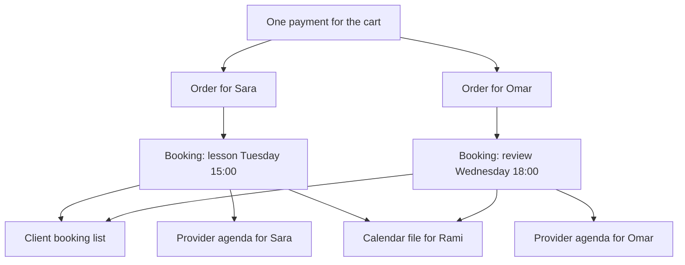

# A booking is not an order

Rami pays once with a test card for a 45-minute English lesson with Sara on Tuesday and a 60-minute design review with Omar on Wednesday. The payment succeeded, so the confirmation page has something to show him. What should it show? Two appointments, each with a time, a provider, a length and a price. Not one order with a total and no schedule, and not two orders with no times.

The order and the booking answer different questions. An Order is one provider's share of one payment: what was charged, in which currency, and what has been refunded since. A Booking is one scheduled obligation: a start instant, an end instant, a duration snapshot and a status that outlives the payment. Rami's single payment created two Orders and two Bookings. One of them can be cancelled on Thursday while the other stays confirmed, and the money record has to explain that without moving the time record.



Follow the arrows down from a Booking and you reach three surfaces that read the same document for three different purposes. Rami's list is ordered by his week in Berlin. Sara's agenda is a day grid in Gaza time. The calendar file is a portable copy that leaves the application entirely. All three must agree about one instant, and only one of them can be regenerated when somebody corrects a time zone label.

## Five states, five different sentences

A Booking carries a status from a small set, and each value changes what the interface may say. `held` means the checkout claimed the blocks and a payment is in progress, so the screen shows a countdown and never the word confirmed. `confirmed` means a trusted payment result arrived and the appointment is real. `completed` means the provider marked it done after the end instant. `cancelled` means a policy flow ended it, and the refund record explains the money. `expired` means the hold ran out with no payment.

The agenda treats these differently. A provider's day view shows held appointments in a separate, quieter block, because Sara needs to know that fifteen minutes of her afternoon may disappear without treating it as a student. It shows confirmed and completed appointments as her work. It does not show cancelled or expired ones on the day grid at all, though both remain readable in history, because the calendar is a plan and the history is a record.

The client list splits by time instead of by status. Upcoming means the start instant is after the server's current instant and the status is held or confirmed. Past means everything else, including cancelled sessions and no-show history. This split is computed against the injected server clock, never the browser's, because a client who changes her phone's date must not be able to move an appointment into the past.

## Why both agendas read Bookings

Sara's agenda is a question about time: what is on my calendar between Monday and Sunday. Rami's list is the same question from the other side. Both are answered by a range query on `Booking.startAt`, one scoped by `providerId` and one by `clientId`. That is why Module 6 declared an index on each pair, and why neither screen needs to read an Order to draw a time.

An Order would be the wrong source for a different reason. Orders are per provider per payment, so an Order has no single start instant to sort by, and a Booking that was rescheduled twice has one Order and one current time. If the agenda read the Order, the reschedule in Module 22 would have to edit a money record to move a calendar entry. Say that sentence out loud once: moving a session may not change what was charged.

Money still belongs on the screen, in its own place. Rami's booking card may show the amount paid for that session, taken from the Booking snapshot, and it may link to the provider Order for the refund history. The confirmation page can show both orders in one summary. What it must not do is derive a time from an Order total or a total from a Booking count, because those two records are kept correct by different transactions.

## The snapshot is what the agenda draws

Drawing a card for Tuesday's lesson needs a title, a duration, a price and a zone. All four were copied into the Booking when it was created, precisely so this screen does not have to ask the Service what it says today. Sara can rename her service on Friday, archive it on Saturday, and Rami's booking card still reads what he bought.

The practical gain is one query instead of three. A list of twenty bookings across eight providers would otherwise need a Service lookup per distinct service and a Provider lookup per provider, and a careless implementation does it per row. The snapshot turns the agenda into one range read plus one filter, which matters on the phone and the connection your reader actually has.

The snapshot also carries the provider's zone. That value is what makes the calendar file honest, because it lets the file explain the appointment in the provider's own words even when the client reads the file in another country. A zone stored only on the current Provider would move every past appointment the day a provider relocates, which Module 10 already refused to allow.

## Whose clock the screen uses

Rami reads his list in Berlin time, because that is where he will be sitting when the lesson starts. Sara reads her agenda in Gaza time, because her day grid is built from her own working hours and a grid in another zone would put lunch at the wrong hour. Neither screen shows one time without the other, and neither shows a time without a label.

The rule that prevents most arguments is: the primary label is the viewer's zone and the secondary label is the other party's zone, both formatted with `Intl.DateTimeFormat` and both showing an abbreviation such as `GMT+1` or `EET`. Day boundaries are computed in the viewer's zone. Sara's "today" is Gaza's today, so a booking at 00:30 Gaza time belongs to that day even though a Berlin client sees it at 23:30 the previous evening.

Do not store either label. Store the UTC instant, and format on read. A stored label becomes wrong the moment a zone's rules change, and a stored offset becomes wrong twice a year in most of the world.

## Show the address to the person who needs it

An in-person visit needs a street address, and an online lesson needs a meeting link. Both are private facts about a client or a provider, and the authorization matrix from Module 9 already says who may see them: the other party of a confirmed booking, and nobody else. The agenda must apply that rule in the projection, not in the interface.

Concretely, a booking view has two shapes. The full shape includes the location detail, and it is returned only when the viewer is the client or the provider on that Booking and the status is confirmed or completed. The reduced shape omits the field entirely, not with an empty string and not with a hidden flag, because a field that exists is a field that leaks through a careless component. A third party asking for the same booking gets 403 before any shape is chosen.

A `held` booking is a deliberate gap. The client has not paid yet and the provider has not accepted work, so neither side sees the other's address or link. This is also the honest answer to "the payment is still processing": there is nothing to travel to yet.

## One instant, one calendar file

The download is a single `.ics` file with a `VCALENDAR` wrapper and one `VEVENT`. Its `UID` is derived from the Booking id, so importing the same booking twice updates one entry instead of creating two. `DTSTAMP` is the moment the file was generated. `DTSTART` and `DTEND` are UTC instants written with the trailing `Z`, which is the only form that cannot be misread by a calendar application in another zone.

The description is where the provider's zone appears, in words: the session at 15:00 in `Asia/Gaza`. A calendar app shows the event in whatever zone the phone is set to, and that is correct, but the human reading it in Berlin also needs to know what the tutor calls that hour. The location field follows the same need-to-know rule as the API: present only when the appointment is confirmed and the file is generated for a participant.

Write the file with CRLF line endings, escape commas and semicolons in text fields, and fold long lines at 75 octets. Those three details are what separate a file that opens in every calendar from one that opens only in the browser that wrote it. Serve it with `Content-Type: text/calendar; charset=utf-8` and `Content-Disposition: attachment`.

## What the learner will build

The next lesson builds three things on top of these decisions. A client bookings route that returns upcoming and past in the client zone. A provider agenda route that returns a day or a week in the provider zone. And a calendar file route that turns one confirmed booking into a valid `.ics` with the correct UTC instants. Each route reads Bookings, each applies the need-to-know rule, and each is tested with two accounts that are not the participants.

Before you start, write one sentence about what a cancellation of one booking must leave untouched. The next lesson tests it, and Module 22 spends a whole gate on it.

```predict
prompt: "Rami cancels the Tuesday lesson inside its free window. The payment covered two providers. Which records must stay exactly as they are?"
options:
  - id: other
    label: "Omar's Booking and Order, still confirmed and paid"
  - id: both
    label: "Both Orders, because one payment covered both of them"
correctOptionId: other
explanation: "One payment does not make one obligation. The lesson's Booking moves to cancelled and its Order records a partial refund, while the review keeps its own Booking, its own Order and its own paid state."
allowRetry: true
```
