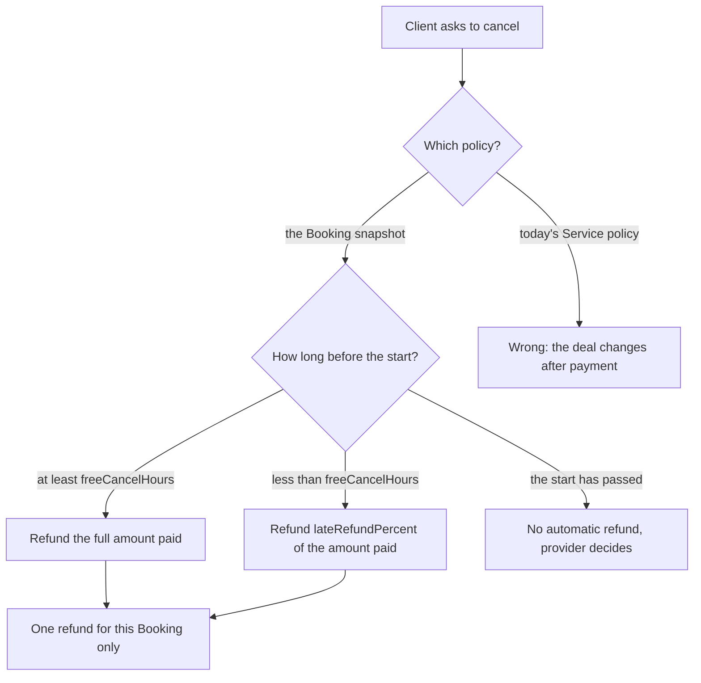

# A booking that has to move

Amal booked a 45-minute lesson for Tuesday at 15:00 Gaza time. On Monday morning Sara edits her service and shortens the free cancellation window from 48 hours to 24. On Monday lunchtime Amal cancels, which is 30 hours before the lesson. Sara thinks the late window applies. Amal thinks she cancelled a day and a half ahead under the rule she read at purchase. One of them is about to be told that the platform changed the deal after the money moved.

The answer is already in the database. When Amal paid, the checkout copied the cancellation policy into the Booking. The refund is calculated from that copy, so Amal keeps her full refund and Sara's later edit affects only bookings made after it. This chapter is about making that sentence true in code, and about the second half of the same problem: moving an appointment without selling the same hour twice.



Read the two branches from the first decision. The left branch uses the policy the client accepted, so a later edit to the Service changes nothing for an existing Booking. The right branch is the tempting one, because the Service document is one query away and it always holds the newest numbers. It also creates the dispute described above, and it does so for every booking the provider has already sold.

## The snapshot is the contract

The Booking carries four policy numbers in its purchase snapshot: `freeCancelHours`, `lateRefundPercent`, `rescheduleCutoffHours` and `maxReschedules`. They were copied from the Service in the same transaction that created the Booking, and nothing in this module writes to them again. A cancellation handler reads them from the Booking and nowhere else.

If your Module 6 policy has only the first three fields, add `maxReschedules` to the Service schema and copy it into the snapshot now. The reschedule limit has the same problem as the refund percentage: it is part of what the client agreed to, and a provider who lowers the limit later cannot apply the new limit to a lesson already bought.

Snapshot the amount paid as well, per Booking, in integer minor units. That number is not the Service price. If a provider-funded discount applied at checkout, the client paid less, and the refund is a percentage of what she actually paid. Refunding a percentage of the list price returns money the client never sent, which is a different bug with the same shape.

## Three windows and integer arithmetic

Every cancellation lands in one of three windows, decided by comparing the start instant with the request instant plus the snapshot's free window. Use absolute time for the comparison, because "48 hours" is 48 hours of elapsed time, not two calendar days. A client cancelling across a clock change would otherwise gain or lose an hour of protection depending on which side of the change she sits.

Inside the free window the refund equals the amount paid. Between the free boundary and the start instant, the refund is the snapshot's percentage of the amount paid. After the start instant there is no automatic refund, and the route refuses with a code that names the reason, because a no-show refund is a provider decision made in support rather than an arithmetic result.

An example makes the rounding rule concrete. Amal paid 4500 minor units for the lesson, after a 500 unit provider discount from a list price of 5000. Her snapshot says 40 percent in the late window. The refund is `floor(4500 * 40 / 100)`, which is 1800, and the provider keeps 2700. With 4501 paid, the same arithmetic gives 1800.4 and the refund is still 1800. Round down, keep the remainder with the provider, and write that choice into a test with an odd amount so nobody changes it by accident.

Never use floating point for this. `4500 * 0.4` can give a value a hair below 1800 on some paths and a hair above on others, and a one unit difference on a receipt is a support ticket. Multiply first, divide once, floor the result, and assert the values on both sides of the boundary.

## Refunding one booking from a shared payment

Amal paid once for two providers, so the payment provider holds one charge for the combined amount. Cancelling the lesson must not refund the review. The refund call therefore names an amount, not a full reversal, and that amount comes from the quote for the single Booking.

Two records follow the money. The Order for Sara's provider share receives a refund record with the amount, the time, the reason and the provider's refund identifier, and its state moves to `partially-refunded` or `refunded` depending on what remains. The Booking moves to `cancelled` with a history entry that names the policy value used and the amount returned. Omar's Order and Booking are not touched at all.

Give every refund a stable idempotency key derived from the Booking and the action, such as `refund:booking:665f:client-cancel`. A dropped connection, a retried request or a duplicate webhook then creates one refund instead of three. The key is the reason you can safely retry a money operation at all, and it costs one line in the call.

## A provider cancellation is not the same decision

Sara can cancel too. When she does, the client gets a full refund regardless of the window and regardless of the snapshot percentage, because the provider is the party who failed to deliver the session. There is no late window to argue about, and there is no partial outcome to explain.

Treat this as two endpoints with two policies rather than one endpoint with a flag. A `cancelAsClient` path reads the snapshot and quotes a percentage. A `cancelAsProvider` path quotes the full amount paid and skips the window test entirely. Separating them makes the difference reviewable, and it stops a later refactor from quietly applying the client rule to a provider who cancelled the day before.

Both paths end in the same place: cancelled Booking, released SlotClaims, recorded refund, one message to the other party. The difference is only the amount and the reason code stored in history.

## A reschedule is one swap

The tempting implementation is two calls: cancel the old booking, then book the new time. It has a failure mode that is easy to describe and hard to forgive. Amal moves her Tuesday lesson to Thursday, the cancel succeeds, and the Thursday start is taken by another client in the half second between the two operations. She now holds a refund and no lesson, and she has to start again from the provider page.

Do it as one operation instead. In a single transaction, insert the SlotClaim blocks the new time needs, confirm the insert succeeded, update the Booking's start and end instants, delete the old claims, and write the history entry. If any new block collides with an existing claim, the unique index rejects the insert, the transaction aborts, and nothing changed. Amal keeps her Tuesday lesson and reads a message that names the new start she could not have.

The order inside the transaction matters for one practical reason. Claim the new blocks first, because that is the step that can fail. Releasing the old blocks first would open a window in which another request can take them, and a failed swap would then leave Amal with neither time. Claiming first means the worst case is a cancellation that never happened, which is a recoverable outcome.

The reschedule also obeys the snapshot, not the Service. `rescheduleCutoffHours` decides whether the move is still allowed, and `maxReschedules` caps how many times one Booking may move. A third request on a booking that allows two is refused with a code that names the limit, before any claim is attempted.

## Reminders must move with the appointment

A reminder is only useful if it describes the appointment as it will happen. A message that says "your lesson is in one hour" for a lesson that moved to Thursday is worse than silence, because it sends a client to a meeting that is not happening.

Bind every reminder to a version rather than to a booking alone. The Booking carries a `reminderVersion` integer, incremented in the same transaction as any change to the start instant. A reminder job created for version two is discarded by its processor when the Booking is already at version three, so a stale job cannot speak for a moved appointment. This design is small enough to test now, before the queue exists: assert that a reschedule increments the counter and that a job carrying the old version is not sent.

The other half is cleanliness. When the queue arrives in Module 24, the reschedule transaction should also write a durable instruction to move the scheduled jobs, so the worker replaces them rather than waiting for the old ones to expire. The version check protects correctness; the move keeps the useful reminder at a sensible time.

## Failure tests that a lost slot deserves

The interesting test is not the happy swap. It is the swap that loses. Reserve the new start with a second client, then ask to reschedule and assert four things: the response is 409 with a code naming the lost start, the Booking still holds its original instants, the original SlotClaims are still present, and `reminderVersion` is unchanged. A test that checks only the status code will pass while the old claims are gone.

Run the same race in parallel. Twenty simultaneous reschedule requests from ten clients onto one contested start must leave exactly one winner, and the losers must show no partial state. This is the same class of test as the checkout race in Module 19, on a harder operation, because the swap writes and deletes in one step.

Then test the collision between two flows. Send a cancellation and a reschedule for the same Booking at the same moment and assert that exactly one succeeds. The two handlers both want to change the same Booking and both want to touch its claims, so the loser must read a conflict rather than overwrite the winner's work.

## What the learner will build

The next lesson writes the quote function, the two cancel routes, the refund records and the swap transaction. It also writes the version bump that keeps reminders honest and the six tests described above. The gate after it runs the cancel and reschedule together and looks for exactly one winner plus a partial refund in test mode.

Before you start, write one sentence about which document decides Amal's refund and one sentence about what the database looks like after a swap that loses its new start. Both answers are checkable in the next lesson, and both are the questions a mentor asks in the viva.

```predict
prompt: "Sara lowers freeCancelHours from 48 to 24 after Amal booked. Amal cancels 30 hours before the lesson. What refund does the snapshot give?"
options:
  - id: full
    label: "The full amount paid, because her booking says 48 hours"
  - id: late
    label: "The late percentage, because the service now says 24 hours"
correctOptionId: full
explanation: "The Booking copied the policy at purchase, so the 48 hour window applies to this booking. Sara's edit changes the offer for future bookings only, which is also why the refund amount is read from the Booking snapshot rather than the Service."
allowRetry: true
```
