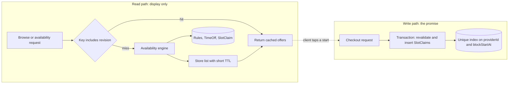

# Availability is a display, not a promise

Amal in Berlin opens Yusra's page at 14:59:12 and sees a 15:00 start in her own time zone. That page was assembled from a list the server computed 40 seconds earlier. At 14:59:40 a client in Gaza claims the same hour. Amal taps the green start at 15:00:05 and receives a 409 with a refreshed list. Nothing in the system is broken. The page told her what the server knew when it was asked, not what the server promised for the future. This module is about keeping that distinction sharp while the read path gets much faster.

SkillSlot needs a faster read path because the same handful of records is read far more often than it is written. One browse request draws a dozen provider cards, and each card shows a price, a duration, language badges and a next free time. The availability route expands seven days of weekly rules into candidate starts, then removes time off, claims and notice. A provider with three services and a full week of hours generates a few hundred candidate checks per request. That work is cheap once. It is not cheap when forty clients in one class refresh the same tutor's page during a break.

Read the diagram by following the two boxes separately. Inside the left box nothing is reserved, nothing is owned and nothing is guaranteed. The only arrow between the boxes is the dotted one, and it means a tap, not a transfer of ownership. There is deliberately no arrow from the cache into the claim transaction. The unique index in the right box is the only thing that decides who gets an hour, and it decides it at the moment of the write.

## What display data means here

Display data is a value derived from durable records that a client may read but cannot use as authority. The public service list is display data. A provider card with a headline and a next free time is display data. The availability offer list is display data, and so is a search result page. These values can be late by seconds without harming anyone, because the client always acts through a route that rechecks.

Hold state, claim ownership, the amount a client pays and the amount a booking may be refunded are not display data. They are decisions the server makes and records. A cached copy of any of them becomes a second, weaker source of truth that can disagree with the database, and the client reads whichever copy answers first. When the weaker copy wins, the double booking that Module 19 was built to prevent comes back through a side door.

Yusra's calendar already has a cheap authority query: a compound index on provider and block start for current SlotClaims. Checkout writes into that index and lets a duplicate key error decide the loser of a race. The cache cannot improve on that decision, and it must not try. If the cache says a start is free and the index says the block is taken, the index wins, checkout returns `SLOT_TAKEN`, the cart survives, and the client picks another time.

## The shortcut that sells a booking

The tempting shortcut is to cache the occupied blocks themselves. Write a Redis set per provider per day, add every claimed block start, and let a member test mean "taken". That design moves the correctness of booking into a store that can restart, evict keys under memory pressure or be flushed during a deploy. Redis eviction is not a business event. It has no idea that a client paid for 15:00, and it will happily forget the fact.

The same shortcut appears in a friendlier form: cache the availability response and extend the TTL to an hour because the page feels fast. Now a start that was claimed five minutes ago is still offered to every visitor, and the client who taps it is told the slot is gone by a system that just showed it as open. Speed that creates a visibly wrong page is not a gain.

Store the computed list, never the ownership. A cached list is a photograph of an earlier calculation. When the calculation changes, the photograph is stale, and the cheapest way to make a stale photograph unusable is to stop pointing at it.

## Invalidation by revision, not only by delete

Availability depends on more records than it first appears. A hold is created. A hold expires. A payment confirms. A client cancels. A reschedule swaps one block set for another. The provider edits weekly rules, adds a time-off range, archives a service, changes their zone or unpublishes. Every one of those changes makes earlier offer lists wrong, and a list of delete calls that must all fire in the right order is a list that will eventually miss one.

SkillSlot already has two counters that track exactly these changes. `scheduleRevision` on the Provider increments when rules, time off, services or the zone change, as built in Module 13. `calendarRevision` increments inside the same transaction that inserts or releases SlotClaims, as built in Module 19 and extended in Module 20. Both live in the database, so both survive a restart and both commit atomically with the change they describe.

Put the revision in the cache key. A key built as `availability:v1:<providerId>:<serviceId>:<startDate>:<revision>` cannot return a list computed before the claim, because the claim moved the revision and therefore moved the key. A failed delete then costs a little memory until the TTL expires, and nothing else. Deleting the old key is still worth doing, but it becomes housekeeping rather than the mechanism that keeps bookings correct.

## TTL is a safety net, not the plan

A short time to live bounds how wrong a list can be when an invalidation is missed, and it also sets the cost of the first request after expiry, which runs the full engine again. For the availability list, a target of 30 to 60 seconds is reasonable for this course; treat that as an illustrative starting point, not a tuned number for a real deployment. For the public service list, several minutes is fine because a price edit is a deliberate provider action with an explicit revision bump.

Two failure directions are worth naming. A ten minute TTL on availability makes a normal action feel broken, because a client who just booked keeps seeing the hour they took. A two second TTL makes the cache decorative while adding a Redis round trip to every request. Choose one value per key in a written table, and say what stale window that value permits.

## Search answers a different question

Search adds a second read surface. Clients look for a skill ("calculus", "laptop screen replacement"), a language ("Arabic", "English") and a way to meet, online or in person. The skill lives in Service titles and categories. The language is a small controlled list on the provider profile. The zone is the provider's IANA zone, which is not a service area and not a language.

Keep those three filters honest. A client in Berlin filtering by `Europe/Berlin` should see providers whose calendar and hours are set in Berlin, not every provider who could teach a German speaker. Most online lessons do not care about the provider's zone at all, since the engine sends UTC instants and the browser formats them. The zone filter earns its place for in-person visits and for a client who wants a provider awake at the same hour.

Search must never become a booking entry point. A result row can carry a `nextAvailableAt` that is a few minutes old, so label it as a next free time and refresh it from the availability route when the client opens the profile. Checkout takes identifiers and reloads canonical records. Nothing in a search response is an authorisation to charge.

## When Redis is down

Redis is an optional dependency in this design, and the system should behave that way. Every cache read has a MongoDB path behind it. If the connection fails, the route takes the slow path, still returns correct offers, and marks the response so an operator can see degraded mode. Availability must not become a 500 because a memory store is unavailable. A client who cannot see offers cannot book at all, which is a larger loss than a slow response.

Treat the cache client as something that times out quickly and fails quietly. A short connection and command timeout, a small circuit breaker that stops calling a dead server for a few seconds, and one log line per fallback are enough. Do not retry a dead Redis connection inside every request, because each retry adds latency to the request that was supposed to be fast.

## The decision for this module

The choice is cache-aside for two public reads, the service list and the availability offer list, both keyed by a revision, both with a short TTL and an explicit delete. Checkout, the release service and any refund path never read the cache. Search runs on a MongoDB text index over a small denormalised set of provider fields, with an ordinary compound index for the language, zone and listing filters. There is no external search engine, no materialised availability collection and no second copy of claim ownership.

The alternative worth stating is caching nothing at all. Five seeded providers do not need a cache, and the fallback path is then the only path, which is the easiest system to defend. This module still builds the cache because the read shape, many readers of a few records, is exactly the shape that a marketplace reaches within its first month, and because building the fallback first is the discipline that keeps the cache safe. If your engine read stays under your latency target at your real traffic, you may keep the cache switched off and say so in the gate.

## How you will know it works

Three tests carry this module. Delete every cache key between a hold and a fresh availability read: the claimed start must be absent, because the revision moved. Point the cache client at a closed port: the availability route must still answer 200 with the slow-path marker and a correct list. Warm the cache, then run checkout against a start inside that list: the claim must still be won or lost by the unique index, never by the cached text.

The next lesson builds the cache port, the revision keys, the search route and the fallback, in that order. Keep one sentence in front of you while you work: the cache may decide what a client sees, and it may never decide what a client owns.

References: [MongoDB text search](https://www.mongodb.com/docs/manual/core/index-text/) and [Redis key expiry](https://redis.io/docs/latest/commands/expire/).
