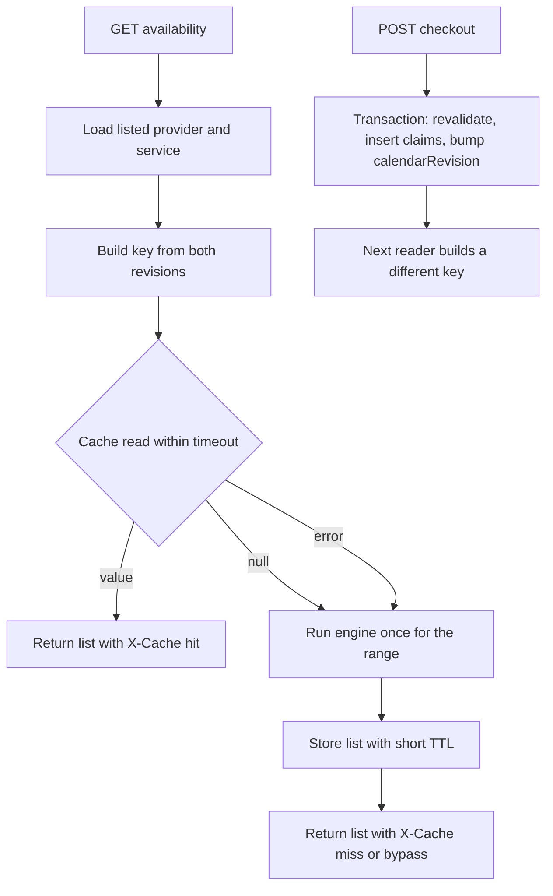

# Cache display data and search providers

The project already returns correct offers. Module 15 computes them from rules, time off, claims and notice. Module 16 stores `nextAvailableAt` for the browse cards. Module 19 and Module 20 decide ownership with a transaction and a unique index. Module 22 added cancellation and reschedule, and each of those writes changes what the next reader should see. This lesson puts a fast layer in front of those reads without giving that layer any authority over the writes.

Build in four steps. First, one module that builds cache keys, so no call site invents its own string. Second, a thin port with three methods and a timeout, so the rest of the code does not know whether Redis answered. Third, the availability route and the public service list behind that port, both keyed by a revision. Fourth, the search route over a text index with language, zone and mode filters. Only after the first three exist does it make sense to measure anything.



Two arrows leave the cache read box and only one of them comes back with a value. The error branch and the null branch lead to the same place, which is the engine and the database. Notice what is absent: there is no path from the cache to the checkout box, and the checkout box changes a database counter that a later key depends on. That is the whole invalidation story, and the code below is arranged to make it visible.

## One module owns the key shape

Create `server/src/cache/keys.ts`. Its job is to turn identifiers and revisions into a string, and to refuse any other way of making one. A branded type is enough to make a bare string a type error, which stops a future contributor from writing a key by hand and forgetting the revision.

```ts
// server/src/cache/keys.ts
declare const cacheKeyBrand: unique symbol;
export type CacheKey = string & { readonly [cacheKeyBrand]: true };

export type RevisionSource = Pick<Provider, 'scheduleRevision' | 'calendarRevision'>;

// Two counters, not one. A sum can collide when one counter rises as the other falls.
export function revisionOf(provider: RevisionSource): string {
  return `${provider.scheduleRevision}.${provider.calendarRevision}`;
}

export function availabilityKey(input: {
  providerId: string;
  serviceId: string;
  startDate: string;
  revision: string;
}): CacheKey {
  const { providerId, serviceId, startDate, revision } = input;
  return `availability:v1:${providerId}:${serviceId}:${startDate}:${revision}` as CacheKey;
}

export function serviceListKey(providerId: string, revision: string): CacheKey {
  return `services:v1:${providerId}:${revision}` as CacheKey;
}
```

The composite revision is deliberate. `scheduleRevision` moves when weekly rules, time off, services or the zone change. `calendarRevision` moves inside the checkout and release transactions. If you add them into one integer, a rule edit on the same day as a release can reach the same total as the previous key and hand a client a list computed before the release. Keeping the pair as text costs a few bytes and removes a whole class of collision.

Never scan for keys to delete. `KEYS` and `SCAN` in a request path put Redis in a bad mood at exactly the wrong moment, and a revision-keyed cache does not need them, because correctness comes from the key moving. Memory is bounded by the write rate multiplied by the TTL, and an unreachable old key expires on its own.

## The port has three methods and a timeout

Define the port in `server/src/cache/cache.port.ts` and one Redis adapter beside it. The port stores a single value shape, the computed offer list, and nothing else. Limits, hold state, prices and claim ownership never appear in a value of this type.

```ts
export interface CachedOffers {
  providerId: string;
  serviceId: string;
  startDate: string;
  revision: string;
  computedAt: string;
  starts: string[];
}

export type CacheOutcome = 'hit' | 'miss' | 'bypass';

export interface CachePort {
  getOffers(key: CacheKey): Promise<{ value: CachedOffers | null; outcome: CacheOutcome }>;
  setOffers(key: CacheKey, value: CachedOffers, ttlSeconds: number): Promise<void>;
  deleteOffers(key: CacheKey): Promise<void>;
}
```

The adapter catches its own errors and reports `bypass`. The route never sees a Redis exception, so there is no place in a handler where a dead cache becomes a 500. Give the client a 50 millisecond command timeout, open a small breaker after a few consecutive failures, and log one line per bypass with the route and the elapsed time. Three methods and one error rule are easier to test than a cache library wrapped around the whole application.

```ts
// server/src/cache/redis-cache.adapter.ts (shape, error handling omitted)
const OFFERS_TTL_SECONDS = 45;

async getOffers(key: CacheKey) {
  if (breaker.open) return { value: null, outcome: 'bypass' as const };
  try {
    const raw = await redis.get(key);
    if (!raw) return { value: null, outcome: 'miss' as const };
    return { value: JSON.parse(raw) as CachedOffers, outcome: 'hit' as const };
  } catch (error) {
    breaker.recordFailure(error);
    return { value: null, outcome: 'bypass' as const };
  }
}
```

A parse failure is worth treating as a miss rather than a crash. A value written by an older deploy can have a different shape, and the version segment in the key already reduces that risk. When the shape changes, change `v1` to `v2` and the old keys become unreachable without a migration.

## Wire the availability route

Load the provider and confirm it is listed. Load the service and confirm it belongs to that provider and is active. Both reads are indexed and small. Then build the key from the revisions you just read and ask the port. A hit returns the stored list with the stored `computedAt`, so the client can show how fresh the offer is. A miss runs the engine once for the requested range and stores the result.

```ts
// server/src/routes/availability.route.ts (shape, validation omitted)
const provider = await loadListedProvider(providerId);
const service = await loadOwnedActiveService(provider.id, serviceId);
const key = availabilityKey({
  providerId: provider.id,
  serviceId: service.id,
  startDate,
  revision: revisionOf(provider),
});
const { value, outcome } = await cache.getOffers(key);
if (value) {
  res.set('X-Cache', 'hit');
  return res.json({ starts: value.starts, computedAt: value.computedAt, revision: value.revision });
}
const starts = await availabilityEngine.offersFor({
  provider, service, startDate, horizonDays: 7, nowUtc: clock.now(),
});
const payload: CachedOffers = {
  providerId: provider.id,
  serviceId: service.id,
  startDate,
  revision: revisionOf(provider),
  computedAt: new Date(clock.now()).toISOString(),
  starts,
};
await cache.setOffers(key, payload, OFFERS_TTL_SECONDS);
res.set('X-Cache', outcome === 'bypass' ? 'bypass' : 'miss');
res.json({ starts, computedAt: payload.computedAt, revision: payload.revision });
```

The engine still reads claims from MongoDB on every miss, which is why a bypass is slower but never wrong. Do not "help" the engine by filtering cached starts against a cached claim list. One authoritative read of the claim range already exists in Module 15, and a second copy of that range is the failure this module is written to avoid.

The public service list is the same pattern with a longer TTL, five minutes in the illustrative table, and its own revision. A service edit, an archive or a price change already bumps `scheduleRevision` in the Module 12 write path. Confirm that in a test rather than assuming it, because a cache that never invalidates looks correct for exactly one afternoon.

## Search in one query

SkillSlot searches by skill, language, zone and meeting mode. Do not run one query per filter, and do not load every listed provider and filter in Node. Add two indexes to the Provider schema and build one filter object.

```ts
// server/src/models/provider.schema.ts (fields added in this lesson)
const providerSchema = new Schema({
  displayName: { type: String, required: true },
  headline: { type: String, default: '' },
  skills: { type: [String], default: [] },
  languages: { type: [String], default: [] },
  timeZone: { type: String, required: true },
  mode: { type: String, enum: ['online', 'in_person', 'both'], required: true },
  listed: { type: Boolean, default: false, index: true },
  nextAvailableAt: { type: Date, default: null },
  scheduleRevision: { type: Number, default: 0 },
  calendarRevision: { type: Number, default: 0 },
});

// MongoDB allows one text index per collection, so name the fields you really search.
providerSchema.index(
  { displayName: 'text', headline: 'text', skills: 'text' },
  { name: 'provider_text', weights: { skills: 4, displayName: 3, headline: 1 } }
);
providerSchema.index({ listed: 1, languages: 1, timeZone: 1, mode: 1 });
```

`skills` is denormalised from active Service titles and categories. Copying that data is a real cost, so give it one owner: the service create, update and archive path recomputes the provider's skill tokens in the same request, and a repair script can recompute every provider idempotently. Searching Service with a text index and then joining provider rows would avoid the copy and cost one extra query plus a sort that mixing two collections makes awkward. At twelve cards and a few hundred services, the copy is the better trade, and the gate asks you to say why you chose it.

```ts
// server/src/routes/search.route.ts (shape, scoring omitted)
const filter: FilterQuery<Provider> = { listed: true };
if (query.language) filter.languages = query.language;
if (query.zone) filter.timeZone = query.zone;
if (query.mode) filter.mode = { $in: [query.mode, 'both'] };
if (query.q) filter.$text = { $search: query.q };
const results = await Provider.find(filter)
  .select('displayName headline skills languages timeZone mode nextAvailableAt')
  .limit(query.limit)
  .lean();
```

The route returns provider identity and card fields only. It must not return a service price that was archived, a home address or a `nextAvailableAt` that was never refreshed. Treat a card's next free time as a hint and refresh it when the client opens the profile, which is the route built above.

## Write the failing tests first

Three tests should fail before any of the code above exists. Write them, run them, read the failure, then build. The first one proves the revision is doing the work rather than a delete call that might not have fired.

```ts
// server/src/__tests__/cache.test.ts (expected 409-style assertions)
it('withholds a start claimed after the list was cached', async () => {
  const before = await getAvailability('p1', 's1', '2026-11-02');
  expect(before.body.starts).toContain('2026-11-02T13:00:00.000Z');

  await holdStart('p1', 's1', '2026-11-02T13:00:00.000Z');

  const after = await getAvailability('p1', 's1', '2026-11-02');
  expect(after.body.starts).not.toContain('2026-11-02T13:00:00.000Z');
});

it('serves availability from MongoDB when Redis is unreachable', async () => {
  await redisClient.quit();
  const res = await request(app)
    .get('/api/providers/p1/availability?serviceId=s1&startDate=2026-11-02');
  expect(res.status).toBe(200);
  expect(res.headers['x-cache']).toBe('bypass');
  expect(res.body.starts.length).toBeGreaterThan(0);
});

it('rejects checkout for a start that only the cached page called free', async () => {
  const page = await getAvailability('p1', 's1', '2026-11-02');
  const startAt = page.body.starts[0];
  await holdStart('p1', 's1', startAt);
  const res = await postCheckout('client-b', 'p1', 's1', startAt);
  expect(res.status).toBe(409);
  expect(res.body.code).toBe('SLOT_TAKEN');
});
```

A fourth test checks the index rather than the response. Run `explain('executionStats')` on the skill query and assert that the winning plan names `provider_text` and that `totalKeysExamined` is not zero. A search route that returns the right rows by scanning every provider passes a response test and fails this one.

The reschedule case deserves its own assertion. Reschedule one booking, then read availability for the affected provider and day, and assert the old start is back and the new start is gone. If that fails, the reschedule transaction is not bumping `calendarRevision`, and the cache will keep showing a stale week until the TTL expires.

## Acceptance criteria and how to check them

Your work is done when a hold makes the next read change, the same read still answers with Redis stopped, checkout ignores a warm cache, and the skill query uses the text index. Check TTLs on live keys with `redis-cli TTL availability:v1:p1:s1:2026-11-02:3.4`, and confirm the key names carry two revision numbers. Watch the response headers while you work: `X-Cache` should move from `miss` to `hit` and back to `miss` after a hold, and to `bypass` when you stop Redis.

<Callout type="warning">
Do not cache carts, checkout responses, hold state, bookings, refunds or anything under an authenticated route in this chapter. The cache is for public display data only. A cached private response is a data leak, not a performance win.
</Callout>

<TraceRequest title="One cached availability read, then one hold">
  <TraceStep actor="API" label="GET availability" detail="Key for p1, s1, 2026-11-02, revision 7.4" />
  <TraceStep actor="Cache" label="Miss, then engine" detail="Rules, time off and claims read once from MongoDB" />
  <TraceStep actor="API" label="Store with 45 second TTL" detail="X-Cache miss, computedAt returned to the client" />
  <TraceStep actor="Checkout" label="Claim in one transaction" detail="SlotClaim inserted, calendarRevision moves to 7.5" />
  <TraceStep actor="API" label="Next GET builds a new key" detail="Revision 7.5, so the earlier list is unreachable" />
</TraceRequest>

```quiz
type: mcq
id: cache-q1
question: "A hold commits and the follow-up delete of the cached availability key throws a connection error. What does the next client see?"
options:
  - "The held start stays offered until the TTL expires, so the cache sold it again"
  - "The next read builds a key with the moved revision, so the held start is absent"
  - "The checkout route fails, because the cache delete belongs to the same transaction"
  - "Redis keeps returning the old value even after the revision moves, until a flush"
correct: 1
explanations:
  - "That would be true only if the key ignored the revision counters."
  - "The revision is in the key, so the old entry cannot be addressed by a later read."
  - "Redis is outside the database transaction and a failed delete never blocks a claim."
  - "The old key is simply never asked for again, and it expires on its own."
```

The next lesson is the gate. Bring a recorded `X-Cache` sequence, one `explain` output, the stopped-Redis response and the reschedule assertion. A cache that is fast on a quiet database and wrong after a reschedule has not passed this module.

References: [MongoDB explain results](https://www.mongodb.com/docs/manual/reference/explain-results/) and [ioredis error handling](https://github.com/redis/ioredis#error-handling).
