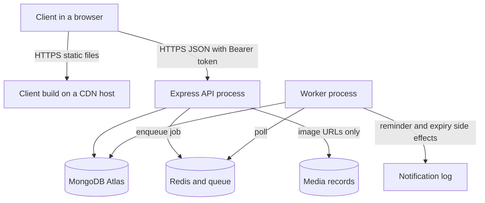

# 23.15 Recap and what's next

> **[Wrap]** · Chapter 23 · Deploy · *Recap what you built, and what comes next*

Chapter 23 moved SkillSlot from localhost to HTTPS. Along the way you created a production environment, built the client, deployed the API and the worker, ran smoke tests against the live host, and watched the API survive a restart. That is a real deployment, not a screenshot of one.

## What you actually achieved

You have two live HTTPS URLs, one for the client and one for the API, and both are worth pasting into the learning log and the portfolio. A reviewer who opens them sees a working marketplace rather than a description of one, and that difference decides how the rest of the review reads.

You have secrets discipline. Every value that must stay private lives in the host environment, `.env.example` documents every key a teammate needs without carrying a working value, and no secret appears in the repository, in a screenshot, or in a log line. This is the part of deployment that is easiest to fake locally and hardest to fake in front of a reviewer.

You have three deployed components and you can explain why they are three. The API and the worker are separate supervised processes with separate restart behaviour, and the client is a static artifact that can be served from a CDN and versioned independently of the server. Collapsing them into one process would work in a demo and would make the hold expiry job a hostage of request traffic.

You have CORS and TLS working together. The browser talks to the API over HTTPS, `VITE_API_URL` points at the deployed API at build time, and the refresh cookie is set with the attributes a production origin requires. You also have smoke test evidence from the live URL, which is a different claim from a localhost replay.

## The architecture you can draw on a whiteboard

Read the diagram for its missing arrows. The browser never reaches Redis, the worker, or MongoDB. The worker never answers an HTTP request. Every write that decides whether a slot is free still goes through the API, and the worker only acts on jobs the API already committed. That separation is what makes the restart evidence in this chapter meaningful, because a worker that dies does not lose a Booking, it only delays a reminder.

<TraceRequest title="A live smoke test against the deployed API">
  <TraceStep actor="Client" label="GET /api/availability live over HTTPS" detail="Query names a Service and a date" />
  <TraceStep actor="API" label="Reads AvailabilityRule and TimeOff" detail="Production database, production zone" />
  <TraceStep actor="API" label="200 with offered start times" status={200} detail="CORS headers allow the deployed client origin" />
  <TraceStep actor="Client" label="POST /api/holds with the Bearer token" detail="Access token from a real live login" />
  <TraceStep actor="API" label="Writes SlotClaim documents in one transaction" detail="The unique index still applies in production" />
  <TraceStep actor="API" label="201 with holdExpiresAt" status={201} detail="The hold is durable before the response is sent" />
  <TraceStep actor="Worker" label="Picks up the expiry job" detail="A released hold frees its claims without a request" />
</TraceRequest>

Step through the trace and notice that every step is a claim you can check yourself. The availability read proves the database connection, the CORS configuration and the deployment environment agree. The hold write proves the transaction and the unique index survived the move from localhost. The worker step proves the queue is reachable from the second process, which is the one thing a single process deployment would have hidden.

## Evidence worth keeping

Operational evidence is what separates a deployment that worked once from one you can defend. Record the smoke test results beside the URL that answered them, so the timestamp and the host are visible together. Record the rollback target, meaning the previous release you would return to if the next one fails, and name it before you need it. Record a measured recovery time for the API restart, because "it came back" is a claim and "it answered health after eleven seconds" is a measurement. Record one queued job that survived a worker outage, because that is the evidence that the queue is doing its job.

Keep the evidence as a short table in the learning log with a date column. A reviewer will ask what you changed and what you observed, and a table answers both without a narrative.

One more habit belongs here, and it is the one that keeps a deployment honest after the chapter ends. Run the smoke test after every release, not only after the first one, and run the same four checks each time: health, login, an availability read, and a hold. A release that passes health and fails the hold is a release that broke a write path, and the difference between those two outcomes is invisible unless you check both. Store the output with the release name so a later failure can be compared against a known good run rather than against memory.

| Target | Status |
|---|---|
| Cached availability and search | Done in Chapter 23 cache work |
| Async jobs after checkout | Done in Chapter 24 |
| Live HTTPS for client and API | Done in this chapter |
| API and worker survive a restart | Done, with a measured recovery time |

## Failure modes you will meet again

The most common deployment failure is a process that starts and is immediately marked healthy while its dependencies are not ready. The API answers health with a static 200, the platform sends traffic, and the first real request fails. The fix is the connection discipline from Module 4, where health reads the actual database state instead of a constant.

The second most common is a CORS or cookie mismatch that only appears across two origins. A refused request in the browser console usually means the allowed origin list does not contain the deployed client host, and a refresh that returns 401 on the live site but works in curl usually means the cookie is missing `Secure` in production or the fetch call is missing `credentials`. Both are configuration, and both look like code until you read the network panel.

The third is a build time variable that was set after the client was built. `VITE_API_URL` is baked into the bundle, so changing it in the host dashboard without rebuilding changes nothing. A client that calls localhost from a deployed page is almost always this mistake.

The fourth is a worker that was never restarted with the new environment. The API works, jobs are enqueued, and nothing happens, because the worker is still running the previous release against the previous database. Read the worker log before reading the job code.

## A debugging path for a live incident

Start with health, and read what it actually checks. Then read one request in the network panel, including the request headers, the response status and any CORS message. Then read the API log for the same request id, and confirm the request arrived at all. Then confirm the environment the process believes it is running, by name and not by memory. Then confirm the database and queue are the ones you intended, which in practice means checking the host name of each. Only after those four answers does reading application code make sense, and most incidents end before that point.

Write that order down. The instinct under pressure is to read the most recently edited file, and the most recently edited file is rarely where a deployment broke.

## Where this leaves the final week

This chapter completes the deployment milestone. It does not complete the course, and it does not complete the final week. Two required pieces remain, and both are about honesty under load rather than features.

**Chapter 26, concurrency and clock evidence:** twenty parallel checkouts against one slot, the claim index proof, a report on what a clock change does to a hold, and the expiry race that must not double book. This is where the SlotClaim design from Module 19 stops being a diagram and becomes evidence.

**Chapter 27, coupons:** provider funded coupons, a capped campaign under concurrency, and refunds calculated from the amount actually paid rather than the list price. This is where the server stays the source of truth for every discount.

After those gates, continue to the closing chapter, where you ship, document, and prepare the demo video, the case study and the viva.

## Continue to the gate

**Sub-chapter 23.16:** the checklist and learning log with the live URL. Your application is on the internet. The next proof is that two clients cannot claim the same slot, and that a provider cannot move a price or a discount past the server.
