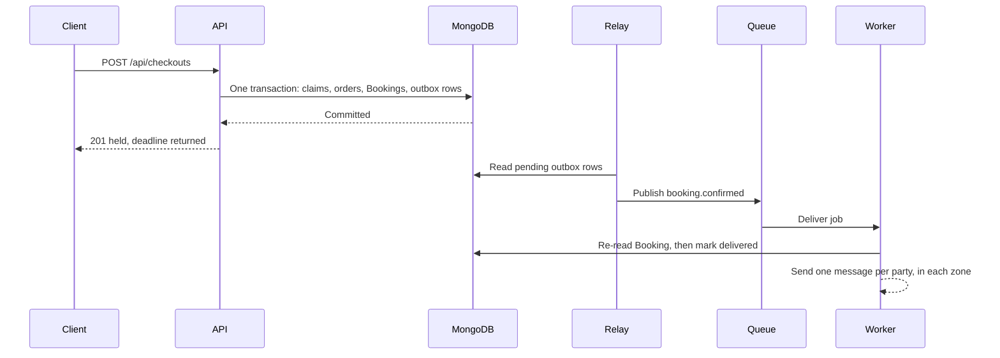

# What should not happen inside a request

Yusra pays for a Thursday lesson at 21:40 on a weak connection. In the first version of the checkout route, the API claims the blocks, writes the orders, then sends two confirmation messages before it replies. The mail server is slow that evening. The phone gives up after eight seconds and retries with the same checkout ID. The client sees a spinner, the claim transaction stayed open longer than it needed to, and the server now has to decide whether the second attempt should send the messages again. None of that delay helped anyone: the client does not need the mail server's opinion to know whether the hour is theirs.

The rule for this module is narrow and useful. A request may do work whose result the client must know before it can continue. Claiming blocks, computing the server total, writing the hold deadline and recording the idempotency key all belong there, because the response is meaningless without them. Sending a message, waiting for another service, polling for something that has not happened yet and refreshing a derived value for a different page all belong after the response, in a process that can fail and retry without holding a client's phone open.

Follow the vertical line for the client. It ends at the 201, before the relay has done anything. The work below that line has its own record, its own retries and its own clock, and it can be inspected in the morning without asking a client what they saw. If the relay is down for ten minutes, the client still owns the hour they paid for; the message is late, and the system knows it is late.

## The list worth moving

Booking confirmation messages are first. They go to two people who are not the requester, they depend on a mail or message provider, and they must say different things in different time zones: the client reads their own zone first, the provider reads theirs. None of that belongs between a payment confirmation and an HTTP response.

Reminders come next, and they are a different shape: their work is scheduled for a future instant, twenty four hours and one hour before the start. A request cannot wait until then. Hold expiry is a sweep, not a message: it looks for held bookings whose `holdExpiresAt` has passed and hands each one to the Module 20 release service. The `nextAvailableAt` refresh from Module 16 is a derived value for other people's pages, so it can trail the booking by seconds. A cache bust is bookkeeping that the revision counters already make safe, so it can be retried without consequence.

One property links all five: none of them changes what the client is told in the response. The claim is what matters, and it is already committed by the time any of them runs.

## Why a timer in the API process is not a queue

The cheapest looking option is `setTimeout` in the API. It fails four tests. A deploy restarts the process and the timer disappears with no record. Three API instances behind a load balancer each schedule their own copy, so a client receives three reminders. A crash between payment and the timer loses the message entirely, and nobody can prove it ever existed. There is no retry, no attempt count and no way to answer a support question about what the worker tried at 09:00.

A queue fixes the fourth problem and keeps the first three visible. A job is a durable record with a name, a payload, an attempt count and a next run time. A worker process claims it, runs a function, and either completes or fails in a way the queue remembers. Restarting the worker does not lose jobs that were already stored. Deploying the API does not touch them, because the worker is a separate process built from the same repository.

SkillSlot uses Redis and BullMQ, which Module 23 already installed for the cache. Two clients, two purposes, one server: cache keys live under their own prefix and queue keys live under the queue namespace. Never flush that Redis instance. A `FLUSHALL` during a debugging session deletes the offers and the pending reminders together, and only one of those losses is easy to notice.

## The outbox answer to a Redis outage

A queue introduces a new failure. If the business change commits and the enqueue then fails, the client owns an hour and nobody will be told. If you enqueue before committing and the transaction aborts, a worker may announce a booking that does not exist. Neither order is safe on its own, because Redis and MongoDB cannot commit together.

The answer is to write the intent inside the same transaction as the business change. Confirming a checkout also inserts outbox rows, one per message, each with a semantic key such as `booking-confirmed:<bookingId>`. Those rows commit or abort with the booking, so the record of "someone must be told" is exactly as durable as the claim. A relay then reads undelivered rows and publishes them to the queue. If Redis is down, the rows wait. If the relay dies mid publish, the row is still there and the next relay run retries it.

This is a small amount of extra machinery, and it is the honest version of the promise a queue makes. The queue becomes transport, not the record. At this course's scale a relay that polls every few seconds is enough. Larger systems reach for change streams or a transactional log, and the reason is throughput, not correctness.

## Retries need a class, not a number

Every job needs a retry policy and a way to tell two kinds of failure apart. A timeout, a refused connection or a 503 from a message provider is transient: retrying in a few seconds is reasonable, and exponential backoff with a cap keeps a struggling provider from being hammered. A missing booking, a recipient with a malformed address or a payload that fails validation is permanent: retrying it five times only delays the support ticket and fills the log.

BullMQ lets a processor throw an unrecoverable error marker to skip the remaining attempts. Use it deliberately. A processor that catches every error and returns quietly marks failures as successes, and the queue reports a healthy worker while messages disappear. Log the job name, the job ID, the attempt number and the business identifier, and leave the payload's personal fields out of the log line.

Retries make duplicate execution normal rather than exceptional, which is why the next section matters more than this one.

## Deduplication is a product requirement

Work can be duplicated twice over. The queue may deliver the same job again after a worker crash, and the business event itself may arrive twice, because a payment provider can deliver the same webhook more than once. A client who receives two confirmation messages for one lesson notices, loses a little trust, and asks whether they were charged twice. A provider who receives two reminders may block the hour twice in their own calendar.

Use two mechanisms. Give each job a deterministic ID derived from the business fact, such as `reminder:<bookingId>:v<reminderVersion>:24h`, so a second add with the same ID is ignored while the first still exists. Then give the side effect its own key, checked immediately before sending, so a job that did run twice sends once. The outbox row is the natural place for that key, and its delivered marker is the evidence.

## A job must read the world again

A reminder that describes a lesson which has moved is worse than no reminder. It sends a client to an empty room at the wrong hour and makes the provider look unreliable. The job payload therefore carries the booking ID and the reminder version it was scheduled for, and the processor re-reads the booking before composing anything. If `reminderVersion` changed or the state is no longer `confirmed`, the processor records a skip and returns.

This is the same discipline Module 20 applied to the webhook: the event is evidence that something happened, not proof of the current state. A queue payload is the same kind of evidence. It tells the processor what to look at, and the database tells it what is true now.

## What the worker costs

A worker is a second process to run, watch and deploy. It needs its own environment variables, its own connection pool and its own log stream. When it is down, the application still takes bookings and the messages pile up, which is a quiet failure until someone checks the queue depth or the age of the oldest undelivered row. When the API is down, the worker has nothing to do, which looks like health.

That is the trade: availability of the booking flow no longer depends on the message path, and in exchange the message path needs its own monitoring. A host cron entry is a credible alternative for the sweep, since a sweep every minute needs no queue at all. It cannot schedule a reminder for a future instant with retries, which is why the course uses one system for both. A managed queue is the alternative when you do not want to run Redis, at the cost of a second provider and its own failure modes.

## What you will build

You will add a separate worker entry point, one queue with three job names, an outbox relay and a repeatable hold expiry sweep. Then you will make a reschedule move its reminders instead of leaving the old ones behind, and you will prove with a test that a duplicate delivery sends one message. The next lesson is the build. Read it once before you start, because the order of the steps matters: queue module first, then the confirmation job, then reminders, then the sweep.

Keep one question visible while you build. If this process dies halfway through, what will the next run see, and will it duplicate anything a person can notice? A worker that can answer that question for every job is a worker you can leave running overnight.

References: [BullMQ queues and workers](https://docs.bullmq.io/), [BullMQ retries and backoff](https://docs.bullmq.io/guide/retrying-failing-jobs) and [MongoDB transactions](https://www.mongodb.com/docs/manual/core/transactions/).
