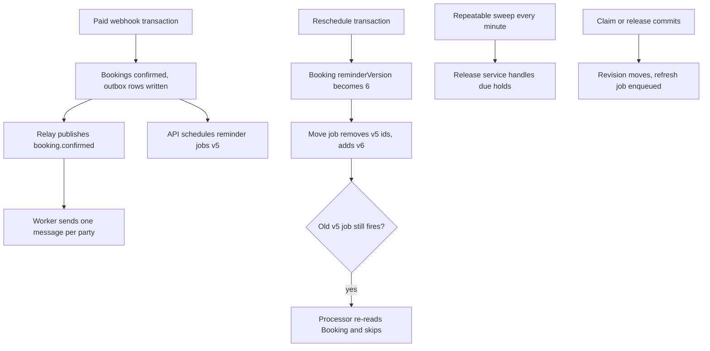

# Reminders, hold expiry and cache invalidation

The project has a correct booking flow and a stale-work problem. Module 20 confirms a hold in a transaction and writes notification intents, Module 22 swaps blocks on a reschedule, Module 23 keys every cached read by two revision counters. Nothing yet runs after the response goes out. This lesson adds that process and the four jobs it runs.

Build in this order, and run each step before starting the next. Queue module and worker entry point, then the confirmation message, then reminders, then the reschedule that moves them, then the hold expiry sweep, then the derived value refresh. Each step is small and each one is verifiable on its own, which matters because a worker that is broken in three ways at once is hard to diagnose.



The shape to notice is that every arrow into the worker carries an identifier and a version, not a rendered message. The worker always reads the current booking before composing anything. That single rule covers a stale reminder, a cancelled lesson and a booking that was moved while a job was waiting, without needing a reliable cancel operation on the queue.

## Queue module and a separate worker

Create one queue with five job names. Keep the payload typed and small: identifiers, a reminder version and an offset. A payload that contains a formatted message, a price or a provider address is a snapshot from the moment it was created, and it will be wrong by the time the job runs.

```ts
// server/src/jobs/queue.ts
import { Queue } from 'bullmq';

export const BOOKING_QUEUE = 'booking-jobs';

export type BookingJobName =
  | 'booking.confirmed'
  | 'booking.reminder'
  | 'booking.reminders.move'
  | 'hold.expiry.sweep'
  | 'provider.nextAvailable';

export interface BookingJobData {
  bookingId?: string;
  providerId?: string;
  reminderVersion?: number;
  previousVersion?: number;
  offset?: '24h' | '1h';
}

// Deterministic id: adding the same reminder twice is the same job, not two.
export function reminderJobId(
  bookingId: string,
  reminderVersion: number,
  offset: '24h' | '1h'
): string {
  return `reminder:${bookingId}:v${reminderVersion}:${offset}`;
}

export const bookingQueue = new Queue<BookingJobData>(BOOKING_QUEUE, {
  connection: queueConnection,
  defaultJobOptions: {
    attempts: 5,
    backoff: { type: 'exponential', delay: 2000 },
    removeOnComplete: { age: 24 * 60 * 60 },
    removeOnFail: { age: 7 * 24 * 60 * 60 },
  },
});
```

The worker is a second entry point, `server/src/worker.ts`, started with `npm run worker`. It builds its own Mongo connection, creates a `Worker` for the queue, attaches completed and failed listeners, and handles `SIGTERM` by closing the worker so a job finishes before the process exits. It must not import the Express app and must not listen on a port. Module 25 deploys it as its own service, which is only possible because it has never depended on being inside the API process.

## Write the intent, then publish it

The confirmation message is not enqueued from inside the payment webhook transaction, because Redis is not part of that transaction. The webhook writes outbox rows instead, one per recipient.

```ts
// server/src/models/outbox.schema.ts
const outboxSchema = new Schema(
  {
    key: { type: String, required: true, unique: true }, // booking-confirmed:<bookingId>:<party>
    topic: { type: String, enum: ['booking.confirmed', 'booking.reminders.move'], required: true },
    payload: { type: Schema.Types.Mixed, required: true },
    state: { type: String, enum: ['pending', 'published', 'failed'], default: 'pending' },
    attempts: { type: Number, default: 0 },
    publishedAt: Date,
    lastError: String,
  },
  { timestamps: true }
);
outboxSchema.index({ state: 1, createdAt: 1 });
```

The relay is a loop that claims a batch of pending rows, publishes each one to the queue with the outbox key as the job ID, and marks it published. Two relays can race, so the claim is a conditional update from `pending` to `publishing`, and an abandoned claim older than a minute is returned to `pending`. A relay crash therefore delays a message by seconds rather than losing it.

```ts
// server/src/jobs/relay.ts (shape, batching omitted)
const claimed = await Outbox.findOneAndUpdate(
  { state: 'pending' },
  { $set: { state: 'publishing' }, $inc: { attempts: 1 } },
  { new: true, sort: { createdAt: 1 } }
);
if (!claimed) return;
await bookingQueue.add(claimed.topic, claimed.payload, { jobId: claimed.key });
await Outbox.updateOne({ _id: claimed._id }, { $set: { state: 'published', publishedAt: new Date() } });
```

The provider message and the client message are separate outbox rows, because they can be rendered differently, sent to different addresses and retried independently. Each row states a fact: this booking, this party, this template. The rendering happens in the worker, from the current booking, so the message always shows the zone-correct start. The reschedule move instruction written in Module 22 uses the same collection with a different topic, which is why the topic field is an enum rather than a free string.

## Reminders that know their version

A reminder is a delayed job whose delay is computed from the UTC start. Both the 24 hour and the 1 hour reminder are scheduled when the booking is confirmed, and the delay is the difference between the target instant and the current server instant.

```ts
// server/src/jobs/reminders.ts
export function reminderPlan(booking: Booking, nowUtc: number) {
  const plan: Array<{ offset: '24h' | '1h'; delayMs: number }> = [];
  for (const offset of ['24h', '1h'] as const) {
    const leadMs = offset === '24h' ? 24 * 60 * 60 * 1000 : 60 * 60 * 1000;
    const delayMs = booking.startsAt.getTime() - leadMs - nowUtc;
    if (delayMs > 0) plan.push({ offset, delayMs });
  }
  return plan;
}

export async function scheduleReminders(booking: Booking, nowUtc: number) {
  for (const { offset, delayMs } of reminderPlan(booking, nowUtc)) {
    await bookingQueue.add(
      'booking.reminder',
      { bookingId: booking.id, reminderVersion: booking.reminderVersion, offset },
      { jobId: reminderJobId(booking.id, booking.reminderVersion, offset), delay: delayMs }
    );
  }
}
```

A booking made two hours before its start gets the 1 hour reminder only. A booking made forty minutes before its start gets none, and that is deliberate: the confirmation message already carries the time, and a reminder that arrives almost immediately is noise. A negative delay must be skipped rather than passed to the queue, where it would run at once.

The reminder version in the job ID and in the payload is doing two jobs. It makes the ID unique per booking change, and it gives the processor a cheap way to detect that the booking moved. Both matter, and the second one is the reason you cannot leave it out even when the ID is already unique.

## Move the reminders, do not hope to cancel them

Module 22 already did the important half. A reschedule commits the new start and increments `Booking.reminderVersion` in the same transaction that swaps the SlotClaims, and it writes an outbox row keyed by the booking and the new version. That row is a durable instruction to move the scheduled jobs. The relay publishes it as `booking.reminders.move`, and the worker does the queue work after the request has long finished.

```ts
// server/src/jobs/processors/reminder-move.processor.ts (shape, error handling omitted)
const stale = (['24h', '1h'] as const).map((offset) =>
  reminderJobId(job.data.bookingId as string, job.data.previousVersion as number, offset)
);
await Promise.allSettled(stale.map((id) => bookingQueue.remove(id)));

const booking = await Booking.findById(job.data.bookingId).lean();
if (!booking) return { skipped: 'missing' };
if (booking.reminderVersion !== job.data.reminderVersion) return { skipped: 'superseded' };
return scheduleReminders(booking, clock.now());
```

The removal is best effort, and the design assumes it can fail. A job that is already active cannot be removed, and a worker that is down cannot confirm a removal. The move job re-reads the booking and does nothing if the version has moved again, so two quick reschedules leave only the newest set of reminders scheduled. The reminder processor itself also re-reads the booking and compares the version in the payload with the version in the database. If they differ, it returns `superseded` and sends nothing. This is why the reminder still behaves correctly when the remove call never happened, and it is the assertion your test should make.

```ts
// server/src/jobs/processors/reminder.processor.ts (shape, rendering omitted)
const booking = await Booking.findById(job.data.bookingId).lean();
if (!booking) return { skipped: 'missing' };
if (booking.reminderVersion !== job.data.reminderVersion) return { skipped: 'superseded' };
if (booking.state !== 'confirmed') return { skipped: booking.state };

const deliveryKey = `reminder:${booking.id}:${booking.reminderVersion}:${job.data.offset}`;
if (await deliveryLog.exists(deliveryKey)) return { skipped: 'already-sent' };
await sendOnce(deliveryKey, renderForBothZones(booking));
return { sent: true };
```

The delivery key is the second layer of dedup. The queue can deliver a job twice after a worker crash mid job, and the reminder version does not change between those two deliveries. Without the key, the client receives the same reminder twice and the support inbox fills with questions about double charges.

## Sweep the expired holds on a timer

Hold expiry is not one delayed job per hold. A hold is created many times an hour, most are paid or abandoned, and each one would need its own job and its own cancellation. A repeatable sweep every minute is simpler, and it is safe to run late or twice because the release service built in Module 20 changes state under a predicate.

```ts
// server/src/jobs/sweep.ts
export async function processHoldExpirySweep() {
  const due = await Booking.find({
    state: 'held',
    holdExpiresAt: { $lte: new Date(clock.now()) },
  })
    .select('_id checkoutAttemptId')
    .limit(50)
    .lean();

  for (const booking of due) {
    await holdExpiryCoordinator.expireAttempt(booking.checkoutAttemptId);
  }
  return { considered: due.length };
}
```

Two rules keep this honest. The sweep never deletes SlotClaims itself, because the payment-aware coordinator decides whether a claim may be released. And the batch is capped, so a backlog is worked down over several minutes instead of one long run that blocks the queue.

Register the repeatable job once, from a bootstrap script, not on every API boot. Registering the same schedule from each instance adds duplicate schedules that all fire, which is the classic way to run the same sweep four times a minute.

```ts
await bookingQueue.add('hold.expiry.sweep', {}, { repeat: { every: 60_000 } });
```

## Refresh derived values and drop stale cache entries

Module 16 wrote `nextAvailableAt` inside the request that changed it. Move that work here. When a claim, a release, a cancellation or a reschedule commits, enqueue a refresh that carries the revision it was created for.

```ts
await bookingQueue.add(
  'provider.nextAvailable',
  { providerId, revision: revisionOf(provider) },
  { jobId: `nextAvailable:${providerId}:${revision}`, attempts: 3 }
);
```

The processor computes the next free start from the engine and writes it back only if the provider's revisions still match the ones in the payload. A comparison that fails means the schedule changed again after this job was created, and that newer change has already enqueued its own refresh. Writing anyway would overwrite a fresher value with an older one.

```ts
const [scheduleRevision, calendarRevision] = job.data.revision.split('.').map(Number);
const result = await Provider.updateOne(
  { _id: job.data.providerId, scheduleRevision, calendarRevision },
  { $set: { nextAvailableAt } }
);
if (result.modifiedCount === 0) return { skipped: 'stale-revision' };
```

The cache side needs almost nothing here, because Module 23 keyed every cached read by the revision counters. The revision moved inside the database transaction, so earlier cached lists are already unreachable. The worker deletes the public service list key, which is derivable from the provider ID and the revision, and leaves availability keys to expire on their TTL. A delete that fails costs memory and nothing else.

## Prove it with tests that fail first

Write these five tests before the implementation. Each one fails in a specific, informative way, which is what makes it worth keeping.

```ts
// server/src/__tests__/jobs.test.ts
it('does not send a reminder for the old start after a reschedule', async () => {
  const booking = await confirmBooking('p1', 's1', '2026-11-05T13:00:00.000Z');
  await reschedule(booking.id, '2026-11-05T15:00:00.000Z');

  const sent = await runReminderJob({
    bookingId: booking.id,
    reminderVersion: booking.reminderVersion,   // the superseded version
    offset: '24h',
  });
  expect(sent).toEqual({ skipped: 'superseded' });
  expect(messages.for(booking.id)).toHaveLength(0);
});

it('sends one message when the same job is processed twice', async () => {
  const booking = await confirmBooking('p1', 's1', '2026-11-05T13:00:00.000Z');
  const data = { bookingId: booking.id, reminderVersion: booking.reminderVersion, offset: '24h' as const };
  await runReminderJob(data);
  await runReminderJob(data);
  expect(messages.for(booking.id)).toHaveLength(1);
});

it('releases a due unpaid hold exactly once across two sweeps', async () => {
  const held = await holdCheckout('client-a');
  clock.advanceMinutes(11);
  await processHoldExpirySweep();
  await processHoldExpirySweep();
  expect(await SlotClaim.countDocuments({ bookingId: held.bookingId })).toBe(0);
  expect(releaseEvents.for(held.checkoutAttemptId)).toHaveLength(1);
});

it('leaves claims alone while a payment is still being resolved', async () => {
  const held = await holdCheckoutWithIntent('client-b');
  clock.advanceMinutes(11);
  await processHoldExpirySweep();
  expect(await SlotClaim.countDocuments({ bookingId: held.bookingId })).toBe(1);
});

it('refuses to overwrite a fresher nextAvailableAt', async () => {
  const booking = await confirmBooking('p1', 's1', '2026-11-05T13:00:00.000Z');
  await bumpProviderSchedule('p1');       // a later edit
  const result = await runNextAvailableJob({ providerId: 'p1', revision: '3.4' });
  expect(result).toEqual({ skipped: 'stale-revision' });
});
```

A sixth check belongs in the operations list rather than the unit suite: stop the worker, create a hold through the API, and confirm that the hold still succeeds while the outbox row stays `pending`. Start the worker and confirm the message is delivered once. That is the observable promise of the whole lesson.

<TraceRequest title="A reschedule moves two reminder jobs">
  <TraceStep actor="Client" label="PATCH reschedule" detail="New start 2026-11-05T15:00:00.000Z" />
  <TraceStep actor="API" label="One transaction" detail="Claim new blocks, release old, reminderVersion 5 becomes 6" />
  <TraceStep actor="API" label="Replace reminders" detail="Remove v5 ids, add v6 ids after commit" />
  <TraceStep actor="Queue" label="A v5 job survives" detail="Active job refuses removal, so it still runs" />
  <TraceStep actor="Worker" label="Re-read and skip" detail="Payload carries 5, Booking is at 6" />
</TraceRequest>

```quiz
type: mcq
id: jobs-q1
question: "A reschedule removes the old reminder jobs, but one removal fails and the old job runs anyway. What happens?"
options:
  - "The client receives a reminder for the previous start, because the job payload is authoritative"
  - "The processor re-reads the Booking, sees a different reminder version and sends nothing"
  - "BullMQ rejects the old job, because the job ID is no longer registered in the queue"
  - "The new reminder is cancelled instead, because two jobs for one booking cannot coexist"
correct: 1
explanations:
  - "The payload describes what to look at, not what is true now."
  - "The reminder version check makes a stale job harmless even when removal never happened."
  - "A stored job keeps its own ID and will still be delivered."
  - "Each reminder version has its own IDs, and the newer one is untouched."
```

## Acceptance criteria

The worker runs as its own process and survives a restart without losing scheduled jobs. A confirmed checkout sends exactly one message per party, each in the recipient's zone. A reschedule moves both reminders and leaves no message for the old start. A sweep releases a due unpaid hold once, and leaves a hold whose payment is unresolved. A stale `nextAvailableAt` job writes nothing. Every failure is retried with backoff except the ones you mark unrecoverable, and the log line for each job carries the job name, the job ID, the attempt and the booking or provider ID.

Verify by watching the queue while you work. `redis-cli --scan --pattern 'bull:${BOOKING_QUEUE}:*'` shows the stored jobs, and the worker log shows each completion with its result object. Keep one reschedule trace and one sweep trace for the gate, because those two are the hardest to explain without evidence.

References: [BullMQ delayed jobs](https://docs.bullmq.io/guide/jobs/delayed), [BullMQ repeatable jobs](https://docs.bullmq.io/guide/jobs/repeatable) and [BullMQ job ids](https://docs.bullmq.io/guide/jobs/job-ids).
