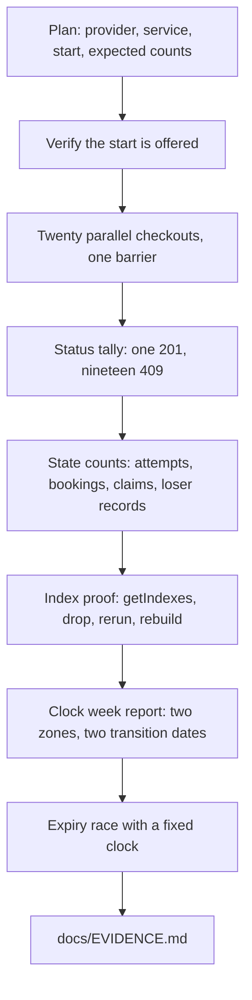

# Twenty clients, one slot

At 14:04 on a Tuesday, twenty test clients ask SkillSlot to hold the same 15:00 block on Sara's calendar. On a correct build exactly one receives a held booking. The other nineteen receive 409 with the code `SLOT_TAKEN`, and no other record changes. Sara's 15:00 is sold once or not sold at all.

You built that path in Module 19 and finished it with payment in Module 20. What you cannot yet show is that the path holds when twenty requests arrive together, on the deployed system, against the real unique index. A video of one successful checkout and one refused retry shows that a sequential second request fails. It does not show that two requests which both read the slot as free cannot both commit. The product promise is exclusive time, and exclusivity is a property of the database under contention, not of a happy path.

This module converts that promise into an experiment you can rerun. The module has one Build lesson and this gate, and it produces two artifacts: `server/scripts/race-booking.mjs` and a concurrency section in `docs/EVIDENCE.md`. Everything else in the week depends on those two files being honest.

## The question a mentor will ask

A mentor will not ask whether checkout works. They watched that in the Week 3 demo. They will ask how you know that nineteen other clients cannot buy the same hour. The useful answer is a command, the output it printed, the database counts after the run, and the index that made the outcome possible.

That answer has four parts, and a missing part makes the other three weak. The command must be reproducible by another person on another machine. The run must carry a date and an environment name, because a result from last Tuesday's local database says nothing about today's deployment. The raw output must be kept, not retyped, so a reader can see the status codes and the error code inside each response. The state check must query the database after the run, because a correct set of HTTP statuses can sit on top of leaked or missing records.

A claim without those four parts is a story. Stories are welcome in a viva, but they do not replace a run log. This distinction matters in both directions: an honest story about a bug you fixed is valuable, and a run log you cannot reproduce is worth nothing.

## What counts as evidence

There are three separate artifacts, and learners often collapse them into one. The first is the script: readable source that shows how many requests you send, how you start them together, and which client each request belongs to. The second is the run log: the stdout of one execution, pasted unchanged, including the failure lines. The third is the state check: the queries and their output that count the records the run created.

Keep all three. A screenshot of a terminal is weak because it cannot be searched or rerun; paste the text instead. If a run produced an error you do not understand, keep that run too, with a sentence about what you changed next. An evidence file that only contains clean runs tells a reviewer that failed runs were hidden, and it removes the most useful part of the story.

Evidence is also scoped. A run against `http://localhost:4000` with ten clients on one laptop proves your route logic and your indexes. It does not prove the deployed system, because the deployed system has a real network between the clients and the API, a managed database with its own latency, and possibly more than one API instance. Both runs are useful. Label each one with where it ran.

## Four races, one document

SkillSlot has more than one way to break under concurrency, and the twenty-client test covers only the first. Plan all four now so that the evidence file has a fixed shape before you start writing results.

| Race | The failure it would cause | Where it is created |
|---|---|---|
| Twenty checkouts for one start | Two clients hold the same block | Module 19 |
| Overlapping starts of different lengths | A 15:45 booking slips inside a 15:00 hold | Module 15 and Module 19 |
| Hold expiry against payment success | A paid appointment is released, or an expired one is confirmed | Module 20 and Module 24 |
| Cancel against reschedule | One path refunds after the other path already swapped the blocks | Module 22 |

The first two are claim races and they share one mechanism. The third and fourth are state races: two code paths read the same booking, both decide they may change it, and both write. A test that only covers the claim race leaves the state races in the same condition as Module 19 left them, which is to say unproven.

The table also decides where each result goes. Every row needs a command, a status or state count, and one sentence stating what the run rules out. If a row has no command, it is a plan, and it should be marked as a plan rather than written up as a result.

## Why twenty clients and not two

Two simultaneous requests will sometimes serialize by luck, especially on a fast machine where the first request finishes before the second begins its claim insert. A test that passes because of timing teaches the wrong lesson twice: it hides the race when it happens to pass, and it hides the code when it happens to fail. Twenty requests with a shared start barrier make the overlap likely on every run, and the count makes the result readable.

The clients must be distinct. Each request needs its own authenticated client, its own cart line and its own checkout identifier. Twenty requests from one client with one checkout identifier measure idempotency, which Module 19 already tests separately. They do not measure competition, because the server is supposed to collapse them into one attempt. Mixing the two setups produces a run that looks like a successful concurrency test while proving the safest possible case.

The twenty requests must also start from a verified offer. Ask the availability endpoint for the provider's next free start, then use that exact instant on all twenty lines. Inventing a convenient UTC string can produce a run where every request is rejected for a reason that has nothing to do with claims, such as a start inside the minimum notice window or outside the provider's weekly rule.

## The index is the proof, not the test

A route can look safe and still be unsafe. Suppose checkout reads availability, sees the block free, and inserts a Booking. Under two simultaneous requests both reads return free, so both inserts succeed. The code looks careful and the manual test passes whenever the requests are a second apart. The guarantee has to come from something the database enforces for every writer at once.

In SkillSlot that guarantee is the compound unique index on `SlotClaim`, over `{ providerId, blockStartAt }`, named `unique_provider_block`. Twenty requests can compute the same block keys freely; only one set of inserts can commit. The rest fail with a duplicate key error, and the checkout transaction aborts, including any earlier claims it had inserted for other providers in the same cart.

So the evidence has two halves. The first half is the successful run: one 201 and nineteen 409. The second half is the index itself: the output of `getIndexes()` showing `unique: true` on the named index, and, better, a deliberate experiment in which you drop the index, rerun the race, watch two requests succeed, then rebuild the index and rerun. That experiment is the strongest single artifact in this module, because it shows your evidence would catch the removal of the mechanism, not only the removal of a line of code.

## Zero successes is a failure too

The assertion that catches the most real problems is not "at most one success". That assertion passes when the seed is broken, when the provider is unpublished, when the offer is stale, or when the database does not support the transaction and every request fails. A run of twenty 500s would pass a careless check and teach nothing.

Write the assertion as exactly one `201` and exactly nineteen `409` with code `SLOT_TAKEN`, and then add the state counts. Twenty requests that all lose because of a rate limit are not a demonstration of exclusivity; they are a demonstration of the rate limiter. Twenty requests that all lose because the transaction could not run are a demonstration of a missing replica set. Both are failures of the experiment, and both should be fixed before the run is written into the evidence file.

The same logic applies to a run with two successes. That is the interesting failure, and it deserves a written diagnosis rather than a quiet rerun. Module 26.2 gives the diagnosis order: check the index, check the stored type of `blockStartAt`, check that both requests used the same database, then check whether the route answered before its transaction committed.

## What the evidence file must contain

`docs/EVIDENCE.md` is the capstone's index of proof. It is not a diary and not a marketing page. A reviewer should be able to open it, find the claim, find the command, and find the output without asking you a question.

The file gets one section per claim: the parallel race, the overlapping-start race, the webhook replay, the clock-change week, the hold expiry race, the deployment check, and the demo video. Each section holds the command, the date and environment, the redacted output, and one sentence naming what the run rules out. Later lessons paste their results into the matching section instead of creating new files, so the document stays the single entry point.

Redaction rules are part of the specification. Use booking IDs, provider IDs and checkout IDs. Do not paste a client's address, meeting link, phone number, email or card data. Do not paste a Stripe key, even a test key, and do not paste a webhook signing secret. A test card number is safe because it is published for testing; a real secret in a committed file is a security incident, and rotating it is the only fix.

## A run that looks impressive and proves nothing

Consider a learner who writes the script, runs it against the live URL, and gets nineteen 409s and one 201. The output looks perfect. Then a reviewer reads the script and finds that all twenty requests were sent one after another with `await` inside a `for` loop. The run proved that sequential requests behave correctly, which Module 19 already proved. The barrier was the whole experiment.

A second learner runs twenty truly parallel requests, gets twenty 409s, and writes up a successful gate. The seed provider had no availability rule for that weekday, so no start was ever offered and every checkout was rejected before the claim step. The status count was consistent with success and inconsistent with the product. The fix is the same in both cases: verify the offer, then verify the barrier, then read the state counts.

The near-miss is worth remembering because it is the normal shape of a bad experiment. The output is not wrong; the setup was. This is why the plan below asks you to write down the expected counts before the run, including the expected number of claims and the expected number of loser records.

## Write the plan before you run anything

Before opening a terminal, write six lines in `docs/EVIDENCE.md` under a heading for this module. Name the provider and the service you will use, including duration and buffer. Name the exact start you expect the availability endpoint to offer. State the number of blocks that start requires. State the expected counts for attempts, bookings, orders and claims. State the expected count of records owned by losing clients, which is zero. State where the run will execute.

Those six lines turn the run into a prediction, and a prediction is what makes a result informative. If the run disagrees with the plan, you have found either a bug or a wrong assumption about your own system, and both are worth writing down. If you skip the plan, the run can only produce numbers you will interpret after the fact, in whatever direction makes them look acceptable.

Keep the plan with the result. Do not edit the plan after the run. If your assumption was wrong, add a line that says so and what the correct assumption turned out to be.

The diagram is the order of work, not a menu. The index proof comes after a clean race because a race on a broken index is easier to interpret when you already know the healthy result. The clock and expiry evidence come last because both depend on the same seed provider and the same hold records.

## What you will produce

`server/scripts/race-booking.mjs` sends twenty authenticated checkouts at one offered instant and prints a tally plus the identifiers of the winner. A second script, `server/scripts/clock-change-report.mjs`, prints one week of a provider's rule across a clock change and shows a client label in a second zone. A test file for the release service proves that an expiry sweep and a payment success cannot both win. `docs/EVIDENCE.md` holds the plan, the runs, the index output and the counts.

You will also keep one negative result. Break something on purpose, record what the break looked like, and restore it. The broken-index run is the one to keep, because it is the only artifact that shows your detection works when the guarantee is missing rather than when it is present.

## Check before moving on

Sara's 15:00 service lasts 45 minutes with a 15-minute buffer. Write down the four block starts a checkout must claim, the number of `SlotClaim` documents the winner should own, and what a losing client's database footprint should be. Then answer one harder question: if all twenty requests returned 409 but no claim existed for that start, what would you check first, and what would you conclude about the run?

References: [MongoDB unique indexes](https://www.mongodb.com/docs/manual/core/index-unique/), [MongoDB transactions](https://www.mongodb.com/docs/manual/core/transactions/).
