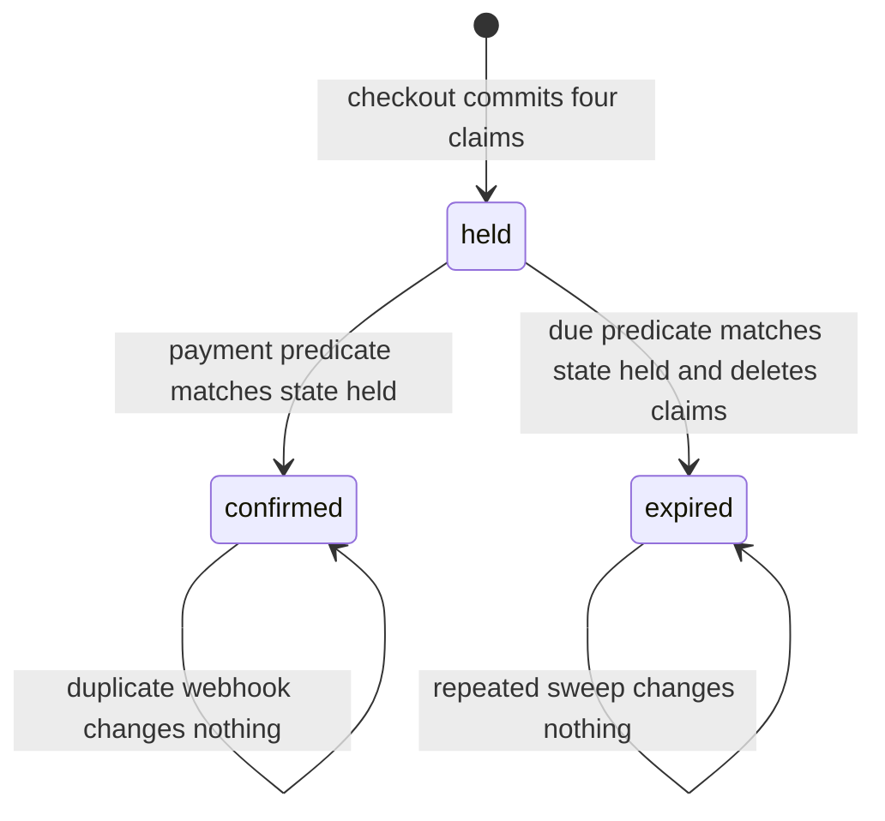

# Parallel booking and clock-change evidence

Your checkout route has passed Module 19 and Module 20. Payments confirm, holds expire, cancellations refund and reschedules swap blocks. All of that was observed one request at a time, from a browser or a single curl call. This lesson attacks the same route with twenty requests that start together, then attacks the calendar logic with a week that contains a clock change. The output goes into `docs/EVIDENCE.md`.

Two habits make the difference between a real experiment and a performance. First, check the setup before the load: confirm that the start you are racing is genuinely offered by the availability engine. Second, read the database after the status codes. A run of twenty correct statuses can hide a missing claim, a leaked booking from a loser, or an index that was never created on the deployed collection.

The lesson also settles the race that Modules 19 and 20 handed forward: an expiry sweep and a payment success can arrive in the same second. That race is not visible in a browser and does not reproduce reliably by clicking, so it needs a test with a fixed clock.

## Where the project is now

The API, client and worker run over HTTPS from Module 25. The worker owns the reminder jobs and a repeatable hold expiry sweep. Cancellation and rescheduling from Module 22 move reminders and create refund records. The seed holds five providers in `Asia/Gaza` and clients in `Asia/Gaza`, `Europe/Berlin` and `Asia/Qatar`.

What is missing is a recorded experiment against that deployment. Until it exists, the strongest true statement you can make about double booking is that you tried it a few times and nothing went wrong. That statement is not enough for a capstone review, and it is not enough for you, because it gives you no way to notice when a later change removes the guarantee.

Create the folder `docs/evidence/` for raw artifacts and `server/scripts/` for the two scripts. Commit both, along with the run logs you will paste into `docs/EVIDENCE.md`.

## The script

Write `server/scripts/race-booking.mjs` as a plain Node script with no test framework. It uses the platform `fetch`, reads its configuration from environment variables, and exits with a non-zero code when the tally is not the expected one. A script is easier for a reviewer to run than a test suite that hides the network setup.

```js
// server/scripts/race-booking.mjs
// Twenty authenticated checkouts at one offered start. Expect one 201 and nineteen 409.
import { writeFile, mkdir } from 'node:fs/promises';

const API = process.env.RACE_API_URL;
const ATTEMPTS = Number(process.env.RACE_ATTEMPTS ?? 20);
const providerId = process.env.RACE_PROVIDER_ID;
const serviceId = process.env.RACE_SERVICE_ID;

const accounts = await signInTestClients(ATTEMPTS);

const offerUrl = `${API}/api/v1/providers/${providerId}/availability?serviceId=${serviceId}&days=7`;
const offer = await fetch(offerUrl).then(response => response.json());
const startAt = offer.starts?.[0];
if (!startAt) {
  throw new Error('no offered start: seed the provider rules and notice window first');
}

// Wait for one shared release time, then send every request together.
const sendOne = async (account, index) => {
  const response = await fetch(`${API}/api/v1/checkouts`, {
    method: 'POST',
    headers: { 'content-type': 'application/json', authorization: `Bearer ${account.accessToken}` },
    body: JSON.stringify({
      checkoutId: `race-${process.pid}-${index}`,
      lines: [{ serviceId, startAt }],
    }),
  });
  return { index, status: response.status, body: await response.json() };
};

// A shared start time a fraction ahead, so every request leaves together.
const releaseAt = Date.now() + 300;
const ready = accounts.map((account, index) => (async () => {
  while (Date.now() < releaseAt) await new Promise(resolve => setTimeout(resolve, 5));
  return sendOne(account, index);
})());

const results = await Promise.all(ready);

const held = results.filter(result => result.status === 201);
const conflict = results.filter(result => result.status === 409 && result.body.code === 'SLOT_TAKEN');
const other = results.filter(result => result.status !== 201 && result.body.code !== 'SLOT_TAKEN');

console.log(`offered start   ${startAt}`);
console.log(`attempts        ${results.length}`);
console.log(`201 held        ${held.length}`);
console.log(`409 SLOT_TAKEN  ${conflict.length}`);
console.log(`other           ${other.length}`);
for (const result of other) console.log(`  other ${result.status} ${result.body.code} #${result.index}`);
if (held.length) console.log(`winner          ${held[0].body.checkoutId}`);

await mkdir('docs/evidence', { recursive: true });
await writeFile(`docs/evidence/race-${new Date().toISOString().replace(/[:.]/g, '')}.json`,
  JSON.stringify({ startAt, results }, null, 2));

if (held.length !== 1 || conflict.length !== ATTEMPTS - 1 || other.length !== 0) process.exitCode = 1;
```

Three details in that code carry the experiment. The shared release time puts every request in flight within a few milliseconds of the others, which is what makes the overlap reliable rather than lucky. Each request has its own account and its own checkout identifier, so the per-client hold quota and idempotency cannot collapse twenty requests into one attempt. The final exit code turns a wrong tally into a failed run, so the command cannot quietly succeed.

The snippet leaves one helper out. `signInTestClients` logs in the seeded test clients and returns their access tokens. Write it beside the script, read the credentials from environment variables, and keep it to clients you created for this purpose; do not point the race at a real client account. If your auth routes need an OTP step, seed the accounts as already verified so the helper has one job.

Run it against the live URL from the repository root:

```bash
RACE_API_URL=https://skillslot-api.onrender.com \
RACE_PROVIDER_ID=6724b1c9a1f3e20012345678 \
RACE_SERVICE_ID=6724b1e2a1f3e20012345680 \
node server/scripts/race-booking.mjs
```

```text
offered start   2026-11-02T13:00:00.000Z
attempts        20
201 held        1
409 SLOT_TAKEN  19
other           0
winner          race-8421-7
```

The sample start is illustrative. The provider's local 15:00 on that date resolved to 13:00Z through the runtime's zone data on the machine that ran the script, and your own run will print the instant it actually used. Do not copy the instant into a test.

## Count the records, not only the statuses

The tally tells you what the clients saw. The database tells you what the system owns. Query both the winner and the losers, using the checkout IDs that the saved JSON file records.

```js
// mongosh, connected to the same database the API used
const race = /^race-/;

db.checkoutattempts.countDocuments({ checkoutId: race });   // 1
db.bookings.countDocuments({ checkoutId: race });           // 1
db.orders.countDocuments({ checkoutId: race });             // 1

const winner = db.bookings.findOne({ checkoutId: race });
db.slotclaims.countDocuments({ bookingId: winner._id });    // 4
db.slotclaims.find({ bookingId: winner._id }).sort({ blockStartAt: 1 })
  .map(claim => claim.blockStartAt.toISOString());
// [ '2026-11-02T13:00:00.000Z', '2026-11-02T13:15:00.000Z',
//   '2026-11-02T13:30:00.000Z', '2026-11-02T13:45:00.000Z' ]

// Nobody else owns those blocks.
const blocks = db.slotclaims.find({ bookingId: winner._id }).toArray().map(claim => claim.blockStartAt);
db.slotclaims.countDocuments({ providerId: winner.providerId, blockStartAt: { $in: blocks },
  bookingId: { $ne: winner._id } });                        // 0
db.bookings.countDocuments({ providerId: winner.providerId, state: { $ne: 'held' },
  _id: { $ne: winner._id } });                              // 0 for this run
```

Four claims is the module's arithmetic: a 45-minute service with a 15-minute buffer occupies 15:00, 15:15, 15:30 and 15:45, and the 16:00 boundary is not claimed. If you count five claims, check whether your occupancy helper added the end boundary. If you count three, check whether the buffer block was skipped. Both mistakes are invisible in the HTTP tally.

The loser counts are the ones reviewers forget. A route that returns nineteen conflicts after committing a booking, an order or a single claim for one loser still fails the product test. The `checkoutId` pattern is a convenience for a fresh test database; if you run the race repeatedly, narrow it with the identifiers saved in the JSON file, because an older `race-` attempt may still be present. Read the records by client ID as well, since a leaked record may carry a rewritten checkout ID.

Also confirm that each losing response identified its own cart line and start, and that no response body contained the winning client's identity. A conflict that leaks who won is an authorization problem inside a concurrency test, and it should be fixed before the evidence is committed.

## Break the index on purpose

The race shows that your route and your index agree. It does not show that the index is what produces exclusivity. To show that, remove the guarantee and watch the outcome change, then restore it.

```js
db.slotclaims.getIndexes()
```

```js
[
  { key: { _id: 1 }, name: '_id_' },
  { key: { providerId: 1, blockStartAt: 1 }, name: 'unique_provider_block', unique: true }
]
```

If the second entry is missing on the deployed database, stop. Nothing else in this module means anything, because the route's protection is absent. Create it with `db.slotclaims.createIndex({ providerId: 1, blockStartAt: 1 }, { unique: true, name: 'unique_provider_block' })` after a duplicate check, and record that the index build succeeded.

Now drop it on a staging database, rerun the race script, and read the tally.

```bash
db.slotclaims.dropIndex('unique_provider_block')
node server/scripts/race-booking.mjs
```

```text
attempts        20
201 held        2
409 SLOT_TAKEN  0
other           18
```

Two successes with no index is the result that makes the earlier run meaningful. The eighteen other responses are likely write conflicts or aborted transactions, and their mix depends on timing, which is exactly why the tally prints every status it did not expect. Save this run as `docs/evidence/race-no-index.json`. Then delete the duplicate claims it created, rebuild the index, and rerun to recover the single-winner result.

The duplicate-key error is worth seeing once by hand, because you will meet it in logs:

```js
db.slotclaims.insertOne({
  providerId: ObjectId('6724b1c9a1f3e20012345678'),
  bookingId: ObjectId('6724b200a1f3e20012345690'),
  blockStartAt: ISODate('2026-11-02T13:00:00.000Z'),
  state: 'held'
})
```

```text
MongoServerError: E11000 duplicate key error collection: skillslot.slotclaims
index: unique_provider_block dup key: { providerId: ObjectId('6724b1c9a1f3e20012345678'),
blockStartAt: new Date('2026-11-02T13:00:00.000Z') }
```

That message names the index and the exact key, which is why the route can map it to a truthful 409 for one cart line. It is also why the original claims must use one stored type for `blockStartAt`. A string block key and a date block key in the same collection are two different index entries for one hour, and the index will happily accept both.

## The clock-change week

The second experiment watches a weekly rule across a clock change. The point is not to prove that Luxon works. The point is to show that your engine recomputes each dated window instead of adding elapsed time to a previous instant, and that a client in a second zone sees their own label move on the zone's own transition date.

Print the transitions first, so the lesson never hard-codes a date that a government can change.

```js
// server/scripts/clock-change-report.mjs
import { DateTime } from 'luxon';

function transitionDays(year, zone) {
  const found = [];
  const end = DateTime.fromObject({ year, month: 1, day: 1 }, { zone }).plus({ years: 1 });
  let cursor = DateTime.fromObject({ year, month: 1, day: 1 }, { zone });
  let offset = cursor.offset;
  while (cursor < end) {
    cursor = cursor.plus({ hours: 1 });
    if (cursor.offset !== offset) {
      found.push(`${cursor.toISODate()} local offset ${offset} to ${cursor.offset}`);
      offset = cursor.offset;
    }
  }
  return found;
}

console.log('Europe/Berlin', transitionDays(2026, 'Europe/Berlin'));
console.log('America/New_York', transitionDays(2026, 'America/New_York'));
```

```text
Europe/Berlin    [ '2026-03-29 local offset 60 to 120', '2026-10-25 local offset 120 to 60' ]
America/New_York [ '2026-03-08 local offset -300 to -240', '2026-11-01 local offset -240 to -300' ]
```

Step in hours, not days. A daily step visits each local midnight, and Berlin's change happens at 02:00, so a daily probe would notice the new offset on the next midnight and report the following day. That is the same class of mistake as adding seven fixed days: the probe has to look at the moment the offset changes.

Berlin changes on the last Sunday of March and the last Sunday of October. New York changes on the second Sunday of March and the first Sunday of November. In 2026 those dates fall three weeks apart in spring, so a single month contains one transition in each zone and no shared transition date. That is the situation the product must survive: the provider's rule is stable in local time, the client's label moves, and neither movement changes the other zone's wall clock.

Now print one week of a provider's 09:00 rule in Berlin, viewed by a client in New York.

```js
const providerZone = 'Europe/Berlin';
const clientZone = 'America/New_York';
for (let index = 0; index < 8; index += 1) {
  const open = DateTime.fromISO('2026-03-23', { zone: providerZone }).plus({ days: index }).set({ hour: 9 });
  const utc = open.toUTC();
  console.log(open.toISODate(), open.toFormat('HH:mm ZZ'), utc.toFormat("yyyy-MM-dd'T'HH:mm:ss'Z'"),
    utc.setZone(clientZone).toFormat('HH:mm ZZ'));
}
```

| Provider date | Provider label | Stored instant | Client label |
|---|---|---|---|
| 2026-03-23 | 09:00 +01:00 | 2026-03-23T08:00:00Z | 04:00 -04:00 |
| 2026-03-27 | 09:00 +01:00 | 2026-03-27T08:00:00Z | 04:00 -04:00 |
| 2026-03-28 | 09:00 +01:00 | 2026-03-28T08:00:00Z | 04:00 -04:00 |
| 2026-03-29 | 09:00 +02:00 | 2026-03-29T07:00:00Z | 03:00 -04:00 |

Read the table in two directions. The provider's rule keeps saying 09:00, which is what she wrote. The stored instant loses an hour on the transition date, because Berlin moved its clock forward and the same local hour now happens earlier in UTC. The client's label also changes on that date, from 04:00 to 03:00, even though New York did nothing that morning.

Then run the earlier week, 2026-03-02 to 2026-03-09. New York changes on March 8, so the client label moves from 03:00 to 04:00 while the provider's 09:00 and the stored `08:00Z` stay fixed. Put both weeks in the evidence file. Together they prove the property in one sentence: each zone moves on its own date, and neither move alters a stored instant that a booking already holds.

## The near-miss: seven fixed days

The bug this experiment is designed to catch is easy to write. Take the first Monday's UTC instant and add seven days of elapsed time for each following week.

```js
const firstMonday = DateTime.fromISO('2026-03-23T08:00:00Z');
const nextMonday = firstMonday.plus({ days: 7 });
console.log(nextMonday.setZone('Europe/Berlin').toFormat('HH:mm ZZZZ')); // 10:00 +02:00
```

The output is 10:00, not 09:00. A provider who set one weekly rule has just been moved by an hour, and the client in New York sees the wrong time too. The assertion that catches this in a test suite is not about a specific hour in UTC. It is that every dated occurrence formats back to the rule's own local fields in the provider zone.

```js
test('every dated occurrence keeps the provider wall clock', () => {
  const week = expandWeeklyRule({ weekday: 1, startMinutes: 9 * 60, durationMinutes: 180, zone: 'Europe/Berlin' },
    { from: '2026-03-02', to: '2026-03-31' });
  for (const occurrence of week) {
    assert.equal(formatInZone(occurrence.startAt, 'Europe/Berlin').slice(11, 16), '09:00');
  }
});
```

If that test passes while the naive `plus({ days: 7 })` helper exists elsewhere in the code, the engine is not the only path that builds slot starts. Search for the second path before you write the evidence.

## The hold expiry race

The third experiment is the state race. A held booking reaches `holdExpiresAt`. In the same second, a signed payment success arrives. Two workers, or one webhook and one sweep, read the same booking and both decide the booking is theirs to change. One path deletes the claims and marks the booking expired. The other marks it confirmed. The calendar and the money disagree, and the client is charged for an appointment the provider was told about or not, depending on which write landed last.

Both paths leave the same starting state and only one may leave it. The diagram below is the whole argument: `held` is a single door, and both the payment handler and the sweep must open it with an update that matches `state: 'held'`. The loser of that match is not an error, it is the expected no-op.



Write the test first and let it fail. The naive release service checks the clock and deletes claims.

```js
// server/src/modules/booking/release.test.js
test('a confirmed booking keeps its claims when the sweep runs late', async () => {
  const booking = await seedHeldBooking({ startAt: '2026-11-02T13:00:00.000Z', blocks: 4, holdMinutes: 10 });
  await confirmFromPaymentSuccess(booking.id);
  const released = await releaseIfDue(booking.id, fixedClock('2026-11-02T13:11:00.000Z'));
  const claims = await SlotClaim.countDocuments({ bookingId: booking.id });
  assert.equal(released, false);
  assert.equal(claims, 4);
});
```

```text
not ok 4 - a confirmed booking keeps its claims when the sweep runs late
  error: expected 4, found 0
  expected: 4
  actual: 0
```

The failure is correct and useful. A release that deletes by booking ID has no idea what state the booking reached, so a late sweep erases a paid appointment. The fix is a state predicate in the same atomic write, so the database decides which path wins.

```js
// server/src/modules/booking/release.js
export async function releaseIfDue(bookingId, clock, reason = 'unpaid_timeout') {
  const now = clock.now();
  return connection.transaction(async session => {
    const booking = await Booking.findOneAndUpdate(
      { _id: bookingId, state: 'held', holdExpiresAt: { $lte: now } },
      { $set: { state: 'expired', releasedAt: now, releaseReason: reason } },
      { session, new: false }
    );
    if (!booking) return false; // confirmed, cancelled or already released
    await SlotClaim.deleteMany({ bookingId }, { session });
    await releaseActiveHoldQuota(booking, session);
    return true;
  });
}
```

Now the test passes, and two more cases are worth writing beside it. Run the same release twice with the same fixed clock: the first call returns `true` and the second returns `false`, with the claim count still zero and the quota decremented once. Then confirm at the same instant and release at the same instant, in both orders, and assert one terminal state. The winner is allowed to vary; the pair of outcomes is not.

Record the boundary decision in `docs/TIME-DECISIONS.md`: this course treats `now >= holdExpiresAt` as due for an unpaid hold, and the payment path must be able to prove that no trusted success exists before a release commits. If your implementation lets the sweep release a booking whose `PaymentAttempt` is still `processing`, the test above is not enough and Module 20.8's reconciliation path is the missing piece.

## Replay the webhook at the deadline

While the payment fixtures are open, resend the success event for the winning checkout with `stripe events resend <event_id>`. Confirm that the booking stays confirmed, the claim count stays at four, the order stays paid and no second refund record appears. Then take a cancelled booking with a partial refund and resend its refund event; the refund record must not duplicate.

The replay and the expiry test together cover the two ways a duplicated external fact can corrupt local state. A webhook that arrives twice is normal. A sweep that runs twice is normal. Both must be boring.

## Write the results down

Add a section to `docs/EVIDENCE.md` for this module. It needs the plan from lesson 26.1, the race tally from the live URL and from the dropped-index staging run, the `getIndexes()` output, the two clock weeks with their transition dates, the failing test output followed by the passing one, the replay result, and the counts after each run. Name the Node version, the Luxon version, the database host and the commit you ran.

Redact before you commit. Replace client emails with client IDs, remove addresses and meeting links, and remove every key and signing secret. Keep the test card number, because it is published for testing and it proves the payment path is in test mode.

## When the run disagrees with the plan

If the race returns two 201s on the live URL but one on staging, compare the databases before the code. The usual causes are a missing unique index in production, a different `blockStartAt` type written by an older deployment, or two API instances pointed at different databases. If the race returns twenty 409s, check the offer first, then the notice window, then whether the transaction can run at all.

If the clock report shows a provider label of 10:00 on a transition date, your engine is adding elapsed days instead of resolving local fields. If the client label does not move on the client's own transition date, the formatter is using the provider zone for display. If the expiry test passes for the wrong reason, check that the fixture really has four claims before the sweep runs; a booking seeded with no claims will pass every assertion about zero.

```quiz
type: mcq
id: concurrency-q1
question: "A race run prints twenty 409 SLOT_TAKEN responses and zero 201. What does it prove?"
options:
  - "That the claim index works, since every request was refused"
  - "Nothing yet, since setup or a failed transaction may reject all twenty"
  - "That the hold quota alone is enough to prevent a double booking of this start"
  - "That the seeded provider has no availability rule on that weekday, so nothing was offered"
correct: 1
explanations:
  - "A refusal for any reason looks the same at the status level."
  - "A run with no winner cannot distinguish a correct conflict from a stale offer or a failed transaction."
  - "Quota limiting is a different mechanism and did not necessarily run."
  - "Missing rules are one possible cause among several and are not established by the tally."
```

```quiz
type: mcq
id: concurrency-q2
question: "You drop unique_provider_block, rerun the race and see two 201 responses. What have you shown?"
options:
  - "That the checkout route has no state predicate and must be rewritten"
  - "That the unique index, not the route, was enforcing exclusivity"
  - "That the availability endpoint returned a stale offer to two clients"
  - "That MongoDB cannot run transactions when a claims index is missing"
correct: 1
explanations:
  - "The route may be correct; its guarantee came from the index that was removed."
  - "The experiment isolates the index by removing it and observing the exact failure it prevents."
  - "Both clients received the same real offer; only the missing uniqueness let both writes commit."
  - "Transactions run without that index; the index supplies uniqueness, not transaction support."
```
