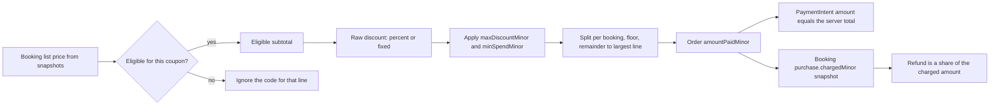

# A coupon is a server-owned price change

A tutor offers a code that takes 20 percent off a first lesson. The lesson costs 30.00, so the client should pay 24.00. That single sentence hides three separate decisions. The server computes the 6.00 discount and the 24.00 total. The payment must be created for 2400 minor units and nothing else. And when the client cancels inside the free window, the refund must return 2400, not 3000, because 3000 was never charged. A coupon is not a decoration on a total. It is a price change that the server owns from the first read to the last refund.

Module 19 already established the rule that the server rebuilds the quote at checkout from Service snapshots, so a client-supplied subtotal is never charged. This module extends that rule to a submitted code. The client sends a string such as `FIRST20`. The server looks the code up, checks it against the provider, the service, the client and the campaign limits, computes the new amounts in minor units, and returns a quote. If the client sends an amount as well, the amount is treated as a claim to compare against, not as an instruction.

Follow the two endings of the diagram. The payment amount and the booking snapshot come from the same computed numbers, and the refund reads the snapshot rather than the catalogue. Everything above the split is a calculation over records the server controls. Nothing in the flow accepts a discount, a total or a paid amount from the browser.

## Provider funded, not platform funded

SkillSlot has no payouts, which makes the funding source easy to miss but important to model. A coupon created by a provider is funded by that provider. The client pays 24.00 for a lesson that usually sells for 30.00, and the provider's own order records 24.00. There is no platform contribution and no negative line item.

The alternative is a platform-funded coupon, where the provider still earns 30.00 and the platform absorbs 6.00. That is a different product with a different data model: it needs a platform ledger, a separate settlement rule and a refund rule that decides who gets the money back. The course does not build it, and the reason is scope, not difficulty. What matters is that the two models are not mixed by accident. If a field called `discount` exists without a stated payer, the first accounting question will expose the ambiguity.

Provider-funded coupons also constrain the rules. A provider can discount their own services, and cannot discount another provider's service. The coupon document therefore carries a `providerId`, and every application checks that the booking's provider matches it. A cart that holds a tutor's lesson and a designer's session applies the tutor's coupon to the tutor's order only, and the designer's order is untouched.

## Four caps that protect four different things

A campaign needs limits, and the limits answer separate questions. `maxDiscountMinor` caps one use, so a 50 percent code on an expensive session cannot swallow the whole order. `minSpendMinor` stops a nearly free service from producing a nearly free booking. `maxRedemptions` caps the campaign as a whole, which is what "first twenty clients" actually means. `perClientLimit` caps one client, which is what makes a first-session code behave like a first-session code. A validity window keeps last season's code from working in this one.

Each cap is checked at a different moment, and the moment matters more than the check. Checking `maxRedemptions` after the payment succeeds is too late, because the client has already paid a price that the campaign cannot honour. The cap has to be consulted when the price is fixed, which in this system is when the hold is created. That is the same transaction that claims blocks, and it is why the redemption record is written there rather than in the webhook.

## Rounding, remainders and the sum that must match

Percent discounts leave fractions of a minor unit. Work in integer minor units throughout, floor each booking's share, and allocate the leftover units deterministically to the largest line. A 15 percent discount on a booking of 3333 minor units is 499.95, which floors to 499. One unit is left over, and the payment total must equal the sum of the lines, so that unit has to be placed somewhere and recorded.

Write the allocation down, per booking and per order. A refund later reads the allocation, not a fresh percentage calculation. This is the practical reason the snapshot exists: recomputing a discount at refund time, from a coupon that may have been edited or archived, gives a number that will not match the charge. Storing the allocation makes the money history auditable, which is what a support conversation needs.

## Refunds use the paid amount

Cancellation policy is a percentage of what the client paid for that booking. A free-window cancellation returns the full paid amount, 2400. A late cancellation at 50 percent returns 1200. Module 22 built the refund math in minor units and this module changes only its input: the base is the charged amount on the purchase snapshot, not the list price on the same snapshot.

The failure is easy to see and easy to ship by accident. A refund built from the list price asks Stripe to return 3000 from a charge of 2400, and Stripe rejects a refund larger than the remaining charge. The client sees a cancellation that fails with a server error, the provider's hour is gone, and support has no number that explains the state. The same bug in the free window is worse, because the operation usually succeeds for the full charge and quietly over-refunds a discounted booking.

## One redemption per checkout

A redemption record is the proof that a client used a code. Give it a unique index over the coupon and the checkout, and move it through three states. Reserve it when the hold is created. Consume it when the payment confirms. Release it when the hold expires or is cancelled before payment.

Reserving is what makes a cap real under concurrency. Two clients can both read `redeemedCount: 19` against a cap of twenty, both reserve, and both pay, which gives twenty one redemptions. Count after the fact and the campaign has overspent. Reserve with a conditional update that compares `redeemedCount + reservedCount` against the cap, and one of the two reservations fails. Consuming on payment only, without reserving, reopens the same race between reservation and payment.

Releasing matters as much as reserving. An abandoned checkout should not burn a slot in a twenty-client campaign. The hold expiry sweep from Module 24 already releases claims; it releases the reservation at the same time, in the same state-guarded way, so running it twice does not decrement a counter twice. A released reservation keeps its record, so a support question about a code that "did not work" has an answer.

## The client experience of a rejected code

Most coupon bugs in a marketplace are not arithmetic. They are ambiguity about why a code did not apply. Return a specific, non-leaking reason: unknown code, expired, not this provider's code, already used by this client, minimum spend not reached, campaign exhausted. Do not confirm whether a code exists for a different provider, because that turns the endpoint into a code oracle.

Rate limit the apply route per client and per address. A six character code is guessable at a few hundred attempts per minute, and a limiter makes the guessing noticeable instead of free. If a code is rejected, keep the cart intact and show the price without the discount, so the client can choose to continue rather than losing the slot selection.

## What you will build

You will add a Coupon and a Redemption model, a pure pricing function with a remainder rule, an apply route that returns a server quote, a reservation inside the checkout transaction, consumption in the paid webhook, release in the expiry path, and a refund change that reads the paid amount. Then you will test the messy cases: two clients racing the last redemption, a replayed webhook, a partial refund of one booking from a two-provider discounted payment, and a code that was archived after the booking.

The alternative to all of this is not offering coupons. That is a real option and a smaller one. A second option is a manual price adjustment on a single booking, which is useful for a goodwill gesture and useless as a campaign. A third is a platform-funded discount, which needs a ledger this course does not build. Choose provider-funded coupons because they keep the money inside the order the rest of the system already understands.

<BigWordAlert term="Minor units" plainEnglish="The smallest unit of a currency, such as a cent. Every amount in SkillSlot is a whole number of minor units, so no rounding happens by accident." whyItMatters="Discounts, payments and refunds must add up exactly, and floating point arithmetic does not." />

Before you build, write one complete example by hand with odd numbers. A 15 percent coupon on two lessons from one provider, priced 3333 and 1667, with a cap of 600 and a client who cancels one lesson in the late window. Compute the eligible subtotal, the raw discount, the capped discount, each booking's share, the payment amount, and the refund. If your numbers do not add back to the payment total, the remainder rule is not yet decided and the tests in the next lesson will tell you so.

References: [Stripe refunds](https://docs.stripe.com/refunds) and [MongoDB conditional update with $expr](https://www.mongodb.com/docs/manual/reference/operator/update/inc/).
