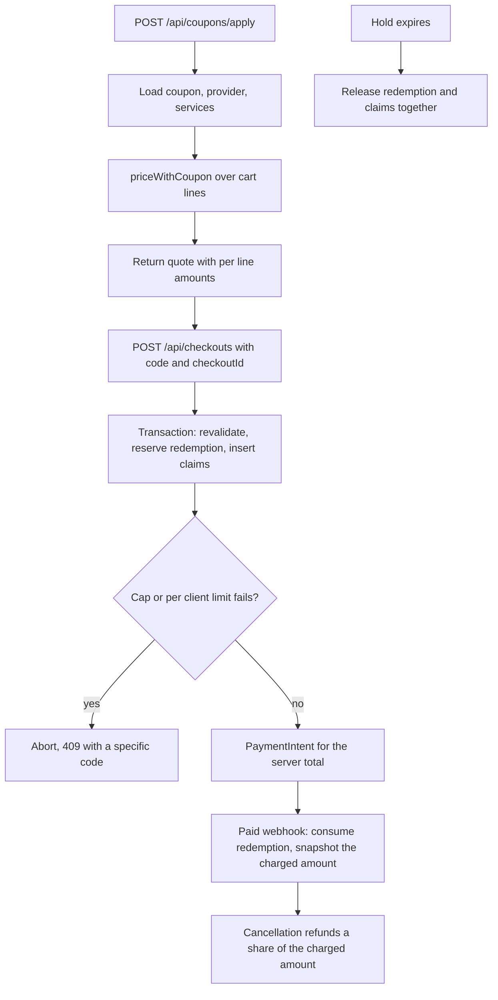

# Provider-funded coupons, caps and refunds

The project already splits one payment into one order per provider and one booking per slot. Module 22 refunds a booking from its policy snapshot. This lesson inserts a discount between the list price and the payment, and then follows that discount through the redemption record and the refund path. The work is small in code and large in consequences, because every number a client sees after this lesson is a server number.

Build the pricing function first and test it alone. A pure function over a list of lines and a coupon is easy to test with odd numbers, and every route afterwards becomes a thin wrapper. Then the models and indexes, then the apply route, then the reservation inside checkout, then consumption, release and refund.



Notice that the quote and the payment are separate calls with the same computation behind them. The quote is a convenience for the browser. The payment amount is recomputed inside the checkout transaction, because the cart, a service price or the campaign could change between the two calls.

## Models and the indexes that make them safe

Two collections carry the campaign. The coupon holds the rules and two counters. The redemption holds the fact that one client used one coupon on one checkout.

```ts
// server/src/models/coupon.schema.ts
const couponSchema = new Schema(
  {
    code: { type: String, required: true, unique: true }, // stored upper case
    providerId: { type: Schema.Types.ObjectId, ref: 'Provider', required: true },
    kind: { type: String, enum: ['percent', 'fixed'], required: true },
    percentOff: { type: Number, min: 1, max: 100 },
    amountOffMinor: { type: Number, min: 1 },
    maxDiscountMinor: { type: Number, min: 1 },
    minSpendMinor: { type: Number, default: 0, min: 0 },
    currency: { type: String, required: true },
    validFrom: { type: Date, required: true },
    validTo: { type: Date, required: true },
    maxRedemptions: { type: Number, min: 1, required: true },
    perClientLimit: { type: Number, default: 1, min: 1 },
    redeemedCount: { type: Number, default: 0, min: 0 },
    reservedCount: { type: Number, default: 0, min: 0 },
    appliesToServiceIds: { type: [Schema.Types.ObjectId], default: [] },
    state: { type: String, enum: ['active', 'paused', 'archived'], default: 'active' },
  },
  { timestamps: true }
);
couponSchema.index({ providerId: 1, state: 1 });

// server/src/models/redemption.schema.ts
const redemptionSchema = new Schema(
  {
    couponId: { type: Schema.Types.ObjectId, required: true },
    clientId: { type: Schema.Types.ObjectId, required: true },
    providerId: { type: Schema.Types.ObjectId, required: true },
    checkoutId: { type: Schema.Types.ObjectId, required: true },
    state: { type: String, enum: ['reserved', 'consumed', 'released'], required: true },
    discountMinor: { type: Number, required: true, min: 0 },
    allocations: [
      {
        orderId: Schema.Types.ObjectId,
        bookingId: Schema.Types.ObjectId,
        amountMinor: { type: Number, required: true },
      },
    ],
    consumedAt: Date,
    releasedAt: Date,
  },
  { timestamps: true }
);
redemptionSchema.index({ couponId: 1, checkoutId: 1 }, { unique: true });
redemptionSchema.index({ couponId: 1, clientId: 1, state: 1 });
```

The unique index on coupon and checkout is the idempotency guarantee. A retried checkout with the same `checkoutId` finds the existing redemption and returns the committed one instead of creating a second. The second index supports the per-client count without scanning the collection.

Validate coupons on write as well as on read. A percent coupon must not also carry a fixed amount. A fixed amount must not exceed the smallest eligible service price, or every use of it gives a zero price and an argument with the provider. Reject both at creation with a clear message, because a campaign that cannot price a lesson is better discovered by the provider than by the client.

## The pricing function is pure and boring

`priceWithCoupon` takes lines, a coupon and nothing else. No database handle, no clock, no environment. It returns the discount, the per-line allocation and the total, all in integer minor units.

```ts
// server/src/pricing/coupon.ts
export interface PricedLine {
  orderId: string;
  bookingId: string;
  providerId: string;
  serviceId: string;
  listPriceMinor: number;
}

export interface CouponTerms {
  providerId: string;
  kind: 'percent' | 'fixed';
  percentOff?: number;
  amountOffMinor?: number;
  maxDiscountMinor?: number;
  minSpendMinor: number;
  appliesToServiceIds: string[];
}

export interface Quote {
  discountMinor: number;
  totalListMinor: number;
  totalPaidMinor: number;
  lines: Array<PricedLine & { eligible: boolean; discountMinor: number; paidMinor: number }>;
}

export function priceWithCoupon(lines: PricedLine[], coupon: CouponTerms): Quote {
  const eligible = lines.filter(
    (line) =>
      line.providerId === coupon.providerId &&
      (coupon.appliesToServiceIds.length === 0 ||
        coupon.appliesToServiceIds.includes(line.serviceId))
  );
  const eligibleSubtotal = eligible.reduce((sum, line) => sum + line.listPriceMinor, 0);
  const raw =
    eligibleSubtotal < coupon.minSpendMinor
      ? 0
      : coupon.kind === 'percent'
        ? Math.floor((eligibleSubtotal * (coupon.percentOff ?? 0)) / 100)
        : Math.min(coupon.amountOffMinor ?? 0, eligibleSubtotal);
  const discountMinor = Math.min(raw, coupon.maxDiscountMinor ?? raw);
  return allocate(lines, eligible, discountMinor);
}
```

`allocate` is where the remainder rule lives. Give each eligible line its proportional share, floor it, then hand the leftover units to the largest eligible line so the sum of the parts equals the whole. Break ties by ascending booking ID. Module 20 asked for exactly this kind of documented deterministic rule, and any rule is acceptable as long as it is written down and the sum still matches. Never let a line's discount exceed its own price, because a negative paid amount is not a discount.

```ts
function allocate(lines: PricedLine[], eligible: PricedLine[], discountMinor: number): Quote {
  const subtotal = eligible.reduce((sum, line) => sum + line.listPriceMinor, 0);
  const shares = new Map<string, number>();
  let assigned = 0;
  for (const line of eligible) {
    const share = subtotal === 0 ? 0 : Math.floor((discountMinor * line.listPriceMinor) / subtotal);
    shares.set(line.bookingId, share);
    assigned += share;
  }
  const largest = [...eligible].sort((a, b) => b.listPriceMinor - a.listPriceMinor)[0];
  if (largest && assigned < discountMinor) {
    shares.set(largest.bookingId, (shares.get(largest.bookingId) ?? 0) + (discountMinor - assigned));
  }
  const priced = lines.map((line) => {
    const discount = Math.min(shares.get(line.bookingId) ?? 0, line.listPriceMinor);
    return { ...line, eligible: shares.has(line.bookingId), discountMinor: discount,
      paidMinor: line.listPriceMinor - discount };
  });
  const totalListMinor = priced.reduce((sum, line) => sum + line.listPriceMinor, 0);
  const totalPaidMinor = priced.reduce((sum, line) => sum + line.paidMinor, 0);
  return { discountMinor, totalListMinor, totalPaidMinor, lines: priced };
}
```

Test the function with numbers that do not divide evenly, because those are the ones that break a payment. Two lessons at 3333 and 1667 with a 15 percent coupon should give a discount of 750, shares of 500 and 250, and a paid total of 4250. Now change the coupon to a fixed 500 and confirm the same proportional split still holds, 334 and 166, with the leftover unit on the larger line. A cap of 400 on the percent coupon must yield 400, and the shares must still add to 400.

## Apply the code and return a server quote

`POST /api/coupons/apply` accepts a code, the cart line IDs and the authenticated client. It loads the cart, rejects another client's lines, loads the coupon by upper-cased code, and checks the provider, the service list, the window, the state, the per-client count and the campaign counters. Then it calls `priceWithCoupon` and returns the quote with per-line amounts, the discount, the total, and the coupon's human-readable label.

```ts
// server/src/routes/coupons.route.ts (shape, error mapping omitted)
const coupon = await Coupon.findOne({ code: code.toUpperCase(), state: 'active' });
if (!coupon) throw new HttpError(404, 'COUPON_UNKNOWN');
if (coupon.providerId.toString() !== providerOf(cartLines)) throw new HttpError(409, 'COUPON_OTHER_PROVIDER');
if (now < coupon.validFrom || now > coupon.validTo) throw new HttpError(409, 'COUPON_EXPIRED');
if (coupon.redeemedCount + coupon.reservedCount >= coupon.maxRedemptions) {
  throw new HttpError(409, 'COUPON_EXHAUSTED');
}
if ((await Redemption.countDocuments({ couponId: coupon._id, clientId, state: { $in: ['reserved', 'consumed'] } })) >= coupon.perClientLimit) {
  throw new HttpError(409, 'COUPON_CLIENT_LIMIT');
}
const quote = priceWithCoupon(toPricedLines(cartLines), toTerms(coupon));
res.json({ quote, label: `${coupon.percentOff ?? coupon.amountOffMinor} off`, couponId: coupon.id });
```

The route never returns the raw coupon document. `maxRedemptions`, the counters and the internal identifiers are campaign data, and a client-facing label is enough. Rate limit this route per client, and return the same `COUPON_UNKNOWN` shape for a code that exists but belongs to another provider, so the endpoint does not confirm which codes exist elsewhere.

The client may send the total it displayed. Compare it with the server total and return `409 QUOTE_CHANGED` with the new numbers when they differ. That comparison is a courtesy to the browser, not an input to the price.

## Reserve once, inside the checkout transaction

Checkout extends the Module 19 transaction. After the cart is reloaded and the service prices are re-read, reserve the coupon with a conditional update. The predicate compares the sum of the two counters against the cap, so two concurrent checkouts cannot both take the last redemption.

```ts
// inside the checkout transaction, session passed to every call
const reserved = await Coupon.findOneAndUpdate(
  {
    _id: couponId,
    state: 'active',
    $expr: { $lt: [{ $add: ['$redeemedCount', '$reservedCount'] }, '$maxRedemptions'] },
  },
  { $inc: { reservedCount: 1 } },
  { session, new: true }
);
if (!reserved) throw new HttpError(409, 'COUPON_EXHAUSTED');
```

Then count this client's live redemptions with the session, and insert the redemption with its allocation. If the unique index on coupon and checkout rejects the insert, a retry of the same checkout is in progress: load the existing redemption and continue, which keeps the retry idempotent. A retry with the same checkout ID must not reserve twice, and a second checkout ID from the same client must hit the per-client limit.

The reservation commits with the claims, so the price is fixed for the life of the hold. That is a deliberate promise: the cap check and the claim are in one atomic step, and a client who holds an hour at 24.00 is not repriced at 14:15 because the campaign filled up. When the hold expires, the release path returns the reservation, and the next client can use it.

## Consume and release under state predicates

The paid webhook consumes the redemption. The expiry path releases it. Both move state with a predicate, and both adjust the coupon counters only when the transition actually happened.

```ts
const consumed = await Redemption.findOneAndUpdate(
  { couponId, checkoutId, state: 'reserved' },
  { $set: { state: 'consumed', consumedAt: eventTime } },
  { session, new: true }
);
if (!consumed) return; // replay, or already released by a sweep
await Coupon.updateOne(
  { _id: couponId },
  { $inc: { reservedCount: -1, redeemedCount: 1 } },
  { session }
);
```

Two properties fall out of this shape. A replayed webhook finds no `reserved` document and returns without touching the counters, so the campaign does not double count. A sweep that wins the race moves the redemption to `released` first, and the webhook then finds nothing to consume and follows the late-payment reconciliation path from Module 20 instead.

The release path is the same code with the opposite direction: `reserved` to `released`, `reservedCount` down by one, `redeemedCount` untouched, and `releasedAt` recorded. Keep the released document. A client who asks why a code stopped working deserves an answer that is not guesswork.

## Refund from the amount paid

Module 22 computes a refund as a policy percentage in integer minor units. Change the base and nothing else.

```ts
// server/src/refunds/policy.ts
export function refundableMinor(booking: Booking, policy: PolicySnapshot, nowUtc: number) {
  if (nowUtc <= booking.startsAt.getTime() - policy.freeCancelHours * 3600_000) {
    return booking.purchase.chargedMinor;
  }
  if (nowUtc < booking.startsAt.getTime()) {
    return Math.floor((booking.purchase.chargedMinor * policy.lateRefundPercent) / 100);
  }
  return 0;
}
```

The purchase snapshot gains two fields beside the list price: `discountMinor` and `chargedMinor`. `purchase.priceMinor` stays the list price, because a receipt shows both, and `purchase.chargedMinor` is written at confirmation from the allocation, so it survives a coupon edit, an archive or a deleted campaign. Module 22 read `purchase.priceMinor` as the paid amount because there were no discounts then; from this module the refund base is `purchase.chargedMinor`, and a test should catch any regression to the old field. Pass a deterministic idempotency key to the refund call, such as `refund:<bookingId>:<policyWindow>`, so a retried cancellation returns the first refund instead of creating a second one. Then guard the amount: a refund must never exceed `purchase.chargedMinor` minus what has already been refunded for that booking.

The multi-provider case needs one more check. A payment of 4250 across two providers, with 750 of discount on one order, can be refunded one booking at a time, and the sum of the refunds must never exceed the payment. Because each booking's paid share is snapshotted, the arithmetic works without asking Stripe for a balance first. Ask anyway in a test, by adding the refunded amounts and comparing them with the original charge.

## Tests that must fail first

```ts
// server/src/__tests__/coupons.test.ts
it('refuses the second client when the last redemption is contested', async () => {
  const coupon = await seedCoupon({ maxRedemptions: 1, perClientLimit: 1 });
  const [a, b] = await Promise.allSettled([
    holdWithCoupon('client-a', coupon.code),
    holdWithCoupon('client-b', coupon.code),
  ]);
  const winners = [a, b].filter((r) => r.status === 'fulfilled');
  expect(winners).toHaveLength(1);
  expect((await Coupon.findById(coupon._id))!.redeemedCount).toBe(0);
  expect((await Coupon.findById(coupon._id))!.reservedCount).toBe(1);
});

it('keeps one redemption when the same checkout is retried', async () => {
  const checkoutId = newObjectId();
  await holdWithCoupon('client-a', 'FIRST20', checkoutId);
  await holdWithCoupon('client-a', 'FIRST20', checkoutId);
  expect(await Redemption.countDocuments({ checkoutId })).toBe(1);
  expect((await Coupon.findOne({ code: 'FIRST20' }))!.reservedCount).toBe(1);
});

it('refunds the discounted amount, not the list price', async () => {
  const booking = await confirmWithCoupon('client-a', 'FIRST20', 3000, 20);
  expect(booking.purchase.chargedMinor).toBe(2400);
  const refund = await cancelInsideFreeWindow(booking.id);
  expect(refund.amountMinor).toBe(2400);
});

it('does not double consume on a replayed paid webhook', async () => {
  const event = await paidEvent('client-a', 'FIRST20');
  await postWebhook(event);
  await postWebhook(event);
  const coupon = await Coupon.findOne({ code: 'FIRST20' });
  expect(coupon!.redeemedCount).toBe(1);
  expect(coupon!.reservedCount).toBe(0);
});

it('returns the reservation when the hold expires', async () => {
  const held = await holdWithCoupon('client-b', 'FIRST20');
  clock.advanceMinutes(11);
  await processHoldExpirySweep();
  expect((await Redemption.findById(held.redemptionId))!.state).toBe('released');
  expect((await Coupon.findOne({ code: 'FIRST20' }))!.reservedCount).toBe(0);
});

it('rejects a client supplied total that differs from the server quote', async () => {
  const res = await postCheckout('client-a', { couponCode: 'FIRST20', clientTotalMinor: 3000 });
  expect(res.status).toBe(409);
  expect(res.body.code).toBe('QUOTE_CHANGED');
  expect(res.body.serverTotalMinor).toBe(2400);
});
```

The first two tests are the idempotency story and they need a real database with the unique indexes in place, because the guard is an index, not a JavaScript check. The third is the refund story and it fails immediately if the refund path still reads the catalogue price.

<TraceRequest title="One coupon from code to refund">
  <TraceStep actor="Client" label="Apply FIRST20" detail="Cart line for a 3000 lesson" />
  <TraceStep actor="API" label="Server quote" detail="Discount 600, total 2400, per line allocation" />
  <TraceStep actor="Checkout" label="Reserve inside the transaction" detail="reservedCount up, claims inserted, price fixed" />
  <TraceStep actor="Webhook" label="Consume once" detail="reserved becomes consumed, redeemedCount 1" />
  <TraceStep actor="Cancel" label="Refund the paid share" detail="2400 in the free window, 1200 late" />
</TraceRequest>

```quiz
type: mcq
id: coupon-q1
question: "A booking with a list price of 5000 was paid at 4000 after a provider coupon. The client cancels inside the late window at 50 percent. What refund is correct?"
options:
  - "2500, because the policy percentage applies to the list price of the booking"
  - "2000, because the policy percentage applies to the amount actually paid"
  - "4000, because a late cancellation in a discount campaign returns the full charge"
  - "1000, because the coupon reduces the refundable base twice"
correct: 1
explanations:
  - "The list price was never charged, and a refund above the charge is rejected."
  - "The paid share is the base, and half of 4000 is 2000."
  - "The late window is a partial refund by policy, not a full one."
  - "The discount is applied once, when the price is computed."
```

## Acceptance criteria

The quote and the payment amount come from one function. A code is reserved once per checkout and the cap holds under concurrent checkouts. A replayed webhook consumes once and a repeated sweep releases once. A booking records its paid amount and its discount, and the refund path reads those fields rather than the catalogue. A rejected code returns a specific reason without disclosing another provider's campaign. Every amount in the database is an integer number of minor units, and the sum of booking paid amounts equals the order and payment totals.

Verify with `redis-cli` for the queue, the database for the counters and the Stripe test dashboard for the amounts. The gate asks for one discounted payment and one discounted refund with matching numbers in all three places.

References: [Stripe idempotent requests](https://docs.stripe.com/api/idempotent_requests) and [MongoDB findOneAndUpdate](https://www.mongodb.com/docs/manual/reference/method/db.collection.findOneAndUpdate/).
