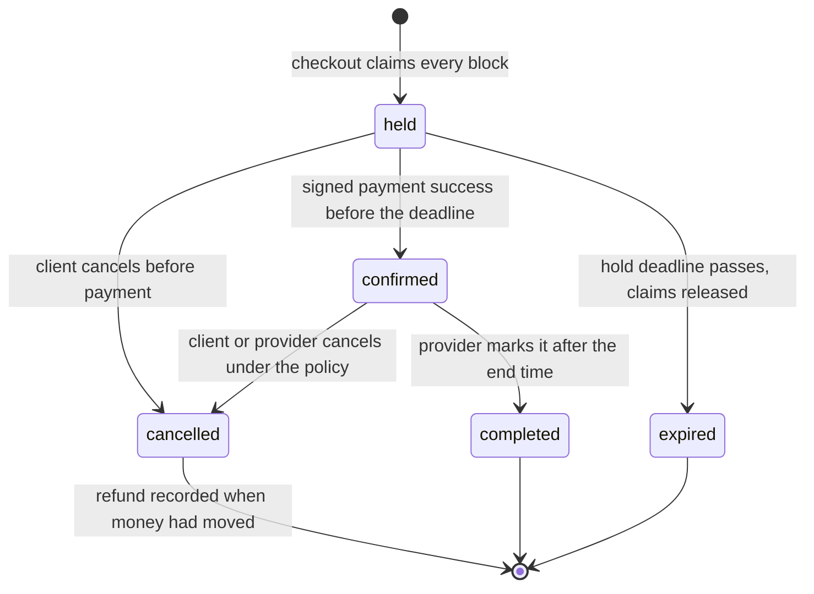

# Ship and document SkillSlot

SkillSlot is deployed, paid for with a test card, and defended by experiments. A stranger who opens the repository still cannot tell what it does, what it needs to run, or where to look for proof. This lesson closes that gap. It is the last build step before the demo and the defense, and it is the step most learners skip because the code already works.

Documentation here is not a summary of the course. It is an interface to your own system. A mentor should be able to read four files and answer four questions: what does this product do, how do I run it, how is the data shaped, and what have you proven. If any of those questions needs you present, the file is unfinished.

Work in seven files and one diagram: `README.md`, `.env.example`, `docs/RUNBOOK.md`, `docs/ERD.md`, `docs/AUTHORIZATION.md`, `docs/EVIDENCE.md` and `docs/DEMO.md`, plus the booking state diagram inside `docs/ERD.md`. Keep `docs/TIME-DECISIONS.md` from Module 5 and `docs/LEARNING-LOG.md` from Module 1 in place; they are part of the same package.

## The README answers four questions

Most READMEs begin with a technology list, which answers the one question a reader did not ask. Begin with the product sentence, then the live address, then the shortest path to running it locally. Put the stack after those, and keep the stack honest: if the worker process exists, name it, because the most common way to run this project wrongly is to start only the API.

```markdown
# SkillSlot

A marketplace where freelancers sell their time. Providers publish weekly hours in their own
time zone, list fixed-price services with a duration, and block time off. Clients book one or
more slots from different providers in a single cart, pay once with Stripe test mode, and manage
cancellations and reschedules under the policy saved at booking time.

## Live
- App: https://skillslot.vercel.app
- API health: https://skillslot-api.onrender.com/health
- Demo video: docs/DEMO.md links the recording

## Run locally
1. Copy `.env.example` to `.env` in `server/` and `worker/` and fill the marked values.
2. Start MongoDB as a single-node replica set (see `docs/RUNBOOK.md`).
3. `cd server && npm ci && npm run seed && npm run dev`
4. `cd worker && npm ci && npm run dev`
5. `cd client && npm ci && npm run dev`

## What this project demonstrates
- One slot, one booking: compound unique claims on provider and 15-minute block
- Time zones: weekly rules in provider local time, instants in UTC, display in the client zone
- Holds: expiring claims confirmed by a signed Stripe webhook
- Cancellation and reschedule: policy snapshots, partial refunds, reminders moved
- Evidence: `docs/EVIDENCE.md` records the race, replay, clock and expiry runs

## Docs
`docs/ERD.md`, `docs/AUTHORIZATION.md`, `docs/EVIDENCE.md`, `docs/DEMO.md`, `docs/TIME-DECISIONS.md`
```

Three rules for that block. Replace the two addresses with your own deployment before you commit, because a reviewer will open them. Every command must have been run by you from a clean clone, in the order written, and every link must resolve on the day you commit it. A README that starts a database with no replica set will fail at checkout, and the reader will conclude your concurrency work is broken rather than your instructions.

Add one short paragraph on the replica set, because it is the least obvious requirement in the project. A standalone MongoDB accepts writes and refuses transactions, so a reader who skips the replica set sees failed checkouts with no obvious cause. Naming the requirement costs two sentences and saves an hour.

## The environment example

`.env.example` is a contract. It lists every variable the processes read, with no secret values, and it is the only environment file in Git. The real `.env` is ignored. Commit the example with empty values for secrets so nobody mistakes a sample key for a working one.

```diff
--- /dev/null
+++ b/server/.env.example
@@ -0,0 +1,14 @@
+NODE_ENV=production
+TZ=UTC
+PORT=4000
+MONGODB_URI=
+JWT_ACCESS_SECRET=
+JWT_REFRESH_SECRET=
+STRIPE_SECRET_KEY=
+STRIPE_WEBHOOK_SECRET=
+CLIENT_ORIGIN=https://skillslot.vercel.app
+REDIS_URL=
+LOG_LEVEL=info
```

```bash
git grep -n "sk_test_" -- . ':!docs' ':!server/.env.example'
git grep -n "whsec_"
```

Both searches must print nothing. If either finds a value, rotate the key before you continue; removing the line from the latest commit does not remove it from history. This is the one mistake in the module that cannot be fixed by a better paragraph.

`TZ=UTC` belongs in the example even though the code does not depend on it. Module 4 established that correctness comes from explicit zones, and the variable is there to remove a class of accidental local-time output in logs. Put the same variable in the worker, because a reminder job that formats a start in the host zone will look correct on one machine and wrong on the next.

Write one sentence beside each variable in `docs/RUNBOOK.md` explaining what breaks without it. `STRIPE_WEBHOOK_SECRET` missing means every event fails signature verification and no booking is ever confirmed. `REDIS_URL` missing means the cache falls back to MongoDB and the queue cannot start reminders. A reader who knows what breaks can debug their own setup.

## A check that fails before the docs exist

Documentation rots silently, so give it a check. Add `server/scripts/check-docs.mjs` that fails when a required file is missing, when the README has no live API address, and when a relative link in `docs/` points at a file that is not there. Run it in the same step as the test suite.

```js
// server/scripts/check-docs.mjs
import { readFile, readdir, access } from 'node:fs/promises';
import path from 'node:path';

const required = ['README.md', '.env.example', 'docs/RUNBOOK.md', 'docs/ERD.md', 'docs/AUTHORIZATION.md',
  'docs/EVIDENCE.md', 'docs/DEMO.md'];
const headings = ['Parallel race', 'Webhook replay', 'Clock-change week', 'Hold expiry race'];
const problems = [];

for (const file of required) {
  await access(file).catch(() => problems.push(`missing ${file}`));
}

const readme = await readFile('README.md', 'utf8').catch(() => '');
if (!/API health: https:\/\//.test(readme)) problems.push('README has no live API health line');

const evidence = await readFile('docs/EVIDENCE.md', 'utf8').catch(() => '');
for (const heading of headings) {
  if (!evidence.includes(heading)) problems.push(`EVIDENCE.md has no ${heading} section`);
}

for (const name of await readdir('docs').catch(() => [])) {
  if (!name.endsWith('.md')) continue;
  const text = await readFile(path.join('docs', name), 'utf8');
  for (const [, link] of text.matchAll(/\]\((?!https?:)([^)#\s]+)\)/g)) {
    await access(path.join('docs', link)).catch(() => problems.push(`${name} links to missing ${link}`));
  }
}

if (problems.length) {
  console.error(problems.join('\n'));
  process.exit(1);
}
console.log('docs ok');
```

The first run should fail, and that is the point of writing it now:

```text
$ node server/scripts/check-docs.mjs
missing docs/RUNBOOK.md
missing docs/DEMO.md
README has no live API health line
AUTHORIZATION.md links to missing BOOKING-POLICY.md
```

Four problems from the first run, and each one is a real gap rather than a formatting complaint. A reader following the authorization matrix needs the policy document it points at, or the row is unusable.

Fix the files rather than the check. When the check passes, add it to the `test` script so a pull request cannot remove a required doc quietly. The check is deliberately shallow: it proves presence and one structural fact per file, not quality. Quality is what the review in the next lesson is for.

## The final ERD

`docs/ERD.md` must match the models you shipped, not the draft from Module 3. Draw the ownership chain first: a client and a provider are both users, a provider owns Services and AvailabilityRules, a Service belongs to one provider, a Booking references one client and one provider and one Service, and a SlotClaim belongs to a provider and a Booking. TimeOff belongs to a provider. A refund belongs to a Booking and to the payment that covered it.

List the fields that carry a decision, not every field. The ones a reviewer will ask about are the snapshots and the keys.

```text
Booking
  _id                 ObjectId
  clientId            ObjectId -> User
  providerId          ObjectId -> Provider
  serviceId           ObjectId -> Service
  checkoutId          string, unique with clientId
  startAt             Date, UTC instant
  endAt               Date, UTC instant
  durationMinutes     number, snapshot
  bufferMinutes       number, snapshot
  priceMinor          integer, snapshot in minor units
  currency            string, snapshot
  policy              { freeCancelHours, lateRefundPercent, rescheduleCutoffHours }, snapshot
  providerTimeZone    string, IANA zone at booking time
  clientTimeZone      string, IANA zone shown at booking time
  state               held | confirmed | completed | cancelled | expired
  holdExpiresAt       Date, present while held
  cancelledAt         Date, optional
  cancelReason        provider_cancelled | client_cancelled | policy_late | time_off_conflict
  history             [{ from, to, at, actor }]

SlotClaim
  _id                 ObjectId
  providerId          ObjectId -> Provider
  bookingId           ObjectId -> Booking
  blockStartAt        Date, UTC instant aligned to 15 minutes
  state               held | confirmed
  index               unique_provider_block on { providerId, blockStartAt }

Refund
  _id                 ObjectId
  bookingId           ObjectId -> Booking
  paymentIntentId     string
  amountMinor         integer
  currency            string
  reason              late_cancel | provider_cancel | reschedule_failed | late_success_lost
  idempotencyKey      string, unique
  state               requested | succeeded | failed
```

Write two sentences under the diagram. The first names the two fields that make a receipt readable a year later: `priceMinor` and `policy`. The second names the field that makes two simultaneous requests agree: `blockStartAt`, in UTC, aligned to a fifteen-minute boundary. Those two sentences are the data model's argument, and they are the ones a reviewer quotes back to you in the viva.

Say what you did not implement. If payouts, video calls or calendar sync are out of scope, one line in the ERD or the README settles it. A reader who assumes a missing feature is a bug will ask about it in the defense.

## The booking state diagram

A Booking moves through five states, and every transition has an owner. Draw the diagram in Mermaid inside `docs/ERD.md` so it changes with the document, and keep the same diagram in this lesson as the reference.



Read the diagram by asking who is allowed to cause each arrow. Only the checkout transaction creates `held`. Only a verified webhook or a payment reconciliation creates `confirmed`. Only the release service creates `expired`, and only with a state predicate on `held`. Only the client or the provider creates `cancelled`, through two different routes with different refund rules. Only the provider creates `completed`, and only after `endAt`.

Notice what is not in the diagram: refunds. A refund is not a booking state, because one payment can cover several bookings and each is refunded separately, and because money can be partly returned while an appointment remains valid for another line. Keep refund progress on the `Refund` collection and show its amount on the order share. If you built the late-success recovery path with a booking-level marker such as `refund_pending`, draw it in your own copy and keep the two documents consistent; a diagram that contradicts the code is worse than a diagram with one extra edge.

The diagram also answers a question that comes up in every defense: what happens to the claims when a booking is cancelled. The arrow leaves the state, and the release step deletes the claims in the same transaction. If your code deletes claims in a separate job, the diagram is lying about atomicity and should be corrected before the demo.

## The evidence index

`docs/EVIDENCE.md` already holds the Module 26 runs. Module 28 adds the framing: what each section claims, which environment it ran in, and what it does not cover. Keep the file as an index with short entries rather than a long narrative, because a reviewer reads it during the call and needs to find a section in seconds.

The demo video belongs in this file too, with the recording date and the commit it demonstrates. A video that shows a build from three commits ago is still useful evidence if the file says so. A video with no date is a claim about nothing in particular.

Finish the file with a short limitations section. Two or three honest lines are enough: the load test used twenty clients, the payment flow used test mode, Redis was not put behind a managed failover, and no load was run from a phone network. Limitations make the rest of the document credible, and they give a reviewer nothing to catch you on.

## The authorization matrix

`docs/AUTHORIZATION.md` was written in Module 9 and needs a final read against the routes you actually shipped. Use one row per route and name four things: the caller relation, the allowed action, the state predicate, and the fields returned.

| Route | Caller | State predicate | Returns |
|---|---|---|---|
| `GET /api/v1/bookings/:id` | A participant of that booking | any | client-safe fields only |
| `PATCH /api/v1/services/:id` | The owning provider | service active | price, duration, policy |
| `GET /api/v1/providers/:id/agenda` | The owning provider | any | their own bookings only |
| `POST /api/v1/bookings/:id/cancel` | Client owner or owning provider | held or confirmed | booking and refund status |
| `POST /api/v1/bookings/:id/reschedule` | The client who owns it | confirmed | new time and policy result |
| `GET /api/v1/checkouts/:id` | The client who created it | any | their own attempt and orders |

The state predicate column is the part learners forget. A cancel route that allows `completed` bookings lets a client refund a lesson that already happened. The projection column is the other part: a confirmed booking shows the meeting link to the other party, and no route returns the client's address to a provider with no confirmed booking.

Read the matrix beside the router files. Count protected routes, then count rows. If the counts differ, one of the two is stale. A new route without a row is an authorization review that never happened.

## The five-minute demo script

Write `docs/DEMO.md` as instructions a mentor can follow without you, then rehearse it. Five minutes is short, so the script names six moments and nothing else. Each moment has a time budget, an action, and the sentence that explains why it matters.

The third moment carries the most information, so describe it in prose as well as in the table. One test payment covering two providers has to create one order per provider and one booking per slot, and the demo shows both of those after the card is approved. If the checkout creates a single order for the whole cart, the split by provider is not implemented, and that table row would describe an intention rather than an observation.

| Time | Action | What it proves |
|---|---|---|
| 0:00 to 0:45 | Provider view: weekly hours in Gaza time, one blocked afternoon for a power cut | Rules are local, time off is explicit |
| 0:45 to 1:45 | Client in Berlin sees the same tutor in Berlin time with Gaza time beside it | One instant, two labels |
| 1:45 to 2:45 | Book a tutor and a designer in one cart, pay once, show one order per provider and one booking | Split checkout over one payment |
| 2:45 to 3:30 | Run the race script: twenty attempts, one success, nineteen 409 | Exclusive time under contention |
| 3:30 to 4:20 | Reschedule one booking, show the old slot offered again and the reminder time changed | Atomic swap and moved job |
| 4:20 to 5:00 | Cancel the other booking inside the late window, show the partial refund on the order | Policy snapshot and refund math |

Two rules for the rehearsal. Narrate the state, not the clicks: say "this slot is held for ten minutes", not "now I press the blue button". And prepare the slow parts before recording: seed the providers, open the two browser profiles, authenticate the twenty test clients, and warm the API. A live database that has been asleep for an hour will spend your first minute waking up.

```bash
node server/scripts/race-booking.mjs
```

Run that command once before recording, so the provider's calendar has the expected free start and the terminal font is already large enough to read on a phone. Keep the same command in `docs/DEMO.md`, without the identifiers, because the script reads them from the environment.

If the rehearsal shows more than one success, stop and fix the index before recording. A demo that shows two winners is worse than a demo that omits the race, because it proves the opposite of what you are claiming.

## Documentation that lies

The three failure modes are all common and all avoidable. The first is a stale ERD that still shows a field you renamed in Module 22; a reviewer will find it in one minute and then doubt the rest. The second is a screenshot of `localhost` presented as the live app, which is the documentation equivalent of a false claim. The third is an instruction that works only on your machine, usually because an environment variable is missing from `.env.example` or because the seed assumes a database you created by hand.

Fix each by running your own instructions from a fresh clone, in a new terminal, with an empty `.env`. That one exercise finds most documentation defects, and it takes twenty minutes. Record what you fixed in `docs/LEARNING-LOG.md`; the fixes are part of the work.

Two checks follow. Answer them before you commit the documentation, because both describe mistakes that survive a green test suite.

```quiz
type: mcq
id: closing-q1
question: "A payment covers two providers and one booking is cancelled. Where does the refund amount belong?"
options:
  - "On the Booking state, because a cancelled booking is also a refunded booking"
  - "On a Refund record for that Booking, since money and appointment are separate facts"
  - "On the client profile, because the client is the party who paid and can be credited"
  - "On the SlotClaim, because the refund returns the claimed blocks to the calendar pool for resale"
correct: 1
explanations:
  - "A booking state answers what happened to the appointment and cannot carry an amount."
  - "One payment can refund several bookings separately, so each refund needs its own record and key."
  - "A profile is not a ledger and would mix unrelated purchases."
  - "Claims describe calendar occupancy, not money."
```

```quiz
type: mcq
id: closing-q2
question: "A reviewer runs your README from a clean clone and checkout fails with a transaction error. What is the most likely documentation defect?"
options:
  - "The README omits that MongoDB must run as a replica set"
  - "The README lists the worker process before the API process, which is a confusing order"
  - "The environment example contains an empty Stripe secret value, so signature checks fail"
  - "The ERD was committed as Mermaid instead of a rendered image file"
correct: 0
explanations:
  - "Transactions need a replica set, and a standalone server makes every checkout fail in this way."
  - "Order of the instructions is a readability issue, not a cause of transaction errors."
  - "An empty value is intentional in an example file and gives a different error."
  - "Mermaid is the preferred format and has no effect on database capability."
```
