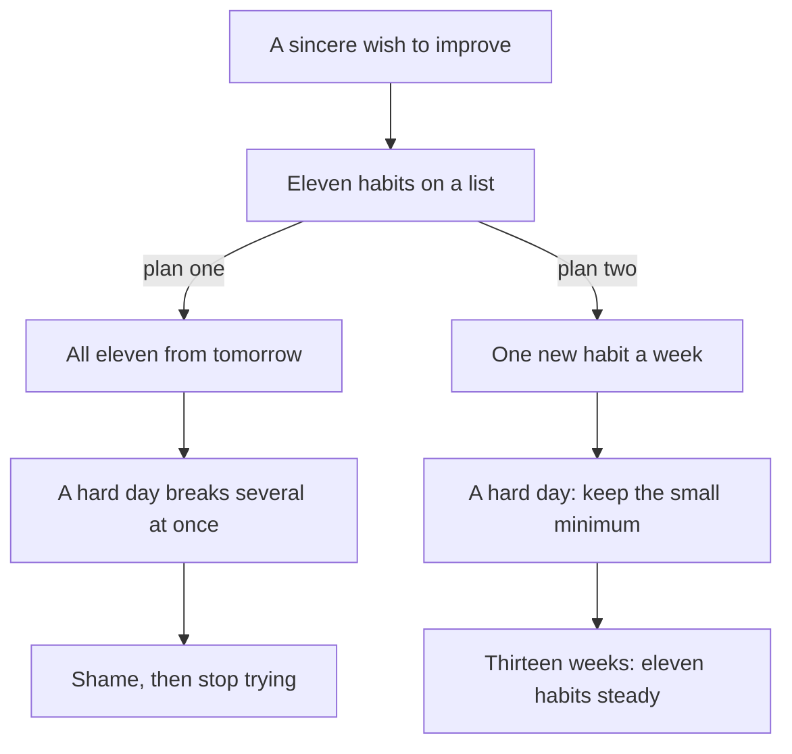

## Nine good days

Hamza is 27. He is a backend developer at a software company. He works in the office three days a week and from home on the other two. He lives with his mother and his wife, Ayesha, in a flat six minutes' walk from the local mosque. He prays all five prayers, most days. He reads the Quran on Fridays and in Ramadan. He knows some of the morning adhkar, the words of remembrance the Prophet, peace be upon him, taught for the start of the day, but he has not said them regularly since school.

One Thursday in September, after a talk at the mosque, Hamza felt a strong pull to change. That night he wrote a list on his phone. He would pray every prayer in the mosque, from the very first takbir. He would read a juz of the Quran every day. He would say the full morning and evening adhkar, the adhkar after every prayer, the last two verses of Surah al-Baqarah and Surah al-Mulk before sleep. Eleven habits, all starting the next morning.

The first three days were wonderful. He woke for Fajr before the alarm. He read his juz after Fajr, which took him almost an hour, so he was late to his first meeting twice. He carried a small book of adhkar in his bag and read it on the bus. He felt lighter and closer to Allah than he had for years.

On day four he had a production bug at work and stayed online until 1:30 at night. He missed Fajr in the mosque and prayed at home after the sun was up. He told himself he would make up the juz in the evening, so that evening he had two juz to read. He read one and fell asleep. On day six he missed Asr in the mosque because of a client call. On day seven he did not open the adhkar book at all. On day nine he looked at his list and felt only shame. He closed the list and did not open it again for two weeks.

## A second, quieter thought

The shame was the worst part. Hamza did not stop praying. He still prayed his five prayers, mostly at home and mostly late. But he stopped trying to improve. A voice in his head said: you are not the kind of person who can do these things. You had nine days and you broke them. People who are serious about their deen do not fall apart after a bug at work.

This thought is common, and it is worth looking at closely, because it is wrong in two ways. First, it treats nine days of eleven habits as a test of Hamza's faith, when it was really a test of a plan. The plan asked a tired man with a full-time job to add about two and a half hours of new worship to his day, starting the next morning. Very few people in any field could keep that up. Second, it treats the missed days as the end of the story. In fact Hamza did a lot of good in those nine days, and none of it was lost.

Before you read on, make a guess about what the Sunnah says.

```predict
prompt: "Hamza wonders which kind of deed Allah loves most. What did the Prophet, peace be upon him, say?"
options:
  - id: consistent
    label: "The most consistent deeds, even if they are small"
  - id: biggest
    label: "The biggest deeds, done with the greatest effort and care"
correctOptionId: consistent
explanation: "The Prophet was asked which deeds are most beloved to Allah. He said: the most consistent of them, even if small, and he told people to take on only the deeds they can manage (Sahih al-Bukhari 6465). Hamza's nine days were big deeds. What he had not yet built was a small deed he could keep."
```

## The book on the shelf

Two weeks later, a friend from work lent Hamza a book: *Atomic Habits* by James Clear. Hamza read the first chapter on the bus. Its main idea is simple. If you get 1% better at something every day, the small gains add up. Clear points out that 1% better every day for a year, as arithmetic, ends about 37 times better than you started. One percent worse every day ends close to nothing. The point is not the exact number. The point is that small, steady changes, kept up, matter more than one big burst.

Hamza laughed when he read it, because he had seen the same idea before, in a hadith he had learned at school and forgotten. The Prophet said that the deeds most beloved to Allah are the most consistent, even if they are small. The book gave him a picture and some tools. The Sunnah gave him the reason.

> أَدْوَمُهَا وَإِنْ قَلَّ

Meaning: (The most beloved deeds are) the most consistent of them, even if small (Sahih al-Bukhari 6465).

So Hamza made a new plan. He opened Notion on his laptop and made a page called "Daily Islamic Habits, 1st October to 30th December". That is thirteen weeks. He copied his list of eleven habits into a table, one row for each. But this time he did not start them all at once. He would add one new habit each week and keep practising the ones he had already added. In week one, only one habit was new. In week two, there were two habits, one of them already a week old. By week eleven, all eleven would be in place, and weeks twelve and thirteen would be for steadying them.

<BigWordAlert term="Istiqamah" plainEnglish="Steadiness: staying on the right way, day after day, without large swings." whyItMatters="This course is about istiqamah in small things. The goal is not a great week of worship but a steady year of it, which grows a little at a time." />

## Why the order matters

The diagram shows the two plans side by side. Both start with the same sincere wish and the same list.



Look first at what the two plans share: the wish and the list are the same. Hamza's intention in September was good, and so was the list. The difference is the shape of the plan. In plan one, a single bad day hits all eleven habits at once, and the damage feels total. In plan two, each habit has had time to settle before the next one arrives, and each has a small minimum for bad days. A bad day still comes, because bad days always come. But it bends the plan instead of breaking it.

## What this course covers

This course follows Hamza through his thirteen weeks, and then through the months after, as the same method spreads from his worship to the whole of his daily life. It gives you the tools to make the same plan for yourself. In the rest of module 1 you will see why small and steady works, in research and in the Sunnah, and how to build your plan one week at a time. You will also look at a worry many sincere people carry: if I track my worship, am I showing off? You will learn to keep your intention for Allah, keep your record private, and still share the good idea with others.

Module 2 is about the five prayers, prayed in congregation from the very first takbir, and how each prayer needs its own plan. Module 3 is about reading the Quran every day, and what to do when a day is missed. Module 4 is the morning and evening adhkar. Module 5 is the adhkar after each prayer, the easiest habit in the course to stack. Module 6 is the two recitations before sleep: the last two verses of Surah al-Baqarah, often called Amana al-Rasul from its first words, and Surah al-Mulk. Modules 7 to 14 widen the plan to the rest of daily life: the Sunnah of ordinary moments such as waking, eating and leaving home; purity and wudu; the heart, with taqwa, ihsan and a clean heart; guarding the tongue, eyes, ears and phone; character with people; family, home and neighbours; time, learning and halal provision; and Jumu'ah, sadaqah and Ramadan. Module 15 brings everything together in your own plan.

Every verse in this course is given with its surah and verse number. Every hadith is given with its collection and number, and with its grading when it comes from outside the two Sahih collections. Where a popular report is weak, the course says so and uses a sound one instead. You can look every hadith up in a hadith app such as Islam 360 or on sunnah.com by its collection and number. Some apps number Sahih Muslim differently, so if a number does not match, search for a few words of the meaning.

<Callout type="info" title="This is not a fiqh course">
The course teaches habits for deeds whose basis is clear in the Quran and Sunnah. It does not give rulings. Where a question is about what is obligatory, what is allowed, or what to do in a special case, ask a scholar you trust.
</Callout>

<LearningObjectives items={["Explain why the most consistent deeds, even if small, are the most beloved to Allah, and connect it to the 1% idea", "Plan to add one habit a week while you keep the others going", "Keep your intention for Allah, keep your tracker private, and share the idea instead of your score", "Build a cue, a plan and a smallest version for each of eleven daily Islamic habits", "Track days done, review once a week, and restart after a missed day without shame"]} />

## Key words

| Word | Plain English |
|---|---|
| **Takbir al-ula** | The first takbir: saying "Allahu akbar" to begin the prayer right after the imam does. In Urdu, *takbir-e-ula* |
| ***Tilawah*** | Reciting the Quran aloud or under your breath. In Urdu, *tilawat* |
| ***Adhkar*** | Words of remembrance of Allah taught in the Quran and Sunnah; one of them is a *dhikr*. In Urdu, *azkar* |
| ***Niyyah*** | Intention: what you are aiming for in your heart when you act |
| ***Riya*** | Showing off: doing a good deed so that people see it and praise you. In Urdu, *riyakari* |
| ***Istiqamah*** | Steadiness on the right way, day after day |

## What is in this module

| Chapter | You will practise |
|---|---|
| 1.2 | Why small and steady works, and planning one new habit a week |
| 1.3 | Keeping your intention for Allah, and sharing the idea, not the score |
| 1.4 | Your list of habits, your first habit, and your privacy rule |

**Next:** Small and steady: the 1% idea, and the Sunnah behind it.
