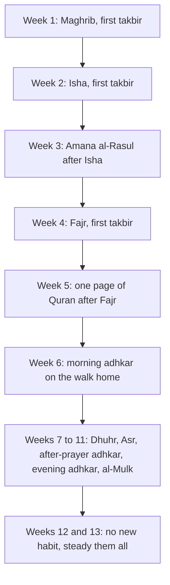

## Why the big start fails

Hamza's September list was full of good deeds. What went wrong was not the deeds but the size of the change. He added about two and a half hours of new worship to a full working day, all at once, starting the next morning. When the first bad day came, every habit took the hit together.

James Clear, in *Atomic Habits*, puts the opposite idea in one picture: small steps, kept up every day, add up to large changes over time. As arithmetic, getting 1% better each day for a year ends about 37 times better than the start. The number is only a picture. Nobody can measure 1% of a prayer or of a heart. But the shape of the picture is useful, and you can test it yourself.

Before you use the canvas, make a guess.

```predict
prompt: "Hamza's year of 1% steps would end at about x37.8 with no bad days. If one day every week slips backwards by 1%, where does the year end?"
options:
  - id: far-ahead
    label: "Still far ahead of where he started"
  - id: back-to-start
    label: "Back near where he started, or even below it"
correctOptionId: far-ahead
explanation: "With one slip day a week, the year still ends at about x13.4. The good days far outnumber the slips. A bad day does not cancel the week, and a bad week does not cancel the year."
```

Move the sliders below. Start with one slip day a week, then try thirty days, then three slip days.

<InteractiveCanvas slug="one-percent-a-day" />

The canvas showed three things. First, one slip day a week leaves the year far ahead, at about x13.4: the habit survives bad days. Second, thirty days of 1% steps end at only about x1.35, which looks like very little. That is why so many people quit in the first month: the change is real but hard to see. Third, three slip days a week still end just above the start. Steady small steps forgive a lot.

## What the Sunnah says about size

The Prophet, peace be upon him, was asked which deeds are most beloved to Allah. He said: the most consistent of them, even if small. And he said: take on only the deeds you are able to do (Sahih al-Bukhari 6465).

> اكْلَفُوا مِنَ الأَعْمَالِ مَا تُطِيقُونَ

Meaning: Take on of deeds only what you are able to do (Sahih al-Bukhari 6465).

In a longer narration, Aisha, may Allah be pleased with her, reports that he said: do the deeds you can manage, for Allah does not grow tired until you grow tired. She adds that the family of the Prophet, when they did a deed, kept it up (Sahih Muslim 782). Notice the order. First, choose a size you can manage. Then keep it. The family of the Prophet did not judge a deed by how impressive it was on day one, but by whether it was still there later.

In another hadith he said that the religion is ease, and no one makes it too hard for himself without being overcome. So aim for what is right, come as close as you can, and be glad (Sahih al-Bukhari 39). "Come as close as you can" is a gentle phrase. It does not ask for perfection on the first day. It asks you to move toward the right thing and keep moving.

<GlossaryTerm term="smallest version" definition="The least you will do on your hardest day, small enough that you can always do it: for example one page instead of five, or three adhkar instead of the full set." />

## One rule this course will not bend

There is one place where "start small" must be read carefully. The five daily prayers are obligatory for every adult Muslim, from today, in full. This course never asks you to add a prayer in week four. What it grows week by week is the *way* the prayers are prayed: on time, with the congregation, from the first takbir, with the adhkar after them. If you are not yet praying all five, begin all five now, at their times, and talk to someone you trust if something makes that hard. Everything else in the course is a voluntary deed that you can build gently.

## One new habit a week

Hamza's new plan has one rule: add one new habit each week, and keep practising the habits you already added. Research on habit forming supports the patience behind this. In a well-known study led by Phillippa Lally in London, people built one small daily habit. The middle time before the habit felt automatic was 66 days, and the range was very wide, from 18 days to a predicted 254. So a habit is not "set" after a week. But a week is long enough for it to stop feeling new, which leaves room for the next one.

The diagram shows Hamza's ladder for the thirteen weeks, as he planned it on 1 October.



Read the ladder from the top and notice how each new habit leans on an old one. Maghrib comes first because Hamza is usually home at that time and the mosque is close, so it is the easiest win. Isha follows the same walk. Amana al-Rasul, only two verses, sits right after Isha, which is now a habit. Fajr comes in week four, after three weeks of better evenings, because Fajr is won the night before. The Quran page sits after Fajr, and the morning adhkar sit on the walk home. Each new habit is attached to one that is already steady.

## How to choose your order

You do not need Hamza's order. You need a rule for making your own. Three questions help.

First, which habit do you nearly do already? Start there. A first week that goes well gives you a reason to continue. For Hamza that was Maghrib. For a student who already reads the Quran on Fridays, it might be a daily page.

Second, what will each new habit attach to? A new habit is easier to keep when it comes right after something you already do every day, in the same place. Clear calls this habit stacking. The prayers are the strongest anchors most Muslims have, because they come five times a day at known times. Many habits in this course are stacked on them.

Third, what is the smallest version? Before you add a habit, write the least you will do on your hardest day. For the Quran it may be one page or five verses. For the evening adhkar it may be one dhikr said three times. On good days you do more. On hard days you do the smallest version, and the habit stays alive.

## Worked example: Sana's ladder

Sana is a third-year computer science student. She lives with her parents and two sisters. She prays all five prayers at home, usually late in their time. Her list has the same eleven habits as Hamza's, but her day is different, so her ladder is different.

**Her first habit.** She often prays Maghrib on time already, because the family eats after it. So week one is Maghrib at the start of its time, at home. The anchor is the adhan on her phone, and her smallest version is simple: pray as soon as she hears it, before anything else.

**Her next habits.** Week two: the adhkar after Maghrib, which come straight after her first habit. Week three: one page of the Quran after the adhkar after Maghrib, because the family's evening meal gives her a fixed time. Week four: Isha at the start of its time. She leaves Fajr at the start of its time until week six, after she has moved her bedtime earlier for two weeks.

**Her rule for adding.** She adds the next habit only if every habit so far was done on at least five of the last seven days. In week five, the Quran page was done only three times, because of exams. She did not add a new habit that week. She cut the page to five verses for the exam weeks and added the next habit a week later. Her ladder was one week longer, and it held.

Notice what Sana's ladder shares with Hamza's. Both start with the habit they nearly do already. Both attach each new habit to a steady one. Both have a smallest version, and both have a rule for when to wait.

## Where people misunderstand it

The first misunderstanding is "small means not serious". The Prophet himself told people to take on only what they could manage, and he praised the deed that lasts. Small and steady is the Sunnah's own way.

The second is "one week per habit means the habit is finished after a week". It is not. A week is enough for a habit to stop feeling new, not to become automatic. You keep practising every habit for the whole thirteen weeks and after.

The third is "if I miss a day, the plan has failed". The canvas showed that slip days bend the line but do not break it. Module 15 teaches exactly what to do after a miss.

## Check your understanding

```quiz
type: mcq
question: "Bilal wants to start reading the Quran daily. He plans a juz every day from tomorrow, because he says a small amount 'is not serious'. Which plan fits Sahih al-Bukhari 6465 best?"
options:
  - "Start with one page a day, and grow it only when it feels easy"
  - "Keep the juz plan, since a big start shows the strongest commitment"
  - "Read one juz a week on Fridays, when he has the most free time"
  - "Wait for Ramadan, when a juz a day will feel natural to keep"
correct: 0
explanations:
  - "Right. A small amount he can keep every day is what the hadith praises. Growing it when it feels easy keeps it within what he can manage."
  - "The Prophet told people to take on only the deeds they can manage, and called the most consistent deeds the most beloved, even if small (Sahih al-Bukhari 6465). A big start that cannot last is the risk, not the strength."
  - "A weekly juz is not wrong, but it is not a daily habit, and one busy Friday removes a whole week. The hadith praises the deed that is kept up."
  - "Waiting delays a good deed he can start today in a small way. Small and steady can begin now."
```

```quiz
type: mcq
question: "Hira is building her ladder. She prays Fajr late most days, but she almost always prays Dhuhr on time at university with friends. Which should be her first habit, using this chapter's three questions?"
options:
  - "Fajr on time, because it is the hardest and so the most rewarding to fix"
  - "All five on time from tomorrow, so no prayer is left behind"
  - "Dhuhr on time, because she nearly does it already and has an anchor"
  - "Morning adhkar, because they are short and need no time at all"
correct: 2
explanations:
  - "Fajr may be her most important change, but this chapter starts with the habit you nearly do already, so the first week goes well. Fajr can come later, after its night-before plan is ready."
  - "Her prayers are already obligatory and she prays all five. What she is building is praying them on time, and adding that to all five at once is the big start that broke Hamza's plan."
  - "Right. She nearly does it already, it has an anchor (her friends at university), and a good first week gives her a reason to continue."
  - "The adhkar are a good habit, but they are not the one she nearly does already, and the question asks for her first step using the three questions."
```

## This week

Write your own list of the habits you want to build, using the eleven in this course or your own. Next to each one, write what it could attach to. Then circle the one you nearly do already. That is your week one habit, and the gate in chapter 1.4 asks for it.

**Next:** Intention, and the fear of showing off.
