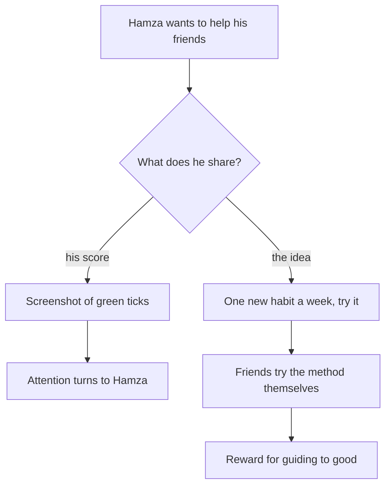

## Day 21

By the third week of his new plan, Hamza's Notion page looks beautiful. Maghrib and Isha with the first takbir: green, every day. Amana al-Rasul after Isha: green. He takes a screenshot and opens his friends' group chat. His thumb stops over the send button.

He asks himself why he wants to send it. Partly, he tells himself, to encourage his friends. But he is honest enough to notice another reason. He wants them to reply "MashaAllah, Hamza". He wants them to see him as the friend who is serious about his deen. And he feels a little sick, because he remembers a word his grandmother used: *riyakari*, showing off. He wonders whether the whole tracker is a mistake. Maybe worship should never be counted at all.

Before you read on, make a guess.

```predict
prompt: "Hamza fears that showing off could spoil his worship. Is the danger in being seen while doing a good deed, or in why the deed is done?"
options:
  - id: why
    label: "In why the deed is done"
  - id: seen
    label: "In being seen while doing it"
correctOptionId: why
explanation: "Actions are judged by intentions (Sahih al-Bukhari 1). Many good deeds are seen by people by their nature, such as prayer in congregation. Showing off is doing a deed so that people see it. The danger is in the aim, not in the eyes."
```

Step through the canvas below. It follows Hamza's week three, from the private tick to the screenshot he did not send.

<InteractiveCanvas slug="share-the-idea-not-the-score" />

The canvas showed one person meeting the pull to be seen, and turning it into something better. He checked his intention, kept the record private, and shared the idea without his score. Praise came anyway, unasked, and he kept going. Each step has a source, and the rest of this chapter goes through them.

## Intention comes first

The Prophet, peace be upon him, said that actions are only by intentions, and each person will have what he intended (Sahih al-Bukhari 1).

> إِنَّمَا الأَعْمَالُ بِالنِّيَّاتِ، وَإِنَّمَا لِكُلِّ امْرِئٍ مَا نَوَى

Meaning: Actions are only by intentions, and each person will have what he intended (Sahih al-Bukhari 1).

This hadith is not a warning only. It is also good news. The same prayer, prayed for Allah, is worship. The same tracker, kept to help you worship Allah better, is a tool for worship. Hamza does not need to stop tracking. He needs to know what the tracker is for.

## What showing off is

*Riya* (showing off) is doing a good deed so that people see it and praise you. The Quran describes, among those who are blamed, people who pray but are careless about their prayer, and who do deeds to be seen (Quran 107:4 to 6). It says that whoever hopes to meet his Lord should do good deeds and not join anyone with Him in His worship (Quran 18:110).

The Prophet warned in strong words. Whoever does a deed so that people hear of it, Allah will make his real aim heard; whoever does a deed to be seen, Allah will show his real aim (Sahih al-Bukhari 6499). And he reported that Allah said: I am the One most free of need of any partner. Whoever does a deed in which he joins someone else with Me, I leave him and his partner (Sahih Muslim 2985).

These are serious texts, and they explain why Hamza's grandmother used the word with such care. But notice what they describe. Every one of them is about the aim of the deed: doing it to be seen, to be heard of, to share it with someone other than Allah. None of them says that a deed someone happens to see is spoiled.

## Being seen is not the same as showing off

Many good deeds are public by their nature. Prayer in congregation is done in a row of people. The adhan is called aloud. The Prophet himself prayed in front of his companions every day. If being seen spoiled a deed, the congregational prayer could never be prayed. So the fear of being seen cannot be a reason to stop praying in the mosque.

The Prophet was also asked about a man who does a good deed and people praise him for it. He said: that is the glad tidings of the believer, given early (Sahih Muslim 2642). Praise that comes without being sought does not spoil the deed. What matters is whether the deed was done for the praise.

There is also a place for deeds kept hidden. Among the seven whom Allah will shade on the Day when there is no shade but His, the Prophet named a person who gives charity so quietly that his left hand does not know what his right hand gave, and a person who remembers Allah alone and his eyes fill with tears (Sahih al-Bukhari 1423). Private worship has its own special worth. That is why this course asks you to keep your tracker private.

## The fix is in the heart, not in quitting

Here is the trap Hamza nearly fell into. Afraid of showing off, he thought of deleting the tracker, and even of praying at home so that nobody would see him walk to the mosque. That would not cure the problem. It would only remove a good deed. The cure the texts point to is the intention: notice the pull to be seen, turn your aim back to Allah, and carry on with the deed. You may need to do this many times. That is normal, and it is part of the work.

Some practical rules make the work easier. Keep your tracker where only you can see it. Do not post screenshots, streaks or counts of your worship. If you use an accountability partner, choose one person you trust and share only what helps you, such as "I keep missing Fajr", not your full record. And notice one warning sign in yourself: if you do more when people are watching and less when you are alone, that is the moment to renew your intention.

## Share the idea, not the score

Hamza still wants his friends to benefit. That wish is good. The Prophet said that whoever guides someone to good has a reward like the one who does it (Sahih Muslim 1893).

> مَنْ دَلَّ عَلَى خَيْرٍ فَلَهُ مِثْلُ أَجْرِ فَاعِلِهِ

Meaning: Whoever guides to something good has a reward like that of the one who does it (Sahih Muslim 1893).

So Hamza does not send the screenshot. Instead he writes in the group: "I read that 1% a day adds up, so I am adding one Islamic habit a week. Try it." He shares the method. He does not share his ticks, his streak or his list. The idea can help ten friends. His score would only show them Hamza.

The diagram shows the difference between the two messages Hamza could send.



Both messages start from the same good wish. The difference is what travels. On the left, the screenshot carries Hamza's record, and the attention it brings lands on him. On the right, the idea carries the method, and the friends who use it build their own habits for Allah. That second road is the one Sahih Muslim 1893 describes.

## Worked example: Usman's study circle

Usman leads a small weekly Quran circle with five friends. One week a friend says: "Usman, you always know the adhkar. How do you remember them?" Follow his reasoning.

**What he notices.** He feels pleased, and he notices the feeling. Being asked is not showing off. The question is what he does next.

**What he shares.** He explains the method: one dhikr a week, on a card in his wallet, said on the walk to work. He offers to make a card for anyone who wants one. He does not say how many weeks he has kept it, or how many adhkar he now knows.

**What he keeps private.** His own tracker stays on his phone. When a friend asks to see it, he smiles and says, "It is just ticks. Make your own, it works better."

**What he does afterwards.** On the walk home he renews his intention. If the pleased feeling comes back the next week, he renews it again. He does not stop leading the circle.

## Where people misunderstand it

The first misunderstanding is "tracking worship is showing off". A private record kept to help you worship better is a tool, and its value depends on the intention behind it.

The second is "if people might see me, I should stop". Many deeds are public by nature, and unsought praise is glad tidings (Sahih Muslim 2642). The cure for a worried heart is a renewed intention.

The third is "sharing anything about my worship is riya". Sharing a good idea so others can benefit is guiding to good (Sahih Muslim 1893). What you guard is your own score.

## Check your understanding

```quiz
type: mcq
question: "Talha prays Isha in the mosque every night. A neighbour says, 'MashaAllah, I always see you at Isha.' Talha feels pleased, and then afraid that he is showing off. He thinks of praying Isha at home. What does this chapter suggest?"
options:
  - "Pray Isha at home for a while, so that nobody sees him and praises him"
  - "Ask the neighbour not to mention it again, so the deed stays hidden"
  - "Keep going, and treat the praise as proof that his deed was accepted"
  - "Keep going to the mosque, and renew his intention when it comes"
correct: 3
explanations:
  - "Leaving the mosque removes a good deed and does not fix the heart. Prayer in congregation is seen by people by its nature."
  - "There is no need. The neighbour's kind words do not spoil the deed. What matters is why Talha goes."
  - "He should keep going, but praise is not proof of acceptance. Only Allah knows what He accepts."
  - "Right. Praise he did not seek is glad tidings for the believer (Sahih Muslim 2642). The cure for the worry is a renewed intention, not leaving the deed."
```

```quiz
type: mcq
question: "Noor has kept a private tracker for six weeks. Her cousin asks how she started reading the Quran every day. Which reply fits Sahih Muslim 1893 and this chapter best?"
options:
  - "Send her the tracker so she can see the full six weeks of ticks"
  - "Explain the method, one page after Fajr, and offer to help"
  - "Say nothing, because talking about her worship could be showing off"
  - "Tell her she reads every day now and has not missed for six weeks"
correct: 1
explanations:
  - "The tracker carries Noor's own score. The cousin needs the method, not the record."
  - "Right. She shares the idea and the help, which can benefit her cousin, and she keeps her own record private."
  - "Saying nothing loses a chance to guide to good, which has its own reward (Sahih Muslim 1893)."
  - "Telling her score is not needed for the cousin to start, and it turns the talk toward Noor."
```

## This week

Decide where your tracker will live and who can see it. Write one line you will say to yourself when you feel the pull to be seen, for example: "Who is this for?" You will need both in the gate.

**Next:** The module 1 checklist and learning log.
