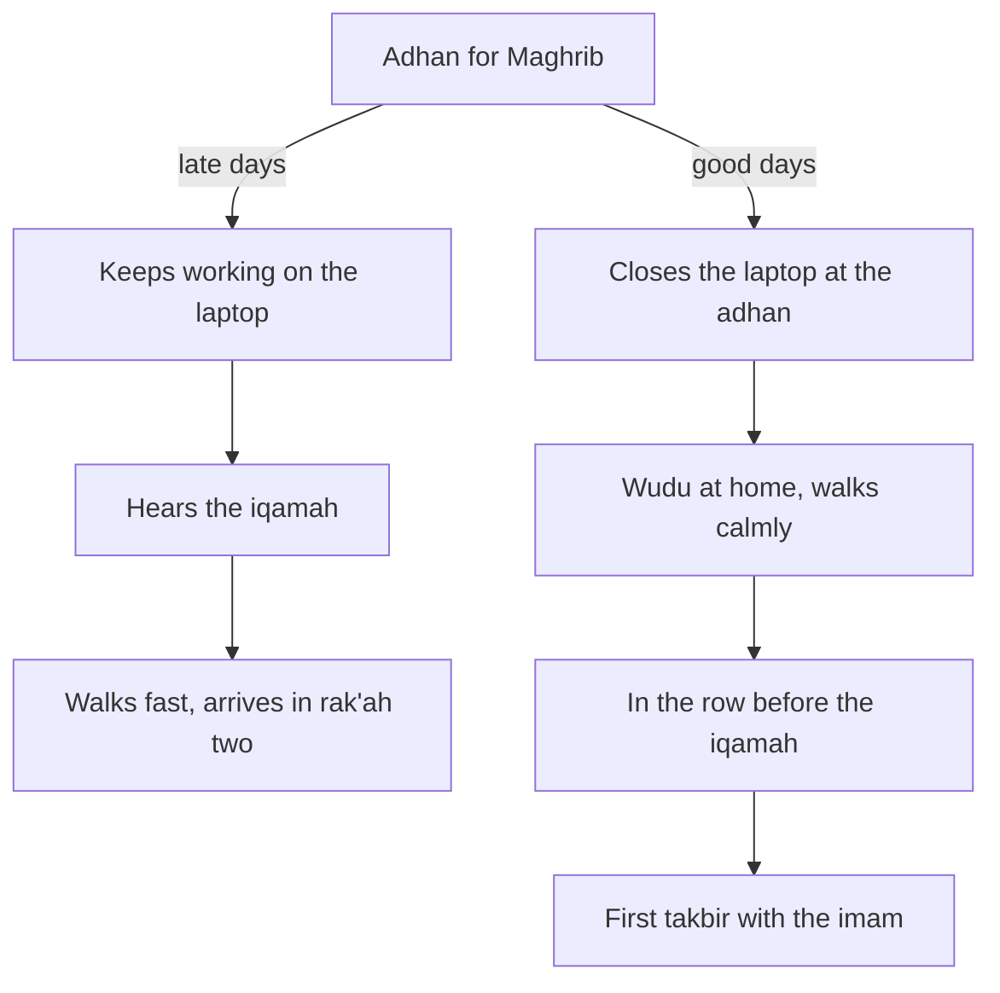

## An honest week

Before week one of his plan begins, Hamza does something he has never done. For seven days he writes down, after every prayer, three things: where he prayed, whether he was with the congregation, and at which point he joined. He does not change anything that week. He only writes. He wants to see the truth before he tries to improve it.

By the end of the week his page has thirty-five lines. He prayed every one of the thirty-five prayers, alhamdulillah. But only six of them were with the congregation from the first takbir, the moment the imam says "Allahu akbar" to begin and the people behind him follow. Eleven times he joined the congregation late, in the second or third rak'ah. Eighteen times he prayed alone, at home or at his desk, often late in the prayer's time.

Writing it down was harder than he expected. Twice he caught himself wanting to round a late prayer up to "with the congregation", because the truth felt small. He wrote the truth anyway. A record that flatters you cannot help you, and nobody else would ever see this page.

He reads the page twice. Then he notices something he did not expect. The thirty-five lines are not one problem. They are five different problems, one for each prayer.

## Five prayers, five stories

**Fajr.** On five of the seven days he prayed Fajr alone at home, twice after he had already overslept the congregation. On those nights he went to sleep after midnight. Twice his phone was in his bed, and he had been watching videos until his eyes closed. On the two days he did catch the first takbir, he had slept before 23:00.

**Dhuhr.** On office days he prayed Dhuhr at his desk, alone, late in its time, because the time fell in the middle of meetings. There is a prayer room on the fourth floor where several colleagues pray together at 13:30. He has walked past it many times.

**Asr.** Asr was the worst. It falls at his busiest hour, when tickets pile up and the team lead wants updates. Four times he prayed it with only a few minutes of its time left. Once he almost missed it.

**Maghrib.** Maghrib was his best prayer. He is usually home, the mosque is six minutes away, and he caught the first takbir four times. The other three times he joined in the second rak'ah. Each time he had left the flat when he heard the iqamah, the second call that means the prayer is starting now.

**Isha.** Isha went the same way as Maghrib: mostly in the mosque, mostly late. He would finish dinner, check his phone, hear the iqamah, and walk fast.

## The thought that came next

Looking at the page, Hamza feels two things. First, gratitude: he prayed all thirty-five, and some weeks in his life he has not. Second, a small, honest embarrassment. Six out of thirty-five is not what he imagined about himself.

Then a familiar thought arrives: "I pray all five, so this is fine. The first takbir is extra. Allah sees that I prayed." Part of this is true. He did pray, and prayers prayed alone and late are still prayers. But part of it is a way of not looking. The page shows something specific and fixable. In most cases Hamza was not too far away or too busy to join from the start. He simply left at the wrong moment.

Before you read on, make a guess.

```predict
prompt: "Hamza joined Maghrib late three times out of seven. Each time, when did he leave the flat?"
options:
  - id: iqamah
    label: "When he heard the iqamah, the call that the prayer is starting"
  - id: adhan
    label: "When he heard the adhan, the first call that the prayer time has begun"
correctOptionId: iqamah
explanation: "He left at the iqamah, when the prayer was already about to begin. A six-minute walk cannot beat a call that means 'now'. The first takbir is decided at the adhan, several minutes earlier."
```

## Where the first takbir is really decided

The diagram shows Hamza's Maghrib on the days he joined late, and on the days he caught the first takbir.



Look at where the two paths split. They split at the adhan, not at the iqamah. On the late days, the iqamah was the signal that made Hamza move, and by then nothing could save the first takbir except running, which the Sunnah tells us not to do. On the good days, the adhan was the signal. The walk was the same length. The mosque was the same distance away. Only the starting signal changed.

This is the first lesson of module 2, and it is a habit lesson as much as a lesson about prayer. Every habit has a cue, the moment that starts it. If your cue comes too late, no amount of effort afterwards will fix the habit. For the first takbir, the cue is the adhan.

## What Hamza decides for week one

Hamza could try to fix all five prayers on 1 October. He remembers September and does not. His ladder from module 1 says week one is Maghrib, so he looks only at Maghrib. It is already his best prayer: four of seven with the first takbir. The other three days fail at one point, the moment he hears the adhan and keeps typing. So his whole plan for week one is a single line: "If I hear the adhan for Maghrib, then I close the laptop and make wudu."

He also decides what he will not do. He will not run. He will not feel guilty about the other four prayers this week; he will keep praying them as he does now, and their turn will come. And he will keep writing the three things after every Maghrib: where, with whom, and when he joined. The page he wrote this week becomes the "before" picture. In seven days he will have an "after" to compare it with.

At the end of week one, his Maghrib line reads seven of seven with the first takbir. He did not become a different person in a week. He moved one cue by five minutes. The rest of this module shows how to do the same for every prayer, one at a time, in the order your own week shows you.

## Why this matters

Praying in congregation is one of the great acts of worship that Muslims share. The Prophet, peace be upon him, said that the prayer in congregation is better than the prayer alone by twenty-seven degrees (Sahih al-Bukhari 645). Chapter 2.2 looks at what the sound sources say about congregation, about Fajr and Isha in particular, and about the first takbir itself, including one popular hadith whose grading scholars differ on.

Many people who read this course will not pray in a mosque every day, and some never will. Women, people who live far from a mosque, people whose work keeps them away from it, and people who are ill all build a version of this habit too. Chapter 2.2 gives that version clearly. The core of it is the same for everyone: pray at the start of the time, from the first moment you can, with your whole attention.

<Callout type="info" title="Questions of fiqh">
Who must pray in the mosque, what counts as catching the congregation, and what to do in special cases are questions of fiqh, and schools of law differ on some of them. This course does not rule on them. Ask a scholar you trust.
</Callout>

## What this module covers

In chapter 2.2 you will learn what the first takbir is, why it is caught at the adhan, and why walking with calm is part of the Sunnah, not an obstacle to it. In chapter 2.3 you will give each of the five prayers its own cue and plan, including how Fajr is won the night before, and how to protect Dhuhr and Asr at work or university. Chapter 2.4 adds the small habits around and inside each prayer: answering the adhan, a careful wudu, the sunnah prayers and khushu. Chapter 2.5 is a short quiz. In chapter 2.6 you will write a plan for the one prayer you find hardest to join from the start.

<LearningObjectives items={["Explain what catching the first takbir means, and why it is decided at the adhan, not at the iqamah", "Use the sound sources on congregation, Fajr and Isha, and say where a popular hadith on the first takbir has a disputed grading", "Walk to the prayer with calm, as the Sunnah teaches, and complete what you missed when you are late", "Build the version of this habit that fits you, in the mosque, at home or at work", "Give each of the five prayers its own cue, obstacle and if-then plan, with Fajr planned the night before"]} />

## Key words

| Word | Plain English |
|---|---|
| **Adhan** | The first call to prayer, which tells you the prayer's time has begun |
| ***Iqamah*** | The second call, said just before the congregation starts the prayer |
| **Takbir al-ula** | The first takbir: the "Allahu akbar" that begins the prayer, said right after the imam |
| ***Jama'ah*** | The congregation: praying together behind an imam. In Urdu, *jamaat* |
| ***Rak'ah*** | One unit of the prayer, from standing to the end of the second prostration |
| **If-then plan** | A plan that names an exact moment and an exact action: "If X happens, then I do Y" |

## What is in this module

| Chapter | You will practise |
|---|---|
| 2.2 | What the first takbir is, and catching it at the adhan with calm |
| 2.3 | A cue and an if-then plan for each of the five prayers |
| 2.4 | Around and inside the prayer: the adhan, wudu, the sunnah and khushu |
| 2.5 | A short quiz with five cases |
| 2.6 | A written plan for your hardest prayer |

**Next:** The first takbir: what it is, what the sources say, and how it is caught.
