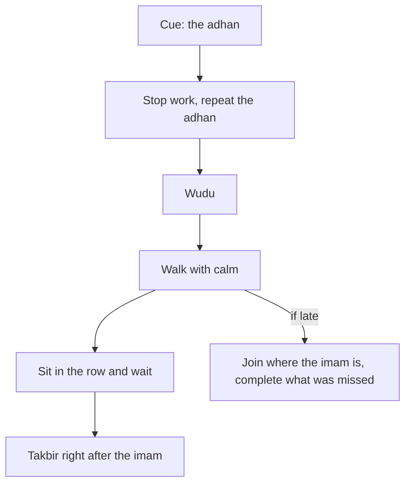

## What "the first takbir" means

Every prayer begins with a takbir: "Allahu akbar", Allah is the Greatest. In congregation, the imam says it first and the people behind him say it after him. The Prophet, peace be upon him, said that the imam is there to be followed: when he bows, bow; when he prostrates, prostrate (Sahih al-Bukhari 722). So "catching the first takbir" means being in the row, ready, when the imam begins, and saying your own opening takbir straight after his. In Urdu this is called *takbir-e-ula*.

Hamza's honest week in chapter 2.1 showed that he usually missed it by a few minutes, not by a long way. That is good news, because a few minutes is something a habit can fix. Before you step through his Maghrib, make a guess.

```predict
prompt: "Hamza leaves late and hears the imam begin while he is still on the street, 100 metres away. What does the Sunnah tell him to do?"
options:
  - id: walk
    label: "Walk with calm, join where the imam is, and complete what he missed"
  - id: run
    label: "Run the last stretch, so that he can still catch the first takbir with the imam"
correctOptionId: walk
explanation: "The Prophet said: when you hear the iqamah, walk to the prayer with calm and dignity, do not rush; pray what you catch and complete what you missed (Sahih al-Bukhari 636). The first takbir is caught by leaving early, not by running."
```

Step through the canvas below. It follows one Maghrib, from the adhan to the first takbir, and one late evening.

<InteractiveCanvas slug="adhan-to-first-takbir" />

The canvas showed that the first takbir was decided at the adhan, when Hamza closed his laptop, not at the iqamah. It also showed the late day: he did not run, he joined where the imam was, and he made a plan for tomorrow. Both days were acts of worship. One was set up by a better cue.

## What the sound sources say about congregation

The Prophet said that the prayer in congregation is better than the prayer of a person alone by twenty-seven degrees (Sahih al-Bukhari 645).

> صَلاَةُ الْجَمَاعَةِ تَفْضُلُ صَلاَةَ الْفَذِّ بِسَبْعٍ وَعِشْرِينَ دَرَجَةً

Meaning: The prayer in congregation is better than the prayer of one alone by twenty-seven degrees (Sahih al-Bukhari 645).

Two prayers are given special mention. Uthman ibn Affan, may Allah be pleased with him, reported that the Prophet said: whoever prays Isha in congregation, it is as if he prayed half the night; and whoever prays Fajr in congregation, it is as if he prayed the whole night (Sahih Muslim 656). And in another hadith he said that if people knew what is in the first row, and in going early to the prayer, they would race for it; and if they knew what is in Isha and Fajr, they would come to them even crawling (Sahih al-Bukhari 615).

The time in between also counts. The Prophet said that while a person sits in his place of prayer waiting for the prayer, the angels say: O Allah, forgive him; O Allah, have mercy on him, and that he is counted as in prayer for as long as the prayer is what keeps him there (Sahih al-Bukhari 659). He also named three things that wipe away sins and raise ranks: wudu done well when it is hard, many steps to the mosques, and waiting for one prayer after another (Sahih Muslim 251). So the minutes Hamza spends in the row before the iqamah are not wasted waiting. They are part of the worship.

## A popular hadith, and its grading

Many people know a hadith about the first takbir in particular. It is in Jami' at-Tirmidhi (241), from Anas ibn Malik, may Allah be pleased with him: whoever prays for Allah for forty days in congregation, catching the first takbir, two freedoms are written for him: freedom from the Fire and freedom from hypocrisy.

This hadith is popular, and it may be the reason you know the phrase *takbir-e-ula* at all. It is important to know how scholars graded it. Al-Albani and Ahmad Shakir graded it hasan (sound). But at-Tirmidhi himself, right after reporting it, said that it is also reported as the words of Anas rather than of the Prophet, and that he knew only one chain that attributed it to the Prophet. Other scholars, such as Zubair Ali Zai, graded it weak. So its grading is disputed.

This course therefore does not build the habit on that hadith alone. If your scholar accepts it, it is a beautiful encouragement. Either way, the habit stands on the sound hadith you have just read: the twenty-seven degrees of congregation, the special worth of Fajr and Isha in congregation, the instruction to follow the imam, and the worth of waiting for the prayer. Catching the first takbir is simply the most complete way of praying with the congregation: all of it, from its first word.

## Walk, do not run

Here is a surprise for many people who try to build this habit. The Sunnah does not want you to catch the first takbir by running. The Prophet said: when you hear the iqamah, walk to the prayer, and keep to calm and dignity, and do not rush. Pray what you catch, and complete what you missed (Sahih al-Bukhari 636).

> إِذَا سَمِعْتُمُ الإِقَامَةَ فَامْشُوا إِلَى الصَّلاَةِ، وَعَلَيْكُمْ بِالسَّكِينَةِ وَالْوَقَارِ وَلاَ تُسْرِعُوا، فَمَا أَدْرَكْتُمْ فَصَلُّوا وَمَا فَاتَكُمْ فَأَتِمُّوا

Meaning: When you hear the iqamah, walk to the prayer with calm and dignity, and do not rush. Pray what you catch, and complete what you missed (Sahih al-Bukhari 636).

This hadith changes the whole habit. If you cannot run, the only way to catch the first takbir is to leave earlier. The decision moves from the last minute to the first. That is exactly what Hamza found in his honest week: the late days were the days he moved at the iqamah. And on a day you are late anyway, the hadith also tells you what to do: walk calmly, join, and complete what you missed. A late day is not a failed day.

The diagram shows the habit as a chain of small steps, and the one cue that starts it.



The chain has one entry point: the adhan. Every later step depends on it. The side branch shows that a late day still ends in prayer with the congregation, done calmly. So the whole habit can be written as one if-then plan: if I hear the adhan, then I stop what I am doing and make wudu.

## The same habit for women and for anyone at home or at work

Many readers will not pray in a mosque every day. Women may go to the mosque: the Prophet said, do not stop the female servants of Allah from the mosques of Allah (Sahih al-Bukhari 900). Many women pray at home, and that prayer is fully valid and rewarded. Questions about where it is better for whom to pray belong to fiqh, so ask a scholar you trust.

For anyone praying at home or at work, the habit has the same shape with a different last step. Abdullah ibn Mas'ud, may Allah be pleased with him, asked the Prophet which deed is most beloved to Allah. He said: the prayer at its time (Sahih al-Bukhari 527). So the home version is: if I hear the adhan, then I stop, make wudu and pray at the start of the time, on my prayer mat in my usual place. If others are at home, such as family members or flatmates, many people pray together. At the office or university, many people join a small congregation in a prayer room.

## Worked example: Fatima's version

Fatima is a product designer who works from home. She prays at home. Her habit is the start of the time, with the same chain as Hamza's.

**Her cue.** The adhan app on her laptop, set to play at a low volume. She used to mute it during work.

**Her steps.** She stops at the adhan, saves her file and makes wudu. Her prayer mat stays laid out in the corner of her room, so starting takes one step.

**Her obstacle.** Video calls. If a call is running at the adhan, she says, "I need ten minutes at the next break," and prays then, still early in the time.

**Her late day.** One Asr, a client call runs long. She prays when it ends, still within the time, calmly. Then she moves the call slot for the next week.

Fatima's habit and Hamza's are the same chain: one cue, a few small steps, and a plan for the late day.

## Check your understanding

```quiz
type: mcq
question: "Saad usually leaves for Isha when he hears the iqamah. The mosque is four minutes away, and he joins in the second rak'ah. He decides to start jogging to catch the first takbir. What does this chapter suggest?"
options:
  - "Jog, because the first takbir is worth the extra effort"
  - "Keep his timing, since joining in rak'ah two is still praying"
  - "Leave at the adhan, and walk to the prayer with calm"
  - "Pray at home for now, until he can arrive before the iqamah"
correct: 2
explanations:
  - "The Prophet told us to walk to the prayer with calm and not rush (Sahih al-Bukhari 636). The fix is an earlier cue, not a faster walk."
  - "Joining late is still prayer in congregation, and he completes what he missed. But he wants the first takbir, and an earlier cue gives it to him with little cost."
  - "Right. The first takbir is decided at the adhan. Leaving then gives him time to walk calmly and wait in the row (Sahih al-Bukhari 636 and 659)."
  - "Praying at home loses the congregation he already reaches. A small change in when he leaves fixes the habit."
```

```quiz
type: mcq
question: "Zainab prays at home. Her friend tells her that the first takbir 'is only for men, so there is nothing for her to build'. Which reply fits this chapter?"
options:
  - "She can build the same habit: pray at the start of the time"
  - "Her friend is right, so she should choose a different habit"
  - "She should pray in the mosque, or the habit does not count"
  - "She can follow the forty-day hadith, praying alone at home for forty days"
correct: 0
explanations:
  - "Right. The same chain works at home: the adhan as cue, wudu, and prayer at the start of the time (Sahih al-Bukhari 527)."
  - "There is a home version of this habit with a sound source: the prayer at its time is the deed most beloved to Allah (Sahih al-Bukhari 527)."
  - "Women may go to the mosque (Sahih al-Bukhari 900), and prayer at home is fully valid. Where it is better for her to pray is fiqh, for a scholar."
  - "That hadith, whose grading is disputed (Jami' at-Tirmidhi 241), speaks of congregation. The home habit stands on Sahih al-Bukhari 527."
```

## This week

Choose one prayer this week. Write one line: "If I hear the adhan for ___, then I ___." Then try it every day, and notice on which days the cue comes and you do not move.

**Next:** A plan for each prayer, starting with Fajr the night before.
