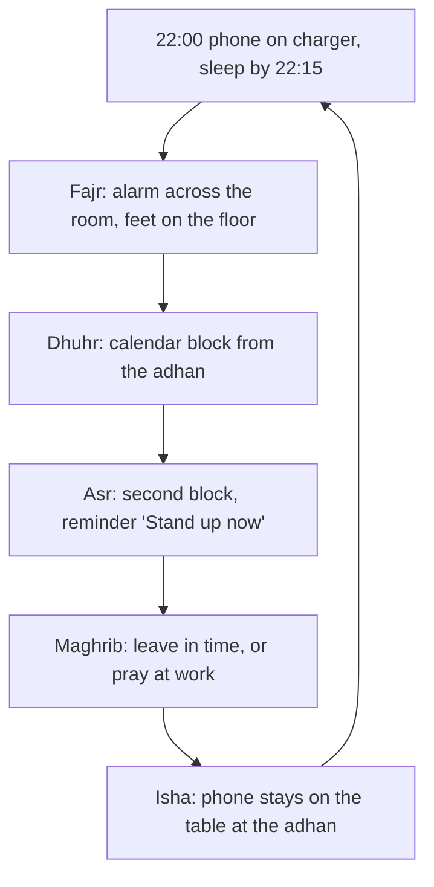

## One plan is not enough

Hamza's honest week showed five different problems: late nights before Fajr, meetings at Dhuhr, the busiest hour at Asr, a short window at Maghrib and a phone after dinner at Isha. A single rule such as "try harder to pray on time" would not fix any of them. Each prayer needs its own small plan, written for the moment it falls in.

The Prophet, peace be upon him, gave a picture of what the five prayers do in a day. He asked his companions: if there were a river at the door of one of you and he bathed in it five times every day, would any dirt remain on him? They said no. He said: that is the example of the five prayers; by them Allah wipes away sins (Sahih al-Bukhari 528). Five times, every day, in the middle of ordinary life. That is why each one needs a plan that fits its own part of the day.

Before you step through Hamza's office day, make a guess.

```predict
prompt: "Hamza's plan for the five prayers starts at a particular moment of the day. When does the plan for Fajr begin?"
options:
  - id: night
    label: "The night before, when he puts his phone away and goes to sleep"
  - id: alarm
    label: "When the alarm rings in the morning, a little before the Fajr adhan"
correctOptionId: night
explanation: "Fajr is mostly won or lost the night before. A man who sleeps at 00:30 with his phone in his bed is fighting Fajr with very little sleep. A man who sleeps at 22:45 with the alarm across the room has set himself up to stand."
```

Step through the canvas below. It follows Hamza through one office day, prayer by prayer.

<InteractiveCanvas slug="five-prayers-one-day" />

The canvas showed one obstacle and one plan for each prayer. Fajr began the night before, with the phone on the charger and the alarm across the room. Dhuhr and Asr were protected by blocks in his calendar. Maghrib needed a decision about where to be when Asr ends. And Isha led straight back into tomorrow's Fajr.

## Fajr: won the night before

The Prophet said that when one of you sleeps, Satan ties three knots at the back of his head, saying over each one: you have a long night, so sleep. If he wakes and remembers Allah, one knot comes undone. If he makes wudu, another comes undone. If he prays, the third comes undone, and he starts the morning lively and in good spirits; otherwise he starts it in bad spirits and lazy (Sahih al-Bukhari 1142).

> فَإِنِ اسْتَيْقَظَ فَذَكَرَ اللَّهَ انْحَلَّتْ عُقْدَةٌ، فَإِنْ تَوَضَّأَ انْحَلَّتْ عُقْدَةٌ، فَإِنْ صَلَّى انْحَلَّتْ عُقْدَةٌ

Meaning: If he wakes and remembers Allah, a knot is undone; if he makes wudu, a knot is undone; if he prays, a knot is undone (Sahih al-Bukhari 1142).

The hadith gives the morning in three small steps: remember Allah, make wudu, pray. Each one is short. That makes it a perfect if-then chain: if the alarm rings, then my feet go on the floor and I say "Alhamdulillah"; then wudu; then the walk.

But the hadith also describes a fight with sleep, and sleep is mostly decided earlier. Hamza works backwards. Fajr congregation in October is around 5:15 in his city. He needs about seven hours of sleep to be well. So he should be asleep by about 22:15, which means his phone goes on the charger in the hall at 22:00. That one line, "the phone goes on the charger at 22:00", does more for his Fajr than any alarm.

Three more things help many people. Put the alarm across the room, so you must stand to stop it. Lay out your clothes and keep the wudu area clear. And if someone in your home already wakes for Fajr, ask them to knock on your door, kindly, until your habit is steady.

If you oversleep anyway, pray as soon as you wake. The Prophet said: whoever forgets a prayer or sleeps through it, its expiation is to pray it when he remembers it (Sahih Muslim 684). Then look at what happened the night before, and change one thing.

## Dhuhr and Asr: protected at work

At work and university, the problem is rarely the distance to a prayer room. It is meetings, deadlines and the feeling that stopping is not allowed. Allah says: guard the prayers, and the middle prayer, and stand before Allah in devotion (Quran 2:238).

> حَافِظُوا عَلَى الصَّلَوَاتِ وَالصَّلَاةِ الْوُسْطَىٰ وَقُومُوا لِلَّهِ قَانِتِينَ

Meaning: Guard the prayers, and the middle prayer, and stand before Allah in devotion (Quran 2:238).

"Guard" is an active word. You guard something by planning around it before the danger comes. At work, that means a recurring block in your calendar from the adhan time, labelled plainly, for example "Dhuhr, 20 minutes". Most colleagues will book around it. If a meeting runs into the time, you can say: "I need ten minutes at the next break for prayer." Asr usually needs a second block and often a stronger reminder, because it falls at the busiest hour. Hamza's reminder says only "Stand up now". It works because it names the first action, not a feeling.

## Maghrib and Isha: the evening pair

Maghrib's time is short and it often falls during the commute. The plan is a decision made earlier: "On office days, if I am still at work when Asr is prayed, then I leave in time to reach the mosque near home, or I pray Maghrib with colleagues at the office." Isha is easier in time but harder in attention, because the phone is out after dinner. Hamza's Isha plan: if I hear the adhan for Isha, then the phone stays on the table and I make wudu. And because Isha leads into the night, his Isha plan ends with the phone going on the charger when he comes home.

The diagram shows the five plans as one day, with the line that links the end of the day to the next morning.



The arrow from Isha back to the top is the most important line in the diagram. The five prayers are not five separate habits. They are one daily loop, and the end of each day sets up the start of the next. A good Isha evening makes a good Fajr morning, and a late night with the phone breaks both.

## Worked example: Ahmed's night shift

Ahmed works remotely for a company in another time zone. Three nights a week he works from 19:00 to 3:00. His Fajr problem looks different from Hamza's. Follow his reasoning.

**The obstacle.** On shift nights he finishes at 3:00 and Fajr congregation is at 5:15. If he sleeps at 3:30, he misses Fajr. If he stays awake, he is exhausted at work the next evening.

**The plan he chose.** On shift nights, he stays up after 3:00 and uses the time for a short rest without sleeping, his Quran page and the morning adhkar. He prays Fajr with the congregation and sleeps straight after, until Dhuhr. On non-shift nights he sleeps early, as Hamza does.

**His if-then lines.** "If my shift ends at 3:00, then I do not lie down until after Fajr." "If I hear the adhan for Dhuhr, then I get up, pray, and sleep again if I need to."

**What he checks.** After two weeks he reviews his tracker. Fajr in congregation went from one of seven to five of seven. He keeps the plan.

Ahmed's plan is not Hamza's plan, and it does not need to be. The method is the same: find the real obstacle for each prayer, and write one line for the moment it comes.

## Where people misunderstand it

The first misunderstanding is "I just need more willpower for Fajr". Willpower at 5:00 is weakest after a short night. The plan that works moves the effort to 22:00, when it is easy to put a phone on a charger.

The second is "asking for time to pray at work is a burden on others". A short, clear request made in advance, such as a calendar block, is usually easier for colleagues than a sudden disappearance. Many people find their team respects it quickly.

The third is "one plan, once written, lasts all year". Prayer times move with the seasons, and so do the obstacles. Check your five lines at the start of each month.

## Check your understanding

```quiz
type: mcq
question: "Hamza's sister Rida misses Fajr on time about four mornings a week. She sleeps at about 1:00 and her alarm is on her phone, under her pillow. She plans to buy a louder alarm. Which change fits this chapter best?"
options:
  - "Buy the louder alarm, since the problem is that she does not hear it"
  - "Put the phone away by about 22:30 and the alarm across the room"
  - "Set three alarms ten minutes apart on her phone, under the pillow"
  - "Pray Fajr as soon as she wakes, and accept that it will be late"
correct: 1
explanations:
  - "A louder alarm does not change the five hours of sleep. Fajr is mostly won the night before."
  - "Right. An earlier night gives her enough sleep, and an alarm across the room makes her stand, which starts the chain in Sahih al-Bukhari 1142."
  - "More alarms under the pillow are easy to stop without standing, and her sleep stays short."
  - "If she oversleeps she should pray as soon as she wakes (Sahih Muslim 684), but that is the plan for a missed morning, not a plan to stop missing it."
```

```quiz
type: mcq
question: "Kamran's Asr is late most days, because it falls during a daily team meeting that starts at 16:00. He is shy about leaving. Which plan fits this chapter best?"
options:
  - "Pray Asr after the meeting, even if only a few minutes are left"
  - "Pray Asr early, before its time begins, to avoid the meeting"
  - "Make dua each day that the meeting will end sooner than it does"
  - "Block Asr in his calendar and ask to move the meeting"
correct: 3
explanations:
  - "Praying in the last minutes is still valid, but it is the problem he wants to fix. 'Guard the prayers' (Quran 2:238) asks for a plan made before the danger."
  - "A prayer before its time has begun is not valid. The plan must work inside the time."
  - "Dua is good, but this chapter pairs it with a plan he controls: the block and the request."
  - "Right. A block his colleagues can see guards the time in advance, and one honest request is often all it takes to move a meeting by fifteen minutes."
```

## This week

Write one if-then line for each of the five prayers, for your own day. Mark the one that slips most often. You will write a full plan for it in the gate.

**Next:** A short quiz on the five prayers.
