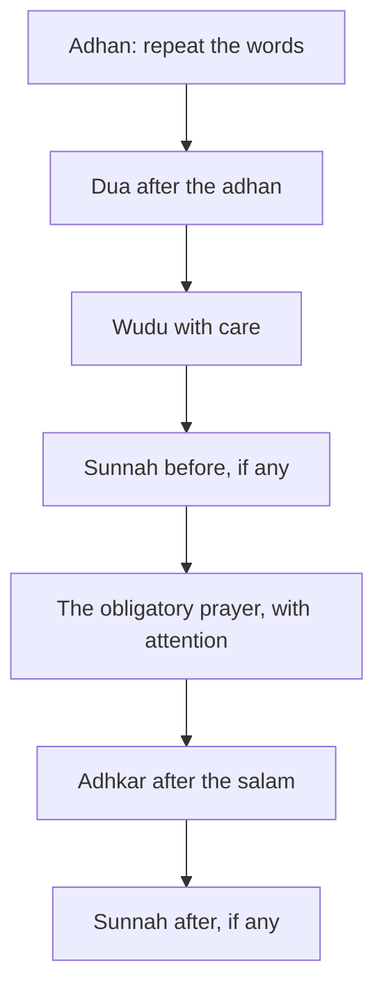

## A prayer on time, and then what?

By the end of his first thirteen weeks, Hamza prays most prayers on time and many with the first takbir. One evening Baba Rashid asks him a gentle question after Isha: "And inside the prayer, son, where is your mind?" Hamza laughs, then admits the truth. On many days he finishes the prayer and cannot remember which surah he recited after al-Fatihah.

Praying on time is the foundation. But the Sunnah surrounds each prayer with small habits that make it fuller: words to say when the adhan is called, a wudu done with care, extra rak'ahs before and after, and attention inside. Each one is small. Each one is attached to the prayer, which already comes five times a day.

Before you step through Hamza's Dhuhr, make a guess.

```predict
prompt: "Sahih Muslim 728 promises a house in Paradise for a number of voluntary rak'ahs prayed each day and night. How many?"
options:
  - id: twelve
    label: "Twelve rak'ahs in a day and night"
  - id: forty
    label: "Forty rak'ahs, one for each day of a habit"
correctOptionId: twelve
explanation: "Whoever prays twelve rak'ahs in a day and night, a house is built for him in Paradise (Sahih Muslim 728). Jami' at-Tirmidhi 415 names them: four before Dhuhr and two after, two after Maghrib, two after Isha and two before Fajr."
```

Step through the canvas below. It follows one Dhuhr, from the adhan to the last sunnah.

<InteractiveCanvas slug="inside-the-prayer" />

The canvas showed five small habits around one obligatory prayer: answering the adhan with its dua, a careful wudu, the sunnah before, attention inside, and the sunnah after. It ended with why the prayer matters so much: it is the first deed a servant will be asked about.

## The first deed

Abu Hurairah, may Allah be pleased with him, reported that the Prophet, peace be upon him, said that the first of a servant's deeds to be reckoned on the Day of Resurrection is his prayer; if it is sound he succeeds, and if it is corrupt he fails and loses (Jami' at-Tirmidhi 413, graded sahih by al-Albani and Ahmad Shakir). The same hadith says that if something is lacking in the obligatory prayers, Allah will say: see whether My servant has any voluntary prayers, and the lack will be made up from them.

That last line is a strong reason for the sunnah prayers. Most people's obligatory prayers have gaps: a distracted rak'ah, a rushed sujud. The voluntary prayers are like a reserve that fills those gaps. They are not a burden added to the obligation. They protect it.

## Answering the adhan

The habit starts before the prayer. The Prophet said: when you hear the call, say what the mu'adhdhin says (Sahih al-Bukhari 611). When he says "Allahu akbar", you say "Allahu akbar"; when he says "Ashhadu an la ilaha illallah", you say the same. Then, after the adhan, the Prophet taught a dua.

> اللَّهُمَّ رَبَّ هَذِهِ الدَّعْوَةِ التَّامَّةِ وَالصَّلاَةِ الْقَائِمَةِ آتِ مُحَمَّدًا الْوَسِيلَةَ وَالْفَضِيلَةَ وَابْعَثْهُ مَقَامًا مَحْمُودًا الَّذِي وَعَدْتَهُ

Meaning: O Allah, Lord of this perfect call and of the prayer about to be established, give Muhammad the wasilah and the excellence, and raise him to the praised station You promised him. Whoever says this when he hears the call will have the Prophet's intercession on the Day of Resurrection (Sahih al-Bukhari 614).

For Hamza this habit is easy to stack, because the adhan is already his cue for wudu (chapter 2.2). Now the adhan also starts two minutes of remembrance: repeat, then the dua, then wudu.

## Wudu with care

Wudu done in a rush is still valid if its parts are done. But the Sunnah invites more. The Prophet said that when a Muslim washes his face in wudu, every sin he looked at with his eyes leaves with the water, or with the last drop; when he washes his hands, every sin his hands did leaves; when he washes his feet, every sin his feet walked to leaves, until he comes out pure from sins (Sahih Muslim 244). Knowing this changes how wudu feels. Each wash is a small tawbah.

## The twelve rak'ahs

The twelve sunnah rak'ahs are a habit with a clear shape: four before Dhuhr and two after, two after Maghrib, two after Isha, two before Fajr (Jami' at-Tirmidhi 415, graded sahih). Umm Habibah, may Allah be pleased with her, who narrated the hadith, said she never left them after she heard it (Sahih Muslim 728). Build them the 1% way: start with the two that fit most easily, often the two after Maghrib or after Isha, and add the others one at a time over several weeks. Details of which sunnah prayers are most emphasised differ a little between schools; follow your scholar.

## Khushu: attention inside the prayer

Allah says: successful indeed are the believers, those who are humble and attentive in their prayer (Quran 23:1 to 2).

> قَدْ أَفْلَحَ الْمُؤْمِنُونَ الَّذِينَ هُمْ فِي صَلَاتِهِمْ خَاشِعُونَ

Meaning: Successful indeed are the believers, those who are humble and attentive in their prayer (Quran 23:1 to 2).

Khushu is not a feeling you can switch on. It is a habit of returning your mind to the prayer each time it wanders. Three small practices help most people. First, learn the meaning of what you say: al-Fatihah, the short surahs you recite, and the dhikr in ruku and sujud. A mind that understands the words has something to hold. Second, slow down one thing at a time, for example pause in ruku until you have said its dhikr calmly. Third, prepare: phone on silent before the adhan, a quiet place, wudu done with care. When your mind wanders, bring it back without frustration. Returning is the habit.

The diagram shows the small habits in order around one prayer.



The obligatory prayer sits in the middle, and everything else leans on it. You do not need all six boxes from tomorrow. Add one box to one prayer, keep it for a week, then add another. Module 5 already covered the box after the salam.

## Learning the meanings

Attention in the prayer depends heavily on understanding what you are saying, so it is worth a small habit of its own. Start with al-Fatihah, which you recite at least seventeen times a day. Learn the meaning of one verse a day for seven days, and on the eighth day you will understand every word of the surah you say most in your life. Then learn the dhikr of ruku ("SubhanaRabbiyal-Adhim", glory be to my Lord the Most Great) and of sujud ("SubhanaRabbiyal-A'la", glory be to my Lord the Most High). After that, take one short surah at a time, the ones you recite most after al-Fatihah.

When you know the meaning, a wandering mind has somewhere to return to. Instead of trying to "feel" khushu, you think about what you are saying: in al-Fatihah you are praising Allah, then asking Him to guide you. That is a real conversation, and it is much easier to keep your mind on.

## Worked example: Fatima adds the sunnah

Fatima, who prays at home (chapter 2.2), wants to add the sunnah prayers. Follow her reasoning.

**Her first two.** She starts with the two rak'ahs before Fajr, because she is already awake and calm at that time.

**Her next.** After two weeks she adds the two after Maghrib, attached to her adhkar after the salam.

**Her harder ones.** The four before Dhuhr are hardest because of work calls. She starts with two, and grows to four after a month.

**Her attention habit.** She learns the meaning of one short surah each week, the one she will recite in her sunnah prayers that week.

## Where people misunderstand it

The first misunderstanding is "the sunnah prayers are only extra, so they do not matter". The Prophet said that gaps in the obligatory prayers are made up from the voluntary ones (Jami' at-Tirmidhi 413).

The second is "a prayer without khushu is worthless". It is still a prayer. Khushu is the habit of returning the mind, and it grows with practice.

The third is "I must add everything at once". Add one habit to one prayer, the 1% way.

## Check your understanding

```quiz
type: mcq
question: "Owais prays all five prayers on time but no sunnah prayers. He wants to start, but twelve rak'ahs a day feels like a lot. What does this chapter suggest?"
options:
  - "All twelve from tomorrow, since the reward is a house in Paradise"
  - "Only the sunnah of Fajr, forever, since it is the most important"
  - "Wait until Ramadan, when praying more will feel more natural"
  - "Two that fit most easily first, then add the rest over weeks"
correct: 3
explanations:
  - "The reward is real (Sahih Muslim 728), but twelve at once is the big start that broke Hamza's September plan."
  - "Starting with Fajr's sunnah is a fine choice, but the hadith speaks of twelve, and he can grow toward them."
  - "He can start in a small way today."
  - "Right. Start with the two that fit best and grow them the 1% way, toward the twelve in Jami' at-Tirmidhi 415."
```

```quiz
type: mcq
question: "Rida says her mind wanders in every prayer, so she feels her prayers do not count and wonders whether to keep praying. Which reply fits this chapter?"
options:
  - "Her prayers still count; return the mind each time, and learn the meanings"
  - "She should repeat each prayer until she manages one with full, unbroken attention"
  - "Khushu is a gift some people have, so she should not worry about it"
  - "She should pray fewer prayers, but each with complete attention"
correct: 0
explanations:
  - "Right. Khushu is the habit of returning the mind (Quran 23:1 to 2), and knowing what she recites gives her mind something to hold."
  - "The course does not ask this. A distracted prayer is still a prayer, and the habit is to return the mind."
  - "Khushu is described as a quality of believers to work toward (Quran 23:2), not only a gift."
  - "The obligatory prayers are never reduced. Attention grows inside them."
```

## This week

Choose one prayer that is already steady. Add one habit to it this week: the dua after its adhan, two sunnah rak'ahs, or learning the meaning of the surah you recite in it.

**Next:** A short quiz on the five prayers.
