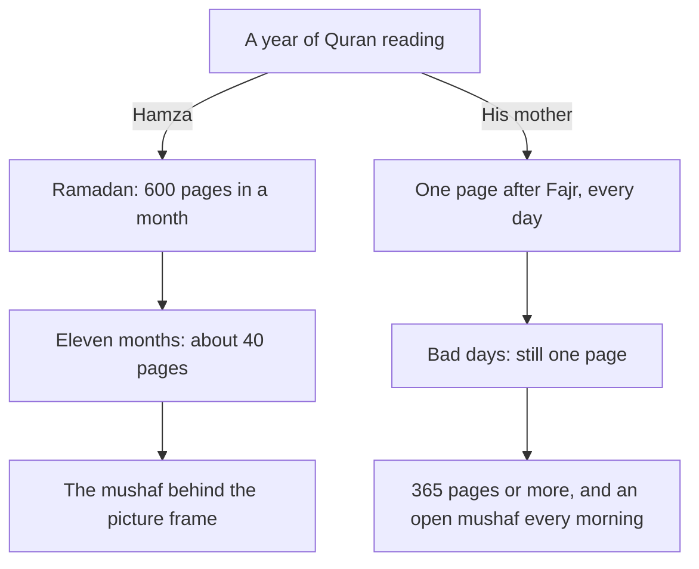

## The mushaf on the shelf

There are two copies of the Quran in Hamza's flat. One belongs to his mother. Its cover is soft from use, and a thin green ribbon marks her place. It lives on the small table next to her chair by the window. The other belongs to Hamza. It was a gift on his graduation day, with gold letters on the cover, and it lives on the top shelf of the bookcase in the living room, behind a picture frame. In October it has a thin line of dust along its top edge.

Hamza reads his copy every Ramadan, usually finishing the whole Quran once in the month, sometimes twice. In the other eleven months he opens it on some Fridays and when someone in the family is ill. Each Ramadan he promises himself that this year he will keep going after Eid. Each year, by the middle of Shawwal, the mushaf is back behind the picture frame.

His mother has never finished the Quran in a month in her life. When he once asked her how much she reads, she laughed and said she does not count. When he pressed her, she said: "A page, sometimes two. After Fajr, before tea." She has done this, as far as Hamza can remember, every day of his life. On the morning his father passed away, she read her page. On the day of Hamza's wedding, she read her page. When she was in hospital for a week, Hamza's sister held the mushaf for her while she read.

## Doing the sum

In week four of his plan, while he is getting his Fajr habit settled, Hamza does a small calculation on the back of an envelope. In a good Ramadan he reads about 600 pages, the whole mushaf. In the other eleven months he reads, at a guess, 40 pages. That is about 640 pages a year.

His mother reads one or two pages a day, every day. Even at one page a day, that is 365 pages a year. At a page and a half, it is about 550. Most years, then, she reads nearly as much as he does in total. But her reading is spread over every single day, and his is packed into one month. And in the eleven months when his mushaf collects dust, hers is open every morning.

Before you read on, make a guess about what a small, daily reading means in the sight of Allah.

```predict
prompt: "Hamza's mother reads one page a day. How did the Prophet, peace be upon him, describe the reward for reading from the Book of Allah?"
options:
  - id: sessions
    label: "A reward for each completed reading of the whole Quran"
  - id: letters
    label: "A good deed for each letter, multiplied ten times"
correctOptionId: letters
explanation: "The Prophet said that whoever reads a letter from the Book of Allah has a good deed for it, and a good deed is multiplied ten times (Jami' at-Tirmidhi 2910, graded sahih). A single page is hundreds of letters. Small, daily reading is not small."
```

## What his mother's habit has

Hamza looks at his mother's habit as a developer looks at a system that has run without failing for thirty years. What makes it work? He finds four things.

It has a fixed cue. Her page comes after Fajr and before tea, every day. She does not decide each morning whether to read. The end of Fajr starts it.

It has a fixed place, with the mushaf ready. The mushaf lives on the table by her chair, open at the ribbon. Starting takes one step: sit down.

It is small. One page, sometimes two. On her worst days, such as the morning of her husband's death, one page was still possible. A juz would not have been.

And it has no debt. When she misses a day, which is rare, she does not "make up" ten pages the next day. She reads her page. The habit is the page and the time, not a total to reach.

The diagram shows the two ways of reading the Quran in Hamza's family over one year.



Look first at the totals: they are closer than Hamza expected. Then look at the shape. His reading is a single tall peak and a long flat line. Hers is a low line that never stops. The most beloved deeds to Allah are the most consistent, even if small (Sahih al-Bukhari 6465), and her habit is a living picture of that hadith. It is also a picture of what the Prophet said about the Quran itself: recite it, for it will come on the Day of Resurrection as an intercessor for its companions (Sahih Muslim 804). A companion is someone who keeps returning, every day, not someone who visits once a year.

This is not a criticism of Ramadan. Reading the whole Quran in Ramadan is a beautiful practice, and Hamza will keep it. The point is what happens in the other eleven months. A small daily habit is what keeps the mushaf open between one Ramadan and the next.

## The thought that stops many readers

When Hamza tells his mother about his plan, she is pleased. Then he says something that has been in his mind for years: "I read slowly, Ammi. I stumble on the words. When I hear a qari on the radio, I feel ashamed to read at all."

His mother is quiet for a moment. Then she says that she, too, stumbled when she started, and that her father used to tell her a hadith about the one who reads with difficulty. She does not remember the exact words. Chapter 3.2 gives them, with their source, and they are a gift to every slow reader.

This thought, "my reading is not good enough", stops more people than laziness does. Many grown men and women read the Quran only in their heads, or only in Ramadan when everyone reads together, because they are embarrassed by the sound of their own reading. The Sunnah's answer to that embarrassment is one of the most encouraging teachings in this course.

<Callout type="info" title="Learning to read">
If you cannot yet read the Arabic letters, a daily Quran habit can still begin: learning a few letters a day with a teacher is itself learning the Quran. The best of you are those who learn the Quran and teach it (Sahih al-Bukhari 5027).
</Callout>

## What Hamza decides for week five

On the Sunday before week five, Hamza takes his mushaf down from the top shelf and wipes the dust from its edge with his sleeve. He does not put it back. He clears a space on the low shelf in the corner of the living room, next to the armchair he sits in after Fajr, and leaves the mushaf there with a ribbon at the first page of Surah al-Baqarah. He wants starting to take one step, as it does for his mother.

Then he times himself. One page, read carefully, takes him a little over four minutes, with two or three words he is not sure of. That decides his portion: one page after Fajr, in the armchair, before he opens his laptop. His minimum, for the mornings he is late, is the same page read a little faster, or half a page if he truly has no time. He will not grow it until one page feels easy.

He tells nobody except his mother. She does not say much. The next morning, when he sits down with his page, she brings him a cup of tea and leaves it beside him without a word. By the end of the week, the tea has become part of the habit too.

## What this module covers

In chapter 3.2 you will set your own daily portion: how much, where and when, with a minimum for your hardest day and a rule for when to grow. You will also learn the two rewards of the reader who struggles. In chapter 3.3 you will learn what to do when a day is missed: how the Sunnah lets you make up a portion missed through sleep, why illness and travel do not erase your habit, and how to restart at the next cue without a growing debt. Chapter 3.4 adds three small habits to the daily page: the meaning of one verse, tajweed with a teacher, and hifz with revision. Chapter 3.5 is a short quiz. In chapter 3.6 you will write your Quran habit plan.

<LearningObjectives items={["Explain why a small daily portion of the Quran, kept up, is a great deed, using Jami' at-Tirmidhi 2910 and Sahih al-Bukhari 6465", "Set a daily portion by your hardest day, with a fixed cue, a fixed place and the mushaf ready", "Know that the reader who stumbles has two rewards, and keep reading while you learn with a teacher", "Make up a portion missed through sleep, and restart after illness or travel without a growing debt", "Grow your portion only when the current amount is easy on most days"]} />

## Key words

| Word | Plain English |
|---|---|
| ***Mushaf*** | A written copy of the Quran |
| ***Tilawah*** | Reciting the Quran. In Urdu, *tilawat* |
| ***Hizb*** | A regular portion of the Quran that a person reads; also a fixed division of the Quran |
| **Juz** | One of thirty equal parts of the Quran, about twenty pages. In Urdu, *para* |
| ***Tajweed*** | The rules for reciting the Quran correctly, learned from a teacher |
| **Portion** | The amount you read each day; your minimum is its smallest version |

## What is in this module

| Chapter | You will practise |
|---|---|
| 3.2 | Setting a daily portion, a minimum and a growing rule |
| 3.3 | Making up a missed portion, and restarting without a debt |
| 3.4 | Understanding a verse a day, tajweed with a teacher, and hifz with revision |
| 3.5 | A short quiz with five cases |
| 3.6 | Your Quran habit plan |

**Next:** A little Quran every day: your portion, your place and your time.
