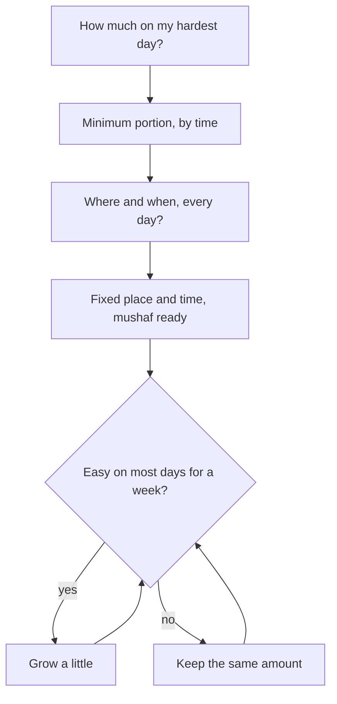

## A juz, or a page?

In September, Hamza tried to read a juz of the Quran every day. A juz is one thirtieth of the Quran, about twenty pages. For him it took almost an hour, and it lasted three days. In week five of his new plan, the Quran comes back onto his ladder. This time he asks a different question. Not "how much should a serious Muslim read?" but "how much can I read every single day, including the worst day of the month?"

His answer is one page. It takes him about four minutes, because he reads slowly and some words are hard for him. He feels a little embarrassed that it is so small. He also remembers chapter 1.2: the most beloved deeds are the most consistent, even if small.

Before you step through his first five weeks, make a guess.

```predict
prompt: "Hamza reads slowly and stumbles over some words. He feels his reading is not good enough to count for much. What did the Prophet, peace be upon him, say about a reader like him?"
options:
  - id: less
    label: "He has less reward than a fluent reader"
  - id: two
    label: "He has two rewards"
correctOptionId: two
explanation: "The Prophet said that the one who is skilled in the Quran is with the noble, righteous angels, and the one who reads it stumbling, finding it hard, has two rewards (Sahih Muslim 798). The struggle itself is rewarded."
```

Step through the canvas below. It follows Hamza's Quran habit over five weeks.

<InteractiveCanvas slug="a-page-after-fajr" />

The canvas showed a small habit that grew without breaking. It started with one page in one place, at one time. Hamza kept going while he stumbled, added a weekly check with a teacher, and grew to two pages only when one felt easy. On hard days he kept a minimum of one page.

## What the sources say about reciting

Allah says, in a verse that speaks of people who are ill, people who travel to earn a living and people with other duties: so recite what is easy of the Quran (Quran 73:20).

> فَاقْرَءُوا مَا تَيَسَّرَ مِنَ الْقُرْآنِ

Meaning: So recite what is easy of the Quran (Quran 73:20).

The words "what is easy" are worth reading slowly. The verse names real lives: illness, travel for work, other duties. It does not ask everyone for the same amount. It asks each person for what is easy for them. Allah also says: We have made the Quran easy to remember, so is there anyone who will remember? (Quran 54:17). The Quran was sent to be read by ordinary people in ordinary days.

The reward of reading is counted letter by letter. The Prophet said: whoever reads a letter from the Book of Allah has a good deed for it, and a good deed is multiplied ten times. I do not say that Alif Lam Mim is one letter; Alif is a letter, Lam is a letter and Mim is a letter (Jami' at-Tirmidhi 2910, graded sahih by al-Albani and hasan sahih by at-Tirmidhi). So a single page is not small in the sight of Allah. It is hundreds of letters.

For the reader who struggles, the Prophet's words are a gift. He said that the one who is skilled in the Quran will be with the noble, righteous scribes, the angels, and the one who reads it and stumbles in it, finding it hard, has two rewards (Sahih Muslim 798).

> وَالَّذِي يَقْرَأُ الْقُرْآنَ وَيَتَتَعْتَعُ فِيهِ وَهُوَ عَلَيْهِ شَاقٌّ لَهُ أَجْرَانِ

Meaning: And the one who reads the Quran and stumbles in it, and finds it hard, has two rewards (Sahih Muslim 798).

Many people stop reading because they are ashamed of how slowly they read. This hadith turns that shame upside down. The difficulty is not a reason to stop. It is part of what is rewarded. The Prophet also said: recite the Quran, for it will come on the Day of Resurrection as an intercessor for its companions (Sahih Muslim 804). A companion of the Quran is someone who keeps returning to it, not someone who reads it perfectly.

## Learning, too

There is one more hadith that belongs in a daily Quran habit. Uthman ibn Affan, may Allah be pleased with him, reported that the Prophet said: the best of you are those who learn the Quran and teach it (Sahih al-Bukhari 5027). Reading is one part. Learning to read correctly is another, and it needs a real teacher. Hamza adds a ten-minute weekly reading with a teacher at the mosque after Jumu'ah. It is a second, tiny habit, attached to a prayer he already attends, and it slowly makes his daily page easier.

## How to set your portion

Choose your daily portion by time, not by what sounds impressive. A fluent reader may read a page in two minutes. Someone learning to read Arabic may need ten minutes for half a page. Neither is better. Ask yourself: what amount could I read on a day I wake late, have a full day of work and come home tired? Make that your minimum. On normal days you may read more, but the habit is the minimum.

Then fix the place and the time. Hamza reads in the same corner of the living room, straight after he comes home from Fajr. The mushaf stays open on the shelf with a ribbon at today's page, so starting takes one step. If he had to find the mushaf, find the page and find a light, starting would take four steps, and on a tired morning four steps is often too many. An app works too, but for many people a phone in the hand at dawn leads to messages, not to the Quran. Choose the tool that leads you to the page.

Finally, decide when to grow. Grow only when the current amount feels easy on most days, not on the morning you feel inspired. Inspiration is a good feeling, but it is a poor guide to what you can keep. Hamza waits until one page has felt easy for a full week, then adds a second page. Some people never grow beyond their first amount, and that is fine. A page a day for a year is more than three hundred pages.

The diagram shows the three decisions in order, with the question that answers each one.



Look at the loop at the bottom. The question "is it easy on most days?" comes back every week, and both answers are good. "Yes" means the habit can grow. "No" means it stays the same size and keeps going. There is no box in this diagram for "stop".

## Worked example: Mehwish learns as she reads

Mehwish is 22. She can read the Arabic letters, but slowly, and she has never read the Quran regularly outside Ramadan. Follow her reasoning.

**Her minimum.** She times herself and finds that five lines take her about eight minutes. She sets her minimum at three lines, about five minutes, for hard days.

**Her place and time.** After Isha, at the small table in her room. Her Quran and a pencil stay on the table. Her phone charges in the kitchen.

**Her learning.** Every Saturday she reads to her aunt, who studied tajweed, for fifteen minutes on a video call. Her aunt corrects three words at most each time, so Mehwish is not overwhelmed.

**Her growing rule.** After three weeks, five lines feel easy most nights. She grows to half a page. In week six, during exams, she drops back to three lines for two weeks, and then returns to half a page.

**What she keeps in mind.** On nights she stumbles, she remembers the two rewards (Sahih Muslim 798). The difficulty is part of her worship.

## Where people misunderstand it

The first misunderstanding is "a small portion is not real reading". Every letter carries a good deed multiplied ten times (Jami' at-Tirmidhi 2910). A page is not small.

The second is "I must read perfectly before I read daily". The reader who stumbles has two rewards (Sahih Muslim 798). Read daily, and learn with a teacher alongside.

The third is "grow when I feel inspired". Grow when the current amount is easy on most days. That is how the habit stays within what you can keep.

## Check your understanding

```quiz
type: mcq
question: "Danish reads the Quran only on weekends, two juz at a time, because 'a few verses a day is too little to matter'. He often misses whole weekends. Which plan fits this chapter and Quran 73:20?"
options:
  - "Keep the weekend plan, but add a third juz to make up for missed weekends"
  - "A small daily portion he can keep on his worst day, at a fixed time"
  - "Wait until Ramadan, when reading two juz a day will feel easier"
  - "Read whenever he feels inspired, as much as he can at that moment"
correct: 1
explanations:
  - "A larger weekend load makes the missed weekends more likely, not less. The verse asks for what is easy."
  - "Right. 'Recite what is easy' (Quran 73:20), kept daily, is the consistent deed the Sunnah praises (Sahih al-Bukhari 6465)."
  - "Waiting delays a habit he can start in a small way today."
  - "Inspiration comes and goes. A fixed time and a small portion keep the habit going when inspiration does not come."
```

```quiz
type: mcq
question: "Areeba is learning to read Arabic. She reads slowly and feels embarrassed, so she plans to stop daily reading until she finishes a tajweed course next year. What does Sahih Muslim 798 suggest?"
options:
  - "Stop for now, since reading with mistakes may not be rewarded"
  - "Listen to recitation daily instead, until she can read fluently"
  - "Keep reading daily, slowly, and learn with a teacher alongside"
  - "Read only the short surahs she knows, so she does not stumble"
correct: 2
explanations:
  - "The hadith says the one who stumbles and finds it hard has two rewards (Sahih Muslim 798). The struggle is rewarded."
  - "Listening is good, but the hadith speaks of reading. She does not need to give up reading to learn."
  - "Right. Her slow reading earns two rewards, and a teacher alongside makes it easier over time (Sahih al-Bukhari 5027)."
  - "Familiar surahs are good, but avoiding hard words keeps her from learning. The hadith rewards the difficulty."
```

## This week

Time yourself reading for five minutes. Note how much you read. That amount, or a little less, is your minimum. Choose its place and time, and make the mushaf ready there tonight.

**Next:** When a day is missed: making up a portion, and starting again.
