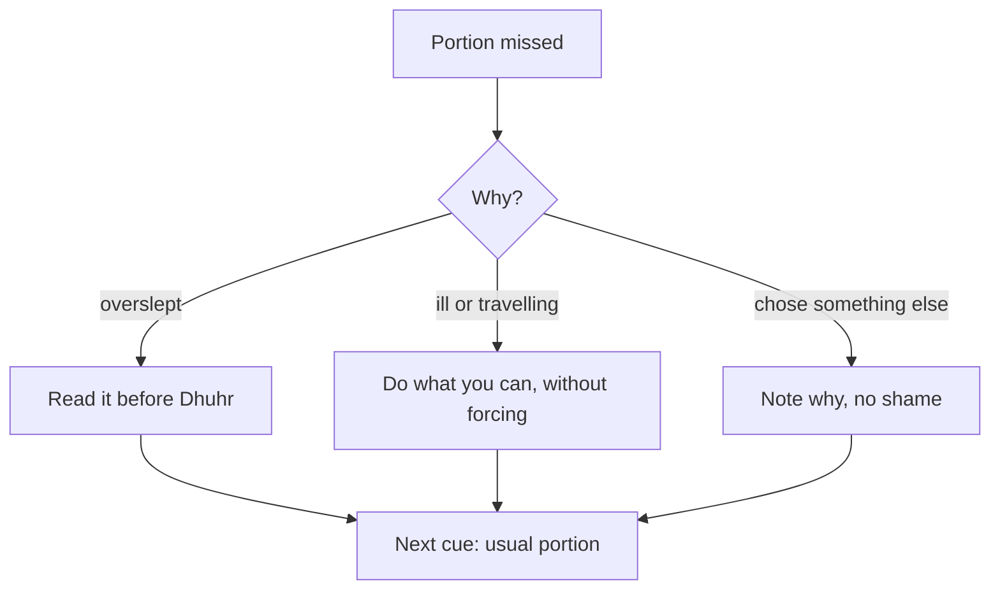

## The thought after the miss

In week six, Hamza oversleeps. A deployment ran late the night before, he slept at 1:30, and he woke at 7:40. He prays Fajr straight away, as soon as he wakes, and rushes to work. On the bus he realises he has not read his page. He has read it every day for nine days. He feels a small, sharp disappointment, and then a familiar thought: "That is it, I broke it."

This thought is the most dangerous moment in any habit. In September, a thought like this ended all eleven habits. The miss itself costs one page. The thought, if he believes it, can cost the whole habit.

Before you step through his week, make a guess.

```predict
prompt: "Hamza slept through the time he usually reads his page after Fajr. Once that time has passed, is the portion simply lost for that day?"
options:
  - id: lost
    label: "Yes, once its time has passed, a missed portion cannot be made up"
  - id: make-up
    label: "No, the Sunnah gives a way to make it up later that morning"
correctOptionId: make-up
explanation: "The Prophet, peace be upon him, said that whoever sleeps through his portion, or part of it, and reads it between Fajr and Dhuhr, it is written for him as if he read it at night (Sahih Muslim 747). There is a way back the same day."
```

Step through the canvas below. It follows two different misses in Hamza's Quran habit.

<InteractiveCanvas slug="missed-portion-make-up" />

The canvas showed two kinds of miss and two responses. When he overslept, he made up his page before Dhuhr. When he was ill, he did what he could and did not force it. On the first healthy morning, he went back to his usual page, without trying to read all the missed pages at once.

## Making up a missed portion

Umar ibn al-Khattab, may Allah be pleased with him, reported that the Prophet said: whoever sleeps and misses his portion, or part of it, and reads it between the Fajr prayer and the Dhuhr prayer, it is written for him as if he read it at night (Sahih Muslim 747).

> مَنْ نَامَ عَنْ حِزْبِهِ أَوْ عَنْ شَىْءٍ مِنْهُ فَقَرَأَهُ فِيمَا بَيْنَ صَلاَةِ الْفَجْرِ وَصَلاَةِ الظُّهْرِ كُتِبَ لَهُ كَأَنَّمَا قَرَأَهُ مِنَ اللَّيْلِ

Meaning: Whoever sleeps through his portion, or part of it, and reads it between the Fajr prayer and the Dhuhr prayer, it is written for him as if he read it at night (Sahih Muslim 747).

Notice the word *hizb*, translated here as "portion". It assumes that a person has a regular amount they read, their own daily portion. That is exactly the habit this module builds. The hadith speaks of a portion usually read at night, and of missing it through sleep. Its spirit fits Hamza's morning page well: a missed portion is not thrown away; there is a way to make it up, and Allah writes it fully.

So Hamza's new line for missed days is: "If I miss my page after Fajr, then I read it before Dhuhr, at my desk." It takes four minutes. On the bus, the thought "I broke it" loses its power, because the habit now has a planned way back.

## When illness or travel stops you

Some misses are not about sleep. Two weeks later, Hamza has a fever for three days. He can barely sit up. He listens to a little recitation on his phone when he can, and he does not force himself to read.

The Prophet said: when a servant falls ill or travels, there is written for him the like of what he used to do when he was at home and healthy (Sahih al-Bukhari 2996).

> إِذَا مَرِضَ الْعَبْدُ أَوْ سَافَرَ، كُتِبَ لَهُ مِثْلُ مَا كَانَ يَعْمَلُ مُقِيمًا صَحِيحًا

Meaning: When a servant falls ill or travels, there is written for him the like of what he used to do when at home and healthy (Sahih al-Bukhari 2996).

This hadith is one of the strongest reasons to build steady habits. The deed you keep up in good days is written for you when illness or travel stops you. The page Hamza read every day for weeks is still being written while he lies in bed. His habit has become something like a savings account: what he built in ease carries him through hardship.

Notice what the hadith does not say. It speaks of illness and travel, not of choosing to skip. It is a mercy for the days you cannot, not a reason to skip the days you can.

## Restart small, at the next cue

On the first morning he is well, Hamza goes back to his usual page after Fajr. He does not try to read the three missed pages in one sitting, plus today's, plus extra to "make up for it". That would turn a four-minute habit into a twenty-minute one on a morning he is still weak, and it would teach him that a miss makes the next day heavier. Next time, he might avoid starting at all.

The restart rule is simple: restart at the next cue, at your usual size. The habit is the cue and the portion, not a debt that grows. If you want to read extra later, as a separate good deed on a good day, that is fine. But the restart itself stays small.

The diagram shows what to do after a miss, by kind of miss.



All three paths end in the same box: the next cue, at the usual size. The path in the middle has a mercy written into it (Sahih al-Bukhari 2996). The path on the right is the honest one: some days you simply choose something else, and it is better to write down why than to pretend. All three lead back to the habit.

## Two different kinds of "missed"

Be careful not to mix up two things. Your daily Quran portion is a voluntary deed, a habit you have chosen. Missing it is a small thing, and this chapter shows the way back. An obligatory prayer is different. If you sleep through or forget an obligatory prayer, the Prophet said: pray it when you remember it; there is no expiation for it except that (Sahih Muslim 684). It is not "made up" by a better habit later, and it is not left. Questions about the details of missed prayers belong to fiqh, so ask a scholar you trust.

## Worked example: Saima's busy month

Saima is a junior doctor. Her daily portion is one page after Fajr. Her hospital rota changes every week, and in one month she has six night shifts. Follow her reasoning.

**Overslept after a night shift.** She sleeps after Fajr and misses her usual time. Her line: "If I miss my page after Fajr, I read it when I wake, before Dhuhr if I can." Most days that works.

**A day she truly cannot.** One night shift runs into the next day. She reads two lines on her phone in the staff room and leaves it there. She does not count it as failure.

**What she writes down.** On her private tracker, she writes "N" for night shift next to those days, instead of a cross. At the end of the month she sees that every miss was a night-shift day.

**Her change.** For the next month, on night-shift days, her portion moves to the start of her break at 2:00, when the ward is quiet. One change, based on what her notes showed.

## Where people misunderstand it

The first misunderstanding is "a missed day breaks the habit". The Sunnah gives a way to make up a portion (Sahih Muslim 747), and the habit continues at the next cue.

The second is "I must repay every missed page before I continue". The restart is your usual portion. A growing debt makes the habit heavier and easier to abandon.

The third is "illness means I have lost my reward". The deed you used to do is written for you when illness or travel stops you (Sahih al-Bukhari 2996).

## Check your understanding

```quiz
type: mcq
question: "Faisal reads half a juz after Fajr. He overslept on Monday and Tuesday, and on Wednesday he plans to read a juz and a half to catch up. He has done this before, and then stopped for a week. What fits this chapter?"
options:
  - "His usual half juz on Wednesday, and make up misses before Dhuhr"
  - "Read the juz and a half, since a missed portion is a debt to repay"
  - "Stop for a week, then start again with a fresh plan next month"
  - "Drop to one page a day for good, since half a juz is too much"
correct: 0
explanations:
  - "Right. Restart at the next cue at the usual size, and use the make-up time before Dhuhr when he oversleeps (Sahih Muslim 747)."
  - "A growing debt is what stopped him last time. The restart is the usual portion."
  - "Waiting for a fresh start turns a two-day miss into a week. The next cue is tomorrow's Fajr."
  - "If half a juz keeps failing, a smaller portion may help, but two missed days alone do not show that. First he can use the make-up rule."
```

```quiz
type: mcq
question: "Mariam has read a page of the Quran every day for four months. She travels for a family wedding and, for five days, reads almost nothing. She feels her four months 'are gone'. What does Sahih al-Bukhari 2996 suggest?"
options:
  - "She is right, so she should start counting again from day one"
  - "Her usual deed is written for her while travel stops her"
  - "She should read five pages a day after the wedding to repay it"
  - "Travel days do not count, so she must stop travelling for a while"
correct: 1
explanations:
  - "The four months are not gone. The deed she kept is written for her during travel (Sahih al-Bukhari 2996)."
  - "Right. When a servant travels, what he used to do at home is written for him (Sahih al-Bukhari 2996). Her habit carries her."
  - "There is nothing to repay. On her first morning home, she reads her usual page."
  - "The hadith is a mercy for travel, not a reason to avoid it."
```

## This week

Write your missed-day line: "If I miss my portion at ___, then I read it ___." Then write your restart rule in one sentence. Both go into the gate.

**Next:** A short quiz on daily Quran.
