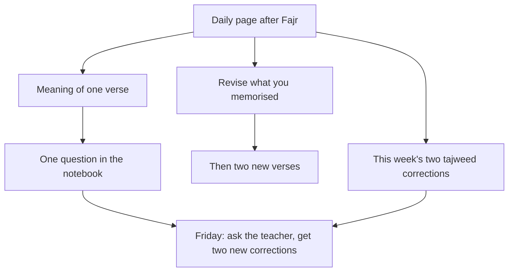

## Reading without knowing

After six weeks of his daily page, Hamza reads more smoothly. But one morning, after finishing a page of Surah al-Baqarah, he realises he could not tell anyone what it was about. He read every letter, and every letter is rewarded (Jami' at-Tirmidhi 2910). Still, he wants the words to reach him.

Three more habits can grow from the daily page: understanding, correct recitation (tajweed) and memorising (hifz) with revision. None needs a new hour in the day. Each can be one small addition to the page you already read.

Before you step through Hamza's mornings, make a guess.

```predict
prompt: "Hamza wants to memorise more of the Quran. According to Sahih al-Bukhari 5033, what is the main challenge of hifz?"
options:
  - id: keeping
    label: "Keeping what you learned, because it slips away"
  - id: learning
    label: "Learning enough new verses quickly, before time runs out"
correctOptionId: keeping
explanation: "The Prophet, peace be upon him, said: keep up the Quran, for it slips away faster than a camel from its tether (Sahih al-Bukhari 5033). Revision is the heart of hifz."
```

Step through the canvas below. It follows Hamza's daily page with three small additions.

<InteractiveCanvas slug="understand-one-verse" />

The canvas showed one page with three additions: the meaning of one verse, one question written down, one tajweed correction a week, and two verses memorised with revision first. None of them took more than a few minutes.

## Understanding: one verse a day

Allah says that the Quran is a blessed Book, sent down so that people reflect on its verses and those of understanding take heed (Quran 38:29).

> كِتَابٌ أَنزَلْنَاهُ إِلَيْكَ مُبَارَكٌ لِّيَدَّبَّرُوا آيَاتِهِ

Meaning: A blessed Book that We have sent down to you, so that they may reflect on its verses (Quran 38:29).

Reflection starts small. After your daily page, choose one verse from it and read its meaning in a language you think in, Urdu, English or any other. Read it twice. Ask yourself one question: what does this verse ask of me today? Some days the answer is clear. Some days it is not, and that is fine. One verse a day, for a year, is 365 verses whose meaning you have met.

A translation gives the meaning, not the full explanation. When a verse puzzles you, write the question in a small notebook and ask a teacher you trust. Jibril came to the Prophet and asked questions in front of the companions, and the Prophet said afterwards that Jibril came to teach people their religion (Sahih al-Bukhari 50). Asking is part of learning.

## Tajweed: one correction a week

Allah says: and recite the Quran with measured recitation (Quran 73:4). Tajweed, the rules of correct recitation, is learned by ear from a teacher, not from a page. A weekly ten minutes with a teacher, as Hamza does after Jumu'ah, is enough to improve steadily.

The key is to take only one or two corrections at a time. A teacher who corrects twenty things at once leaves a learner discouraged and remembering none of them. Ask your teacher for the two most important corrections this week, practise them on your daily page, and check them next week. Over a year, that is about a hundred corrections, each one fixed into habit.

## Hifz: small pieces, revision first

Memorising follows the same 1% shape as everything else in this course. Two verses a day after your page, or five a week, is a pace most people can keep. Module 6 showed this for Surah al-Mulk.

The most important rule comes from the Prophet: keep up the Quran, for by the One in whose hand is my soul, it slips away faster than a camel from its tether (Sahih al-Bukhari 5033). So in hifz, revision comes before new learning. Each morning, recite what you already know first. Only then add something new. If the old verses are shaky, take a week with nothing new.

Recite what you memorise in your prayers. Every prayer is then a revision session, and the verses you learn have a daily place to live.

## Wudu and the mushaf

Many people keep the habit of reading the Quran in a state of wudu, and this is a good habit of respect. Scholars discuss whether wudu is required to touch the mushaf; reciting from memory is different again. Follow the guidance of your scholar. For the habit, the simplest plan is to read after Fajr, when you are already in wudu.

The diagram shows the daily page with its three small additions.



Everything hangs from the daily page. That is the point: none of these habits floats on its own. The weekly meeting with a teacher, at the bottom, joins the questions and the corrections, so one ten-minute habit serves two others.

## Choosing a translation and a teacher

Two practical choices make these habits easier. The first is a reliable translation in the language you think in. Many Urdu readers use well-known translations printed alongside the Arabic in their mushaf, or in apps such as Islam 360, which show the Arabic, a translation and often a short tafsir together. Choose one and stay with it for a while, so that the words become familiar. A translation is a help to understanding, not a replacement for the Arabic, and not a full explanation. When a verse touches a ruling or a difficult topic, ask a teacher rather than drawing your own conclusion from one line.

The second choice is a teacher. A teacher does not need to be a famous scholar. For tajweed, someone who recites correctly and patiently is enough: an imam, a family member, a teacher at a local Quran class, or a teacher online. What matters is regularity. Ten minutes every week with the same person is far more useful than an hour once in a while, because they come to know your mistakes and can correct them in order, the most important first.

If you have no teacher at all, start with a trusted recording. Listen to a slow reciter read the page you will read tomorrow, then read it yourself. It is not a replacement for a teacher's ear, but it is a real means while you look for one.

## A simple weekly rhythm

Put together, the habits in this chapter fit a weekly rhythm. Every day: your page, the meaning of one verse, revision of what you have memorised, and any new verses. Once a week: ten minutes with your teacher, your written questions, and two new tajweed corrections to practise. Once a month: a look at your notebook of questions to see which have been answered and what you have learned.

## Worked example: Ayesha's year with Surah Yasin

Ayesha, Hamza's wife, reads half a page each morning. She wants to understand and memorise Surah Yasin. Follow her reasoning.

**Understanding.** After her half page, she reads the Urdu meaning of one verse of Yasin, slowly, from a reliable translation.

**Memorising.** She learns two verses of Yasin a day, five days a week. Each morning she recites all she knows before adding more.

**Tajweed.** Each Saturday she reads the week's verses to her mother-in-law, who knows tajweed, and gets two corrections.

**Her pace.** Yasin has 83 verses. At ten a week with two review weeks, she finishes in about ten weeks.

Ayesha's plan shows the three habits working together: the meaning she reads is the meaning of the verses she memorises, and the verses she memorises are the ones she reads to her teacher.

## Where people misunderstand it

The first misunderstanding is "reading without understanding has no value". Each letter is rewarded (Jami' at-Tirmidhi 2910). Understanding is an addition, not a condition.

The second is "hifz means learning fast". Hifz means keeping, and keeping means revision first (Sahih al-Bukhari 5033).

The third is "tajweed can be learned from a book alone". It is learned by ear. A teacher, even ten minutes a week, is the means.

## Check your understanding

```quiz
type: mcq
question: "Saleem has memorised Juz Amma and wants to start Surah al-Mulk. Lately he forgets the surahs he learned last year. What does this chapter suggest he do first?"
options:
  - "Start al-Mulk at once, since new learning keeps the mind fresh"
  - "Stop memorising, since he forgets anyway"
  - "Learn al-Mulk quickly in one week, before he forgets it too"
  - "Revise what he knows daily, then add al-Mulk in small pieces"
correct: 3
explanations:
  - "New verses on top of slipping ones make both slip. Revision comes first."
  - "Forgetting is normal; the cure is revision, not stopping."
  - "Fast learning without revision is what is slipping already."
  - "Right. Keep up the Quran, for it slips away (Sahih al-Bukhari 5033). Revision first, then new verses, a few at a time."
```

```quiz
type: mcq
question: "Hira reads a page daily but understands little Arabic. She has thirty minutes a week extra at most. Which plan fits this chapter?"
options:
  - "A full tafsir course every evening for an hour"
  - "Stop reading Arabic and read only the translation"
  - "Wait until she learns Arabic properly, then start"
  - "The meaning of one verse from her page each day"
correct: 3
explanations:
  - "An hour daily is far more than she has. The 1% way starts small."
  - "Reading the Arabic is rewarded letter by letter (Jami' at-Tirmidhi 2910). The meaning is an addition."
  - "Waiting delays reflection she can begin with one verse today."
  - "Right. One verse's meaning a day fits her time and builds reflection (Quran 38:29)."
```

## This week

After your daily page, read the meaning of one verse from it every day. Write one question in a notebook. If you memorise, revise before you learn anything new.

**Next:** A short quiz on daily Quran.
