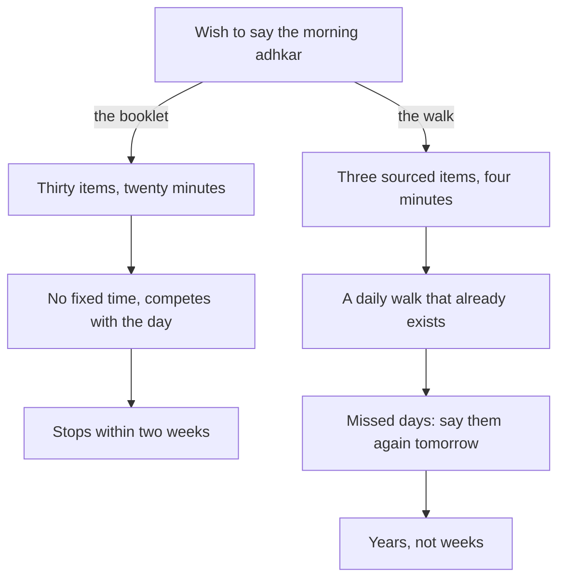

## The outage

On a Tuesday in week five, the payment service at Hamza's company goes down at 9:10 in the morning. Customers cannot pay. The support channel fills with angry messages. By 9:30 there are eleven engineers on a call, and the head of engineering is asking for updates every ten minutes. Hamza's heart is racing. He types fast and makes two small mistakes he has to undo.

The person leading the fix is Imran, a senior engineer in his late forties who has been at the company longer than anyone. Imran speaks slowly on the call. He asks one question at a time. When a junior developer panics and suggests restarting everything, Imran says, "Let us look first," and shares his screen. By 11:40 the service is back. The cause was a configuration change made the night before.

That evening, Hamza leaves the office late, at about the same time as Imran. They walk to the bus stop together. Hamza says he does not know how Imran stayed so calm. Imran smiles and says that he was not calm inside, not at first. Then he says something Hamza does not expect.

## Two walks a day

Imran tells him that for twenty years he has said a few words of remembrance on two walks every day. In the morning, from the car park to the office door, about four minutes. In the evening, from the office door to the car park. "Small things," he says. "The master of seeking forgiveness. 'Bismillah' three times. Some tasbih. That is all. I do not always feel anything. But on a day like today, I already started the day with Allah, and that makes it easier to come back to Him at 9:10."

Hamza asks whether he ever misses. Imran laughs. "Many times. On the morning my son was born I did not remember anything. Then the next day I said them again." He adds that when he first started, in his twenties, he tried to read a whole booklet every morning. It lasted a week. The two walks lasted twenty years.

On the bus home, Hamza thinks about his own mornings. Since week four, he has prayed Fajr with the first takbir on most days. In week five, his Quran page came after it. But between the mosque and his front door there is a six-minute walk that he spends checking his phone. That walk is exactly the size of Imran's.

Before you read on, make a guess.

```predict
prompt: "Imran says the same words on both walks, morning and evening. Did the Prophet, peace be upon him, teach separate lists for the morning and the evening, or many of the same words for both?"
options:
  - id: same
    label: "Many of the same words, for both the morning and the evening"
  - id: separate
    label: "Completely separate lists, one for the morning and one for the evening"
correctOptionId: same
explanation: "Many adhkar are taught for both times, such as 'Bismillahilladhi' three times (Jami' at-Tirmidhi 3388) and 'SubhanAllahi wa bihamdihi' (Sahih Muslim 2692). A few have a morning and an evening wording. One small set said twice a day is a strong start."
```

## What the morning and evening adhkar are

The morning and evening adhkar (in Urdu, *subah aur sham ke azkar*) are words of remembrance of Allah that the Prophet taught for the two ends of the day. Allah says: O you who believe, remember Allah with much remembrance, and glorify Him morning and evening (Quran 33:41 to 42). Some adhkar praise Allah. Some ask His forgiveness. Some ask His protection for the day or the night ahead. Most are short.

The books of adhkar collect many of them, and many people own a small booklet or have them in an app such as Islam 360. That is a blessing, and also a trap. A booklet with thirty items looks like a test you must pass every morning. People start it with energy, as Hamza did in September and Imran did in his twenties, and stop within a week or two. Then the booklet sits in a bag, and the thought "I am not someone who does the adhkar" settles in.

Imran's twenty years did not come from more willpower. They came from a different shape: a few sourced items, two fixed moments that already happened every day, and the habit of saying them again the next day after a miss. That is the shape this module teaches.

## What remembrance does

Imran was careful not to claim too much. He did not say the adhkar made the outage go away, or that he felt peaceful every morning. He said that starting the day with Allah made it easier to come back to Him when the day turned hard. That is close to what the Quran itself says: truly, in the remembrance of Allah hearts find rest (Quran 13:28).

The Prophet gave a stronger picture still. He said that the example of the one who remembers his Lord and the one who does not is like the living and the dead (Sahih al-Bukhari 6407). The adhkar of the morning and evening are a small daily way of staying alive in that sense, a few minutes at each end of the day when the heart turns to its Lord before and after everything else.

The diagram shows the two shapes of the morning adhkar habit: the booklet and the walk.



The two paths start from the same sincere wish. The booklet asks for new time and a long list. The walk asks for neither: it uses a moment that is already in the day, and a list small enough to say on the worst morning. The difference is not how much the person loves the adhkar. It is whether the habit has a shape that survives ordinary life.

## The evening walk

Hamza asks Imran one more question at the bus stop: why the evening as well? Is the morning not enough?

Imran thinks for a moment. He says that the morning set is how he enters the day, and the evening set is how he leaves it. On a good day, the evening words are simple gratitude. On a day like today, with an outage and a tense call and a mistake he made himself in the middle of it, the evening words do something else. "I say 'astaghfirullah' and the master of seeking forgiveness, and I leave the day with Allah. Then I go home to my family as a father, not as the engineer who had a bad morning."

He adds that he does not always manage the evening walk. Some days he leaves after dark, or a call follows him to the car. On those days he says only "Bismillahilladhi" three times as he starts the engine, and that is enough to keep the habit.

Hamza notices that Imran never once called himself a religious man, or said he was better than anyone. He described two walks, a few words, and a habit of starting again the next day. It is the least dramatic description of worship Hamza has ever heard, and the most convincing.

## What Hamza decides

That night, Hamza opens his old booklet and makes a decision for week six. He will choose three items with sound sources, write them on a card, and say them on the six-minute walk home from Fajr. In the evening, when the evening adhkar arrive on his ladder later in his plan, he will say the same three on the walk from the office or after Asr. He will not try the whole booklet. He will add one item at a time, when the three feel easy.

He also decides to check each item's source before he writes it on the card. Imran told him the names of his three. Hamza wants to know where each one comes from, so that he can be sure he is saying something the Prophet taught. Chapter 4.2 gives the three, with their sources and meanings.

<LearningObjectives items={["Explain what the morning and evening adhkar are, and why a small sourced set lasts longer than a long list", "Learn a starter set of three adhkar with their Arabic, meanings and sources", "Say the same set in the morning and the evening, at two fixed moments that already exist in your day", "Use a card until the set is learned by heart, and keep a short minimum for the busiest days", "Grow the set by one item at a time, only when it is steady"]} />

## Key words

| Word | Plain English |
|---|---|
| ***Dhikr*** | Remembrance of Allah, in the heart and on the tongue; many of them are *adhkar*. In Urdu, *zikr* and *azkar* |
| ***Istighfar*** | Asking Allah for forgiveness, for example "Astaghfirullah" |
| ***Tasbih*** | Glorifying Allah, for example "SubhanAllah" |
| **Sayyid al-istighfar** | The master of seeking forgiveness: a dua the Prophet called the best way to ask forgiveness |
| **Starter set** | A small set of about three sourced adhkar that you say every morning and evening |
| **Anchor** | A moment that already happens every day, which the habit is attached to |

## What is in this module

| Chapter | You will practise |
|---|---|
| 4.2 | A sourced starter set, its meanings, and growing it |
| 4.3 | Fitting the set into moments you already have, with a card and a minimum |
| 4.4 | A short quiz with five cases |
| 4.5 | Your adhkar plan |

**Next:** What to say, morning and evening: the starter set and its sources.
