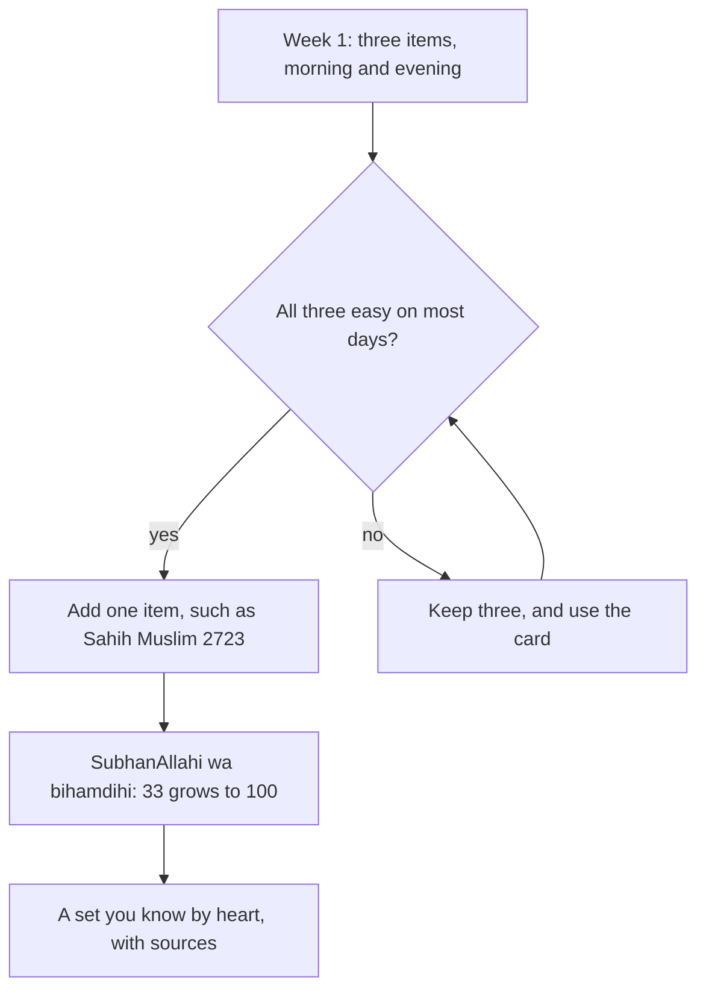

## The book with thirty items

In September, Hamza carried a small book of morning and evening adhkar in his bag. It had about thirty items, some to be said once, some three times, some a hundred times. Reading all of it took him twenty minutes. He managed it for four days on the bus, and then the book stayed in the bag.

In week six of his plan, the morning adhkar come back onto his ladder. He opens the same book and asks a new question: which few items, with sound sources, could I say every morning, even on my worst day? He chooses three. Later in this chapter you will see which three, and why.

Before you step through his starter set, make a guess.

```predict
prompt: "Hamza will say his morning set after Fajr. For the evening, should he learn a different list, or say the same words again?"
options:
  - id: same
    label: "The same few words, said again in the evening"
  - id: different
    label: "A different list, so that each time has its own adhkar"
correctOptionId: same
explanation: "Many of the Prophet's adhkar are taught for both the morning and the evening, such as 'Bismillahilladhi' three times (Jami' at-Tirmidhi 3388) and 'SubhanAllahi wa bihamdihi' (Sahih Muslim 2692). One set said twice a day is learned twice as fast."
```

Step through the canvas below. It shows Hamza's starter set, each item with its source, and how it grows.

<InteractiveCanvas slug="morning-evening-starter-set" />

The canvas showed three sourced adhkar, said after Fajr. When the evening adhkar join his ladder later in his plan, he says the same three after Asr, with nothing new to learn. When the three felt easy, he added the Prophet's words for reaching the morning and the evening. The set is small on purpose. It grows only when it is steady.

## Why remember Allah morning and evening

Allah says: O you who believe, remember Allah with much remembrance, and glorify Him morning and evening (Quran 33:41 to 42). He also says: glorify your Lord with His praise before the rising of the sun and before its setting (Quran 50:39). The two ends of the day are named again and again.

Remembrance is not only a duty. It is rest for the heart. Allah says: truly, in the remembrance of Allah hearts find rest (Quran 13:28). And the Prophet said: the example of the one who remembers his Lord and the one who does not is like the living and the dead (Sahih al-Bukhari 6407). The adhkar of the morning are a way of starting the day alive, and the adhkar of the evening a way of closing it.

When exactly is "morning" and "evening"? Scholars describe the times in slightly different ways. A common practice, which this course uses, is the morning adhkar after Fajr and before the late morning, and the evening adhkar after Asr and before or soon after Maghrib. If your teacher follows a different practice, follow your teacher.

## The starter set

Hamza's three items are short, they are sound, and two of them are taught for both morning and evening.

**First: the master of seeking forgiveness.** Shaddad ibn Aws, may Allah be pleased with him, reported that the Prophet said that the best way of seeking forgiveness is to say these words. Whoever says them during the day with firm faith in them, and dies that day before the evening, is of the people of Paradise; and whoever says them at night with firm faith, and dies before the morning, is of the people of Paradise (Sahih al-Bukhari 6306).

> اللَّهُمَّ أَنْتَ رَبِّي، لاَ إِلَهَ إِلاَّ أَنْتَ، خَلَقْتَنِي وَأَنَا عَبْدُكَ، وَأَنَا عَلَى عَهْدِكَ وَوَعْدِكَ مَا اسْتَطَعْتُ، أَعُوذُ بِكَ مِنْ شَرِّ مَا صَنَعْتُ، أَبُوءُ لَكَ بِنِعْمَتِكَ عَلَىَّ وَأَبُوءُ لَكَ بِذَنْبِي، فَاغْفِرْ لِي، فَإِنَّهُ لاَ يَغْفِرُ الذُّنُوبَ إِلاَّ أَنْتَ

Meaning: O Allah, You are my Lord; there is no god but You. You created me and I am Your servant. I keep Your covenant and Your promise as far as I can. I seek refuge in You from the evil of what I have done. I acknowledge Your blessing upon me, and I acknowledge my sin, so forgive me, for none forgives sins but You (Sahih al-Bukhari 6306).

In transliteration: *Allahumma anta Rabbi, la ilaha illa anta, khalaqtani wa ana 'abduka, wa ana 'ala 'ahdika wa wa'dika mastata'tu, a'udhu bika min sharri ma sana'tu, abu'u laka bi ni'matika 'alayya, wa abu'u laka bi dhanbi, faghfir li, fa innahu la yaghfirudh-dhunuba illa ant.* Learn the pronunciation from a teacher or a trusted recording. Notice the words "as far as I can". The dua itself admits that we will not be perfect. That fits this whole course.

**Second: "Bismillahilladhi" three times.** Uthman ibn Affan, may Allah be pleased with him, reported that the Prophet said: no servant says, in the morning of every day and the evening of every night, "In the name of Allah, with whose name nothing on earth or in the heaven can cause harm, and He is the All-Hearing, the All-Knowing", three times, and is then harmed by anything (Jami' at-Tirmidhi 3388, graded hasan sahih by at-Tirmidhi and al-Albani). In transliteration: *Bismillahilladhi la yadurru ma'asmihi shay'un fil-ardi wa la fis-sama'i, wa huwas-Sami'ul-'Alim.*

**Third: "SubhanAllahi wa bihamdihi".** Abu Hurairah, may Allah be pleased with him, reported that the Prophet said: whoever says, when he reaches the morning and when he reaches the evening, "SubhanAllahi wa bihamdihi" (glory be to Allah, and praise be to Him) a hundred times, no one will bring anything better on the Day of Resurrection, except someone who said the same or more (Sahih Muslim 2692). Hamza begins with 33 and grows to 100 over three weeks. The number in the hadith is a hundred; starting below it, while you build the habit, is a step toward it, not a replacement for it.

## Growing the set

When the three feel easy, Hamza adds one item. The one he chooses is the words Abdullah ibn Mas'ud, may Allah be pleased with him, reported the Prophet saying every evening, and in the morning with "morning" in place of "evening" (Sahih Muslim 2723). It begins: *amsayna wa amsal-mulku lillah*, we have reached the evening, and the dominion belongs to Allah.

The diagram shows how the set grows over Hamza's weeks, one item at a time.



Read it as a set that only ever grows by one, and only when it is steady. This is slower than reading a whole book on day one. But in six months, Hamza will know perhaps eight or ten adhkar by heart, with their meanings and sources, and say them every day. The book on day one gave him four days.

## Meaning makes it stick

People who say adhkar only as sounds often find them slipping away. People who know what they are saying find that the words begin to carry the day. For each item in your set, learn the meaning in a language you think in, Urdu, English or any other. Hamza's card has the Arabic on one side and the Urdu meaning on the other. When he says "I acknowledge Your blessing upon me", he thinks of one blessing from yesterday. That takes one second, and it turns a recitation into a conversation.

## Worked example: Kiran's starter set

Kiran is a nurse who works rotating shifts. She knows Ayat al-Kursi and a few short duas. Follow her reasoning.

**Her three.** She chooses "Bismillahilladhi" three times, because it is the shortest; "SubhanAllahi wa bihamdihi" 33 times, which she counts on her fingers; and the master of seeking forgiveness, which she reads from a card.

**Her two times.** Morning: after Fajr, before she leaves for the hospital or before she sleeps after a night shift. Evening: after Asr, or after Maghrib on days she is on the ward at Asr.

**Her meaning.** She writes the Urdu meaning of each line under the Arabic on her card. In the hospital she says "Bismillahilladhi" quietly while washing her hands at the start of the shift.

**Her growth.** After a month, she has learned the istighfar by heart and adds the words of Sahih Muslim 2723. She keeps the card for the new item.

## Where people misunderstand it

The first misunderstanding is "I must say the whole book or it does not count". Each dhikr is its own deed with its own source. Three, said daily, is a real habit.

The second is "a smaller number than in the hadith is pointless". Starting below a number while you build toward it is a step on the way. Keep the hadith's number as your goal.

The third is "the words work like a charm whether or not I understand them". The adhkar are remembrance of Allah. Knowing their meaning is how the heart takes part.

## Check your understanding

```quiz
type: mcq
question: "Omer wants to start the morning and evening adhkar. He has a booklet with forty items and plans to say all of them twice a day from tomorrow. Which plan fits this chapter best?"
options:
  - "All forty from tomorrow, since each one has a reward to gain"
  - "Ten items in the morning and ten different items in the evening"
  - "Read the booklet once a week, on Fridays, when he has more time"
  - "A sourced set of three, both times, adding one when easy"
correct: 3
explanations:
  - "Each one has a reward, but forty at once is the big start that faded in Hamza's September. The deed that lasts is the one most beloved (Sahih al-Bukhari 6465)."
  - "Different lists at each time are harder to learn. Many adhkar are taught for both morning and evening."
  - "Once a week is not the morning and evening remembrance the verses describe (Quran 33:42)."
  - "Right. A small, sound set said at both times, grown one item at a time, is a habit he can keep."
```

```quiz
type: mcq
question: "Rukhsana says 'SubhanAllahi wa bihamdihi' 33 times each morning. A friend says it is pointless unless she says it 100 times, as in Sahih Muslim 2692. What does this chapter suggest?"
options:
  - "Her friend is right, so she should stop until she can say 100"
  - "Keep going, and grow toward 100, the number the hadith names"
  - "Keep 33 forever, since the number in the hadith does not matter"
  - "Say it 100 times once a week instead of 33 times daily"
correct: 1
explanations:
  - "Stopping loses a daily dhikr. Starting below the number while building toward it is a step on the way."
  - "Right. The hadith names a hundred (Sahih Muslim 2692). She keeps her daily habit and grows toward it."
  - "The number in the hadith is the goal. Keep it in view and grow toward it."
  - "The hadith speaks of morning and evening, not once a week."
```

## This week

Choose your starter set of three. Write each on a card with its Arabic, its meaning in your language and its source. Say the set after Fajr and again in the evening every day this week.

**Next:** Making adhkar stick: moments that need no extra time.
