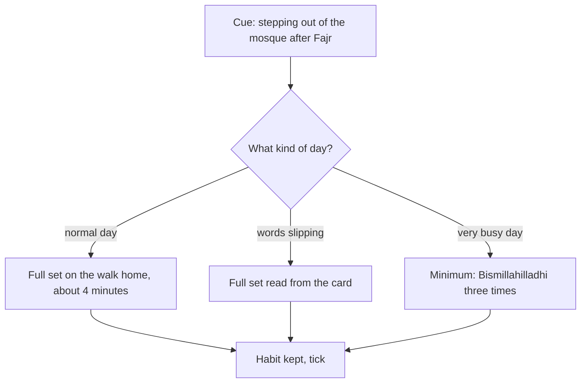

## Twenty minutes he did not have

In September, the problem with Hamza's adhkar book was not the words. It was the time. Twenty minutes on a bus, every morning and every evening, competed with messages, tiredness and the view out of the window. When the bus was crowded, or he had to stand, the book stayed in his bag.

His new starter set takes about four minutes. But even four minutes needs a place in the day. Hamza does not want to find four new minutes. He wants to use four minutes he already has, every day, that need his body but not his mind.

Before you step through his day, make a guess.

```predict
prompt: "Does Hamza need to find a free, quiet ten minutes in his day for his morning adhkar?"
options:
  - id: no
    label: "No, he can use a moment he already has, like a walk"
  - id: yes
    label: "Yes, adhkar need a quiet, free block of time set aside for them"
correctOptionId: no
explanation: "Allah praises those who remember Him standing, sitting and lying on their sides (Quran 3:191). Many adhkar fit moments you already have, such as the walk home from the mosque, as long as your heart is present in them."
```

Step through the canvas below. It follows the moments where Hamza's adhkar fit, without adding time to his day.

<InteractiveCanvas slug="adhkar-on-the-way" />

The canvas showed adhkar placed inside moments Hamza already had: the walk home from Fajr and, once the evening set joins his ladder, the bus home after Asr. It also showed a card for the days the words slipped, and a minimum for a busy day. None of these steps needed a new block of time.

## Moments that are already there

Allah describes the people of understanding as those who remember Allah standing, sitting and lying on their sides, and reflect on the creation of the heavens and the earth (Quran 3:191).

> الَّذِينَ يَذْكُرُونَ اللَّهَ قِيَامًا وَقُعُودًا وَعَلَىٰ جُنُوبِهِمْ

Meaning: Those who remember Allah standing, sitting and lying on their sides (Quran 3:191).

Standing, sitting, lying down: the verse covers almost every position a person is ever in. Remembrance is not only for the prayer mat. It can live inside ordinary moments, which is exactly what a habit needs. The best moments for adhkar share three features. They happen every day. They take a few minutes. And they need your body but not your mind, so your heart and tongue are free.

For Hamza, the walk home from Fajr is perfect: six minutes, every day, the street quiet, his mind fresh. For others it might be the time it takes to make tea, a bus ride, folding the prayer mat and sitting for a moment after the prayer, walking a child to school, or the first minutes on a bicycle. Look at your morning and your evening, and find the moment that already exists.

A word of care. Some moments need your full attention for safety, such as driving in heavy traffic. Remembrance should never take attention from the road. If the drive is busy, choose another moment, or say only the shortest item.

## The card, then the heart

Most people do not know their adhkar by heart when they start. That is not a problem; it is the starting point. Hamza writes his three items on a small card: Arabic on one side, the Urdu meaning on the other, and the source in small letters at the bottom. The card lives in his wallet, so it is with him every time he leaves the house.

He also bookmarks the same adhkar in his Quran and hadith app, such as Islam 360, for days when the card is at home. But he notices a danger. When he opens his phone to read an adhkar, a message notification often catches him first, and five minutes later he is reading something else. So the card comes first, and the phone is the backup.

Learning by heart happens slowly, without a separate effort. Each day he tries the first line without looking, then checks the card. After a week the first line is his. After three weeks, the whole istighfar is. Reading from a card is not cheating. It is how almost everyone learns.

## A minimum for busy days

Even four minutes can be too many on some days. A child is ill. A flight leaves at dawn. Meetings run back to back. On those days Hamza says only "Bismillahilladhi" three times, which takes about twenty seconds. He chose it as his minimum because it is the shortest item in his set, and because it is taught for both morning and evening (Jami' at-Tirmidhi 3388).

The minimum matters more than it looks. A habit that is either "full" or "nothing" breaks on the first bad day. A habit with a twenty-second version survives the bad day, so the next morning the full set is still a habit, not a fresh start. The Prophet said that the example of one who remembers his Lord and one who does not is like the living and the dead (Sahih al-Bukhari 6407). Twenty seconds keeps the habit alive.

The diagram shows the habit as one cue with three versions, chosen by the day you are having.



Every branch leads to the same tick. This is the main idea of the chapter. A habit is kept when the cue comes and you do some version of the deed. The full version is the goal on most days, and the other versions protect the habit on the days that would otherwise break it.

## Two anchors that help each other

Hamza's morning adhkar now sit right after another habit: his Fajr with the first takbir. His evening adhkar, when they join his ladder later in his plan, will sit right after Asr. This is habit stacking again. The prayer is the strong, steady habit, and the adhkar lean on it. If he ever needs to move his adhkar, he will move them to another strong anchor, not to "sometime in the morning".

Notice also that one set at two times means twice the practice. By saying the same three items in the morning and the evening, Hamza practises them fourteen times a week. That is why he learned them so quickly.

The anchor also tells you what to do when the anchor itself changes. On a day Hamza prays Fajr at home because he is unwell, there is no walk. So his rule is simple: no walk, then sit for four minutes on the prayer mat after the salam. The habit follows the prayer, wherever the prayer is.

## Worked example: Zubair on the bus

Zubair is a first-year student who takes a 35-minute bus to university. Follow his reasoning.

**His moment.** He first tries the bus ride, because it is long. But he usually checks his phone as soon as he sits down. So he moves the adhkar to the eight-minute walk from his house to the bus stop, when his phone is in his pocket.

**His card.** A card in the case of his student ID, which he takes out at the gate of his house.

**His minimum.** "Bismillahilladhi" three times, said at the bus stop on days he runs late.

**His evening.** After Asr in the university mosque, he sits for three minutes and says the same set before leaving.

**What he notices.** After a month, he does the walk set without the card. The bus ride is still for his phone, and he decides that is fine for now. One habit at a time.

## Where people misunderstand it

The first misunderstanding is "adhkar need a special quiet time". Allah praises those who remember Him standing, sitting and on their sides (Quran 3:191). A daily moment you already have is often the best place.

The second is "reading from a card is not real". It is how people learn. Each day, try a line without the card, then check.

The third is "a twenty-second version is not worth it". It keeps the habit alive on the day that would break it, so that tomorrow the full set is still a habit.

## Check your understanding

```quiz
type: mcq
question: "Hamna wants to say her morning adhkar but says she 'never has ten free minutes'. Each morning she spends five minutes waiting for the kettle and making breakfast tea. What does this chapter suggest?"
options:
  - "Wake ten minutes earlier and sit on the prayer mat for the adhkar"
  - "Leave the adhkar until the weekend, when she has more time"
  - "Say her set while the kettle boils, with a card by the kettle"
  - "Listen to a recording of the adhkar while she makes the tea"
correct: 2
explanations:
  - "Waking earlier can work, but it adds a new demand to her morning. A moment she already has is easier to keep."
  - "The adhkar are for every morning and evening (Quran 33:42), not the weekend."
  - "Right. The kettle is a daily moment that needs her hands, not her mind, and the card makes starting one step (Quran 3:191)."
  - "Listening can help her learn, but the adhkar are words she says herself."
```

```quiz
type: mcq
question: "Nasir says his full morning set on most days. On days he has an early flight, he skips them entirely, because 'half is pointless'. He has missed four times this month. Which change fits this chapter best?"
options:
  - "Choose a short minimum, such as one item, for flight days"
  - "Wake earlier on flight days, so the full set always fits"
  - "Keep skipping on flight days, since they are not normal days"
  - "Say the full set twice the next day, to make up for the flight"
correct: 0
explanations:
  - "Right. A minimum version keeps the habit alive on the day that would break it, so the full set stays a habit."
  - "Waking earlier on a flight day adds strain to an already hard morning. A minimum is easier."
  - "Skipping turns hard days into breaks. A short version keeps the cue and the habit."
  - "Doubling the next day makes a debt. The minimum on the day itself is the better fix."
```

## This week

Find your moment: a daily few minutes that needs your body but not your mind. Put your card where that moment begins. Choose your twenty-second minimum.

**Next:** A short quiz on morning and evening adhkar.
