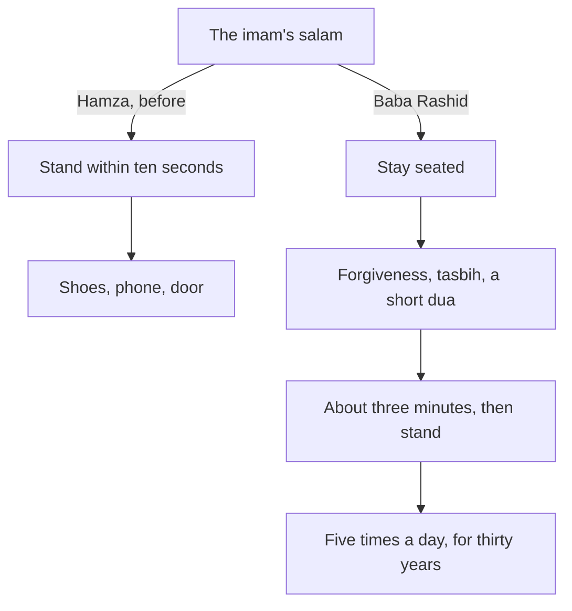

## The man in the second row

Now that Hamza arrives at the mosque before the iqamah, he sees things he never noticed when he rushed in during the second rak'ah. One of them is an old man who always prays in the second row, near the pillar on the right. The children call him Baba Rashid. He is about eighty. He walks slowly, with a stick, and he is always there before Hamza.

What Hamza notices most is what Baba Rashid does after the prayer. When the imam says the salam, the mosque begins to empty within seconds. Men stand, find their shoes, check their phones, greet each other at the door. Baba Rashid stays exactly where he is. His lips move. His fingers move, one at a time. After about three minutes he raises his hands for a short dua, wipes his face, picks up his stick and stands. He does this after every prayer Hamza has seen him pray.

For two weeks Hamza watches, a little curious and a little ashamed. He is usually one of the first men out of the door, often with his phone already in his hand.

## A conversation at the door

One evening after Isha, Hamza finds himself putting on his shoes next to Baba Rashid. He helps him with his stick, and then, a little shyly, asks him what he says after the prayer, and how long he has done it.

Baba Rashid smiles. He says that when he was about fifty, a young imam in his old neighbourhood told the congregation about a hadith. The Prophet, peace be upon him, took the hand of his companion Mu'adh and told him that he loved him, and then advised him never to leave a short dua after every prayer. "I was a busy man," Baba Rashid says. "A shop, six children, debts. I thought: I cannot do all the tasbih. But I can say one dua. So I said that one dua, after Isha only, because after Isha I was going home anyway."

After a year, he says, he added the same dua after Fajr. Then after the other prayers. Then, some years later, he learned the tasbih, the thirty-three and thirty-three and thirty-three, and added that. "Now it is thirty years," he says. "I do not think about it. The salam comes, and my tongue starts by itself. Like breathing."

Hamza asks which dua it was. Baba Rashid tells him, in Arabic, slowly. Hamza types it into his phone, and that night he looks up its source. It is in Sunan Abi Dawud, and it is graded sahih. Chapter 5.2 gives it, with its meaning.

Before you read on, make a guess.

```predict
prompt: "Baba Rashid's habit has run for thirty years with almost no reminders. What starts it each time?"
options:
  - id: salam
    label: "The salam, which comes by itself five times a day"
  - id: decision
    label: "A fresh decision after each prayer to stay and say the adhkar"
correctOptionId: salam
explanation: "The salam is the cue. It happens five times a day, in the same place, at times he already knows. After years of repetition, the salam starts the habit with no decision needed, which is exactly what a strong habit cue does."
```

## The first try

The next evening, after Isha, Hamza decides to try staying seated, just once, to see what it feels like. The imam says the salam. Around him, men begin to stand. Hamza stays where he is, and it feels strange, almost awkward, as if everyone can see him not leaving. Nobody is looking.

He says "astaghfirullah" three times, then the one dua Baba Rashid taught him, slowly, reading it from his phone. His phone buzzes with a message in the middle of the dua. He finishes the dua without looking. The whole thing takes less than a minute. Then he stands, and Baba Rashid, two rows ahead, turns and nods at him.

On the walk home Hamza notices two things. First, the minute was easy. It cost him almost nothing. Second, the urge to stand at the salam is very strong, much stronger than he expected. It is a habit too, ten years old, and it fires as soon as the imam turns his head. A new habit here does not fill an empty space. It replaces an old one.

He does not add the adhkar after the prayer to his ladder that week. His plan has its order, and the after-prayer habit has its place later on. But he writes one line in his notes for when its week comes: "Start like Baba Rashid. Isha first. One dua first."

## The strongest cue in your day

Every habit in this course needs a cue, a moment that starts it. Some cues are weak: "sometime in the morning", "when I am free". Some are strong: "when I hear the adhan", "when I step out of the mosque". The strongest cue most Muslims have is the end of the prayer itself.

Think about what makes it so strong. It happens five times a day, every day. It happens at known times. It happens in the same place: the mosque, the prayer room, or your own prayer mat. It needs no alarm and no reminder, because the prayer brings it. And the deed it leads to is short, about three minutes. A cue like that is rare. Most people spend years trying to build one for other habits. The salam is already there.

This is why the adhkar after the prayer are the easiest habit in the course to stack. You are not adding a new moment to your day. You are adding three minutes to the end of a moment you already have, five times a day.

The diagram shows the difference between Hamza's exit and Baba Rashid's.



Both paths start at the same moment, and both men prayed the same prayer. The difference is the first ten seconds after it. In Hamza's path, those seconds are already given to the day. In Baba Rashid's, they are given to three more minutes of remembrance, and the habit repeats itself without effort because the cue never fails.

## Why one small dua was the right start

The most useful part of Baba Rashid's story is not the thirty years. It is the first year. He started with one dua, after one prayer, the prayer after which he was least rushed. That is the 1% way exactly: start smaller than you think you should, attach the habit to the easiest moment, let it settle, and grow it.

Many people do the opposite. They hear about the full set of adhkar after the prayer and try to say all of it after all five prayers from the next day. After Dhuhr at work, they are rushed. After Asr, they forget. Within a week the whole habit feels like a failure, and they go back to standing up at the salam.

Hamza does not need thirty years to learn this lesson. He has his ladder. When the adhkar after the prayer come onto it, he will begin as Baba Rashid did: after the prayers where he is not rushed, with a small set, and grow it from there.

## A word about the order

You may have seen people in your mosque say different things after the prayer, or say them in a different order. Some read Ayat al-Kursi; some make a dua together with the imam; some only sit quietly. Practices differ between communities, and many have their own evidence. This module teaches a set whose sources are clear and sound: the forgiveness and the short praise the Prophet said straight after the salam, the hundred of tasbih, tahmid, takbir and tahlil, and the dua he taught Mu'adh. If your imam or teacher follows a different order, follow them. The habit is the same: the salam, then remembrance.

<LearningObjectives items={["Explain why the salam is the strongest cue in your day for a new habit", "Learn the sourced adhkar after the prayer in one common order, with their sources (Sahih Muslim 591 and 597, Sunan Abi Dawud 1522)", "Start with the prayers after which you are not rushed, and extend the habit to all five", "Keep the habit on rushed days with a walking version", "Respect different practices in your community while you build on sound sources"]} />

## Key words

| Word | Plain English |
|---|---|
| **Salam** | The greeting of peace that ends the prayer, said to the right and to the left |
| ***Tahmid*** | Praising Allah: "Alhamdulillah" |
| ***Takbir*** | Declaring Allah's greatness: "Allahu akbar" |
| ***Tahlil*** | Declaring that there is no god but Allah: "La ilaha illallah" |
| **The hundred** | 33 SubhanAllah, 33 Alhamdulillah, 33 Allahu akbar and one tahlil, after each prayer |
| **Walking version** | The same adhkar said while walking, on days you cannot stay seated |

## What is in this module

| Chapter | You will practise |
|---|---|
| 5.2 | The adhkar after the salam, their sources and order, and where to start |
| 5.3 | A short quiz with five cases |
| 5.4 | Your after-prayer plan, from one or two prayers to five |

**Next:** After the salam: the three minutes, step by step.
