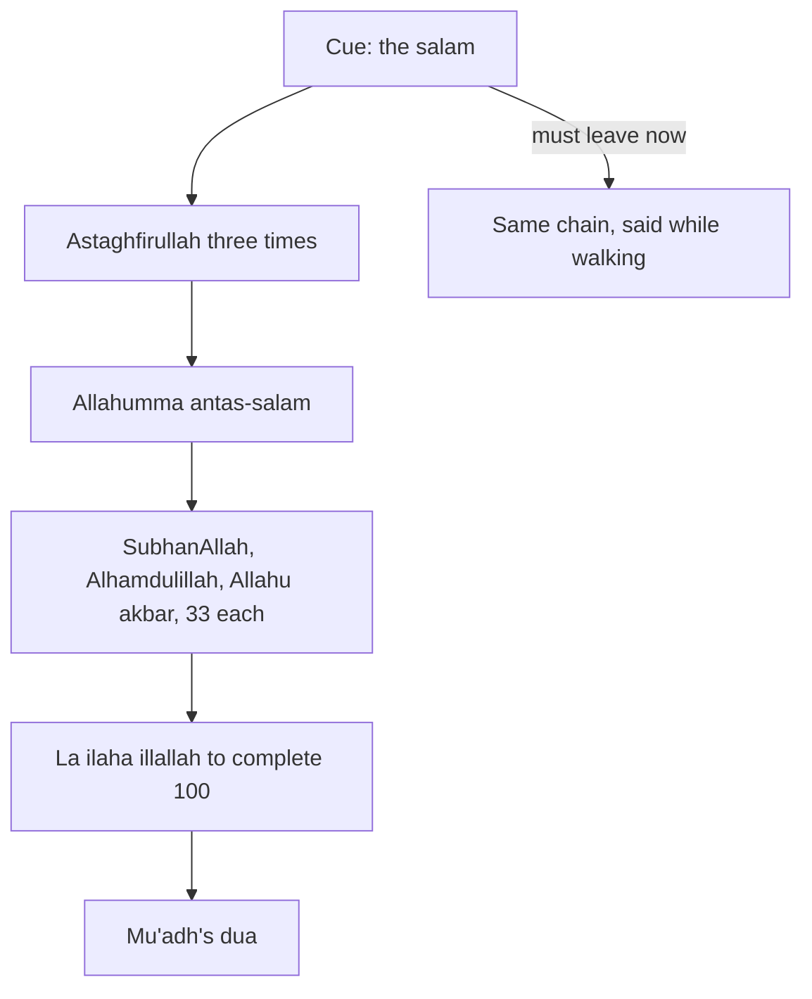

## The fastest exit in the mosque

For years, Hamza's prayer ended the same way. The imam said "As-salamu alaykum wa rahmatullah" to the right and to the left, and within ten seconds Hamza was standing, collecting his shoes and checking his phone. At the office it was even faster: salam, then back to the desk. He knew there were adhkar after the prayer. He had seen older men sitting quietly with their fingers moving. He thought of it as something for people with more time.

In the last weeks of his plan, the adhkar after the prayer come onto his ladder. By now he has a habit he did not have in September: he arrives before the iqamah for most prayers. He realises that the end of the prayer is the easiest cue he has. It happens five times a day. It happens in the same place. He never needs a reminder for it. All he needs is to stay seated for about three minutes.

Before you step through the three minutes, make a guess.

```predict
prompt: "How long do the sourced adhkar after the prayer in this chapter take, said at a normal pace once you know them?"
options:
  - id: three
    label: "About three minutes"
  - id: fifteen
    label: "About fifteen minutes"
correctOptionId: three
explanation: "Three istighfar, one short dua, a hundred short phrases of tasbih, tahmid, takbir and tahlil, and one more short dua take about three minutes once learned. Most of it is the hundred phrases, each one or two words long."
```

Step through the canvas below. It follows the three minutes after one prayer.

<InteractiveCanvas slug="after-the-salam" />

The canvas showed one cue and four short steps: forgiveness and peace, the hundred, and the dua the Prophet taught Mu'adh. It also showed the day Hamza had to leave quickly, when he said them while walking. The rest of this chapter gives each step with its source.

## Forgiveness, then peace

Thawban, may Allah be pleased with him, reported that when the Prophet, peace be upon him, finished his prayer, he asked Allah for forgiveness three times and then said the words below (Sahih Muslim 591). One of the narrators asked how the forgiveness was said, and was told: "Astaghfirullah, astaghfirullah."

> اللَّهُمَّ أَنْتَ السَّلاَمُ وَمِنْكَ السَّلاَمُ تَبَارَكْتَ ذَا الْجَلاَلِ وَالإِكْرَامِ

Meaning: O Allah, You are Peace, and from You comes peace. Blessed are You, O Owner of majesty and honour (Sahih Muslim 591).

There is something beautiful in this order. The prayer has just ended, and the first thing the Prophet did was to ask forgiveness, three times. Even after the best deed of the day, he asked forgiveness for what fell short in it. For a habit builder, this is a gentle lesson. Your prayer does not need to be perfect for you to keep going. You ask forgiveness for what fell short, and you continue.

## The hundred

Abu Hurairah, may Allah be pleased with him, reported that the Prophet said: whoever glorifies Allah after every prayer thirty-three times (SubhanAllah), praises Allah thirty-three times (Alhamdulillah) and declares Allah's greatness thirty-three times (Allahu akbar), that is ninety-nine, and completes the hundred with "La ilaha illallahu wahdahu la sharika lah, lahul-mulku wa lahul-hamd, wa huwa 'ala kulli shay'in qadir", his sins are forgiven, even if they are like the foam of the sea (Sahih Muslim 597).

The last line means: there is no god but Allah, alone, without partner. His is the dominion and His is the praise, and He has power over all things. Most people count the ninety-nine on their fingers. The whole hundred takes a little under two minutes at a calm pace.

Notice the size of the promise and the size of the deed. Two minutes, after a prayer you were praying anyway. This is the 1% idea at its clearest: a very small addition, attached to a habit that is already there, repeated five times a day.

## The dua for every prayer

Mu'adh ibn Jabal, may Allah be pleased with him, reported that the Prophet took his hand and said: "O Mu'adh, by Allah, I love you; by Allah, I love you." Then he said: "I advise you, O Mu'adh, never to leave saying after every prayer:" (Sunan Abi Dawud 1522, graded sahih by al-Albani and Shu'ayb al-Arna'ut).

> اللَّهُمَّ أَعِنِّي عَلَى ذِكْرِكَ وَشُكْرِكَ وَحُسْنِ عِبَادَتِكَ

Meaning: O Allah, help me to remember You, to thank You, and to worship You well (Sunan Abi Dawud 1522).

This dua fits this course perfectly. It does not ask for a result. It asks for help with exactly the things this course is about: remembering Allah, thanking Him, and worshipping Him well. It is a habit builder's dua. Hamza says it last, after the hundred, and it often becomes the moment he renews his intention.

The order used in this chapter is one common order. The books of adhkar contain more adhkar after the prayer, and scholars describe the order in slightly different ways. Start with these, because their sources are clear. If your imam or teacher follows a different order, follow them.

## Staying in your place

Staying seated for these three minutes has its own worth. The Prophet said that the angels keep praying for one of you as long as he stays in the place where he prayed: "O Allah, forgive him; O Allah, have mercy on him" (Sahih al-Bukhari 659). So the three minutes are not only the adhkar. They are three minutes of the angels' dua.

The diagram shows the habit as one strong cue and a short chain, with a version for the days you must leave.



The cue at the top is the strongest one in this course. You do not have to remember it, set an alarm for it or find a place for it. It finds you, five times a day. The side branch is the version for the days you cannot stay: the same words, said while walking back to your desk or your car. Allah praises those who remember Him standing, sitting and lying on their sides (Quran 3:191).

## Which prayers first?

Five prayers a day can feel like a lot to change at once. So Hamza does not start with all five. He starts with the two prayers after which he is never in a hurry: Fajr, because he walks home slowly, and Isha, because the day is over. A week later he adds Maghrib. Only then does he add Dhuhr and Asr at the office, where leaving the prayer room quickly feels most expected. Within three weeks, the habit covers all five.

This is the same ladder idea as in module 1, inside a single habit. Start where it is easiest, let it settle, and then extend it. If you ever lose the habit at the office, you still have it after Fajr and Isha, and it is easy to bring back.

## Worked example: Sadia at home

Sadia prays at home and looks after her mother, who is ill. She often stands up straight after the salam to check on her. Follow her reasoning.

**Her first prayers.** She starts with Isha, when her mother is asleep, and Fajr, before anyone else is awake.

**Her version.** She stays seated on her mat for the full set: forgiveness, peace, the hundred on her fingers, and Mu'adh's dua.

**Her busy prayers.** After Dhuhr and Asr, she often has to stand at once. She says the hundred while walking to her mother's room and making her tea. She keeps Mu'adh's dua for when she sits beside her.

**What she notices.** After a month, the adhkar after Fajr and Isha feel like part of the prayer itself. She tells her mentor that the walking version after Dhuhr "still counts as remembering Allah, even if it is not sitting".

## Where people misunderstand it

The first misunderstanding is "the adhkar after the prayer take too long". The sourced set here takes about three minutes once learned.

The second is "if I cannot sit, I should skip them". The same words can be said while walking (Quran 3:191). Staying seated has its own worth, but walking is not a reason to skip.

The third is "I must start with all five prayers". Start with the prayers where you are not rushed, and extend the habit from there.

## Check your understanding

```quiz
type: mcq
question: "Tahir wants to start the adhkar after the prayer. He is rushed after Dhuhr and Asr at work, but he walks home slowly after Fajr and is relaxed after Isha. Where does this chapter suggest he start?"
options:
  - "All five prayers from tomorrow, so the habit is complete at once"
  - "Fajr and Isha first, then extend to the other prayers"
  - "Dhuhr and Asr first, since those are where he needs it most"
  - "Only on Fridays after Jumu'ah, when he has more time"
correct: 1
explanations:
  - "Five at once is the big start. One habit can also be built step by step."
  - "Right. Start where he is not rushed, let the habit settle, and extend it to Maghrib, Dhuhr and Asr."
  - "Those are the hardest prayers for him to stay after. Starting there makes the first week the hardest."
  - "The hadith speaks of every prayer (Sahih Muslim 597), and five times a day is what makes the cue so strong."
```

```quiz
type: mcq
question: "Rizwan's team meeting starts right after Dhuhr in the office prayer room. He feels he must skip the adhkar after Dhuhr every day. What does this chapter suggest?"
options:
  - "Say the same words while walking back to the meeting"
  - "Skip them after Dhuhr; the other prayers are enough"
  - "Arrive late to the meeting so he can sit for all of them"
  - "Say them after Asr twice, once for Dhuhr and once for Asr"
correct: 0
explanations:
  - "Right. Allah praises those who remember Him standing, sitting and lying down (Quran 3:191). The same words can be said while walking."
  - "There is a version that fits his day, so he does not need to skip."
  - "Being late to his meeting is not needed. The walking version keeps both his work and his adhkar."
  - "The adhkar belong after each prayer (Sahih Muslim 597). Doubling later is not the Sunnah's way."
```

## This week

Choose two prayers after which you are rarely rushed. After each, stay in your place for three minutes and say the set in this chapter. Count the hundred on your fingers.

**Next:** A short quiz on the adhkar after each prayer.
