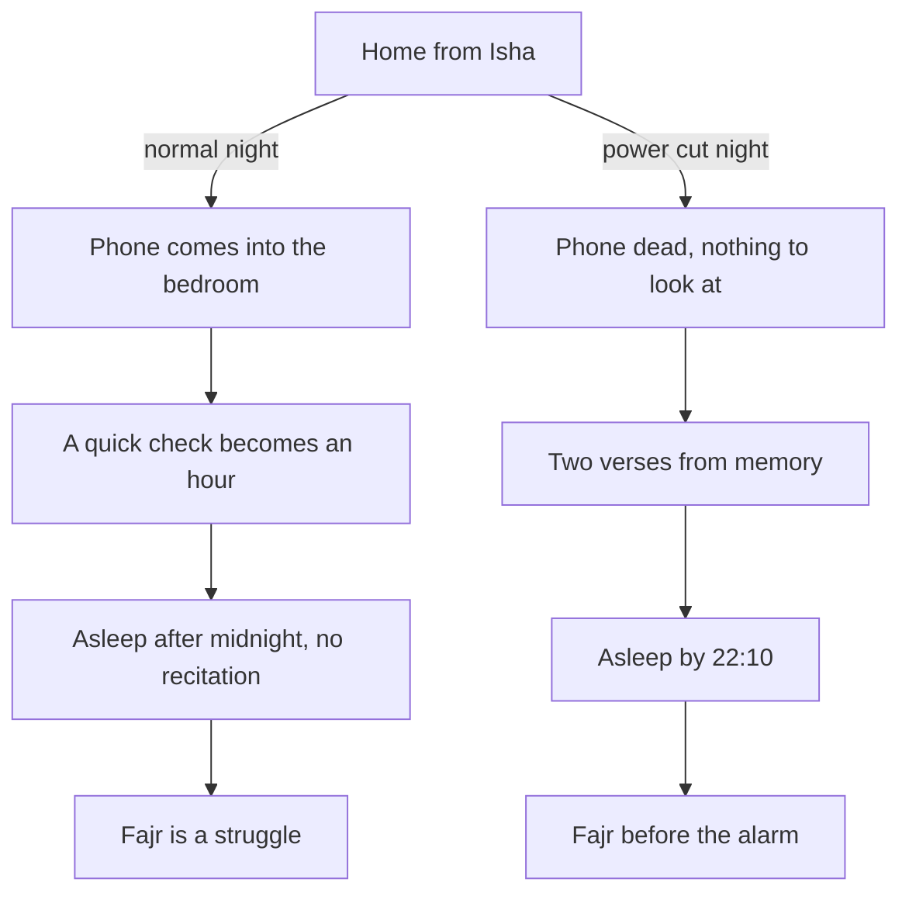

## A dark Tuesday

In week three of his plan, the last two verses of Surah al-Baqarah are Hamza's new habit. His plan says: after Isha, recite them before sleep. On Monday he does. On Tuesday evening, the power goes out across his neighbourhood at 21:40, a few minutes after he comes home from Isha. His phone is at four percent. It dies within ten minutes.

At first he is annoyed. He had planned to watch the second half of a match. Ayesha lights a candle in the kitchen and his mother goes to bed. With nothing to look at, Hamza sits on the edge of his bed in the dark. He remembers his new habit, but the mushaf is in the living room and there is no light to read by.

Then he realises he does not need the mushaf. He learned these two verses as a boy, in the mosque class his father sent him to every summer. He has not recited them from memory for perhaps fifteen years. He starts, slowly. "Amana ar-Rasulu bima unzila ilayhi min Rabbihi wal-mu'minun..." He stumbles once in the second verse, and finds the words again. When he reaches the end, "...fansurna 'alal-qawmil-kafirin", the room is very quiet.

He lies down. It is 22:05. He sleeps almost at once, and wakes for Fajr before his alarm, rested, for the first time in weeks.

## The question in the morning

On the walk to Fajr, Hamza thinks about the night. Nothing special happened. There was no feeling of a miracle. But three ordinary things happened together that rarely happen on his normal nights. He recited the Quran before sleep. He slept before 22:30. And he woke for Fajr easily.

He asks himself an honest question. Why did this happen on the night the power failed? The answer is uncomfortable: because his phone was dead. On a normal night, the phone comes into the bedroom, the "quick check" becomes an hour of videos, and by midnight the Quran has no chance. The power cut did not make him more pious. It removed the thing that usually wins.

Before you read on, make a guess.

```predict
prompt: "On Hamza's normal nights, the recitations before sleep usually lose. What is their real competitor?"
options:
  - id: phone
    label: "His phone in the bedroom"
  - id: tiredness
    label: "Being too tired to recite"
correctOptionId: phone
explanation: "On the night of the power cut he was just as tired, and he still recited and slept early. What was missing was the phone. Most bedtime routines fail at the same point: the phone in the bed."
```

## What Ayesha says

At breakfast, Hamza tells Ayesha about the night: the dead phone, the two verses in the dark, the early sleep and the easy Fajr. She listens and then says, gently, that she has noticed something too. On most nights, she says, they lie side by side, both on their phones, until one of them falls asleep. She misses talking to him before sleep. She would like to recite the two verses as well; she learned them at school and has half forgotten them.

They decide something together. From that evening, both phones charge on the shelf in the hall, next to the front door, from the time Hamza comes home from Isha. If anything is urgent, his mother knows to knock. Before sleep, they recite the two verses together, Ayesha reading from Hamza's mushaf until she knows them again. Then they talk for a few minutes, or not, and sleep.

Hamza notices how much easier this is than doing it alone. A habit that two people share in a home has two people protecting it. And a phone rule that applies to both of them does not feel like a punishment for one.

## The rest of week three

The new routine does not work perfectly. On Thursday Hamza brings his phone into the bedroom "just to set an alarm", and is awake until midnight. On Saturday there are guests until late, and he falls asleep before he remembers the verses. At the end of the week his tracker shows the two verses on five of seven nights, and lights out before 22:30 on four.

In September, a week like that would have felt like failure. This time Hamza writes two words next to Thursday, "phone alarm", and buys a cheap alarm clock for the bedroom the next day. Five of seven is enough to keep the habit, and the alarm clock removes the excuse that broke it.

## The two recitations

This module is about two recitations that many Muslims keep before sleep. Both were on the list Hamza made on 1 October.

The first is the last two verses of Surah al-Baqarah, Quran 2:285 to 286, often called Amana al-Rasul from their first words. They take about two minutes. They begin with a summary of belief and end with the believers' duas: our Lord, do not take us to task if we forget or make a mistake; do not make us carry what we cannot bear; pardon us, forgive us, have mercy on us. The Prophet, peace be upon him, said that whoever recites them at night, they will be enough for him (Sahih al-Bukhari 5009).

The second is Surah al-Mulk, the 67th surah, thirty verses, about ten minutes. There is a sound hadith about it: a surah of thirty verses interceded for a man until he was forgiven, and it is "Blessed is He in whose hand is the dominion" (Jami' at-Tirmidhi 2891, graded hasan). There is also a popular report about it that many people quote, whose grading is disputed. Chapter 6.2 looks at both, and at how to tell a sound report from a weak one.

The diagram shows Hamza's two kinds of night side by side.



The two nights start from the same place, after the same prayer, with the same tired man. They split at one point: what happens to the phone. Everything after that split follows almost by itself, the recitation, the early sleep and the easy Fajr. That is the lesson Hamza takes from the dark Tuesday. He cannot rely on power cuts. He has to make the phone lose on purpose.

## Why the night matters for everything else

The night recitations are short, but the night itself is the hinge of the whole plan. Module 2 showed that Fajr is won the night before. The bedtime routine is that night. If it ends after midnight with the phone in hand, Fajr suffers, the Quran page after Fajr suffers, and the morning adhkar on the walk home suffer. If it ends at 22:15 with the two verses, tomorrow's first three habits are already protected.

So this module teaches more than two recitations. It teaches a short bedtime routine whose first step is the phone, whose minimum is the two verses, and whose last step is lights out early enough for Fajr. Hamza will build it slowly: the two verses now, in week three, and al-Mulk near the end of his thirteen weeks, once the routine is steady.

Your nights may look very different from Hamza's. You may live alone, with no one to share a phone rule with. You may share a room with siblings or flatmates who stay up late. You may work at night and sleep in the day. The routine in this module does not need a quiet house or a partner. It needs three things you can arrange in almost any life: a place for the phone that is not your bed, two verses you can say under your breath, and a time to sleep that leaves room for Fajr. Chapter 6.3 shows how people with night shifts and crowded homes fit it in.

<Callout type="info" title="Sleep and health">
A routine like this is good for sleep, but it does not replace care for real sleep problems. If you cannot sleep for many nights, or feel exhausted for a long time, talk to a doctor.
</Callout>

<LearningObjectives items={["Know what the last two verses of al-Baqarah and Surah al-Mulk say, and their sound sources (Sahih al-Bukhari 5009; Jami' at-Tirmidhi 2891)", "Check a popular saying for a collection, a number and a grading before you pass it on", "Build a bedtime routine that puts the phone away first and keeps a two-minute minimum", "End the day early enough to protect tomorrow's Fajr", "Learn al-Mulk by heart a few verses a week, with review"]} />

## Key words

| Word | Plain English |
|---|---|
| **Amana al-Rasul** | The last two verses of Surah al-Baqarah (Quran 2:285 to 286), named from their first words |
| **Surah al-Mulk** | The 67th surah of the Quran, thirty verses; also called *Tabarak* from its first word |
| **Grading** | A scholar's judgement of how reliable a hadith's chain is: sahih (sound), hasan (good), or da'if (weak) |
| **Bedtime routine** | A short chain of steps after Isha, each one the cue for the next, ending in sleep |
| ***Hifz*** | Learning the Quran by heart |

## What is in this module

| Chapter | You will practise |
|---|---|
| 6.2 | The two recitations, their meanings and sources, and checking a report |
| 6.3 | A bedtime routine that beats the phone, and al-Mulk by heart |
| 6.4 | The night routine: wudu, the right side, the sleep duas and muhasaba |
| 6.5 | A short quiz with five cases |
| 6.6 | Your bedtime routine |

**Next:** Amana al-Rasul and Surah al-Mulk: what they say and what the sources say about them.
