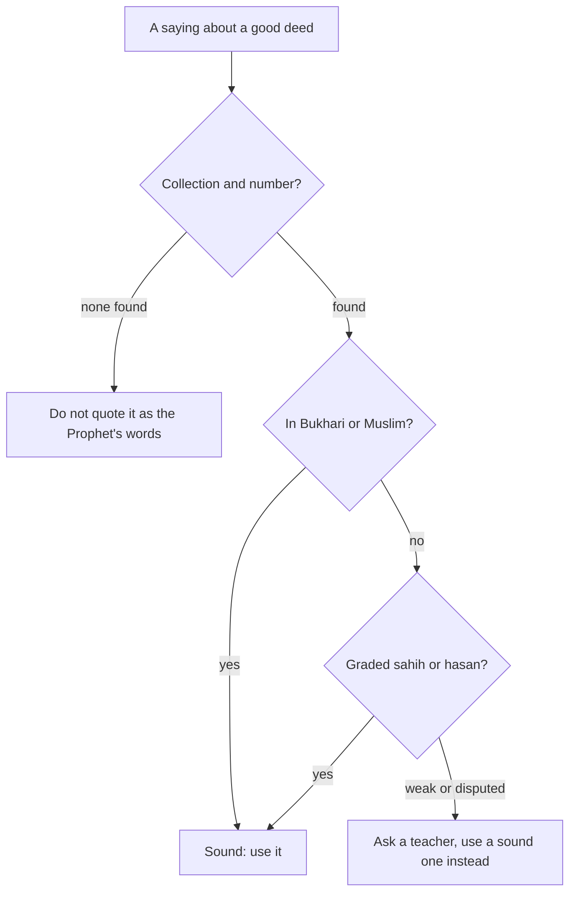

## Two minutes and ten minutes

In week three of his plan, Hamza added the shortest habit on his list: the last two verses of Surah al-Baqarah after Isha. They take him about two minutes. Near the end of his thirteen weeks he adds the longest night habit: Surah al-Mulk, thirty verses, about ten minutes at his pace. Together they become the last fifteen minutes of his day.

When he tells his mother about al-Mulk, she says: "The Prophet never slept until he had read it." Hamza has heard that too. He wants to put it on his card next to the surah's name. But by now he has a habit of his own: before he writes a hadith on a card, he looks up its source and its grading. What he finds surprises him.

Before you step through his last fifteen minutes, make a guess.

```predict
prompt: "Of the two recitations, which is the better minimum on a night Hamza is too tired for both?"
options:
  - id: baqarah
    label: "The last two verses of al-Baqarah"
  - id: mulk
    label: "Surah al-Mulk, the full thirty verses"
correctOptionId: baqarah
explanation: "Both are sound and beloved. But a minimum should be the smallest version you can always do. The two verses take about two minutes, and the Prophet said that whoever recites them at night, they are enough for him (Sahih al-Bukhari 5009)."
```

Step through the canvas below. It follows Hamza's last fifteen minutes, from the front door to his bed.

<InteractiveCanvas slug="before-sleep-recitations" />

The canvas showed that the routine began with the phone, not the Quran. Once the phone was on the charger, the two verses took two minutes and al-Mulk about ten. On a tired night, the two verses alone kept the habit alive. The rest of this chapter looks at what the two recitations say, and what the sound sources say about them.

## Amana al-Rasul: the last two verses of al-Baqarah

Surah al-Baqarah, the longest surah of the Quran, ends with two verses (Quran 2:285 to 286). They are often called Amana al-Rasul, from their first words.

> آمَنَ الرَّسُولُ بِمَا أُنزِلَ إِلَيْهِ مِن رَّبِّهِ وَالْمُؤْمِنُونَ

Meaning: The Messenger believes in what was sent down to him from his Lord, and so do the believers (Quran 2:285).

The first verse is a summary of belief. The Messenger and the believers all believe in Allah, His angels, His books and His messengers, and make no distinction between any of His messengers. And they say: we hear and we obey; we ask Your forgiveness, our Lord, and to You is the return (Quran 2:285).

The second verse begins with one of the gentlest sentences in the Quran for anyone building habits: Allah does not place on any soul more than it can bear (Quran 2:286). Then come the believers' duas: our Lord, do not take us to task if we forget or make a mistake; our Lord, do not place on us a burden like the one placed on those before us; our Lord, do not make us carry what we cannot bear; pardon us, forgive us and have mercy on us; You are our Protector (Quran 2:286).

Read those duas with this course in mind. "If we forget or make a mistake" names exactly what happens to every habit builder. Every night, before sleep, the believer asks Allah not to hold those lapses against him. It is a perfect end to a day of trying.

Abu Mas'ud al-Ansari, may Allah be pleased with him, reported that the Prophet, peace be upon him, said: whoever recites the two verses at the end of Surah al-Baqarah at night, they will be enough for him (Sahih al-Bukhari 5009).

> مَنْ قَرَأَ بِالآيَتَيْنِ مِنْ آخِرِ سُورَةِ الْبَقَرَةِ فِي لَيْلَةٍ كَفَتَاهُ

Meaning: Whoever recites the two verses from the end of Surah al-Baqarah in a night, they will be enough for him (Sahih al-Bukhari 5009).

The hadith does not say exactly how they are enough, and scholars have explained it in several ways. What is clear is the size of the deed: two verses, two minutes, every night.

## Surah al-Mulk

Surah al-Mulk is the 67th surah, thirty verses long. It begins: blessed is He in whose hand is the dominion, and He has power over all things (Quran 67:1). The second verse states the purpose of life in a way that fits this course closely: He created death and life to test which of you is best in deeds (Quran 67:2). Not "most in deeds", but best. The surah turns the reader's attention to the sky, the earth, the birds held up in the air and the provision Allah sends, and asks again and again: who else could do this?

The sound source on al-Mulk comes from Abu Hurairah, may Allah be pleased with him. The Prophet said: there is a surah of the Quran, thirty verses, that interceded for a man until he was forgiven; it is "Blessed is He in whose hand is the dominion" (Jami' at-Tirmidhi 2891). At-Tirmidhi graded it hasan, and al-Albani and others agreed. A similar wording is in Sunan Abi Dawud (1400), also graded hasan.

## A sound report, and a popular weak one

Now to what Hamza's mother said. The report that the Prophet would not sleep until he had recited Surah as-Sajdah and Surah al-Mulk is in Jami' at-Tirmidhi (2892). Hamza looks it up in his hadith app and checks the grading. In the edition he uses, it is graded weak: at-Tirmidhi himself notes a problem in its chain, and later graders also list it as weak. Some scholars accepted it through other chains, so it is not a simple case. But because its grading is disputed, this course does not use it.

Hamza does not tell his mother she is wrong. He tells her what he found, kindly, and shows her the hadith that is sound: al-Mulk interceded for a man until he was forgiven. "So we read it anyway," he says, "and now we know which hadith to give people."

This is a small, important skill for anyone who builds Islamic habits. Many popular sayings are attached to good deeds. Some are sound, some are weak, and a few are not hadith at all. You do not need to become a scholar. You need three habits of your own: look for the collection and the number; look for the grading if it is outside Sahih al-Bukhari and Sahih Muslim; and if you are unsure, ask a teacher you trust. Apps such as Islam 360 and sites such as sunnah.com show gradings for many hadith.

The diagram shows the three checks in order, before a hadith goes onto your card or into a message to someone else.



Notice that none of these branches ends with "stop doing the deed". Reading al-Mulk at night is a good deed whatever happens to one report about it. The checks are about what you say about a deed, especially when you pass it on to others.

## Worked example: Sameer checks a message

Sameer receives a forwarded message: "Whoever reads Surah al-Mulk every night will never be questioned in the grave. Forward to ten people." Follow his reasoning.

**First check.** The message gives no collection or number. He searches for the wording in his hadith app and finds nothing matching it exactly.

**Second check.** He finds the sound hadith about al-Mulk interceding for a man (Jami' at-Tirmidhi 2891, hasan). It does not contain the promise in the message, and it says nothing about forwarding.

**What he does.** He does not forward the message. He keeps reading al-Mulk at night. In his family group he writes only the sound hadith, with its source, and nothing more.

**What he learns.** A good deed does not need an invented promise. The sound source is enough.

## Where people misunderstand it

The first misunderstanding is "if a report is weak, the deed is worthless". Reading al-Mulk is a good deed with a sound source of its own. Only the weak report is set aside.

The second is "checking hadith is only for scholars". Looking for a collection, a number and a grading takes a minute in a hadith app.

The third is "the two verses are too small to matter". The Prophet said they are enough for the one who recites them at night (Sahih al-Bukhari 5009).

## Check your understanding

```quiz
type: mcq
question: "Laila wants to put one sound hadith about Surah al-Mulk on her card. Which one fits this chapter?"
options:
  - "The Prophet never slept until he recited it (Jami' at-Tirmidhi 2892)"
  - "It interceded for a man until forgiven (Jami' at-Tirmidhi 2891)"
  - "Whoever reads it nightly is never questioned in the grave (no source)"
  - "Whoever forwards it to ten people is rewarded ten times (no source)"
correct: 1
explanations:
  - "This report has a disputed grading, so the course does not use it."
  - "Right. At-Tirmidhi graded it hasan, and al-Albani and others agreed (Jami' at-Tirmidhi 2891; Sunan Abi Dawud 1400)."
  - "No collection or number supports this wording. Do not quote it as the Prophet's words."
  - "This has no source at all. Do not quote it."
```

```quiz
type: mcq
question: "Bilal's uncle tells him that a hadith about a good deed is weak, so Bilal decides to stop doing the deed. The deed is reading the last two verses of al-Baqarah at night. What does this chapter suggest?"
options:
  - "Stop, since a weak hadith means the deed has no worth"
  - "Keep going, and also forward the weak hadith to friends"
  - "Stop until a scholar confirms the deed is allowed"
  - "Keep going: this deed has a sound source of its own"
correct: 3
explanations:
  - "Even if one report is weak, a deed may have other sound sources. This one does."
  - "Keep the deed, but pass on only sound sources."
  - "Reciting the Quran needs no special permission. This deed has a source in Sahih al-Bukhari."
  - "Right. Whoever recites the two verses at the end of al-Baqarah at night, they will be enough for him (Sahih al-Bukhari 5009)."
```

## This week

Recite the last two verses of al-Baqarah after Isha every night this week. Read their meaning once in your own language. If you know a popular saying about a good deed, check its source and grading.

**Next:** A bedtime routine that holds, and al-Mulk learned by heart.
