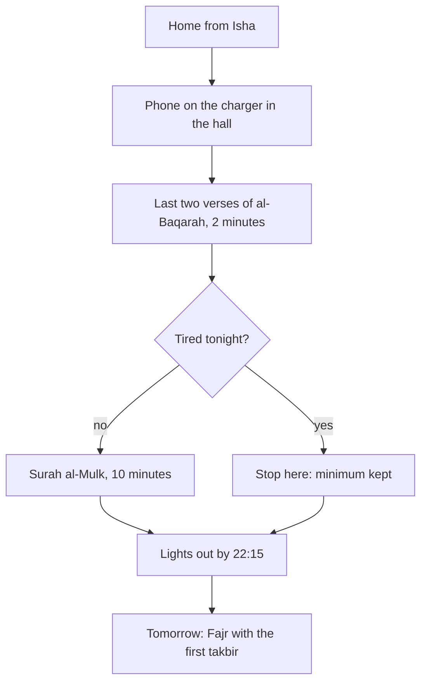

## The real competitor

Hamza's night recitations have one serious competitor, and it is not tiredness. It is his phone. In September, his evenings ended the same way most nights: in bed, phone in hand, "just checking" messages, then videos, until 1:00. The adhkar book and the mushaf were in the next room. They never had a chance.

When he looks at his honest notes from those weeks, he sees that the nights he read anything before sleep were the nights his phone battery died. The Quran won only when the phone lost by accident. So his bedtime plan starts by making the phone lose on purpose.

Before you step through his six weeks with al-Mulk, make a guess.

```predict
prompt: "Hamza is learning al-Mulk by heart, five verses a week. In week four, the verses from week three keep slipping. Should he push on with five new verses, or stop and review?"
options:
  - id: review
    label: "Stop adding new verses for a week, and review"
  - id: push
    label: "Push on with five new verses, so he stays on schedule"
correctOptionId: review
explanation: "A memorisation plan is a habit too. Adding new verses on top of shaky ones makes both slip. A review week keeps everything he has learned, and the most beloved deeds are the most consistent, even if small (Sahih al-Bukhari 6465)."
```

Step through the canvas below. It follows Hamza's weeks of learning Surah al-Mulk by heart.

<InteractiveCanvas slug="al-mulk-by-heart" />

The canvas showed a long goal, thirty verses, turned into a weekly habit of five. New verses were learned in the morning, after Fajr, and reviewed at night, inside the bedtime routine he already had. In week four, when the old verses slipped, he added nothing and only reviewed. By week seven he could recite the whole surah from memory, even in the dark.

## The routine, step by step

A bedtime routine is a short chain of steps, each one the cue for the next. Hamza's has five.

**One: the phone goes on the charger in the hall.** This is the most important step, and it comes first. He does it the moment he comes home from Isha, before taking off his shoes. If the phone comes into the bedroom, the rest of the routine is a fight he usually loses.

**Two: the last two verses of al-Baqarah.** About two minutes, sitting on his bed. This is his minimum. On any night, however tired, he does at least this.

**Three: Surah al-Mulk.** About ten minutes, from the mushaf on the shelf by his bed, or from memory once he has learned it.

**Four: lights out.** On most nights by 22:15, which gives him about seven hours before Fajr congregation.

**Five: nothing else.** No "quick check" of the phone. If something is urgent, his family know to knock on the door.

The diagram shows the chain, and the line that ties it to the morning.



Look at where the chain begins and where it ends. It begins with the phone, not with the Quran, because the phone is what breaks it. It ends at Fajr, because the same early night that protects the recitations also protects tomorrow's first prayer. Module 2 said Fajr is won the night before. Here is the night.

## A minimum that is kind

Allah says: Allah does not place on any soul more than it can bear (Quran 2:286).

> لَا يُكَلِّفُ اللَّهُ نَفْسًا إِلَّا وُسْعَهَا

Meaning: Allah does not place on any soul more than it can bear (Quran 2:286).

This sentence is about what Allah requires, and it is a comfort, not a demand. It is also a good guide for the size of a voluntary habit. On a night after a long journey or a sick child, ten more minutes of reading may be more than Hamza can carry. The two verses are not. So the routine has a fork: on tired nights, he stops after the two verses and sleeps. It is the same verse that he has just recited, which makes the choice easy to remember.

A minimum is not a failure. The habit is kept, the cue is kept, and tomorrow night the full routine is still a habit rather than a fresh start.

## Learning al-Mulk by heart

Reciting al-Mulk from memory has practical benefits. It needs no light, no mushaf and no phone, so it works during a power cut, on a journey or lying in the dark. Memorising is a bonus, not a condition: reading al-Mulk from the mushaf is the same surah and the same habit.

Hamza's method has three parts. He learns five new verses in the morning, after his Quran page, when his mind is fresh: first reading them several times while looking, then without looking. At night, inside the routine, he recites everything he has learned so far from memory, then reads the rest of the surah from the mushaf. And he follows one rule: if the old verses are shaky, he adds nothing new that week. A review week is part of the plan, not a delay.

At five verses a week, thirty verses take six weeks. With one review week, seven. That is a long time for someone who wants it done tomorrow, and a short time for something he will keep for the rest of his life.

Correct pronunciation still needs a teacher. Hamza reads his five new verses to the teacher at the mosque after Jumu'ah each week, as part of the ten minutes he already spends there.

## When the night is different

Some nights do not follow the usual shape. Guests stay late. A family wedding runs past midnight. A journey ends in a hotel room. On those nights, look for the first step and the minimum, and let the rest go. The phone still goes somewhere other than the bed, even if that is the far side of a hotel room. The two verses still come before sleep, even if they are said lying down in the dark.

Hamza learned this in his week of travel, which you will meet in module 15. In a cousin's house, with five people in one room, he could not read al-Mulk from a mushaf with the light on. He recited the two verses under his breath and slept. When he came home, the full routine was waiting for him, unbroken.

## Worked example: Rehana's night shift

Rehana is a call-centre agent. Three nights a week she works until 2:00, and she sleeps when she gets home. Follow her reasoning.

**Her problem.** On shift nights there is no "after Isha". She prays Isha at work in a break, and when she gets home her phone is in her hand for the taxi app.

**Her routine.** On shift nights, she says the last two verses of al-Baqarah in her Isha break at work, sitting on her prayer mat, and plugs her phone in at the front door when she gets home. On other nights she does the full routine after Isha.

**Her memorising.** She learns al-Mulk with a recording on her day off, five verses a week, and recites what she knows in the taxi home, with the phone in her bag.

**What she notices.** After a month, she has not missed the two verses once. Al-Mulk is at fifteen verses, slower than she planned, and she keeps going.

## Where people misunderstand it

The first misunderstanding is "I need more discipline at night". The plan that works removes the phone first, so less discipline is needed.

The second is "a minimum means I am giving up". Allah does not place on a soul more than it can bear (Quran 2:286). The minimum keeps the habit alive.

The third is "I must learn al-Mulk quickly". Five verses a week, with review, is a pace most people can keep. Reading from the mushaf is the same surah until then.

## Check your understanding

```quiz
type: mcq
question: "Nida reads al-Mulk at night about twice a week. On the other nights she falls asleep scrolling on her phone in bed. Which first change fits this chapter?"
options:
  - "Read al-Mulk on her phone in bed, since the phone is already in her hand"
  - "Promise herself to stop scrolling and read on every night instead"
  - "Move al-Mulk to the morning, when the phone is less tempting"
  - "Put the phone on a charger outside the bedroom before she starts"
correct: 3
explanations:
  - "Opening the phone for the Quran usually leads to messages first. The phone in bed is what breaks the routine."
  - "A promise without a change in her surroundings relies on willpower at her most tired moment."
  - "Al-Mulk can be read at other times, but the night is her goal, and the phone is the obstacle to fix."
  - "Right. The routine starts by putting the phone away, so the recitation does not have to win a fight every night."
```

```quiz
type: mcq
question: "Waqar has learned verses 1 to 15 of al-Mulk. This week verses 11 to 15 keep slipping, and he is tempted to start 16 to 20 to stay on schedule. What does this chapter suggest?"
options:
  - "Take a review week: add nothing new, and recite 1 to 15 until steady"
  - "Start 16 to 20, since falling behind schedule is worse than slipping"
  - "Start again from verse 1, learning slower this time"
  - "Stop memorising and read from the mushaf only from now on"
correct: 0
explanations:
  - "Right. A review week keeps what he has, and a steady small deed is the most beloved (Sahih al-Bukhari 6465)."
  - "Adding on top of shaky verses makes both slip. The schedule serves the habit, not the other way round."
  - "He does not need to restart. Verses 1 to 10 are steady. He reviews, then continues."
  - "Reading from the mushaf is a good habit too, but he is close to his goal. A review week is enough."
```

## This week

Choose where your phone will charge at night, outside your bed. Write your bedtime chain: the first step, the minimum, the full version and lights out. If you want to memorise al-Mulk, learn verses 1 to 5 this week.

**Next:** A short quiz on the two recitations and the bedtime routine.
