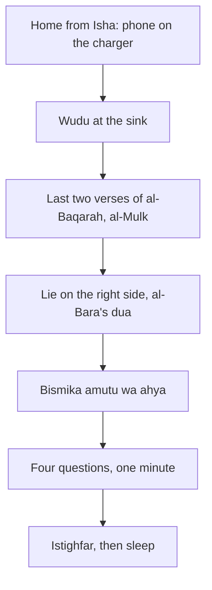

## After the two verses

By now Hamza's bedtime routine has a shape: the phone on the charger in the hall, the last two verses of al-Baqarah, Surah al-Mulk on most nights, and lights out by 22:15. One evening his mother asks whether he also sleeps "the way the Prophet slept". He does not know what she means.

She tells him about a hadith she learned as a girl: the Prophet, peace be upon him, taught a companion to make wudu before bed, to lie on his right side, and to say a particular dua. Hamza looks it up that night. It is in Sahih al-Bukhari. The routine he built can hold a few more small steps, each one short and sourced.

Before you step through his last five minutes, make a guess.

```predict
prompt: "Hamza adds a one-minute look back at his day before sleep. Should it be long and detailed, or short enough to do every night?"
options:
  - id: long
    label: "Long and detailed, so nothing is missed"
  - id: short
    label: "Short enough to do every night"
correctOptionId: short
explanation: "A look back that takes thirty minutes will be dropped on the first tired night. Four short questions, answered honestly in a minute, can be kept every night, which is what turns them into a habit."
```

Step through the canvas below. It follows Hamza's last five minutes.

<InteractiveCanvas slug="the-night-routine" />

The canvas showed four Sunnah steps and one minute of honesty: wudu, the right side with al-Bara's dua, the words "Bismika amutu wa ahya", and four questions about the day, ending in istighfar.

## Wudu, the right side, and al-Bara's dua

Al-Bara ibn Azib, may Allah be pleased with him, reported that the Prophet said to him: when you go to your bed, make wudu as you do for the prayer, then lie on your right side, and say: O Allah, I submit myself to You, entrust my affairs to You, and turn my back to You for support, out of hope and fear of You. There is no refuge and no escape from You except to You. I believe in Your Book which You sent down and in Your Prophet whom You sent. The Prophet added that if he died that night he would die upon the fitrah, and told him to make these his last words (Sahih al-Bukhari 247).

This one hadith gives three habits: wudu before bed, lying on the right side, and a dua. Hamza adds them one at a time. First the wudu, which is easy because he already brushes his teeth at the sink. Then the right side. Then the dua, from a card on his bedside table until he knows it.

## In Your name I die and live

Hudhayfah, may Allah be pleased with him, reported that when the Prophet went to bed he said a short dua, and when he woke he said another (Sahih al-Bukhari 6312).

> بِاسْمِكَ أَمُوتُ وَأَحْيَا

Meaning: In Your name I die and I live (Sahih al-Bukhari 6312).

Sleep is a small death, and waking a small return to life. The same hadith gives the waking dua you will meet again in module 7: praise be to Allah who gave us life after He caused us to die, and to Him is the return. The night and the morning are tied together by two short sentences.

## Muhasaba: one honest minute

Allah says: O you who believe, fear Allah, and let every soul look at what it has sent ahead for tomorrow (Quran 59:18).

> وَلْتَنظُرْ نَفْسٌ مَّا قَدَّمَتْ لِغَدٍ

Meaning: And let every soul look at what it has sent ahead for tomorrow (Quran 59:18).

Muhasaba means taking account of yourself. In this course it is four short questions, answered honestly in your head or in one line of a notebook. What did I do today that pleases Allah? What wrong did I avoid? What do I need to ask forgiveness for? What will I do better tomorrow? For the third, say astaghfirullah, and if you wronged a person, plan one small repair for tomorrow, such as an apology. For the fourth, choose one thing, not ten.

Keep it kind. The goal is not to punish yourself but to steer. A person who looks back for one minute every night will notice patterns, such as the same sharp word to the same person every evening, long before someone who never looks back.

The diagram shows the whole bedtime routine, old steps and new.



Each box is short, and each one is the cue for the next. If a night is very hard, the minimum is still the first two boxes and the two verses. Everything else can wait for tomorrow.

## When the routine meets real nights

Real nights are not all the same, so the routine needs a little flexibility. On a night when you fall asleep on the sofa without meaning to, the routine is gone for that night; do not wake yourself to repeat it, simply start again tomorrow. On a night with guests until late, keep the minimum: the two verses, the right side and "Bismika amutu wa ahya". On a night when you are ill, do what you can lying down; remembrance needs no special position (Quran 3:191).

If you share a room, the routine still works. Wudu happens at the sink, the duas can be said under your breath, and the four questions are silent. If you share a bed with a small child who wakes often, the questions can be asked on the walk back from Isha instead of in bed.

Couples and families can share parts of it. Hamza and Ayesha now say the four questions to each other on two nights a week, briefly. They find that answering "what will I do better tomorrow?" out loud makes them more likely to do it, and that hearing each other's answers makes them kinder.

## The waking end of the same thread

The routine has a partner in the morning. The last words before sleep, "in Your name I die and I live", are answered by the first words on waking, "praise be to Allah who gave us life after He caused us to die" (Sahih al-Bukhari 6312). Learning them together, as a pair, makes both easier to remember. Module 7 builds the rest of the morning from that first sentence.

## Worked example: Musa's night

Hamza's nephew Musa, who is twelve, stays with the family on weekends. His mother wants him to learn the night routine. Follow how they build it.

**Week one.** Wudu before bed, attached to brushing his teeth. Rida, his mother, does it with him.

**Week two.** Lying on the right side, and "Bismika amutu wa ahya", which is short enough to learn in one night.

**Week three.** The four questions, said out loud to his mother as a game: one good thing, one wrong avoided, one sorry, one plan.

**What Rida notices.** By week four Musa reminds her if she forgets. The questions have also become the best five minutes of talk in their day.

Rida also notices something about herself. Saying the four questions with Musa makes her answer them too, and she begins to look forward to the honest minute at the end of her own day.

The order also matters. Musa learned the body habits first, wudu and the right side, because they are easy to see and check. The words came next, and the honest questions last, once the routine already felt like his.

## Where people misunderstand it

The first misunderstanding is "muhasaba means feeling guilty". It means looking honestly and steering. Ask forgiveness, plan one repair, and sleep.

The second is "I must learn every bedtime dua at once". Add one step a week, as Musa did.

The third is "if I sleep without wudu my night is wasted". Wudu before sleep is a Sunnah to grow into, not a condition for rest.

## Check your understanding

```quiz
type: mcq
question: "Bushra wants to start muhasaba before sleep. She plans to write a full page about her day every night. She has tried this before and stopped after three nights. What does this chapter suggest?"
options:
  - "Write the full page anyway, since detail shows sincerity"
  - "Do it only on weekends, when she has time for a full page"
  - "Four short questions in one minute, every night"
  - "Skip muhasaba and rely on istighfar alone"
correct: 2
explanations:
  - "A long version is what stopped her before. Short and daily is the habit."
  - "Weekly is better than nothing, but a short nightly version keeps the habit close to the day."
  - "Right. Let every soul look at what it has sent ahead (Quran 59:18). One honest minute is enough to steer."
  - "Istighfar is part of it, but looking back also helps her plan a repair and tomorrow's change."
```

```quiz
type: mcq
question: "Which three habits does Sahih al-Bukhari 247 give for going to bed?"
options:
  - "Reading al-Mulk, drinking water, and sleeping early"
  - "Wudu, lying on the right side, and a dua of entrusting yourself to Allah"
  - "Ghusl, lying on the left side, and Ayat al-Kursi"
  - "Wudu, sleeping on the back, and reciting the two verses of al-Baqarah aloud"
correct: 1
explanations:
  - "Al-Mulk comes from another hadith (Jami' at-Tirmidhi 2891). Sahih al-Bukhari 247 names wudu, the right side and the dua."
  - "Right. Make wudu as for prayer, lie on your right side, and say: O Allah, I submit myself to You... (Sahih al-Bukhari 247)."
  - "Sahih al-Bukhari 247 says wudu and the right side, not ghusl and the left."
  - "It says the right side, and the two verses come from Sahih al-Bukhari 5009."
```

## This week

Add one step to your bedtime routine: wudu at the sink, the right side, or "Bismika amutu wa ahya". On the last night of the week, try the four questions.

**Next:** A short quiz on the two recitations and the bedtime routine.
