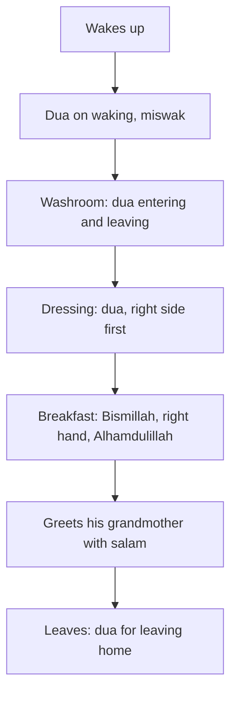

## The rest of the day

On the first Friday of January, Hamza opens his Notion page and looks at thirteen weeks of ticks. His prayers, his Quran page, his adhkar and his night recitations are steadier than they have been in his life. He feels grateful. Then, almost by accident, he does a small calculation.

His eleven habits take, on a normal day, a little under two hours, including the walks to the mosque. He is awake for about seventeen. So what about the other fifteen hours? How does he speak at work? What does he look at on his phone? How does he eat, treat his mother, spend his money, handle anger, use his free time? None of that is on his page.

That weekend his sister Rida and her son Musa, who is twelve, come to stay. On Saturday morning Hamza watches Musa wake up, walk to the washroom, get dressed, eat breakfast and leave for a cousin's house, all in about forty minutes. In those forty minutes there are at least eight moments for which the Prophet, peace be upon him, taught a short word or a small manner. Musa does none of them. Hamza realises that until recently, neither did he.

## Ayesha's list

That evening Ayesha shows him something. For weeks she has been writing, in a notebook, every Sunnah habit of daily life she can remember from her school Islamiyat lessons and from talks: the dua on waking, the duas for the washroom, eating with the right hand, the salam when entering the house, guarding the tongue, honouring parents, kindness to animals, halal earning, Friday's sunnahs, Ramadan. The list runs to nine pages and about a hundred lines.

"I want our home to live by this," she says. "But it is too much. Where do we start?"

Hamza smiles, because he knows the answer now. The same way as the prayers: one habit a week, attached to a moment that already happens, with a small version for hard days, each with a sound source. The list is not a test to pass by Monday. It is a map for a year, or two.

Before you read on, make a guess.

```predict
prompt: "Ayesha's list has about a hundred Sunnah habits for daily life. Using the one-habit-a-week plan, roughly how long would it take to add them all?"
options:
  - id: two-years
    label: "About two years, and that is fine"
  - id: one-month
    label: "About a month, if they try hard enough"
correctOptionId: two-years
explanation: "A hundred habits at one a week is about two years. That sounds slow, but in two years the whole family would be living by a hundred Sunnah habits that are steady, which almost nobody achieves by trying everything at once."
```

## Ordinary moments are cues

Here is the discovery at the centre of this second half of the course. The ordinary moments of a day are the best cues a habit can have. You do not need to remember to wake up, to enter the washroom, to eat or to leave the house. They happen anyway, every day, at roughly the same times. If a short dua or manner is attached to each one, the moment itself becomes the reminder.

The Prophet's Sunnah is full of exactly this kind of habit. There are words for waking and for sleeping, for entering and leaving the washroom, for dressing, for leaving the house and entering the mosque, for eating and finishing a meal, for sneezing, for visiting the sick. Each one is a sentence or two. Each one turns a moment that would pass without thought into a moment of remembrance.

The diagram shows Musa's forty minutes on Saturday morning, and the Sunnah moment hidden in each.



Every box on the left side of the arrows already happened in Musa's morning. The Sunnah does not ask him to add new moments. It asks him to add a few words to moments he already has. That is why these habits, once learned, are among the easiest in the whole course to keep.

## Beyond moments: the whole of life

Ayesha's list is longer than moments, though. It also includes the heart (sincerity, taqwa, envy, pride), the tongue, the eyes and the ears, character with people, rights of others, family, neighbours and guests, discipline and time, learning, halal earning and money, and the weekly and yearly rhythms of Friday, sadaqah and Ramadan. Those cannot be attached to a single moment. They are attached to situations: a hot meeting, a forwarded message, a request from a parent, a sale in a shop.

So the rest of this course is organised like Ayesha's list, in eight more modules, before the final module on tracking and your plan:

- Module 7, this one: the Sunnah of ordinary moments, from waking to coming home, eating and drinking, and the words between people.
- Module 8: purity, wudu through the day and personal hygiene.
- Module 9: the heart, taqwa and ihsan, a clean heart, gratitude, dua and the akhirah.
- Module 10: guarding the tongue, the eyes and ears, and the phone.
- Module 11: character with people, rights, friends, humour, mercy and courage.
- Module 12: family, home, neighbours and guests.
- Module 13: discipline and time, learning, and halal provision and money.
- Module 14: weekly and seasonal habits, Jumu'ah, sadaqah and Ramadan.

Every habit comes with a sound source. Where a popular saying or a popular dua is weak, the course says so and gives a sound one instead. Several lines on lists like Ayesha's, and on many lists shared online, turn out to rest on weak narrations. Their good meaning is often taught by a sound hadith, and the course uses that one.

<Callout type="info" title="For parents">
Many of the habits in modules 7 to 14 suit children as well as adults, and several worked examples follow Musa, who is twelve. If you are a parent, you can build these habits with your children at the same time, one a week, as a family.
</Callout>

## Why the old lists did not work

Hamza and Ayesha have both seen lists like this before. A cousin shared a "100 daily Sunnahs" image on a family group a few years ago. Ayesha printed a chart of daily duas for the fridge when they married. Neither changed much. The chart was still on the fridge, half-covered by a shopping list, and neither of them could remember the last time they had read it.

When they think about why, they find the same reasons that broke Hamza's September plan. The list was too long to start. It had no order, so every item competed with every other. It had no cues: a chart on the fridge is only seen when you open the fridge, not when you leave the house or enter the washroom. It had no smallest versions, so a busy day meant nothing at all. And some of its lines, they now suspect, had no sound source.

The second half of this course fixes each of those problems. Each module takes one part of the list. Each chapter gives an order, a cue in the real day, a smallest version and a sound source for every habit. The gate at the end of each module asks you to turn it into your own plan, so that the list becomes a ladder, one week at a time.

## A word about children and adults

Some of the habits in Ayesha's list sound like children's lessons: say Bismillah, use your right hand, put your shoes in their place. It is tempting for adults to skip them. But the Prophet taught these manners to adults and children alike, and practised them himself to the end of his life. Many adults who check honestly find they keep fewer of these "simple" habits than they thought. Hamza did.

The opposite is also true. Some habits on the list sound like adults' concerns, such as halal earning, rights of others and guarding the eyes, but children meet them early: a borrowed pencil, a joke at someone's expense, a video on a friend's phone. So the worked examples in these modules follow both Hamza and Musa, and the habits are written so that a family can build them together.

## What Hamza and Ayesha decide

They decide three things. First, they will keep the first eleven habits going exactly as they are. Nothing new replaces them. Second, they will add one habit a week from the list, each one chosen by the same three questions as in module 1: what do we nearly do already, what does it attach to, and what is its smallest version. Third, they will start with the ordinary moments, because those have the strongest cues.

Their first choice is easy. The family already eats dinner together every night. So week one of the new list is the Sunnah of eating: Bismillah, the right hand, and Alhamdulillah at the end. Musa, when he stays, will be the one who reminds everyone.

<LearningObjectives items={["Explain why ordinary daily moments are strong cues for Sunnah habits", "Learn the short sourced duas for waking, the washroom, dressing, leaving home, the mosque and coming home", "Practise the Sunnah of eating and drinking, and recognise which details have more than one narration", "Use the salam, the reply to a sneeze, the dua for the sick, durood and istighfar in daily life", "Tell a sound dua from a popular weak one, and choose the sound one"]} />

## Key words

| Word | Plain English |
|---|---|
| **Sunnah** | The way of the Prophet, peace be upon him: what he said, did and approved |
| ***Adab*** | Manners: the right way of doing an ordinary thing |
| ***Masnun dua*** | A dua taught in the Sunnah for a particular moment |
| **Salam** | The greeting "As-salamu alaykum", peace be upon you |
| ***Durood*** | Sending blessings on the Prophet; in Arabic, *salawat* |
| ***Tashmit*** | Replying to someone who sneezes and says Alhamdulillah: "Yarhamukallah" |

## What is in this module

| Chapter | You will practise |
|---|---|
| 7.2 | From waking to the front door: the duas of the morning and coming home |
| 7.3 | The Sunnah of eating and drinking |
| 7.4 | Salam, sneezing, visiting the sick, durood and istighfar |
| 7.5 | A short quiz with five cases |
| 7.6 | Your plan for the ordinary moments of your day |

**Next:** From waking to the front door.
