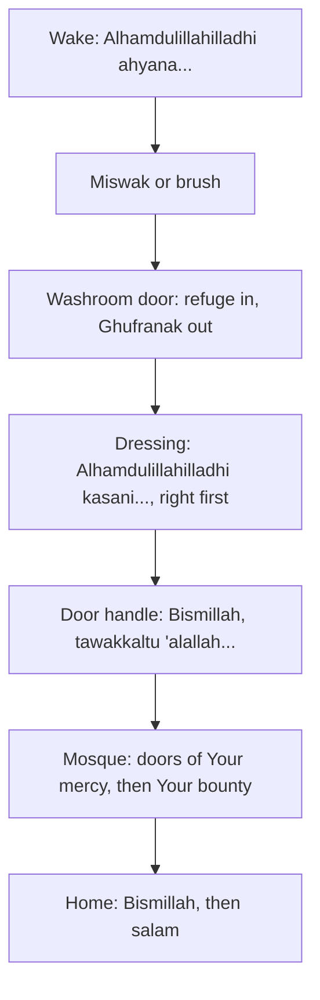

## Forty minutes, eight moments

On Saturday morning Musa's forty minutes, from his alarm to the front door, held eight moments for which the Sunnah gives a word or a manner. This chapter goes through them in the order a morning brings them, and adds the moment the day ends with: coming home.

None of these takes more than a few seconds. The challenge is not time but memory: knowing the words, and remembering them at the moment. That is why each one is learned on its own, attached to its own moment, one at a time.

Before you step through Hamza's morning, make a guess.

```predict
prompt: "Ayesha's notebook has a long dua for entering the home. Hamza checks it. Is it sound?"
options:
  - id: sound
    label: "It is sound, so the whole family should learn it word for word today"
  - id: weak
    label: "It is graded weak; Bismillah and the salam are the sound habit"
correctOptionId: weak
explanation: "The dua for entering the home in Sunan Abi Dawud 5096 is graded weak by al-Albani and others. What is sound is mentioning Allah's name on entering (Sahih Muslim 2018) and greeting the household with salam (Quran 24:61)."
```

Step through the canvas below. It follows Hamza from waking to the mosque and back home.

<InteractiveCanvas slug="a-day-of-small-duas" />

The canvas showed six moments and their words: waking with praise and the miswak, the washroom, dressing, leaving home, the mosque, and coming home with Bismillah and salam.

## Waking

Hudhayfah, may Allah be pleased with him, reported that when the Prophet, peace be upon him, woke he would say (Sahih al-Bukhari 6312):

> الْحَمْدُ لِلَّهِ الَّذِي أَحْيَانَا بَعْدَ مَا أَمَاتَنَا وَإِلَيْهِ النُّشُورُ

Meaning: Praise be to Allah who gave us life after He caused us to die, and to Him is the return (Sahih al-Bukhari 6312).

It is the partner of the sleep dua from chapter 6.4: "in Your name I die and I live" at night, and this in the morning. When the Prophet got up at night he cleaned his mouth with the miswak (Sahih al-Bukhari 245). Many people keep a miswak or a toothbrush by the bed or the sink as the very next step.

Some lists also mention saying SubhanAllah, Alhamdulillah, Allahu akbar and astaghfirullah ten times on waking. There is a sound narration close to this: Aisha, may Allah be pleased with her, described how the Prophet began when he woke at night: he said Allahu akbar ten times, Alhamdulillah ten times, SubhanAllahi wa bihamdihi ten times, SubhanAl-Malikil-Quddus ten times, astaghfirullah ten times and La ilaha illallah ten times, then sought refuge from the hardship of the Day of Resurrection ten times, and then began his prayer (Sunan Abi Dawud 5085, graded hasan sahih by al-Albani). It describes waking for the night prayer. Using these dhikr on waking is a good practice; the habit with the clearest source for every morning is the waking dua above.

## The washroom

Anas, may Allah be pleased with him, reported that when the Prophet entered the place to relieve himself he said: "Allahumma inni a'udhu bika minal-khubuthi wal-khaba'ith", O Allah, I seek refuge in You from the male and female devils (Sahih al-Bukhari 142). When he came out he said: "Ghufranak", I ask Your forgiveness (Jami' at-Tirmidhi 7, graded sahih). Washing the hands well afterwards is part of cleanliness, which module 8 covers.

The door of the washroom is a perfect cue. Hamza puts a small card on the outside of the door for the first two weeks, with both duas on it, and then takes it down.

## Dressing

Mu'adh ibn Anas reported that the Prophet said: whoever puts on a garment and says "Alhamdulillahilladhi kasani hadha wa razaqanihi min ghayri hawlin minni wa la quwwah", praise be to Allah who clothed me with this and provided it for me without any power or strength from me, his past sins are forgiven (Sunan Abi Dawud 4023, graded hasan). And Aisha reported that the Prophet liked to start with the right in putting on his shoes, combing his hair, purifying himself, and in all his affairs (Sahih al-Bukhari 168). So the right sleeve, the right shoe and the right leg go first.

## Leaving the house

Anas reported that the Prophet said: when a man leaves his house and says the words below, it is said to him: you are guided, you are protected, and you are defended, and the devils move away from him (Sunan Abi Dawud 5095, graded sahih).

> بِسْمِ اللَّهِ تَوَكَّلْتُ عَلَى اللَّهِ لاَ حَوْلَ وَلاَ قُوَّةَ إِلاَّ بِاللَّهِ

Meaning: In the name of Allah; I rely on Allah; there is no might and no power except with Allah (Sunan Abi Dawud 5095).

It is tawakkul in one sentence, said at the moment you step into a day you cannot control. Hamza says it with his hand on the door handle.

## The mosque

Abu Usayd reported that the Prophet said: when one of you enters the mosque, let him say "Allahumma iftah li abwaba rahmatik", O Allah, open for me the doors of Your mercy; and when he leaves, let him say "Allahumma inni as'aluka min fadlik", O Allah, I ask You of Your bounty (Sahih Muslim 713). Many people step in with the right foot first, following the Prophet's general love of starting with the right (Sahih al-Bukhari 168).

## Coming home

Jabir reported that the Prophet said: when a man enters his house and mentions Allah on entering and at his meal, Satan says to his companions: there is no place for you to stay and no dinner. If he enters without mentioning Allah, Satan says: you have found a place to stay (Sahih Muslim 2018). Allah says: when you enter houses, greet one another with a greeting from Allah, blessed and good (Quran 24:61). So the sound habit is simple: Bismillah at the door, and salam to whoever is home.

What about entering with the right foot first? There is no specific sound hadith about the right foot for the home, but it follows the Prophet's general love of beginning with the right (Sahih al-Bukhari 168), so many families keep it on that basis.

The diagram shows the morning as a chain of moments, each with its words.



Read it as a morning you already have. Not one box needs a new moment. Learn one box a week, starting with whichever moment you meet most often.

## Worked example: Musa learns one a week

Musa wants to learn all of them before his birthday. His mother suggests one a week instead. Follow their plan.

**Week one.** "Ghufranak" on leaving the washroom: one word, said several times a day. A sticker on the inside of the door.

**Week two.** The washroom entering dua, with the sticker moved to the outside.

**Week three.** The waking dua, with a card under his alarm clock.

**Week four.** Leaving home. His mother says it with him at the door every school morning.

**After two months.** Six duas, each attached to its moment, and none of them feels like homework.

Notice that Musa's order was chosen by frequency. The washroom comes several times a day, so its words get the most practice. Waking and leaving home come once a day, so they come later, once he has the feel of attaching words to moments.

## Where people misunderstand it

The first misunderstanding is "every dua on a popular list is sound". Some are weak, such as the long dua for entering the home (Sunan Abi Dawud 5096). The course gives the sound alternative.

The second is "I must learn them all before I start". One moment a week is enough.

The third is "if I forget the words, the moment is lost". Say what you know, and look at the card next time.

If you have only one week for this chapter, choose the leaving-home dua. It is the moment you step into a day you cannot control, and its words are tawakkul.

## Check your understanding

```quiz
type: mcq
question: "Taimur leaves home every morning in a rush and never remembers any dua. Which one first step fits this chapter?"
options:
  - "Learn only the leaving-home dua, with a card by the door"
  - "Learn all six duas tonight from a booklet"
  - "Say any dua he knows at any time of the morning"
  - "Wait until he is less busy at work before starting any of these duas"
correct: 0
explanations:
  - "Right. One moment, its own words (Sunan Abi Dawud 5095), and a card at the cue."
  - "Six at once is the big start. One moment at a time works better."
  - "The Sunnah gives words for each moment; the moment is the reminder."
  - "The words take seconds. He can start with one tomorrow."
```

```quiz
type: mcq
question: "Hina's family wants a sound habit for entering the house. Which fits the sources in this chapter?"
options:
  - "A long dua for entering the home from a popular booklet"
  - "Bismillah on entering, and salam to whoever is home"
  - "Saying nothing, since there is no sound Sunnah for it"
  - "Reciting Ayat al-Kursi at the door every time"
correct: 1
explanations:
  - "The long dua in Sunan Abi Dawud 5096 is graded weak."
  - "Right. Mention Allah on entering (Sahih Muslim 2018) and greet with salam (Quran 24:61)."
  - "There is a sound Sunnah: mentioning Allah and the salam."
  - "That is not the habit the sources in this chapter teach for entering the home."
```

## This week

Choose the moment you meet most often: the washroom, waking, dressing or leaving home. Learn its words, put a small card at the cue, and say them at that moment every day this week.

**Next:** The Sunnah of eating and drinking.
