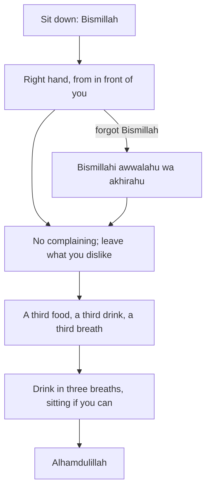

## Dinner on Saturday

Week one of the family's new list is the Sunnah of eating, because dinner already happens every night with everyone at the table. On the first Saturday, Musa grabs bread with his left hand while talking, reaches across the table for the potatoes on his uncle's side, says the dal is too salty, and leaves half his plate. Nobody says Bismillah, and nobody says Alhamdulillah. It is an ordinary family dinner.

Hamza does not lecture. Instead he tells Musa a story: once, a boy about his age was eating at the Prophet's table, and his hand was going all over the dish. The Prophet, peace be upon him, did not scold him. He taught him three things in one sentence.

Before you step through the meal, make a guess.

```predict
prompt: "Musa forgets to say Bismillah at the start of the meal and remembers halfway through. What does the Sunnah teach him to do?"
options:
  - id: say-it
    label: "Say 'Bismillahi awwalahu wa akhirahu' when he remembers"
  - id: lost
    label: "Nothing; the chance for Bismillah was at the start and is now lost"
correctOptionId: say-it
explanation: "If you forget to mention Allah at the start, say: Bismillahi awwalahu wa akhirahu, in the name of Allah at its beginning and its end (Sunan Abi Dawud 3767, graded sahih). The habit has a way back in the middle of the meal."
```

Step through the canvas below. It follows one family meal.

<InteractiveCanvas slug="the-sunnah-meal" />

The canvas showed a meal with six sourced manners: Bismillah with the right hand from in front, a way back if you forget, no complaining, stopping before full, drinking in breaths, and praise at the end.

## The boy at the Prophet's table

Umar ibn Abi Salamah, may Allah be pleased with him, was a boy in the Prophet's care. He said his hand used to wander around the dish, so the Prophet said to him:

> يَا غُلاَمُ سَمِّ اللَّهَ، وَكُلْ بِيَمِينِكَ وَكُلْ مِمَّا يَلِيكَ

Meaning: O boy, mention Allah's name, eat with your right hand, and eat from what is in front of you (Sahih al-Bukhari 5376; Sahih Muslim 2022).

Umar said that from then on, that was how he ate. Three manners, taught kindly to a child, in one sentence. Notice the way the Prophet taught: gently, at the table, at the moment, with a short instruction a child can remember. That is a good model for parents.

The Prophet also explained why the right hand: when one of you eats, let him eat with his right hand, and when he drinks, let him drink with his right hand, for Satan eats and drinks with his left (Sahih Muslim 2020).

## If you forget Bismillah

Aisha reported that the Prophet said: when one of you eats, let him mention Allah's name; if he forgets at the beginning, let him say (Sunan Abi Dawud 3767, graded sahih):

> بِسْمِ اللَّهِ أَوَّلَهُ وَآخِرَهُ

Meaning: In the name of Allah, at its beginning and at its end (Sunan Abi Dawud 3767).

This is the same lesson as chapter 3.3 on missed Quran: a habit with a planned way back survives the day you forget.

## No complaining, and not too much

Abu Hurairah reported that the Prophet never criticised food; if he liked it he ate it, and if he disliked it he left it (Sahih al-Bukhari 5409). For a family, this is a powerful habit. Someone cooked that meal. "Too salty" can become "Jazakallah, Ammi", and the unwanted part can be quietly left.

On the amount, the Prophet said that the son of Adam fills no vessel worse than his stomach; a few mouthfuls to keep his back straight are enough, and if he must eat more, then a third for food, a third for drink and a third for breath (Jami' at-Tirmidhi 2380, graded sahih). Allah says: eat and drink, but do not be excessive (Quran 7:31). A practical habit: serve a smaller first portion, and wait a few minutes before taking more.

## Drinking

Anas reported that the Prophet used to breathe three times while drinking (Sahih Muslim 2028), meaning he drank in three sips, breathing outside the cup between them. He also said: when you drink, do not breathe into the vessel (Sahih al-Bukhari 5630).

On sitting or standing, there are two kinds of narration, and it is honest to show both. Anas reported that the Prophet discouraged drinking while standing (Sahih Muslim 2024). And Ali, may Allah be pleased with him, drank standing and said that some people dislike it, but he had seen the Prophet do as he had done (Sahih al-Bukhari 5615). Many scholars therefore teach that sitting is better and standing is allowed. So the family habit is: sit to drink when you can, without making standing a sin.

There is no single sound dua specific to drinking water beyond the Bismillah and the praise. Allah is pleased with a servant who eats a meal and praises Him for it, or drinks a drink and praises Him for it (Sahih Muslim 2734).

## Praise at the end

Mu'adh ibn Anas reported that the Prophet said: whoever eats food and says "Alhamdulillahilladhi at'amani hadha wa razaqanihi min ghayri hawlin minni wa la quwwah", praise be to Allah who fed me this and provided it for me without any power or strength from me, his past sins are forgiven (Sunan Abi Dawud 4023, graded hasan). Abu Umamah reported that when the Prophet's table was cleared he would say: "Alhamdulillahi kathiran tayyiban mubarakan fih", much good and blessed praise be to Allah (Sahih al-Bukhari 5458). Either is sound; one is enough to start.

The diagram shows the meal as one chain from the first bite to the last.



The side branch is the most useful line for children. The habit does not fail when Bismillah is forgotten; it has a way back. The end of the chain, Alhamdulillah, turns a full plate into gratitude.

## Worked example: the family's three weeks

**Week one.** Only two habits: Bismillah at the start and Alhamdulillah at the end. Musa's job is to say "Bismillah!" loudly when everyone sits down.

**Week two.** The right hand and eating from in front of you. A small bowl for each person helps Musa stop reaching across.

**Week three.** No complaining. The family agrees on a phrase for food you do not like: "I'll leave this, jazakallah."

**After a month.** Musa's little sister, who is eight, starts saying "Bismillahi awwalahu wa akhirahu" when someone forgets, and everyone laughs, and says it.

## Eating alone, at work and on the move

Not every meal is at a family table. Many people eat lunch at a desk, in a van, in a canteen or while walking between classes. The manners travel with you. Bismillah and Alhamdulillah need no table. The right hand works at a desk. Not criticising food applies to a canteen as much as to your mother's cooking. If you eat while working, try at least to stop typing for the first and last bites, so that the Bismillah and the Alhamdulillah are said with attention rather than lost in an email.

Eating with others is also encouraged where you can, and sharing food is a Sunnah of hospitality you will meet again in module 12. A colleague who eats alone every day might welcome an invitation to share yours.

## Where people misunderstand it

The first misunderstanding is "standing to drink is haram". The narrations show sitting is better and standing is allowed (Sahih Muslim 2024; Sahih al-Bukhari 5615).

The second is "if I forget Bismillah, the meal is lost". Say Bismillahi awwalahu wa akhirahu (Sunan Abi Dawud 3767).

The third is "the Sunnah of eating is only for children". The Prophet himself ate this way all his life.

Whichever manner you start with, keep it at one meal a day for the first week, and only then spread it to every meal. Small, steady and shared is the shape that lasts.

## Check your understanding

```quiz
type: mcq
question: "Hamza's colleague says that drinking water while standing is haram and refuses to drink at a standing reception. What does this chapter show?"
options:
  - "He is right; there is only one narration on this, and it forbids standing"
  - "Standing is better, because the Prophet drank standing"
  - "There is no Sunnah about drinking at all"
  - "Sitting is better, and standing is allowed, from two sets of narrations"
correct: 3
explanations:
  - "There are two kinds of narration, and the course shows both."
  - "Sitting is described as preferred (Sahih Muslim 2024)."
  - "There are several: breathing outside the cup, three breaths, and praise."
  - "Right. Sahih Muslim 2024 discourages it, and Sahih al-Bukhari 5615 shows the Prophet drank standing. Many scholars say sitting is better and standing allowed."
```

```quiz
type: mcq
question: "A child at the table complains loudly that the food is bad. Which response follows the Prophet's example in this chapter?"
options:
  - "Tell him he must finish every bite as a punishment"
  - "Let him complain, since children are not yet expected to have table manners"
  - "Cook something else for him immediately"
  - "Teach gently that the Prophet left food he disliked without criticising it"
correct: 3
explanations:
  - "The Prophet taught the boy at his table gently (Sahih al-Bukhari 5376), not with punishment."
  - "The Prophet taught a boy manners at the table, so children are taught too."
  - "That may be kind sometimes, but it does not teach the habit of not criticising food."
  - "Right. He never criticised food: he ate it if he liked it and left it if not (Sahih al-Bukhari 5409)."
```

## This week

At one meal a day, say Bismillah at the start and Alhamdulillah at the end, out loud, with whoever eats with you. If you forget, say Bismillahi awwalahu wa akhirahu.

**Next:** Salam, sneezing and visiting the sick.
