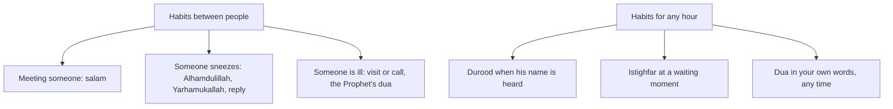

## An office full of moments

On Monday Hamza notices something at work he has never noticed before. In one morning, he greets eleven people, two colleagues sneeze near him, and he hears that his uncle Tariq is in hospital after a fall. Each of these is a moment between people, and each has a word in the Sunnah.

These habits are different from the morning duas. They are said to someone, not only to yourself. That makes them powerful: they spread love, they remind other people of Allah, and they are seen. Module 1's lesson applies here gently: being seen while doing a Sunnah between people is the point of it, not showing off.

Before you step through Hamza's day, make a guess.

```predict
prompt: "Ayesha's list says 'dua is the marrow of worship'. Hamza checks it in his hadith app. What does he find?"
options:
  - id: sound-wording
    label: "That wording is sound, and it is found in Sahih al-Bukhari"
  - id: weak-wording
    label: "That wording is weak; 'dua is worship' is the sound one"
correctOptionId: weak-wording
explanation: "'Dua is the marrow of worship' (Jami' at-Tirmidhi 3371) is graded weak. The sound wording is 'dua is worship' (Jami' at-Tirmidhi 3372, graded sahih; also Sunan Abi Dawud 1479)."
```

Step through the canvas below. It follows Hamza's day of moments between people.

<InteractiveCanvas slug="words-between-people" />

The canvas showed the salam spreading love, a full sneeze exchange in three lines, a visit with the Prophet's dua for the sick, and durood and istighfar threaded through the day.

## Spread the salam

Abu Hurairah reported that the Prophet, peace be upon him, said: you will not enter Paradise until you believe, and you will not believe until you love one another. Shall I tell you something which, if you do it, you will love one another? Spread the salam among you (Sahih Muslim 54). The salam is a dua: "As-salamu alaykum", peace be upon you. Said to the security guard, the cleaner and the new colleague as well as to friends, it turns a building of strangers into a place of small kindnesses. At home, it is the greeting when you come in (Quran 24:61, chapter 7.2).

## A sneeze, in three lines

Abu Hurairah reported that the Prophet said (Sahih al-Bukhari 6224):

> إِذَا عَطَسَ أَحَدُكُمْ فَلْيَقُلِ الْحَمْدُ لِلَّهِ

Meaning: When one of you sneezes, let him say Alhamdulillah (Sahih al-Bukhari 6224).

The hadith continues: and let his brother or companion say to him "Yarhamukallah", may Allah have mercy on you; and when he says that, let him reply "Yahdikumullahu wa yuslihu balakum", may Allah guide you and set your affairs right. Three lines, between two people. It takes four seconds, and both of them have made dua for each other.

## Visiting the sick

Thawban reported that the Prophet said that one who visits a sick person is in the harvest of Paradise until he returns (Sahih Muslim 2568). And Aisha reported that when the Prophet visited a sick person, he would say (Sahih al-Bukhari 5675):

> أَذْهِبِ الْبَاسَ رَبَّ النَّاسِ، اشْفِ وَأَنْتَ الشَّافِي لاَ شِفَاءَ إِلاَّ شِفَاؤُكَ، شِفَاءً لاَ يُغَادِرُ سَقَمًا

Meaning: Remove the harm, Lord of the people. Cure, for You are the Healer; there is no cure except Your cure, a cure that leaves no illness behind (Sahih al-Bukhari 5675).

Hamza visits his uncle on Tuesday evening, stays for twenty minutes, says the dua with his hand on his uncle's shoulder, and asks his aunt whether they need anything from the pharmacy. A visit is not only words: presence, a few kind words and practical help together are what comfort a sick person. If you cannot visit, a call with the same dua is a good second.

## Durood and istighfar, every hour

Two daily habits are not tied to a single moment. They can be said at any time, and the Sunnah encourages saying them often.

The first is durood, sending blessings on the Prophet. Abu Hurairah reported that he said: whoever sends blessings on me once, Allah sends blessings on him ten times (Sahih Muslim 408). The shortest form, "Sallallahu alayhi wa sallam", is said whenever his name is mentioned. The fuller form is the durood said in the tashahhud of the prayer.

The second is istighfar. Abu Hurairah reported that the Prophet said: by Allah, I ask Allah's forgiveness and turn to Him in repentance more than seventy times a day (Sahih al-Bukhari 6307). If the Prophet, who was forgiven, asked forgiveness so often, it is a habit for everyone. Many people attach it to a moment that comes often: waiting for a lift, a page loading, a red traffic light.

## Dua is worship

Ayesha's list ends with a heading: "dua is the marrow of worship". It is a beautiful sentence, but the narration with that wording is graded weak (Jami' at-Tirmidhi 3371). An-Nu'man ibn Bashir reported a sound wording: the Prophet said "dua is worship", and then recited: your Lord said, call on Me, I will answer you (Jami' at-Tirmidhi 3372, graded sahih; Sunan Abi Dawud 1479; Quran 40:60). The meaning is close, and the sound one is even stronger: dua is not a part of worship, it is worship.

The diagram sorts the habits in this chapter by what starts them.



The top group has natural cues: a person, a sneeze, a sickness. The bottom group needs a cue you choose, such as hearing the Prophet's name or a waiting moment. Choose one cue for each, and the habit has a home.

## Worked example: Hamza's waiting moments

**The cue.** Hamza notices how often he waits: the lift, the build, the kettle, the bus.

**The habit.** Each waiting moment gets three "astaghfirullah" and one "Allahumma salli 'ala Muhammad".

**The count.** He does not count every day, but once he counts and finds about forty waiting moments in a day.

**The effect.** The waiting moments that used to go to his phone now go to remembrance, at least half of the time.

## Making these habits natural

Habits between people can feel awkward at first, especially at work. Some practical points help. Say the salam clearly and warmly, as a greeting, not a test of who replies. With colleagues who are not Muslim, a warm "good morning" is the courteous greeting, and you can keep the salam for those who share it. The hadith ties the reply to the one who says Alhamdulillah: when he praises Allah, his brother answers him. A gentle way to teach the habit is to say Alhamdulillah yourself when you sneeze, so others hear the full exchange. When you visit someone sick, keep it short unless they want you to stay, and listen more than you talk.

For durood and istighfar, a counter is not needed. The habit is the cue, not the number. If you like numbers, a small, private target, such as a hundred istighfar a day, can help, as long as it does not turn into a score to show others, as module 1 warned.

These habits also teach children well, because children copy what they hear. A child who hears "Yarhamukallah" at every sneeze in the house will say it without being taught.

## Where people misunderstand it

The first misunderstanding is "every beautiful saying on a list is a hadith". "Dua is the marrow of worship" is weak; "dua is worship" is sound.

The second is "the sneeze reply is only for the one who sneezes". It is three lines between two people (Sahih al-Bukhari 6224).

The third is "visiting the sick is only for family". The hadith speaks of visiting a sick person, any sick person (Sahih Muslim 2568). A colleague, a neighbour or a classmate counts.

Keep each of these small. One salam to someone new, one sneeze answered fully, one call to someone unwell: that is already a week of habits between people, and each one also reminds someone else of Allah.

## Check your understanding

```quiz
type: mcq
question: "A colleague sneezes and says Alhamdulillah. Hamza says Yarhamukallah. What should the colleague reply, according to Sahih al-Bukhari 6224?"
options:
  - "Yahdikumullahu wa yuslihu balakum"
  - "Alhamdulillah, again"
  - "Jazakallahu khayran"
  - "Nothing; the exchange is finished"
correct: 0
explanations:
  - "Right. May Allah guide you and set your affairs right (Sahih al-Bukhari 6224)."
  - "He already said Alhamdulillah when he sneezed. The reply is different."
  - "A kind phrase, but not the one in this hadith."
  - "The hadith gives a third line, his reply."
```

```quiz
type: mcq
question: "Sana wants to put 'dua is worship' on a card for her children. Which reference should she use?"
options:
  - "Jami' at-Tirmidhi 3371, 'dua is the marrow of worship'"
  - "Any reference, since the meaning is good"
  - "Jami' at-Tirmidhi 3372, 'dua is worship', graded sahih"
  - "No reference, since it is a well-known saying"
correct: 2
explanations:
  - "That wording is graded weak."
  - "A reference should point to the sound narration."
  - "Right. 'Dua is worship' (Jami' at-Tirmidhi 3372, sahih; Sunan Abi Dawud 1479)."
  - "Giving the reference lets her children check it themselves."
```

## This week

Spread the salam to three people you usually do not greet. Choose one waiting moment in your day and attach istighfar and durood to it.

**Next:** A short quiz on the Sunnah of ordinary moments.
