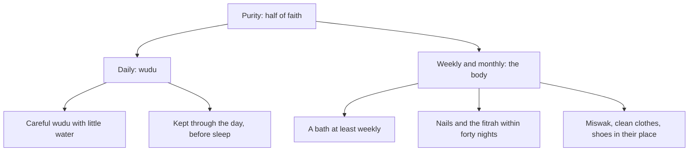

## The rushed Dhuhr

On a Wednesday in January, a meeting runs until 13:25. The office prayer room's congregation is at 13:30. Hamza runs to the washroom, makes wudu in about forty seconds, splashes water across the floor, wipes his wet hands on his trousers and arrives in the row just as the imam says "Allahu akbar". He catches the first takbir. But during the prayer he notices that his feet are still half dry, his sleeves are wet, and his mind is still in the meeting.

On the way back to his desk, Imran, the senior engineer from module 4, walks beside him and says, kindly, "You make wudu like you are late for a train." Hamza laughs. Then Imran tells him something he has done for twenty years: he makes wudu before he leaves home in the morning, and tries to keep it until Dhuhr. When the adhan comes at work, he is already in wudu, and he walks to the prayer room calmly. If his wudu breaks, he renews it straight away, slowly, when there is no rush.

Hamza realises that wudu, for him, has only ever been a quick gate before the prayer. It has never been a habit on its own.

## Musa's weekend

That weekend Rida and Musa come to stay again. On Sunday morning Rida looks at her son's hands and sighs. His nails are long and dark at the edges. His hair has not been washed since Thursday. His school shirt from Friday is in his bag, crumpled. His shoes are in the middle of the hall, one upside down.

"He is a good boy," she says to Ayesha. "He prays. He says Bismillah now. But this," and she waves at the nails, "this I have to remind him every single week."

Ayesha says something that surprises them both. "Maybe it is not about reminding. Maybe it needs a day." In her own childhood home, Friday was the day for nails, a bath and clean clothes, every week, without anyone deciding. It was simply what Friday was.

Before you read on, make a guess.

```predict
prompt: "Personal hygiene in Islam is sometimes treated as a matter of manners only. How did the Prophet, peace be upon him, describe purity?"
options:
  - id: half
    label: "As half of faith"
  - id: manners
    label: "As good manners, separate from faith"
correctOptionId: half
explanation: "The Prophet said: purity is half of faith (Sahih Muslim 223). Cleanliness of the body and wudu are not separate from faith; they are part of it."
```

## Purity is half of faith

Abu Malik al-Ash'ari reported that the Prophet said (Sahih Muslim 223):

> الطُّهُورُ شَطْرُ الإِيمَانِ

Meaning: Purity is half of faith (Sahih Muslim 223).

The same hadith continues: Alhamdulillah fills the scale, SubhanAllah and Alhamdulillah fill what is between the heavens and the earth, the prayer is light, charity is proof, patience is brightness, and the Quran is a proof for you or against you. Purity stands at the head of that list. In Islam, cleaning the body is not a separate area of life from worship. It is the door to the prayer, and it is part of faith itself.

That changes how Musa's nails look. They are not only a question of looking presentable at school. They are a small part of his faith, and they deserve a habit, not a weekly argument.

## Two kinds of purity habits

This module has two chapters, because purity habits come in two shapes.

The first is wudu, which is a habit of the day. It is needed for prayer, and the Sunnah encourages it at other times too: before sleep, as module 6 showed, and as a state you can try to keep through the day. Its sources describe sins washed away with its water, and they show the Prophet using very little water to make it. Wudu also connects to something unexpected: the advice for anger, which this module looks at with care, because a popular version is weak.

The second is care of the body, which is a habit of the week and the month. The Sunnah names five practices of the fitrah, the natural way of human beings: circumcision, removing pubic hair, plucking the armpits, clipping the nails and trimming the moustache. It sets a limit of forty nights on leaving them. It names a weekly bath as a right of Allah on every Muslim. It praises the miswak. It loves clean, simple beauty and warns against pride.

The diagram shows the two shapes side by side.



The left branch is tied to the prayers, so it already has five strong cues a day. The right branch needs a cue of its own, because nails and baths do not come with an adhan. That is exactly what Ayesha noticed: a weekly habit needs a day. For many families, Friday, with its own Sunnah of ghusl that module 14 covers, is the natural choice.

## Hamza's first week

Hamza tries Imran's way for one week, and keeps a few notes. On Monday he makes wudu after Fajr and checks it at the front door. It is still there. At work, Dhuhr's adhan comes at 13:15, and for the first time in months he walks to the prayer room without hurrying. He notices that he arrives calmer, and that his first rak'ah feels different.

On Tuesday his wudu breaks at 11:00. He almost leaves it until the adhan, out of habit. Then he remembers Imran's rule: renew early, when there is no rush. He goes at 11:05 and makes wudu slowly, with the tap low. It takes two minutes. At 13:15 he is ready.

On Wednesday a tense call at 12:30 leaves him angry with a client. He notices that his old instinct is to go and "cool off" with water. He has heard that wudu puts out anger. That evening he looks the narration up, and discovers it is graded weak. The sound advice is different, and in some ways easier: sit down, and seek refuge in Allah from Satan. Chapter 8.2 tells that story.

By Friday he has reached Dhuhr in wudu on four of five days. The washroom floor is dry. His sleeves are dry. And the forty-second wudu has become a two-minute one that no longer feels like a race.

## Why the body is part of worship

Some people feel that hygiene is a lesser subject, a matter for parents to nag about, while faith is about the heart. The Sunnah does not divide them like that. The same hadith that calls purity half of faith calls the prayer light and patience brightness. The Prophet named the five practices of the fitrah as carefully as he named the times of prayer. He used the miswak when he woke at night, and loved to begin with the right.

There is also a social side. People stand shoulder to shoulder in the mosque, sit beside each other at work and share homes. A clean body, clean clothes and a fresh mouth are a kindness to all of them. Module 14 shows how the Friday ghusl and fragrance are tied to coming to the gathering of believers.

Neither Hamza nor Musa needs to become a different person for these habits to work. They need the same tools as every earlier module: a cue that comes early enough, a small first step, and a source that explains why it matters.

## What happens next

After the weekend, two small plans begin. Hamza's: make wudu at home before leaving, slowly, and renew it calmly at work when it breaks. Musa's: Friday after school is nails, a bath, and the school shirt in the wash, with his mother checking only once, at the end. Neither plan needs willpower in the moment. Both need a cue and a small first step.

<LearningObjectives items={["Explain why purity is half of faith (Sahih Muslim 223)", "Make wudu with care and with little water, as the Prophet did", "Try to keep wudu through the day, and renew it calmly", "Meet anger first by sitting and seeking refuge in Allah, and know that the popular 'wudu when angry' narration is weak", "Keep the body clean on a rhythm: a weekly bath, the fitrah within forty nights, miswak, clean clothes"]} />

## Key words

| Word | Plain English |
|---|---|
| ***Taharah*** | Purity: being clean in body, clothes and place, and in a state of wudu or ghusl when needed |
| **Wudu** | The washing before prayer: face, arms, head, feet, in order. In Urdu, *wuzu* |
| ***Ghusl*** | The full bath, needed in some cases and Sunnah in others, such as Friday |
| ***Fitrah*** | The natural way of human beings; five hygiene practices the Prophet named |
| ***Miswak*** | A twig used to clean the teeth |
| ***Mudd*** | A small measure: about what two cupped hands hold; the water the Prophet used for wudu |

## What is in this module

| Chapter | You will practise |
|---|---|
| 8.2 | Wudu through the day: careful, with little water, kept and renewed; and anger |
| 8.3 | Cleanliness and the fitrah, on a daily and weekly rhythm |
| 8.4 | A short quiz with five cases |
| 8.5 | Your purity plan |

**Next:** Wudu through the day.
