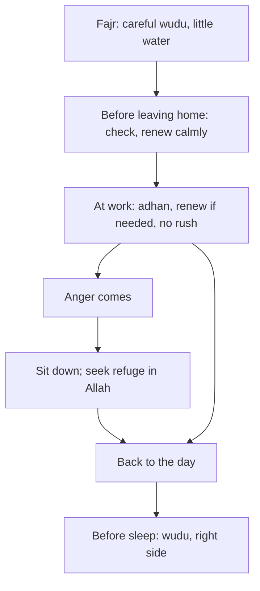

## Forty seconds

Hamza's rushed wudu before Dhuhr took forty seconds, wet the floor and left his feet half dry. The problem was not his knowledge of wudu. He knows every step. The problem was when he made it: at the last minute, under pressure. Like the first takbir in module 2, the quality of the habit was decided earlier, by the time he started.

This chapter treats wudu as a habit of the day, not only as a gate before each prayer. It covers how to make it, how much water to use, how to keep it, when to renew it, and one more use of it that many people know from a popular saying: what to do when angry.

Before you step through Hamza's day, make a guess.

```predict
prompt: "A popular saying advises making wudu when you are angry. Hamza checks the hadith. What does he find?"
options:
  - id: sound
    label: "It is in Sahih al-Bukhari, so wudu is the very first thing to do"
  - id: weak
    label: "That narration is weak; sitting down and seeking refuge are sound"
correctOptionId: weak
explanation: "The narration about making wudu when angry (Sunan Abi Dawud 4784) is graded weak by al-Albani and others. Sound advice for anger is to sit down, and lie down if it does not pass (Sunan Abi Dawud 4782, sahih), and to seek refuge in Allah from Satan (Sahih al-Bukhari 3282)."
```

Step through the canvas below. It follows Hamza through a day in which he tries to stay in wudu.

<InteractiveCanvas slug="staying-in-wudu" />

The canvas showed five steps: a careful wudu with little water, checking his wudu before leaving home, sitting and seeking refuge when anger came, and wudu before sleep.

## Wudu with care

Abu Hurairah reported that the Prophet, peace be upon him, said (Sahih Muslim 244):

> إِذَا تَوَضَّأَ الْعَبْدُ الْمُسْلِمُ - أَوِ الْمُؤْمِنُ - فَغَسَلَ وَجْهَهُ خَرَجَ مِنْ وَجْهِهِ كُلُّ خَطِيئَةٍ نَظَرَ إِلَيْهَا بِعَيْنَيْهِ مَعَ الْمَاءِ

Meaning: When a Muslim or believing servant makes wudu and washes his face, every sin he looked at with his eyes comes out from his face with the water (Sahih Muslim 244).

The hadith continues with the hands and the feet, until he comes out pure from sins. Read it slowly, and wudu becomes a different act. Each wash is a quiet tawbah for what that part of the body did. The eyes looked at something they should not have; the face is washed. The hands did something wrong; the hands are washed. The feet walked somewhere they should not; the feet are washed.

A careful wudu does not take long. Two minutes, without rushing, is enough to wash each part fully, between the fingers and toes, and behind the ears. What makes it careful is attention, not time.

## Little water

Anas reported that the Prophet made wudu with one mudd of water, and bathed with one sa' up to five mudds (Sahih al-Bukhari 201). A mudd is roughly what two cupped hands hold together. That is far less water than most of us use with a running tap.

You may have heard a hadith in which the Prophet passed by Sa'd making wudu and said "what is this waste?", and Sa'd asked whether there is waste in wudu, and was told: yes, even if you are at a flowing river. That narration is in Sunan Ibn Majah (425) and is graded weak. The lesson, though, is taught soundly by the Prophet's own practice in Sahih al-Bukhari 201: very little water. So the habit is simple. Turn the tap to a thin stream, or turn it off while you wash each part. Hamza puts a small cup by the office sink for the first week to remind himself.

## Keeping wudu

Thawban reported that the Prophet said (Sunan Ibn Majah 277, graded sahih by al-Albani):

> اسْتَقِيمُوا وَلَنْ تُحْصُوا وَاعْلَمُوا أَنَّ خَيْرَ أَعْمَالِكُمُ الصَّلاَةُ وَلاَ يُحَافِظُ عَلَى الْوُضُوءِ إِلاَّ مُؤْمِنٌ

Meaning: Be steadfast, though you will not be able to do everything. Know that the best of your deeds is the prayer, and none keeps up wudu except a believer (Sunan Ibn Majah 277).

Notice the words "though you will not be able to do everything". The hadith itself expects that you will not be perfect, and asks for steadiness. Keeping wudu through the day is a practice of steadiness, not of perfection.

Hamza's version follows Imran's. He makes wudu at home after Fajr and checks it before he leaves the house: if it has broken, he renews it at home, slowly, where there is no rush. When the adhan for Dhuhr comes at work, he is usually still in wudu. If not, he goes to the washroom at the adhan, not at the iqamah, so there is time for care. Questions about what breaks wudu are fiqh; learn them from a scholar or a reliable book of your school.

## Wudu before sleep

Module 6 already gave the hadith of al-Bara: when you go to bed, make wudu as you do for the prayer, then lie on your right side (Sahih al-Bukhari 247). It belongs here too, because it closes the day of wudu. The day begins with wudu for Fajr and ends with wudu for sleep.

## When anger comes

Abu Dharr reported that the Prophet said: when one of you becomes angry while standing, let him sit down; if the anger leaves him, good; if not, let him lie down (Sunan Abi Dawud 4782, graded sahih). And Sulayman ibn Surad reported that two men were insulting each other near the Prophet, and one became red-faced with anger. The Prophet said: I know a word which, if he said it, what he feels would go: "I seek refuge in Allah from Satan" (Sahih al-Bukhari 3282).

So the sound habit for anger has two parts: change your position, and seek refuge in Allah. Both work in a meeting, at home or in traffic, and both take seconds. Module 11 returns to anger as a part of character.

What about wudu? A narration in Sunan Abi Dawud (4784) says that anger is from Satan, Satan is created from fire, and fire is put out with water, so make wudu when you are angry. It is widely known, but al-Albani, Shu'ayb al-Arna'ut and others graded it weak. Making wudu is never harmful, and stepping away to wash your face can calm a person, so there is no need to stop someone who finds it helps. But do not present it as the Prophet's sound instruction for anger. Sitting down and seeking refuge are.

The diagram shows the day of wudu from start to end, with the anger branch.



The day starts and ends with wudu, and the middle is kept calm by checking and renewing early. The anger branch is short and leads back into the day, which is what a good habit for anger does: it returns you to normal life quickly.

## Worked example: Musa at school

Musa wants to try keeping wudu at school, where Dhuhr is prayed in the school hall. Follow his plan.

**Morning.** He makes wudu after Fajr at home, slowly, with the tap low.

**Before school.** He checks his wudu at the front door. If it has broken, he renews it before he leaves.

**At school.** If his wudu breaks during the morning, he renews it at break time, not in the last minute before Dhuhr.

**Anger.** When a boy pushes him in the queue, his first move is to sit on the bench and say "a'udhu billahi minash-shaytan". Then he decides what to say.

**After two weeks.** He reaches Dhuhr in wudu on most days, and he no longer runs to the washroom when the bell rings.

## Where people misunderstand it

The first misunderstanding is "a careful wudu takes too long". It takes about two minutes. Rushing is usually about starting late.

The second is "make wudu when angry is the Sunnah". That narration is weak (Sunan Abi Dawud 4784). Sit down and seek refuge (Sunan Abi Dawud 4782; Sahih al-Bukhari 3282).

The third is "more water means a better wudu". The Prophet used about a mudd (Sahih al-Bukhari 201).

## Check your understanding

```quiz
type: mcq
question: "In a heated family argument, Zubair feels his anger rising while standing in the kitchen. Which first step follows the sound Sunnah in this chapter?"
options:
  - "Leave to make wudu, because the Prophet said water puts out anger"
  - "Shout once to release it, then calm down"
  - "Sit down, and say: I seek refuge in Allah from Satan"
  - "Keep standing and argue until the matter is settled"
correct: 2
explanations:
  - "That narration is graded weak (Sunan Abi Dawud 4784). Washing may still calm him, but it is not the sound instruction."
  - "Shouting feeds anger. The Prophet called strong the one who controls himself when angry (Sahih al-Bukhari 6114)."
  - "Right. Sit if standing (Sunan Abi Dawud 4782) and seek refuge in Allah (Sahih al-Bukhari 3282)."
  - "The Sunnah tells him to change his position first."
```

```quiz
type: mcq
question: "Amna leaves the tap running at full pressure for her whole wudu. She says more water makes it more complete. What does this chapter show?"
options:
  - "The Prophet made wudu with about one mudd, a very small amount"
  - "She is right; there is no Sunnah about the amount of water"
  - "She should use as little as possible, even if parts stay dry"
  - "A hadith in Sunan Ibn Majah forbids wasting water and is sahih"
correct: 0
explanations:
  - "Right. One mudd, roughly two cupped hands (Sahih al-Bukhari 201). Every part is still washed fully."
  - "There is: the Prophet's own practice (Sahih al-Bukhari 201)."
  - "Every part must still be washed. Little water does not mean incomplete wudu."
  - "The Ibn Majah narration (425) is graded weak. The sound guide is Sahih al-Bukhari 201."
```

## This week

Make one wudu a day slowly, with the tap low, thinking of each part as it is washed. Check your wudu before you leave home each morning.

**Next:** Cleanliness and the fitrah.
