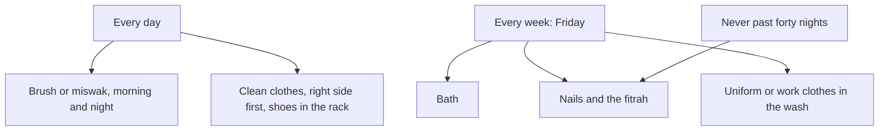

## Friday after school

Ayesha's suggestion, give hygiene a day, becomes Musa's new Friday. After school he clips his nails, has a proper bath, puts his school uniform in the wash and lays out clean clothes for the weekend. On the first Friday it takes him forty minutes and his mother checks everything. By the fourth Friday it takes twenty-five minutes and she checks only his nails.

This chapter gives the sources behind that Friday, and the daily habits that sit around it. Many of them are taught to children as simple manners. They are also part of the Sunnah, with their own sources, and part of faith.

Before you step through the rhythm, make a guess.

```predict
prompt: "The Sunnah sets a limit on how long the practices of the fitrah, such as clipping the nails, should be left. How long?"
options:
  - id: forty
    label: "Not more than forty nights"
  - id: seven
    label: "Not more than seven nights"
correctOptionId: forty
explanation: "Anas said that a time was set for them for trimming the moustache, clipping the nails, plucking the armpits and shaving the pubic hair: that they not leave it more than forty nights (Sahih Muslim 258). Weekly is a good habit well inside that limit."
```

Step through the canvas below. It shows which hygiene habits are daily, which are weekly, and which have a limit.

<InteractiveCanvas slug="the-fitrah-week" />

The canvas showed three rhythms: daily care of the teeth and clean clothes, a weekly bath, and the fitrah within forty nights, all under one reason: purity is half of faith.

## The five of the fitrah

Abu Hurairah reported that the Prophet, peace be upon him, said (Sahih al-Bukhari 5889):

> الْفِطْرَةُ خَمْسٌ ـ أَوْ خَمْسٌ مِنَ الْفِطْرَةِ ـ الْخِتَانُ، وَالاِسْتِحْدَادُ، وَنَتْفُ الإِبْطِ، وَتَقْلِيمُ الأَظْفَارِ، وَقَصُّ الشَّارِبِ

Meaning: Five things are of the fitrah: circumcision, removing the pubic hair, plucking the armpit hair, clipping the nails and trimming the moustache (Sahih al-Bukhari 5889).

Fitrah means the natural way Allah created human beings upon. These five are not cultural habits; the Prophet named them. And Anas, may Allah be pleased with him, said that a time was set for them, that they should not be left more than forty nights (Sahih Muslim 258). Forty nights is the outer limit. A weekly or fortnightly habit keeps you well inside it, and makes it automatic.

For adults, Friday is a common day for these, alongside the Friday ghusl in module 14. For children, the parts that apply to their age, nails especially, are the start, and the rest come in time as they grow.

## A bath, at least every week

Abu Hurairah reported that the Prophet said (Sahih al-Bukhari 898):

> لِلَّهِ تَعَالَى عَلَى كُلِّ مُسْلِمٍ حَقٌّ أَنْ يَغْتَسِلَ فِي كُلِّ سَبْعَةِ أَيَّامٍ يَوْمًا

Meaning: It is a right of Allah on every Muslim that he bathe one day in every seven days (Sahih al-Bukhari 898).

That is the minimum the hadith names. In hot climates and busy lives, many people bathe daily, which is good care of the body and of the people around you. The weekly bath of the hadith is a floor, not a ceiling. If daily bathing is your habit already, this hadith is a reason to keep it with an intention: caring for the body Allah gave you.

## Teeth and the miswak

Aisha reported that the Prophet said: the miswak purifies the mouth and pleases the Lord (Sunan an-Nasa'i 5, graded sahih). Abu Hurairah reported that he said: were it not that it would be hard on my people, I would have commanded them to use the miswak for every prayer (Sahih al-Bukhari 887). And when he got up at night, he cleaned his mouth with the miswak (Sahih al-Bukhari 245).

So the miswak has three cues in the Sunnah: waking, before prayer, and in general care of the mouth. A toothbrush with toothpaste is a good daily habit as well, and many people use both: a brush morning and night, and a miswak before some prayers. A miswak kept in a small case in your pocket or desk makes the before-prayer cue easy.

## Clean clothes, and the right side

Abdullah ibn Mas'ud reported that the Prophet said that no one with an atom's weight of pride in his heart will enter Paradise. A man said: a man likes his clothes to be nice and his shoes to be nice. The Prophet said: Allah is beautiful and loves beauty; pride is rejecting the truth and looking down on people (Sahih Muslim 91). This answer matters for clothes. Wanting clean, neat clothes is not pride. Pride is in the heart, toward truth and toward people. So the Sunnah habit is clean and neat, not expensive and showy.

For shoes and dressing, Aisha reported that the Prophet liked to start with the right in putting on his shoes, combing his hair, purifying himself, and in all his affairs (Sahih al-Bukhari 168). For shoes the Prophet was explicit: when you put on your shoes, start with the right, and when you take them off, start with the left, so that the right is the first on and the last off (Sahih al-Bukhari 5855; Sahih Muslim 2097). Shoes in a rack, not scattered in the doorway, is a simple habit of order that the whole family sees every day.

The diagram shows the rhythm of a week.



The weekly box is the one that most often slips, because nothing in an ordinary day reminds you of nails. Tying it to Friday gives it a cue. The forty-night line at the bottom is a safety net: if a Friday is missed, there is still plenty of time.

## Worked example: Hamza's travel kit

Hamza travels for work two days a month. His hygiene habits used to vanish on those days. Follow his fix.

**The problem.** In a hotel, his routines break: no miswak, no nail clipper, and he forgets which day it is.

**The kit.** A small pouch that lives in his work bag: miswak in a case, a nail clipper, a toothbrush, and a small towel.

**The cue.** Unpacking in the hotel room is the cue: the pouch goes next to the sink first.

**The result.** On travel days his Fajr miswak and brushing continue, and if a Friday falls on a trip, his nails are done in the hotel.

## Hygiene and other people

Personal cleanliness is also a kindness to others. People pray shoulder to shoulder in the mosque. Colleagues sit beside you all day. A clean body, clean clothes and a fresh mouth are part of good companionship. Module 14 shows how Friday's Sunnah of ghusl and fragrance before Jumu'ah is explicitly connected to coming to the gathering of people.

## Cleanliness at home

The same habits extend to the home: a room kept tidy, a bed made, the washroom left clean for the next person, wet towels hung up rather than dropped. These are small acts of responsibility, which module 12 covers as part of family life. A shared rule in Hamza's home now is simple: leave the washroom as you would want to find it. It takes thirty seconds, and it is felt by everyone who comes in after you, many times a day, at home and at work.

Children learn this best by doing it alongside an adult, not by being told. When Musa sees his uncle wipe the sink after wudu, he starts doing it too, without a word being said.

## Where people misunderstand it

The first misunderstanding is "hygiene is manners, not religion". Purity is half of faith (Sahih Muslim 223), and the fitrah practices are named by the Prophet (Sahih al-Bukhari 5889).

The second is "nice clothes are pride". Allah is beautiful and loves beauty; pride is in rejecting truth and looking down on people (Sahih Muslim 91).

The third is "once a week is the Sunnah for bathing, so daily is too much". The hadith names a minimum (Sahih al-Bukhari 898); bathing more often is good care.

## Check your understanding

```quiz
type: mcq
question: "Talha's mother reminds him every few days about his nails, and they argue. Which change fits this chapter?"
options:
  - "Stop reminding him, since nails are only a matter of looks"
  - "A fixed weekly day for nails, such as Friday after school"
  - "Remind him every day until he clips them"
  - "Clip them only when they are long enough to be noticed"
correct: 1
explanations:
  - "Clipping the nails is one of the five of the fitrah (Sahih al-Bukhari 5889), not only looks."
  - "Right. A fixed day gives the habit a cue, well inside the forty-night limit (Sahih Muslim 258)."
  - "Daily reminders are what cause the arguments. A cue replaces reminders."
  - "Waiting until they are noticed is how they reach the limit. A weekly day keeps them short."
```

```quiz
type: mcq
question: "Hamid buys simple, clean clothes and keeps them neat. A friend says caring about clothes is pride. What does Sahih Muslim 91 say?"
options:
  - "His friend is right: caring about clothes is pride"
  - "Only expensive clothes are allowed, to show Allah's blessing on him to others"
  - "Clothes have no place in the Sunnah at all"
  - "Allah loves beauty; pride is rejecting truth and looking down on people"
correct: 3
explanations:
  - "A man asked exactly this, and the Prophet said it is not pride (Sahih Muslim 91)."
  - "The hadith is about beauty, not expense, and showing off is warned against in module 1."
  - "The Sunnah speaks of clean, neat clothing and starting with the right (Sahih al-Bukhari 168)."
  - "Right. Wanting to look clean and neat is not pride; pride is in the heart toward truth and people (Sahih Muslim 91)."
```

## This week

Choose your weekly hygiene day and write what happens on it: bath, nails, clothes in the wash. Put a miswak or a toothbrush where you will see it after waking.

**Next:** A short quiz on purity.
