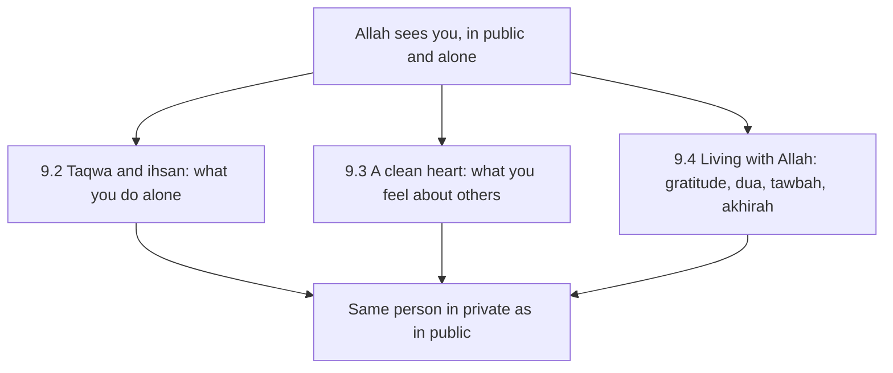

## Nobody would know

In February Hamza travels to a client's office for two days. When he fills in his expense claim, he notices something. The company reimburses taxi fares without receipts up to a limit. His real fares were a little under the limit. If he wrote the limit for each journey, nobody would ever check, and the difference would be small, about the price of a lunch.

He sits with the form for a minute. He has prayed every prayer on this trip. He read his Quran page in the hotel. He said his adhkar on the walk to the client's office. And now, alone, with nobody watching and nothing at stake but a lunch, he is tempted to write a number that is not true.

He writes the real fares. But the moment stays with him on the train home, because he realises how close he came, and how little it would have taken.

## Two more moments

The next week, two more moments of the same kind arrive. On Tuesday his manager announces that Bilal, a colleague who joined a year after Hamza, is the new team lead. Hamza smiles and congratulates him. Inside, he feels a small, hot envy that he did not expect, and that evening he catches himself listing Bilal's weaknesses in his head.

On Thursday night he is alone in the living room after Ayesha and his mother have gone to sleep. His phone is supposed to be on the charger in the hall, but tonight he brought it in "for one message". At 0:50 a video appears in his feed that he would never watch if anyone were in the room.

Three moments, three different kinds: honesty with money, envy in the heart, and what the eyes look at alone. None of them would ever appear on a tracker. None would be seen by anyone. And Hamza realises that his eleven habits, as good as they are, live mostly in the parts of his life that other people can see.

Before you read on, make a guess.

```predict
prompt: "In the hadith of Jibril, the Prophet, peace be upon him, defined ihsan. What did he say it is?"
options:
  - id: deeds
    label: "To do more good deeds than other people, and more often"
  - id: sees
    label: "To worship Allah as if you see Him; and if not, He sees you"
correctOptionId: sees
explanation: "Ihsan is to worship Allah as if you see Him, and if you do not see Him, then He sees you (Sahih al-Bukhari 50; Sahih Muslim 8). Ihsan is about awareness of Allah, especially when nobody else is watching."
```

## The habits nobody sees

Module 1 taught the visible side of sincerity: do not do good deeds to be seen by people. This module teaches the hidden side: do not do wrong because you are unseen by people. Both rest on the same truth. The One whose pleasure we seek sees everything, in public and in private.

Jibril, peace be upon him, came to the Prophet in the form of a man and asked him about Islam, iman and ihsan. About ihsan the Prophet said (Sahih al-Bukhari 50):

> أَنْ تَعْبُدَ اللَّهَ كَأَنَّكَ تَرَاهُ، فَإِنْ لَمْ تَكُنْ تَرَاهُ فَإِنَّهُ يَرَاكَ

Meaning: That you worship Allah as if you see Him; and if you do not see Him, then indeed He sees you (Sahih al-Bukhari 50).

"He sees you" is the heart of this module. It applies to an expense form at a hotel desk, to a feeling about a colleague, and to a phone at 0:50. In Urdu many families teach it to children as one sentence: *Allah mujhe dekh raha hai*, Allah is watching me. It is not meant to frighten. It is meant to keep a person the same in private as in public.

## What Hamza did with the three moments

Looking back, Hamza can see that he handled the three moments differently. At the expense form he did the right thing, but almost by luck: he happened to remember his father, who was scrupulously honest with money, at the moment he picked up the pen. With Bilal he did the right thing outwardly, a smile and congratulations, but inside he made a list of faults and kept adding to it for a week. At 0:50 he did not do the right thing. He watched more than he should have, and went to bed feeling heavy.

He talks to Baba Rashid after Fajr on Saturday, without details. The old man listens and says three things. First: "You noticed. A heart that does not notice is the one to worry about." Second: "For the moments when nobody is watching, you need something that reminds you who is watching. Not a feeling. Something you see." Third: "And when you fall, you get up the same night. You do not wait to feel clean."

Hamza writes the three things in his notebook. They become the outline of his plan for this module: a reminder for private moments, actions for the heart, and a habit of getting up quickly.

## Two sides of sincerity

Module 1 and this module fit together like two sides of a coin. Module 1 asked: when people are watching, is my deed for Allah or for them? This module asks: when people are not watching, am I still the same person? Showing off and private sin are opposites in one way, one wants to be seen, the other hides. But they share one root: forgetting, for a moment, that Allah sees.

## Three areas of the heart

This module has three chapters, following the three moments of Hamza's fortnight.

Chapter 9.2 is about taqwa and ihsan: being mindful of Allah wherever you are, especially when alone; asking before a decision, "would Allah be pleased with this?"; and what to do after a slip.

Chapter 9.3 is about a clean heart: envy, pride and hatred are sins nobody else sees, and the Sunnah gives words and actions to clean them. It also connects back to showing off, which module 1 covered.

Chapter 9.4 is about living with Allah through an ordinary day: gratitude for every blessing, turning to Allah first in every need, daily istighfar and quick tawbah, and remembering the akhirah, the life to come, without being frozen by it.

The diagram shows how the three fit together.



Everything starts from the top box. When a person truly lives with the awareness that Allah sees them, the three areas become one: the same person alone at a hotel desk, the same person when a colleague is promoted, the same person at 0:50.

## Habits of the heart in a family

These habits are also taught at home, mostly by example. Children notice whether their parents are honest with a shopkeeper's change, whether they speak well of relatives behind their backs, whether they say Alhamdulillah for small things. Rida tells Hamza that Musa once returned extra change to a shopkeeper because he had seen his grandfather do it. No lesson had been given. The habit simply passed from one generation to the next. That is one more reason to build these habits now: they are rarely only for yourself, and they outlast the person who started them.

## Can the heart be a habit?

Hamza's first reaction is doubt. The prayer is a habit: it has a time, a place and actions. The Quran page is a habit. But taqwa? Envy? Those feel like states, not habits.

The answer in this module is that the heart is shaped by repeated small actions, just as the body is. You cannot switch off envy. But you can make a habit of saying a dua for the person you envy, every time the feeling comes. You cannot force taqwa. But you can make a habit of one question before any private decision. You cannot make yourself grateful. But you can make a habit of saying Alhamdulillah out loud for three specific things a day. Over months, the actions shape the heart. That is still the 1% way, applied to the inside.

<Callout type="info" title="If a private habit feels out of control">
Some private struggles, such as with certain content online, can feel stronger than willpower. That is common and nothing to hide in shame from Allah, who is Most Merciful. Take practical means, such as filters and keeping the phone out of the bedroom, and talk to someone you trust: a mentor, a scholar or a counsellor.
</Callout>

<LearningObjectives items={["Explain ihsan as worshipping Allah as if you see Him, knowing that He sees you (Sahih al-Bukhari 50)", "Use one question before private decisions: would Allah be pleased with this?", "Follow a slip with tawbah and a good deed, and take practical means for private struggles", "Meet envy, pride and hatred with sourced actions: dua for the other, loving for them what you love for yourself", "Keep gratitude, dua, istighfar and remembrance of the akhirah in an ordinary day"]} />

## Key words

| Word | Plain English |
|---|---|
| ***Taqwa*** | Mindfulness of Allah that guards you from what displeases Him |
| ***Ihsan*** | Worshipping Allah as if you see Him, knowing He sees you; doing things with excellence |
| ***Hasad*** | Envy: wishing someone's blessing would leave them |
| ***Kibr*** | Pride: rejecting the truth and looking down on people |
| ***Shukr*** | Gratitude to Allah, in the heart, on the tongue and in action |
| ***Akhirah*** | The life after this one |

## What is in this module

| Chapter | You will practise |
|---|---|
| 9.2 | Taqwa and ihsan, alone and in decisions |
| 9.3 | A clean heart: envy, pride and hatred |
| 9.4 | Gratitude, dua, tawbah and the akhirah |
| 9.5 | A short quiz with five cases |
| 9.6 | Your plan for the habits nobody sees |

**Next:** Taqwa and ihsan.
