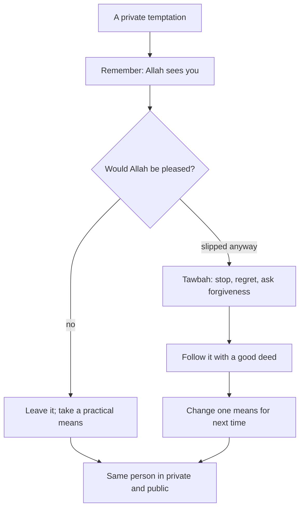

## 0:50, alone

On Thursday night at 0:50, Hamza is alone in the living room with his phone, and a video appears that he would never watch in front of his family. He has a few seconds before his thumb decides for him.

This chapter is about those seconds, and about the many other private moments like them: the expense form, the exam answer nobody would know you copied, the extra item a shopkeeper forgot to charge for, the conversation you could quietly record. Taqwa and ihsan are words for the same thing seen from two sides. Taqwa is guarding yourself from what displeases Allah. Ihsan is worshipping Allah as if you see Him, knowing that He sees you.

Before you step through Hamza's night, make a guess.

```predict
prompt: "In the canvas, Hamza asks himself one question before deciding. Which question fits the Quran's description of the one who feared standing before his Lord?"
options:
  - id: pleased
    label: "Would Allah be pleased with this?"
  - id: caught
    label: "Will anyone ever find out about this?"
correctOptionId: pleased
explanation: "The Quran praises the one who feared standing before his Lord and held his soul back from desire (Quran 79:40 to 41). The question is not whether people will find out, but whether Allah, who always sees, is pleased."
```

Step through the canvas below. It follows Hamza's private moment at 0:50.

<InteractiveCanvas slug="alone-with-allah" />

The canvas showed a temptation alone, the reminder that Allah sees, one question, a practical step of putting the phone outside the room, and, on another night when he slipped, tawbah and a good deed afterwards.

## Allah sees you

The hadith of Jibril gives the definition of ihsan: to worship Allah as if you see Him, and if you do not see Him, then He sees you (Sahih al-Bukhari 50; Sahih Muslim 8). Most people cannot feel, every moment, that they see Allah. But every person can remember the second part: He sees you. It is a fact, not a feeling, and a fact can be remembered on purpose.

Hamza makes it a habit with a small cue. His phone's lock screen is a plain background with three words in Urdu: *Allah dekh raha hai*. Every time he unlocks the phone, alone or not, the words pass in front of his eyes. He does not stare at them. He just sees them.

## Wherever you are

Abu Dharr reported that the Prophet, peace be upon him, said to him (Jami' at-Tirmidhi 1987, graded hasan):

> اتَّقِ اللَّهَ حَيْثُمَا كُنْتَ وَأَتْبِعِ السَّيِّئَةَ الْحَسَنَةَ تَمْحُهَا وَخَالِقِ النَّاسَ بِخُلُقٍ حَسَنٍ

Meaning: Be mindful of Allah wherever you are; follow a bad deed with a good one and it will wipe it out; and treat people with good character (Jami' at-Tirmidhi 1987).

This one hadith is a complete plan for the private life. "Wherever you are" covers the hotel desk and the living room at 0:50. "Follow a bad deed with a good one" is the plan for the night you slip. "Treat people with good character" reminds you that taqwa is not only private; it shows in how you treat people.

## The danger of a double life

Thawban reported a hadith that is hard to read. The Prophet said that he knew people of his nation who would come on the Day of Resurrection with good deeds like the mountains of Tihamah, white, and Allah would make them like scattered dust. When asked who they were, he said: they are your brothers, of your people, who pray at night as you do, but when they are alone with what Allah has forbidden, they violate it (Sunan Ibn Majah 4245, graded sahih by al-Albani).

This hadith is not a reason for despair. It is a warning about one specific pattern: a person who is good in public and makes a habit of sin in private, without caring. Hamza, who prays at night and feels the tug of his phone at 0:50, is exactly the kind of person it is speaking to. Its message is: do not let your private life become a different person from your public one. The cure in the previous hadith, follow a slip with tawbah and a good deed, is how a believer who falls stays on the right side of it.

## One question before deciding

Allah says: as for the one who feared standing before his Lord, and held his soul back from desire, Paradise will be the refuge (Quran 79:40 to 41). Holding the soul back is easier with a fixed question than with a vague effort. The question Hamza uses is short: would Allah be pleased with this? He asks it at the expense form, at a private chat, at a video, at a shortcut at work. Most of the time the answer is obvious. Asking takes two seconds and gives the right answer a chance to speak before the desire does.

## Practical means

Taqwa is in the heart, but the Sunnah also teaches taking the means. For private temptations, the means are often simple and physical. Keep the phone out of the bedroom, as module 6 already taught for sleep. Turn on content filters, and give the password to someone you trust. Avoid being alone with a screen late at night when you are tired. Leave a door open. None of these replace the heart's choice. They make the right choice easier at the moment when the heart is weakest.

The diagram shows the plan for a private temptation, including the slip.



The plan has two good endings, not one. The best is leaving the temptation. But the slip branch also ends well: tawbah, a good deed and one changed means. What does not appear anywhere is "give up, you are a hypocrite". That thought is a trap; the Prophet's instruction is to follow the bad with the good.

## Worked example: Musa and the test answers

Musa's class has an online test at home. A friend sends him the answers on a chat. Nobody would ever know if he used them. Follow his reasoning.

**The moment.** The message arrives. He feels relief, then something uncomfortable.

**The question.** He remembers his uncle's three words: Allah is watching. Would Allah be pleased with copying?

**The means.** He mutes the chat for the hour of the test and puts his phone in the kitchen.

**After.** He gets a lower mark than his friend. He tells his mother, and she tells him she is prouder of that mark than of any full mark.

**The good deed.** The next week he offers to help the friend revise properly instead.

## Building it the 1% way

Taqwa can be built in steps, like any habit in this course. A simple order works for most people.

Week one: the reminder. Put three words where you are most often alone with a choice, such as your lock screen or the inside of your wardrobe door. Do nothing else yet.

Week two: the question. Before one private decision a day, ask: would Allah be pleased with this? Notice how often the answer is obvious.

Week three: one practical means. Choose the private temptation you meet most, and take one physical step against it: a filter, the phone outside the bedroom, a door left open, a different route home.

Week four: the slip plan. Decide in advance what you will do after a slip: istighfar that night, a specific good deed the next morning, and one means changed. Writing it down before you need it makes it easier to follow when you do.

After a month, these four steps work together. The reminder brings the question, the question usually wins, the means protect the weak moments, and the slip plan stops a fall from becoming a pattern.

## Where people misunderstand it

The first misunderstanding is "if I slip in private, I am a hypocrite and should stop praying". The instruction is the opposite: follow the bad deed with a good one (Jami' at-Tirmidhi 1987), and keep praying.

The second is "taqwa is only a feeling". It is also a question before deciding and practical means, done every day.

The third is "private sins harm nobody". The hadith of Thawban (Sunan Ibn Majah 4245) shows they can empty a person's good deeds. And many private habits, such as dishonesty with money, do harm others.

## Check your understanding

```quiz
type: mcq
question: "Zara, a freelancer, could bill a client for two extra hours. The client would never know. Which response fits this chapter?"
options:
  - "Bill the extra hours, since the client is wealthy and will not notice"
  - "Bill the extra hours and give the difference in sadaqah"
  - "Bill the real hours, after asking: would Allah be pleased?"
  - "Bill the extra hours, then make tawbah later"
correct: 2
explanations:
  - "Being unnoticed by the client is exactly the private moment taqwa is for."
  - "Sadaqah from money taken wrongly does not make the taking right; Allah accepts only what is good (Sahih Muslim 1015)."
  - "Right. Ihsan is knowing that Allah sees you (Sahih al-Bukhari 50), and the question before deciding guards her."
  - "Planning a sin with tawbah afterwards is not tawbah; tawbah is for slips, not plans."
```

```quiz
type: mcq
question: "Faizan slipped and watched something he regrets late at night. He now feels he is a hypocrite and is thinking of stopping his night recitations. What does this chapter suggest?"
options:
  - "Stop the recitations for now, since a hypocrite's worship is not accepted"
  - "Ignore it, since private matters do not count"
  - "Wait until he feels pure again before returning to worship"
  - "Tawbah, a good deed, keep his recitations, and change one practical means"
correct: 3
explanations:
  - "That thought is a trap. The instruction is to follow the bad with the good, not to stop the good."
  - "Private deeds count (Sunan Ibn Majah 4245), which is why tawbah matters."
  - "Waiting to feel pure keeps him away from the very worship that helps him."
  - "Right. Follow a bad deed with a good one (Jami' at-Tirmidhi 1987), keep worshipping, and take a practical means such as the phone outside the room."
```

## This week

Put a three-word reminder where you are most often alone with a choice: your lock screen, your desk, your bedroom door. Before one private decision each day, ask: would Allah be pleased with this?

**Next:** A clean heart.
