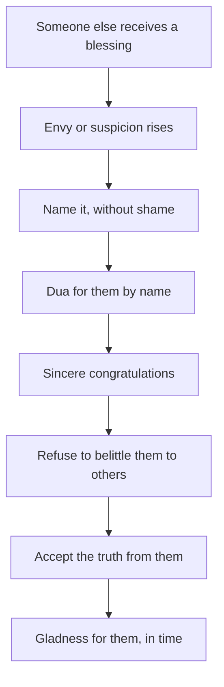

## The list in his head

On the evening Bilal was made team lead, Hamza found himself, on the bus home, making a list in his head: Bilal's code is messy, he talks too much in meetings, he only got it because the manager likes him. Hamza did not say any of it aloud. But he noticed that the list made him feel a little better, and then much worse.

This is how diseases of the heart often work. They do not announce themselves. They show up as a private list, a cold greeting, a pleasure when someone else fails, a quick "he is not that good". Nobody else sees them. But the Sunnah treats them as seriously as visible sins, and gives clear actions against them.

Before you step through Hamza's week, make a guess.

```predict
prompt: "According to Sahih Muslim 91, what is pride?"
options:
  - id: clothes
    label: "Wearing good clothes and looking smart in front of others"
  - id: reject
    label: "Rejecting the truth and looking down on people"
correctOptionId: reject
explanation: "When a man asked whether liking nice clothes was pride, the Prophet, peace be upon him, said: Allah is beautiful and loves beauty; pride is rejecting the truth and looking down on people (Sahih Muslim 91)."
```

Step through the canvas below. It follows Hamza's week after Bilal's promotion.

<InteractiveCanvas slug="cleaning-the-heart" />

The canvas showed envy met with five actions: naming the feeling, a dua for Bilal, sincere congratulations, refusing to belittle him, and accepting fair feedback from him even when it stung.

## Do not envy, do not hate

Abu Hurairah reported that the Prophet said (Sahih Muslim 2563):

> إِيَّاكُمْ وَالظَّنَّ فَإِنَّ الظَّنَّ أَكْذَبُ الْحَدِيثِ وَلاَ تَحَسَّسُوا وَلاَ تَجَسَّسُوا وَلاَ تَنَافَسُوا وَلاَ تَحَاسَدُوا وَلاَ تَبَاغَضُوا وَلاَ تَدَابَرُوا وَكُونُوا عِبَادَ اللَّهِ إِخْوَانًا

Meaning: Beware of suspicion, for suspicion is the most false of speech. Do not spy, do not pry, do not compete against one another, do not envy one another, do not hate one another, and do not turn your backs on one another. Be servants of Allah, brothers (Sahih Muslim 2563).

Read the list slowly, and you will recognise Hamza's bus ride in it. Suspicion: "he only got it because the manager likes him". Envy: wishing the promotion were his instead. Turning his back: the cold greeting he almost gave the next morning. The hadith names each one, and ends with what to be instead: brothers.

## Love for him what you love for yourself

Anas reported that the Prophet said (Sahih al-Bukhari 13):

> لا يُؤْمِنُ أَحَدُكُمْ حَتَّى يُحِبَّ لأَخِيهِ مَا يُحِبُّ لِنَفْسِهِ

Meaning: None of you truly believes until he loves for his brother what he loves for himself (Sahih al-Bukhari 13).

This hadith turns envy into a test with an action. Hamza wanted the promotion for himself. The hadith asks him to want it for Bilal too. He cannot command the feeling, but he can act on the hadith: he makes a dua for Bilal after Isha, asking Allah to bless him in his new role and help him do it well. He makes the same dua the next night, and the next. By the end of the week, the hot feeling has cooled. Not gone, but cooler. The action is shaping the heart.

Envy and ambition are different. Wanting a promotion for yourself, and working for it, is allowed and good. Envy is wishing that the other person's blessing would leave him. Hamza can keep working toward his own promotion while wishing Bilal well in his.

## Pride: two signs

Abdullah ibn Mas'ud reported that the Prophet said that no one with an atom's weight of pride in his heart will enter Paradise. When a man asked about liking good clothes, he said: Allah is beautiful and loves beauty; pride is rejecting the truth and looking down on people (Sahih Muslim 91). Module 8 used this hadith for clothes. Here, look at its two signs of pride, because both appeared in Hamza's week.

The first sign is rejecting the truth. In Bilal's first week as lead, he gives Hamza feedback on his code. The feedback is fair, and it stings, because it comes from Bilal. Pride wants to reject it. Accepting it is the cure: "you're right, I'll fix it."

The second sign is looking down on people. At lunch, a colleague says Bilal got the job by luck, and invites Hamza to agree. Joining in would feel good for a moment. Refusing is the cure: "he works hard; let's see how he does."

## Riya, again

Module 1 dealt with showing off. It belongs here too, because it is also a disease of the heart. Envy looks at someone else's blessing; showing off looks for other people's praise. Both take the heart's attention away from Allah. The cure for both is the same question: who is this for? Envy asks "why him and not me?" and showing off asks "will they see me?". The believer's question is "is Allah pleased?".

## Being glad at another's success

The final step is the hardest and the most beautiful: being genuinely glad when someone else succeeds. It rarely arrives as a feeling first. It usually arrives after weeks of the actions above: the dua, the sincere congratulations, the refusal to belittle. One day you find that the gladness is real.

The diagram shows envy turned around by actions, step by step.



Each step is an action you can take today, even while the feeling is still there. The last box is not a step you take; it is where the steps lead. That is how the heart becomes a habit: through repeated actions, not through waiting to feel different.

## Worked example: Musa and the cricket team

Musa's friend Hassan is picked for the school cricket team, and Musa is not. Follow his week.

**The feeling.** He is upset, and that night he says Hassan only got in because the coach likes him.

**The naming.** His mother asks him gently whether he really thinks so, or whether he is hurt. He admits he is hurt.

**The dua.** She suggests a dua for Hassan's first match. Musa makes it, reluctantly, after Isha.

**The action.** The next day he says "well done" to Hassan in person.

**The result.** Two weeks later he goes to watch Hassan's match and cheers when he takes a catch. He notices he means it.

## Building it the 1% way

Diseases of the heart are hard to track, because they are feelings rather than actions. So track the actions instead. A simple order works for most people.

Week one: notice. Each time you feel envy, suspicion or contempt toward someone, say "astaghfirullah" quietly, and nothing else. You are training yourself to notice.

Week two: the dua. For the person who most often triggers the feeling, make a short dua by name after one prayer each day.

Week three: the tongue. Refuse to belittle anyone to others for a week. If a conversation turns that way, say something good about the person or change the subject.

Week four: the truth. When someone corrects you fairly, especially someone you find it hard to take correction from, say "you're right" before anything else.

None of these needs the feeling to change first. The feeling follows the actions, slowly. Many people find, after a few months, that the person they envied has become someone they pray for without effort.

## Where people misunderstand it

The first misunderstanding is "feelings are not sins, so envy does not matter". Feelings that arrive uninvited are not what the hadith blames; acting on them, nursing them and wishing harm are. The actions in this chapter stop envy from growing.

The second is "ambition is envy". Wanting good for yourself is allowed. Envy is wishing the good would leave someone else.

The third is "pride is about clothes or money". Pride is rejecting the truth and looking down on people (Sahih Muslim 91), which can happen in anyone.

## Check your understanding

```quiz
type: mcq
question: "Sadia's sister gets married before her, and Sadia finds herself criticising the wedding to friends. Which action from this chapter helps first?"
options:
  - "Stop seeing her sister until the feeling passes"
  - "Make dua for her sister's marriage, and stop criticising it to others"
  - "Tell her sister honestly, in front of the family, that she is jealous of her"
  - "Wait for her own marriage, when the feeling will go"
correct: 1
explanations:
  - "Turning your back on one another is one of the things the hadith forbids (Sahih Muslim 2563)."
  - "Right. Love for her what you love for yourself (Sahih al-Bukhari 13): a dua for her, and no belittling."
  - "Honesty may help later, but the first actions are the dua and stopping the criticism."
  - "The actions work now; waiting lets the feeling grow."
```

```quiz
type: mcq
question: "A junior colleague points out a real mistake in Hamid's report in front of the team. Hamid feels insulted. What does Sahih Muslim 91 say about this moment?"
options:
  - "He should reject it, since a junior should not correct a senior"
  - "Pride is only about clothes, so this is not about pride"
  - "Rejecting the truth is a sign of pride, so accept the correction"
  - "He should accept it in public and criticise the colleague in private"
correct: 2
explanations:
  - "The truth is the truth, whoever says it. Rejecting it because of who said it is the first sign of pride."
  - "Sahih Muslim 91 defines pride as rejecting the truth and looking down on people, not as clothing."
  - "Right. Pride is rejecting the truth and looking down on people (Sahih Muslim 91). Accepting a fair correction is the cure."
  - "Criticising the colleague afterwards is looking down on people, the second sign."
```

## This week

Think of one person whose blessing you find hard to see. Make a short dua for them by name after one prayer each day this week, and say one sincere good word about them to someone else.

**Next:** Gratitude, dua and the akhirah.
