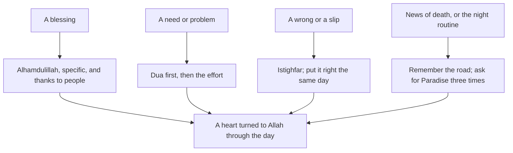

## A Tuesday with Allah

Hamza's ordinary Tuesday holds hot water in the morning, a laptop that works, his mother's tea, a production bug at 11:00, a sharp word to his sister at 18:00, and a funeral announcement at the mosque after Isha. None of these moments is unusual. Each one is a chance to turn to Allah in a different way: with thanks, with a request, with an apology, and with a reminder of where life ends.

This chapter is about those four turnings. They are the habits that keep a heart connected to Allah through a day that is mostly not prayer.

Before you step through his Tuesday, make a guess.

```predict
prompt: "When the production bug appears, what does Jami' at-Tirmidhi 2516 say to do first?"
options:
  - id: ask-allah
    label: "Ask Allah, and seek help from Him"
  - id: fix-first
    label: "Fix it first, and turn to Allah only if it cannot be fixed"
correctOptionId: ask-allah
explanation: "The Prophet, peace be upon him, taught Ibn Abbas: when you ask, ask Allah; and when you seek help, seek help from Allah (Jami' at-Tirmidhi 2516, graded sahih). Turning to Allah first does not replace fixing the bug; it comes with it."
```

Step through the canvas below. It follows Hamza's Tuesday.

<InteractiveCanvas slug="living-with-allah" />

The canvas showed five turnings in one day: Alhamdulillah for small blessings, asking Allah first in a problem, quick tawbah after a sharp word, a brief remembrance of death, and asking for Paradise three times.

## Gratitude, out loud and specific

Allah says: and when your Lord proclaimed, if you are grateful, I will surely give you more (Quran 14:7).

> لَئِن شَكَرْتُمْ لَأَزِيدَنَّكُمْ

Meaning: If you are grateful, I will surely give you more (Quran 14:7).

Gratitude grows when it is specific. "Alhamdulillah for everything" is true and good, but it slips past the mind. "Alhamdulillah for hot water this morning" stops the mind for a second on a real blessing. Hamza's habit is three specific Alhamdulillahs a day, out loud or under his breath, each for something he would miss if it were gone. Within a week he notices he is looking for them.

Gratitude to people is part of gratitude to Allah. The Prophet said: whoever does not thank people does not thank Allah (Sunan Abi Dawud 4811, graded sahih). Thanking his mother for the tea is part of the same habit.

## Ask Allah first

Ibn Abbas, may Allah be pleased with him, reported that he was riding behind the Prophet one day, and the Prophet said: young man, I will teach you some words. Be mindful of Allah and He will protect you; be mindful of Allah and you will find Him before you. When you ask, ask Allah; and when you seek help, seek help from Allah (Jami' at-Tirmidhi 2516, graded sahih). And Allah says: your Lord says, call on Me, and I will answer you (Quran 40:60). Dua is worship (Jami' at-Tirmidhi 3372).

Turning to Allah first does not mean doing nothing. When the bug appears, Hamza says a short dua, "O Allah, make it easy, and guide me to the fix", and then opens the logs. The dua comes first, the effort comes with it. This is the tawakkul of chapter 7.2: in the name of Allah, I rely on Allah, and then you walk out of the door.

Dua does not need special words. The Sunnah's duas are a treasure, but you can always ask in your own language, for anything, at any time. A habit Hamza keeps from this chapter: a short dua at the start of every task at work.

## Istighfar and quick tawbah

At 18:00 Hamza speaks sharply to his sister Rida about something small. He regrets it at once. Allah describes the people of taqwa as those who, when they do something wrong or wrong themselves, remember Allah and ask forgiveness for their sins, and do not persist knowingly (Quran 3:135). Tawbah has three parts in that verse: remember Allah, ask forgiveness, and do not persist. When the wrong was to a person, a fourth part follows: put it right with them.

So Hamza says astaghfirullah, and before Maghrib he apologises to Rida. The quicker the tawbah, the smaller the harm. Waiting until the evening muhasaba from chapter 6.4 is fine for small things, but a wrong to a person is best repaired the same day.

The Prophet asked forgiveness more than seventy times a day (Sahih al-Bukhari 6307). Daily istighfar, even when you cannot think of a specific sin, keeps the heart soft and quick to turn back.

## Remembering the akhirah

After Isha, the imam announces a funeral for tomorrow: an old man from the neighbourhood. Hamza feels the moment that comes with such news, a sudden clarity about what matters.

The Prophet said: remember often the destroyer of pleasures, meaning death (Jami' at-Tirmidhi 2307, graded hasan sahih). And Ibn Umar reported that the Prophet took him by the shoulder and said (Sahih al-Bukhari 6416):

> كُنْ فِي الدُّنْيَا كَأَنَّكَ غَرِيبٌ، أَوْ عَابِرُ سَبِيلٍ

Meaning: Be in this world as if you were a stranger or a traveller passing through (Sahih al-Bukhari 6416).

A traveller does not stop living. He eats, rests and works. But he does not mistake the road for home. Remembering death briefly each day, for example during the muhasaba at night, keeps decisions in the right size: a sharp word, a dishonest form, an hour of scrolling look different from the end of the road.

Remembering the akhirah is also about hope. Anas reported that the Prophet said: whoever asks Allah for Paradise three times, Paradise says, "O Allah, admit him to Paradise"; and whoever seeks refuge from the Fire three times, the Fire says, "O Allah, protect him from the Fire" (Jami' at-Tirmidhi 2572, graded sahih). Hamza adds it to the end of his night routine: "Allahumma inni as'alukal-jannah" three times, and "Allahumma ajirni minan-nar" three times.

The diagram shows the four turnings and the moments that start them.



Each turning has a natural cue in the day: a blessing, a need, a wrong, a reminder of death. None needs a new block of time. The heart's connection to Allah is built from many small turnings, not a few large ones.

## Worked example: Ayesha's gratitude jar

Ayesha wants the family to practise gratitude together. Follow her idea.

**The jar.** A glass jar on the dinner table and a small pad of paper.

**The cue.** After dinner, each person writes one specific blessing from the day and puts it in the jar. Musa writes "the rain stopped before cricket".

**The words.** As each person puts in their paper, they say Alhamdulillah.

**At the end of the month.** They read the papers together. Hamza's mother cries a little at one Ayesha wrote about her.

## Building it the 1% way

The four turnings can be added one at a time, each attached to an anchor you already have.

Week one: gratitude. Three specific Alhamdulillahs a day, attached to meals: one at breakfast, one at lunch, one at dinner.

Week two: dua first. A short dua at the start of each work or study task. Keep it to one sentence, in your own words.

Week three: quick tawbah. When you wrong someone, put it right before the next prayer. Use the prayer as the deadline.

Week four: the akhirah. During the night routine's one-minute muhasaba, add one thought of the road's end and the three requests for Paradise and refuge from the Fire.

These habits overlap with others in the course: the night routine in module 6, the adhkar after the prayer in module 5, the duas of moments in module 7. That overlap is good. A heart turned to Allah is not a separate habit; it is what all the other habits slowly build.

## Where people misunderstand it

The first misunderstanding is "dua replaces effort". The Prophet taught both: ask Allah, and take the means. Dua first, effort with it.

The second is "remembering death is depressing". It brings focus and hope, especially with the habit of asking for Paradise. If it brings fear that stops you living, talk to someone you trust.

The third is "tawbah is only for big sins". Istighfar is a daily habit, and quick tawbah after small wrongs keeps the heart soft.

## Check your understanding

```quiz
type: mcq
question: "Danish has a job interview. He prepares well, but feels he should not make dua because 'I have done my part'. What does this chapter teach?"
options:
  - "Ask Allah and seek His help, together with the preparation"
  - "Dua is only for when effort fails"
  - "Make dua instead of preparing, since Allah decides the result"
  - "Make dua only after the result comes"
correct: 0
explanations:
  - "Right. Dua is worship (Jami' at-Tirmidhi 3372), and it comes with the means, not instead of them."
  - "When you ask, ask Allah (Jami' at-Tirmidhi 2516); dua is not only a last resort."
  - "The Sunnah teaches both dua and effort."
  - "Dua before and during matters; it is not only for after."
```

```quiz
type: mcq
question: "Mehwish says Alhamdulillah many times a day, but it feels empty. Which change fits this chapter?"
options:
  - "Stop saying it until she genuinely feels grateful inside again"
  - "Say it for specific blessings she would miss if they were gone"
  - "Say it a hundred times more quickly"
  - "Only say it in the prayer"
correct: 1
explanations:
  - "Gratitude is built by practice; stopping removes the practice."
  - "Right. Specific gratitude stops the mind on a real blessing. If you are grateful, I will give you more (Quran 14:7)."
  - "Speed does not add meaning."
  - "Gratitude belongs to the whole day, not only the prayer."
```

## This week

Say three specific Alhamdulillahs a day. Start each work or study task with a short dua. Add asking for Paradise three times to the end of your night routine.

**Next:** A short quiz on the heart.
