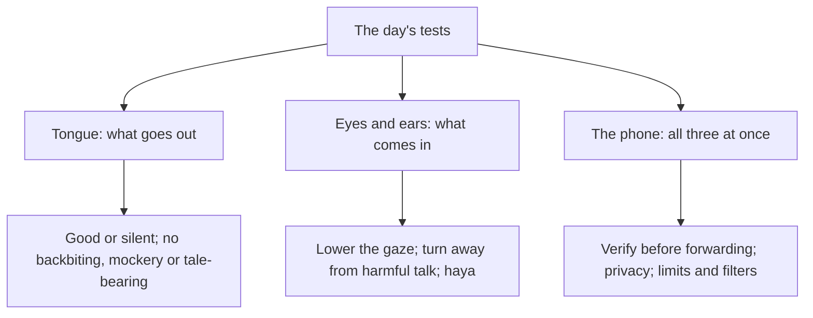

## Lunch on Wednesday

On Wednesday Hamza eats lunch with four colleagues in the office kitchen. In forty minutes, the conversation goes through a familiar route. Someone imitates the new manager's accent and everyone laughs. Someone says that Sara from the design team "obviously" got her bonus because she is close to the director. Someone shares a story about another company's layoffs that later turns out to be false. Someone tells a joke with a double meaning, and two people laugh loudly while one looks at the table.

Hamza laughs at the accent. He says nothing about Sara, but he listens to all of it. He repeats the layoff story to Ayesha that evening. He smiles at the joke, though it makes him uncomfortable.

On the bus home he counts. In one lunch, his tongue joined in mockery, his ears took in backbiting and a false rumour, his tongue passed the rumour on, and he laughed at a joke he would not tell his mother. None of it felt like a sin at the time. It felt like lunch.

## The family group and the evening phone

At 20:00 the family WhatsApp group lights up. An uncle has forwarded a long message about a famous person, full of shocking claims, with "forward to everyone" at the end. Three relatives have already forwarded it. Musa, who is in the group on his mother's phone, sends a laughing emoji.

At 22:00 Hamza is supposed to be putting his phone on the charger. Instead he scrolls through short videos for twenty minutes. Some are funny. Some are harmless. Two show things his eyes should not have stayed on. When he finally puts the phone down, he feels tired and slightly dirty, and he cannot remember most of what he watched.

Before you read on, make a guess.

```predict
prompt: "According to Sahih Muslim 47, what single rule did the Prophet, peace be upon him, give for speech?"
options:
  - id: always-honest
    label: "Say whatever you think, as long as it is honest"
  - id: good-or-silent
    label: "Say what is good, or keep silent"
correctOptionId: good-or-silent
explanation: "Whoever believes in Allah and the Last Day, let him say what is good or keep silent (Sahih Muslim 47; Sahih al-Bukhari 6018). Honesty is required, but not everything true needs to be said."
```

## Three gates

The tongue, the eyes and the ears are three gates. Through the tongue, things go out: words that can build or break. Through the eyes and the ears, things come in: images, sounds and talk that shape the heart. The phone is a fourth gate that joins the other three, because it is where we now speak, look and listen most.

The Sunnah treats all three gates seriously. The Prophet said: whoever believes in Allah and the Last Day, let him say good or be silent (Sahih Muslim 47).

> مَنْ كَانَ يُؤْمِنُ بِاللَّهِ وَالْيَوْمِ الآخِرِ فَلْيَقُلْ خَيْرًا أَوْ لِيَصْمُتْ

Meaning: Whoever believes in Allah and the Last Day, let him say what is good or keep silent (Sahih Muslim 47).

And Allah says: do not follow what you have no knowledge of; the hearing, the sight and the heart, all of these will be questioned (Quran 17:36). The ears and the eyes are named together with the heart, as things a person will be asked about.

## Why guarding the gates is hard

Guarding these gates is hard for a reason this course already knows: they are habits, and very old ones. A person has been laughing at certain jokes, repeating certain stories and scrolling in a certain way for years. The cues are everywhere: a lunch table, a group chat, a phone in the hand. And unlike the prayer, there is no fixed time. The tests come all day, without warning.

That means the tools are slightly different. For the prayer, the habit was "at the adhan, do this". For the gates, the habit is a set of planned responses: "when the talk turns to someone absent, I say this", "when a forward arrives, I check before I share", "when an image appears, I look away the first time". Planned responses are if-then plans, the same tool as module 2, used for moments that come without a schedule.

The diagram shows the three gates and the planned response at each.



Each branch ends in a short list of planned responses, not a general wish. The chapters in this module give each response its source and its words, so that when the moment comes at a lunch table, you already know what you will do.

## Why these gates matter so much

The Prophet gave one of his strongest promises about the tongue: whoever guarantees what is between his jaws and what is between his legs, I guarantee Paradise for him (Sahih al-Bukhari 6474). The tongue is named first. It is the part of the body we use most, from waking to sleeping, and the part we think about least. A person can pray, fast and give charity, and still lose much of the reward through words said carelessly about others. Module 11 shows how serious the rights of others are. Many of those rights are broken through the tongue.

The eyes and ears are quieter, but they shape the heart over years. What we look at and listen to every day becomes what we think about, what we find normal, and eventually what we do. Guarding them is not about being cut off from the world. It is about choosing what gets in.

## What Hamza decides

Hamza does not try to change everything at once. He picks the one test that came up most in his day: backbiting at lunch. His planned response is one sentence: "Let's not talk about her when she isn't here." He will try it at the next lunch. He also decides one rule for the phone, because the family group showed him how fast things spread: he will forward nothing he has not checked.

Ayesha adds a family rule, from her list: no forwarding in the family group without a source. Musa, a little embarrassed about his laughing emoji, agrees to be the one who asks "source?" when anyone forwards something new.

## The next lunch

On Friday the same group eats together again. Twenty minutes in, the talk turns back to Sara and her bonus. Hamza's heart beats a little faster. Then he says, as lightly as he can, "Let's not talk about her when she isn't here. Did anyone see the match last night?"

There is a short, awkward pause. One colleague rolls his eyes. Then someone answers about the match, and the conversation moves on. Nobody is offended. After lunch, one of the colleagues, the one who had looked at the table during the joke on Wednesday, walks back to the desks with Hamza and says quietly, "Thanks for that. I never know how to stop it."

Hamza realises two things. The planned sentence worked because it was short, kind and offered somewhere else to go. And he was not the only person at the table who wanted the conversation to be different. Often, one person going first is all it takes.

## The same tests, at twelve

Musa meets the same three gates at school, in a smaller form. His class has a group chat where boys post memes, some of them crude, and nicknames for a quiet classmate. At break, older boys pass phones around with videos. On the bus, someone always has a story about a teacher.

Rida talks to him about it on Sunday, not with a list of rules, but with the same idea his uncle used: a planned sentence for each moment. For the nicknames: "Leave him, yaar." For the videos: walk away and find his friends. For the crude memes: mute the group, and leave it if it does not change. For the teacher stories: don't pass them on.

Musa is quiet for a while, then says that the nickname one is the hardest, because he used to laugh too. Rida says that is exactly why it is worth starting there.

<Callout type="info" title="Not a call to be harsh">
Guarding your own tongue and eyes is the habit. It is not a licence to lecture colleagues or relatives about theirs. A gentle change of subject, or quietly leaving, usually does more good than a sermon.
</Callout>

<LearningObjectives items={["Use the rule 'say good or be silent' (Sahih Muslim 47) as a question before speaking", "Recognise backbiting, tale-bearing, mockery and harshness, and have a planned response for each", "Lower the gaze, turn away after a sudden glance, and leave harmful talk, keeping haya as part of who you are", "Verify before forwarding, respect privacy, and set limits and filters on the phone", "Respond gently, without lecturing others"]} />

## Key words

| Word | Plain English |
|---|---|
| ***Ghibah*** | Backbiting: mentioning someone absent in a way they would dislike, even if true |
| ***Buhtan*** | Slander: saying something false about someone |
| ***Namimah*** | Tale-bearing: carrying words between people to cause trouble. In Urdu, *chughli* |
| ***Haya*** | Modesty and shyness from what is wrong; a branch of faith |
| **Lowering the gaze** | Turning the eyes away from what should not be looked at |
| **Verifying** | Checking a piece of news before believing or sharing it |

## What is in this module

| Chapter | You will practise |
|---|---|
| 10.2 | The tongue: good or silent, and planned responses at a lunch table |
| 10.3 | Eyes, ears and haya |
| 10.4 | Mobile and internet: forwarding, privacy, limits and filters |
| 10.5 | A short quiz with five cases |
| 10.6 | Your plan for the three gates |

**Next:** The tongue.
