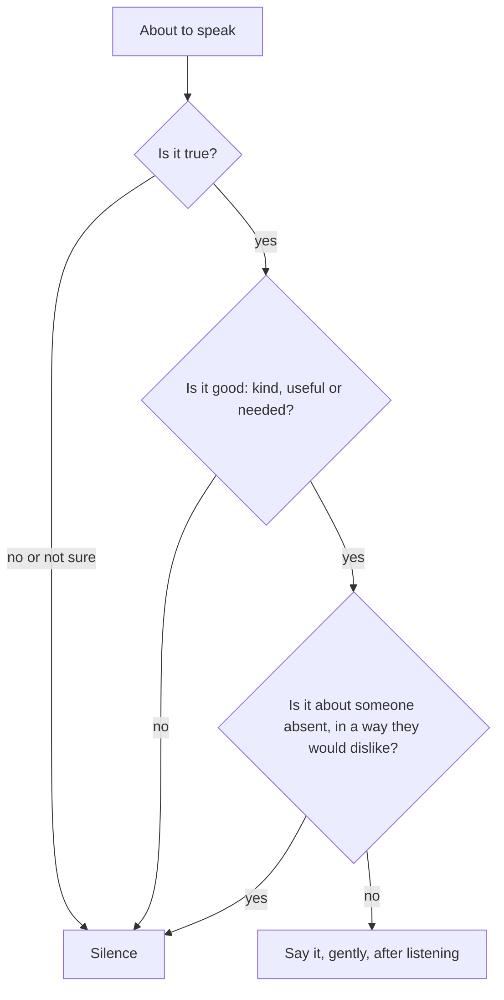

## Five seconds

At the Friday lunch, Hamza had about five seconds between the moment the talk turned to Sara and the moment he spoke. In those five seconds, an old habit wanted to join in, and a new one wanted to change the subject. He had prepared one sentence, and that is why the new habit won.

This chapter is about those five seconds. Speech is the habit we use most, and the one we plan least. The Sunnah gives one rule that covers it all, and then names the kinds of speech that break it: backbiting, slander, tale-bearing, mockery, lying and harshness. For each, the chapter gives a planned response you can use in real life.

Before you step through the lunch, make a guess.

```predict
prompt: "A colleague says something about Sara that is true but that she would dislike. Is it backbiting, according to Sahih Muslim 2589?"
options:
  - id: yes
    label: "Yes; if it is true it is backbiting, and if false it is slander"
  - id: no
    label: "No; it is only backbiting if it is false, otherwise it is honesty"
correctOptionId: yes
explanation: "The Prophet, peace be upon him, defined backbiting as mentioning your brother in a way he dislikes. When asked what if it is true, he said: if it is true, you have backbitten him; and if it is not, you have slandered him (Sahih Muslim 2589)."
```

Step through the canvas below. It follows one lunch break and the tests of the tongue in it.

<InteractiveCanvas slug="before-you-speak" />

The canvas showed the one rule, then four tests at one table: mockery, backbiting, a tale to pass on, and how to speak, gently and truthfully. It ended with the guarantee: whoever guards his tongue, the Prophet guaranteed him Paradise.

## The rule: good or silent

The Prophet said: whoever believes in Allah and the Last Day, let him say good or be silent (Sahih Muslim 47; Sahih al-Bukhari 6018). This rule is simple enough to use as a question in five seconds: is what I am about to say good? If yes, say it. If not, or if you are not sure, silence is also an act of faith.

"Good" includes more than kind words. It includes useful information, honest advice given privately, a needed warning, a joke that is true and harms nobody, and dhikr. What it excludes is speech that harms someone, speech that is false, and speech that adds nothing but noise. Most of what we regret saying falls into those last three.

## Truthfulness

Abdullah ibn Mas'ud reported that the Prophet said (Sahih al-Bukhari 6094):

> إِنَّ الصِّدْقَ يَهْدِي إِلَى الْبِرِّ، وَإِنَّ الْبِرَّ يَهْدِي إِلَى الْجَنَّةِ

Meaning: Truthfulness leads to righteousness, and righteousness leads to Paradise (Sahih al-Bukhari 6094).

The hadith continues: a man keeps telling the truth until he is written as truthful, and lying leads to wickedness, and wickedness to the Fire, and a man keeps lying until he is written as a liar with Allah. Notice "keeps telling". Truthfulness and lying are both habits, built by repetition. Small lies, "I'm five minutes away" when you have not left, "the file was corrupted" when you forgot, are where the lying habit grows. Small truths are where the truthful habit grows.

## Backbiting, slander and tale-bearing

Abu Hurairah reported that the Prophet asked: do you know what backbiting is? They said Allah and His Messenger know best. He said: mentioning your brother in a way he dislikes. He was asked: what if what I say is true? He said: if it is true, you have backbitten him; if it is not, you have slandered him (Sahih Muslim 2589). Allah describes backbiting as like eating the flesh of your dead brother (Quran 49:12).

Tale-bearing, *namimah* or *chughli*, is carrying words from one person to another to cause trouble: "do you know what he said about you?" Hudhayfah reported that the Prophet said: a tale-bearer will not enter Paradise (Sahih al-Bukhari 6056).

These two are the most common sins of the tongue at a lunch table, in a family and in a group chat. A planned response for each: for backbiting, "Let's not talk about him when he isn't here," and change the subject. For tale-bearing, do not pass it on, and if someone brings a tale to you, "I'd rather not know; let's leave it."

Scholars explain that some speech about an absent person is allowed for a real need, such as seeking help against a wrong, asking advice about a marriage or a business partner, or warning someone of real harm. Those are specific cases with conditions; learn them from a scholar. Ordinary lunch-table talk is not one of them.

## Mockery and nicknames

Allah says: O you who believe, let not a people mock another people; perhaps they are better than them. Nor let women mock other women; perhaps they are better than them. And do not insult one another, and do not call each other by offensive nicknames (Quran 49:11). Mocking an accent, a body, poverty, a disability or a mistake is exactly this. A planned response: do not laugh, and if you can, say something kind about the person.

## How you speak

The Quran records Luqman's advice to his son: be moderate in your pace and lower your voice (Quran 31:19). Shouting, interrupting and speaking harshly are habits too. Listening first, letting the other person finish, and answering in a calm voice are habits that can be built one conversation at a time. Allah describes the servants of the Most Merciful as those who, when the ignorant address them harshly, reply with words of peace (Quran 25:63).

## The guarantee

Sahl ibn Sa'd reported that the Prophet said (Sahih al-Bukhari 6474):

> مَنْ يَضْمَنْ لِي مَا بَيْنَ لَحْيَيْهِ وَمَا بَيْنَ رِجْلَيْهِ أَضْمَنْ لَهُ الْجَنَّةَ

Meaning: Whoever guarantees for me what is between his jaws and what is between his legs, I guarantee Paradise for him (Sahih al-Bukhari 6474).

The diagram shows the five-second check before speaking.



Three questions, each a few seconds. Most speech passes all three easily and is said without a thought. The check matters for the moments that fail one of them, and those are exactly the moments people regret later.

## Building it the 1% way

Week one: backbiting. Prepare one sentence to stop it, and use it once this week.

Week two: small lies. Notice the small untruths of convenience, and replace one with the truth each day.

Week three: tale-bearing and rumours. Pass nothing on about a person that they would not want passed on.

Week four: how you speak. In one conversation a day, listen until the other person finishes before you answer, and lower your voice if it rises.

## Worked example: Rida in the family group

Rida's family group has a habit of discussing absent relatives. Follow her change.

**The test.** A cousin writes about an aunt's daughter's divorce, with details.

**The response.** Rida writes: "Let's make dua for her and leave the details. May Allah make it easy for her."

**The result.** Two people send "Ameen". The details stop. One cousin messages Rida privately to thank her.

**The habit.** She keeps the same sentence ready for the next time.

## Speech online

Everything in this chapter applies to typed words too. A comment under a post, a reply in a group, a review of a business: each is speech, and each is either good or not. Online speech is often harsher, because the person is not in front of you. A useful habit: before posting a comment about a person, imagine saying it to their face in front of your family. If you would not, do not type it.


The first misunderstanding is "if it is true, it is not backbiting". The Prophet said the opposite (Sahih Muslim 2589).

The second is "small lies do not count". Lying is a habit that grows, and the hadith speaks of a person who keeps lying (Sahih al-Bukhari 6094).

The third is "guarding the tongue means never speaking". It means saying good. Kind, true and useful speech is encouraged.

## Check your understanding

```quiz
type: mcq
question: "A friend tells Bilal: 'Do you know what Usman said about you behind your back?' What does this chapter suggest Bilal do?"
options:
  - "Say he would rather not know, and leave it"
  - "Listen to all of it, so that he knows who his real friends are"
  - "Go straight to Usman and confront him"
  - "Pass it on to others, so they know what Usman is like"
correct: 0
explanations:
  - "Right. Declining the tale stops it, and protects everyone's hearts."
  - "This is tale-bearing, which the Prophet warned against (Sahih al-Bukhari 6056). Listening encourages it."
  - "Confronting on the basis of a tale often spreads the harm further."
  - "Passing it on makes Bilal a tale-bearer too."
```

```quiz
type: mcq
question: "Mariam says 'I'm on my way' to a friend when she has not yet left home, 'so she doesn't worry'. What does this chapter say about such small lies?"
options:
  - "They are harmless, since they spare her friend from worrying"
  - "They are fine if she arrives on time anyway"
  - "Lying is a habit that grows; say the truth kindly instead"
  - "Only lies about religion count"
correct: 2
explanations:
  - "The Prophet described lying as something a person keeps doing until it is written (Sahih al-Bukhari 6094)."
  - "Arriving on time does not make the words true."
  - "Right. Truthfulness leads to righteousness (Sahih al-Bukhari 6094). 'I'm leaving in ten minutes' is true and kind."
  - "The hadith speaks of lying in general."
```

## This week

Prepare one sentence to stop backbiting, and use it the first time it is needed. Replace one small convenient lie a day with the truth.

**Next:** Eyes, ears and haya.
