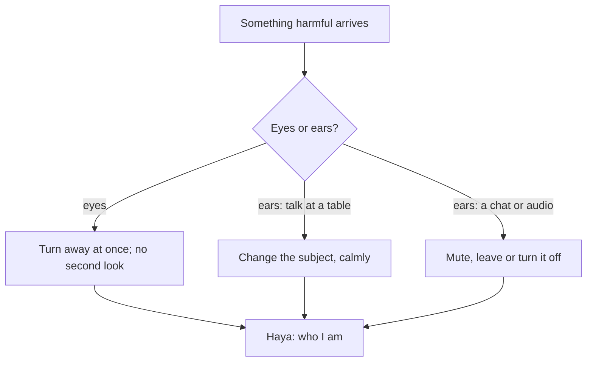

## What gets in

At the Wednesday lunch, Hamza's tongue was tested. But his ears took in more than his tongue gave out: the backbiting about Sara, the false layoff story, the joke with a double meaning. And that night his eyes took in two videos that stayed with him longer than he wanted.

This chapter is about what comes in. The eyes and the ears are open all day, and much of what reaches them is not chosen. The habit is not to see and hear nothing; that is impossible. It is to make a fast, planned choice when something harmful arrives: turn away, leave, or change it.

Before you step through Musa's day, make a guess.

```predict
prompt: "Musa's eyes fall on an image he should not look at, without meaning to. What did the Prophet, peace be upon him, tell Jarir to do with such a sudden glance?"
options:
  - id: guilt
    label: "Feel guilty, since even the first glance is a sin"
  - id: turn-away
    label: "Turn his eyes away"
correctOptionId: turn-away
explanation: "Jarir asked the Prophet about the sudden, unintended glance, and he told him to turn his eyes away (Sahih Muslim 2159). The first glance was not chosen; the habit is what you do next."
```

Step through the canvas below. It follows Musa through the tests of his eyes and ears in one day.

<InteractiveCanvas slug="guarding-eyes-and-ears" />

The canvas showed five moments: a sudden glance turned away, a second look not taken, a group chat left when jokes turned crude, a backbiting conversation changed, and haya explained as part of who he is.

## Lowering the gaze

Allah says: tell the believing men to lower their gaze and guard their private parts; that is purer for them; Allah is aware of what they do. And tell the believing women to lower their gaze and guard their private parts (Quran 24:30 to 31).

> قُل لِّلْمُؤْمِنِينَ يَغُضُّوا مِنْ أَبْصَارِهِمْ

Meaning: Tell the believing men to lower their gaze (Quran 24:30).

The command is addressed to men first, then to women, in the same words. It is a shared habit, not a burden on one side. "Lower" is a practical word: not to close the eyes, but to bring them down and away from what should not be looked at, whether in the street, at work, or on a screen.

## The first glance and the second

Jarir ibn Abdullah reported that he asked the Prophet about the sudden glance, and the Prophet told him to turn his eyes away (Sahih Muslim 2159). Abu Hurairah reported that the Prophet said that Allah has written for the son of Adam his share of zina, and that the zina of the eyes is looking (Sahih Muslim 2657).

Put together, these two hadith describe the habit precisely. The first glance, which you did not choose, is something to turn away from. The second look, which you choose, is what the eyes are responsible for. So the planned response is simple and fast: the moment you notice, look away. Do not argue with yourself first. The longer the argument, the longer the look.

## What the ears take in

Allah says: do not follow what you have no knowledge of; the hearing, the sight and the heart, all of these will be questioned (Quran 17:36). And He describes the believers: when they hear ill speech, they turn away from it and say, "to us our deeds and to you yours; peace be upon you; we do not seek the ignorant" (Quran 28:55).

Turning away has several forms. At a table, it is changing the subject, as Hamza did. In a group chat, it is muting or leaving. With music or audio you know is harmful to you, it is turning it off. With a person who keeps backbiting, it is a gentle "let's leave it". What is not required is a lecture. The verse itself ends with "peace be upon you": the turning away is calm.

Backbiting deserves a special mention for the ears, because listening to it with interest is part of keeping it alive. Module 10.2 covered how to stop it with the tongue. The ears' part is not to encourage it with attention.

## Haya

Abu Hurairah reported that the Prophet said (Sahih Muslim 35):

> الإِيمَانُ بِضْعٌ وَسَبْعُونَ شُعْبَةً وَالْحَيَاءُ شُعْبَةٌ مِنَ الإِيمَانِ

Meaning: Faith has seventy-some branches, and haya is a branch of faith (Sahih Muslim 35).

Haya is often translated as modesty or shyness, but it is wider: an inner sense that stops a person from what is shameful, before Allah and before people. Abu Mas'ud reported that the Prophet said: among the words of earlier prophethood that people have kept is: if you have no haya, do as you wish (Sahih al-Bukhari 6120). In other words, haya is the brake. Without it, nothing stops a person.

For the habit, haya means a few concrete choices: not telling or laughing at crude or double-meaning jokes, not sharing memes that you would be ashamed to show your parents, dressing and speaking in a way you would be comfortable with if your most respected teacher walked in. It is not a rule of being timid or silent. The Prophet was more shy than a veiled young girl (Sahih al-Bukhari 3562), and he was also the best, the bravest and the most generous of people (Sahih al-Bukhari 2820).

The diagram shows the planned responses for what comes in.



Each response takes a second or two. Speed is the point. The longer you stay with something harmful while deciding, the more it takes hold. Planning the response in advance removes the deciding.

## Building it the 1% way

Week one: the first glance. Practise turning away at once, without arguing, in the street and on screens.

Week two: one chat. Find the group or account that most often brings crude or harmful content, and mute or leave it.

Week three: the table. Use a planned sentence to change the subject the next time backbiting starts.

Week four: haya in your own content. For a week, share nothing you would not show your parents or your teacher.

## Worked example: Hamza's feed

Hamza's short-video feed often shows things his eyes should not stay on. Follow his changes.

**The quick response.** When something appears, he scrolls past at once, without watching "to see what it is".

**The means.** He tells the app "not interested" each time, so the feed slowly changes, and he turns on the app's restricted mode.

**The limit.** He removes the app from his home screen, so opening it takes three steps instead of one.

**The result.** After two weeks, the feed is mostly cricket and cooking. He watches less, and remembers more of what he does watch.

## Families and screens

For parents, the eyes are now mostly guarded at the screen. A few family habits help everyone, not only children. Screens are used in shared rooms rather than behind closed doors. Phones charge outside bedrooms at night, as module 6 already suggested. Filters are on for every device in the house, adults' included, so that nobody is singled out. And the family talks about what they watched, which makes it natural to say "that video was not good for us" without shame.

Rida finds that the most useful habit is the last one. When Musa can tell her what he saw without fear of anger, he tells her much more, and she can help, before small problems become large ones.


The first misunderstanding is "the first glance is a sin, so I am already guilty". The Prophet told Jarir to turn away (Sahih Muslim 2159). The habit is the next second.

The second is "lowering the gaze is only for women". The verse addresses men first (Quran 24:30), then women.

The third is "haya means being shy and quiet". It is a brake on what is shameful; it sits with courage, kindness and confidence.

## Check your understanding

```quiz
type: mcq
question: "Owais sees an indecent advert on a billboard while driving. He feels guilty all day. What does this chapter teach?"
options:
  - "He should have closed his eyes, so he has sinned"
  - "He should avoid driving on that road ever again"
  - "He should look carefully, so that he can report it accurately to someone"
  - "The first unintended glance is not what he chose; turn away and move on"
correct: 3
explanations:
  - "Closing the eyes while driving is dangerous; lowering them and turning away is the habit."
  - "A different route can be a reasonable means, but it is not required for an unintended glance."
  - "Looking again is the second look the habit avoids."
  - "Right. The Prophet told Jarir to turn his eyes away from the sudden glance (Sahih Muslim 2159). The habit is turning away, not guilt."
```

```quiz
type: mcq
question: "Sana's college group chat often fills with crude memes. She does not post them, but reads them all. Which response fits Quran 28:55?"
options:
  - "Keep reading quietly, since she is not the one posting"
  - "Mute or leave the group, calmly"
  - "Post a long reminder about haya to the whole group"
  - "Post her own memes to balance them out"
correct: 1
explanations:
  - "The ears and eyes will be questioned (Quran 17:36). Reading them is taking them in."
  - "Right. When they hear ill speech they turn away from it, saying: peace be upon you (Quran 28:55)."
  - "A lecture often causes conflict; the verse describes turning away calmly."
  - "That adds to the problem rather than turning away from it."
```

## This week

Practise the fast turn-away for every sudden glance. Mute or leave one chat or account that most often brings harmful content.

**Next:** Mobile and internet.
