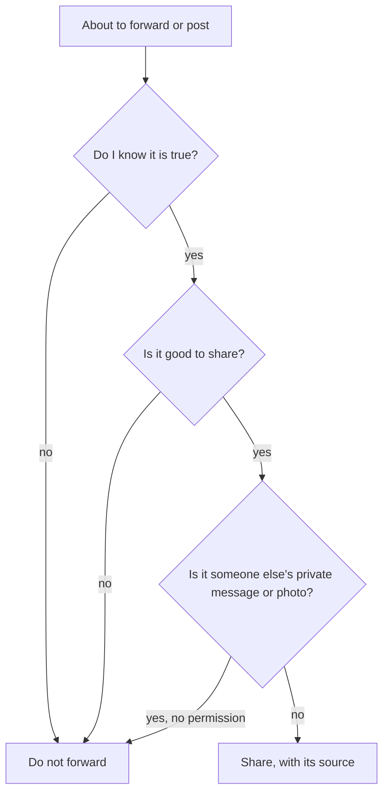

## The forward

At 20:00 on Wednesday, an uncle forwarded a long message to the family group: shocking claims about a well-known person, no source, and "forward to everyone" at the end. Three relatives had forwarded it within an hour. Musa sent a laughing emoji.

The next morning, Hamza searches for the claims. They are false: an old rumour, already denied, with a new photo attached. By then, the message has reached perhaps a few hundred people through his family alone. Nobody who forwarded it meant harm. Each thought they were sharing news.

This chapter is about the phone, because it is now where most speech, most looking and most listening happen. Every rule from chapters 10.2 and 10.3 applies to it, plus a few that are special to it: verifying before forwarding, privacy, and time.

Before you step through the forward, make a guess.

```predict
prompt: "Hamza cannot check whether a forwarded message is true. Should he forward it 'just in case it is useful'?"
options:
  - id: no
    label: "No; it is enough of a sin to pass on everything you hear"
  - id: yes
    label: "Yes; if it turns out false, the sin is on the person who wrote it"
correctOptionId: no
explanation: "The Prophet, peace be upon him, said: it is enough of a sin for a man to narrate everything he hears (Sunan Abi Dawud 4992, graded sahih). Allah also commands verifying news before acting on it (Quran 49:6)."
```

Step through the canvas below. It follows one forwarded message and one evening on the phone.

<InteractiveCanvas slug="before-you-forward" />

The canvas showed a shocking forward, the habit of verifying, not forwarding what cannot be checked, refusing to share a private chat, and using limits and filters to protect free time.

## Verify before you share

Allah says: O you who believe, if a person of bad character brings you news, verify it, lest you harm a people out of ignorance and then regret what you have done (Quran 49:6).

> إِن جَاءَكُمْ فَاسِقٌ بِنَبَإٍ فَتَبَيَّنُوا

Meaning: If a person of bad character brings you news, verify it (Quran 49:6).

A forwarded message is news from an unknown source. Most of the time, nobody in the chain knows who wrote it. The verse's instruction, verify, fits it exactly. In practice, verifying takes a minute: search for the main claim, check whether a reliable source reports it, and look for whether it has already been shown false. If you cannot verify it, the habit is simple: do not forward it.

## Not everything you hear

Abu Hurairah reported that the Prophet said (Sunan Abi Dawud 4992, graded sahih):

> كَفَى بِالْمَرْءِ إِثْمًا أَنْ يُحَدِّثَ بِكُلِّ مَا سَمِعَ

Meaning: It is enough of a sin for a man to narrate everything he hears (Sunan Abi Dawud 4992).

Some books quote a similar narration with the words "enough of a lie" (in the introduction of Sahih Muslim). Either way, the message is the same: passing on everything you hear, without checking, is itself a wrong. A forward button turns this into a daily test. Hamza's habit for the family group: before forwarding anything, ask "do I know this is true, and is it good to share?" If either answer is no, the message stops with him.

The same applies to Islamic messages. Many forwarded "hadith" have no source, or a weak one, as modules 6 and 7 showed. Forward a hadith only with its collection and number, after checking it.

## Privacy

Allah says: do not spy on one another, and do not backbite one another (Quran 49:12). And the Prophet said: do not pry, and do not spy (Sahih Muslim 2563). On the phone, spying has new forms: screenshots of a private chat shared with others, reading someone's messages without permission, sharing a photo of someone who did not agree, recording a conversation secretly. Each is a breach of trust.

The habit: treat every private message you receive as an amanah, a trust. Do not screenshot and share it without the sender's permission. Do not post photos of other people, especially of women and children, without their permission. If someone asks you to share a friend's private message, the answer is no.

## Free time

Ibn Abbas reported that the Prophet said: there are two blessings in which many people are cheated, health and free time (Sahih al-Bukhari 6412).

The phone is where most people's free time now goes, often without a decision. Twenty minutes of scrolling at 22:00, as Hamza found, leaves a person tired and unable to remember what they saw. Module 13 covers time management as a whole. For the phone, a few settings do most of the work: a daily limit on the two apps that take the most time, notifications off for everything that is not a person, and the most tempting apps off the home screen.

## Filters

Some content online is harmful to the eyes and the heart, and much of it arrives without being searched for. Taking practical means is part of the Sunnah, as module 9 showed for private temptations. Content filters on the phone and the home router, restricted modes in apps, and a family rule that phones charge outside bedrooms are means. They are not a sign of weak faith. They are tawakkul with the camel tied.

The diagram shows the check before sharing anything.



The check is the tongue's check from chapter 10.2, with one question added for privacy. Most things you share pass it in a second. The ones that fail it are the forwards that cause harm.

## The good the phone can do

None of this means the phone is the enemy. The same device holds your Quran app, your adhkar, your hadith app with its gradings, your family's photos, lessons from good teachers, and work that feeds your family. Used with intention, it is a tool for many of the habits in this course. Hamza's Quran page on travel days is read on his phone; Musa's sadaqah reminders in module 14 are on his mother's phone.

The habit is not to fear the phone but to decide what it is for. A simple test: when you pick it up, can you name what you are picking it up to do? If yes, do it and put it down. If no, put it down anyway. Over a week, this one question changes how often the phone is in your hand.

## Building it the 1% way

Week one: the forward rule. Forward nothing you have not checked. If you cannot check it, do not forward it.

Week two: privacy. No screenshots of private chats, and no photos of others without permission.

Week three: time. Set a daily limit on the one app that takes most of your free time.

Week four: filters. Turn on content filters on your phone, and, if you can, on the home router, for everyone in the house.

## Worked example: the family group rule

After the false forward, Hamza's family agrees a rule for their group. Follow how it works.

**The rule.** Anything forwarded must come with a source, and Islamic messages with a collection and number.

**The helper.** Musa, at twelve, is the official "source?" asker. He enjoys it.

**The test.** A week later, an aunt forwards a "hadith" about Friday with no reference. Musa writes "source?". Hamza checks it: it is not found. The aunt laughs and deletes it.

**The result.** After a month, forwards in the group have dropped by more than half, and the ones that remain are mostly family news and photos.

## Where people misunderstand it

The first misunderstanding is "if it is false, the sin is on whoever wrote it". Passing on everything you hear is itself a sin (Sunan Abi Dawud 4992).

The second is "screenshots of chats are harmless". Sharing a private message without permission is a breach of trust and close to spying (Quran 49:12).

The third is "filters are for children". Filters are a practical means for everyone.

## Check your understanding

```quiz
type: mcq
question: "Rehan receives a message saying a local shop sells expired food. He cannot verify it. What does this chapter suggest?"
options:
  - "Forward it to warn people, just in case"
  - "Post it publicly, so the shop is forced to answer"
  - "Do not forward it until he can verify it"
  - "Forward it, but add 'not sure if true'"
correct: 2
explanations:
  - "If it is false, he harms the shop out of ignorance, which the verse warns against (Quran 49:6)."
  - "Posting an unverified accusation publicly spreads the harm further."
  - "Right. Verify first (Quran 49:6); passing on everything you hear is enough of a sin (Sunan Abi Dawud 4992)."
  - "Adding a doubt still spreads the claim."
```

```quiz
type: mcq
question: "A classmate asks Musa to send a screenshot of a private message his friend sent him, 'just to see'. What does this chapter teach?"
options:
  - "Refuse; a private message is a trust"
  - "Send it, since it is only between classmates"
  - "Send it, but crop out the name"
  - "Send it, then tell his friend afterwards"
correct: 0
explanations:
  - "Right. Do not spy on one another (Quran 49:12; Sahih Muslim 2563)."
  - "A private message is a trust, whoever asks for it."
  - "Cropping the name is still sharing a private message without permission."
  - "Telling afterwards does not make sharing it right."
```

## This week

Forward nothing you have not verified. Set one daily limit on the app that takes most of your free time.

**Next:** A short quiz on the tongue, eyes and ears.
