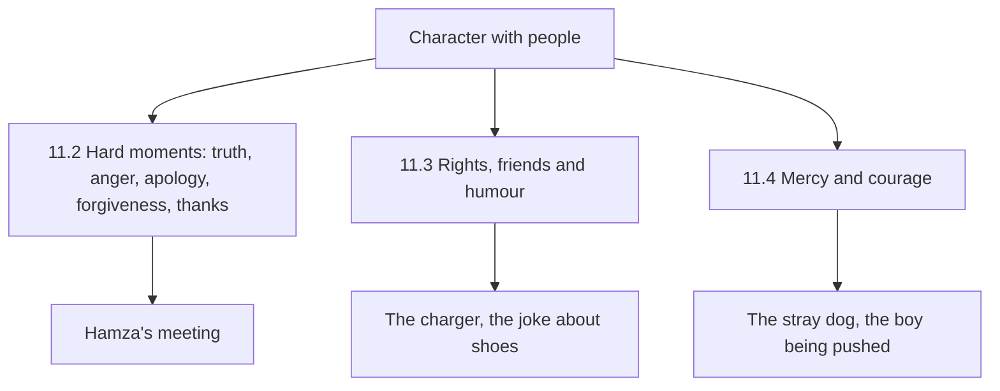

## The best of you

On a Monday in March, Hamza sits in an incident review meeting. A system went down over the weekend. In front of eight people, his colleague Usman says, clearly, that it was Hamza's change that caused it. It was not, mostly. One small configuration change was Hamza's; the main fault was elsewhere. Hamza feels his face go hot. He wants to stand up and list Usman's own mistakes from the last six months. He has the list ready in his head.

Instead, almost to his own surprise, he sits back in his chair, breathes, and says quietly under his breath, "a'udhu billahi minash-shaytanir-rajim". Then he shares the timeline calmly. He admits the one change that was his, and apologises for it. Usman says nothing for a moment, then nods. After the meeting, the manager stops Hamza in the corridor and thanks him for "the way you handled that".

On the walk home Hamza thinks about what happened. Five years ago he would have shouted. Two years ago he would have answered with a list. Today he sat back. He did not plan it. But he has been sitting back and seeking refuge in small moments for weeks, since module 8, and today it was there when he needed it.

Before you read on, make a guess.

```predict
prompt: "The Prophet, peace be upon him, described the believer with the most complete faith. Which quality did he name?"
options:
  - id: worship
    label: "The one who prays the most voluntary prayers"
  - id: character
    label: "The one with the best character"
correctOptionId: character
explanation: "The most complete of the believers in faith is the one with the best character, and the best of you are those who are best to their wives (Jami' at-Tirmidhi 1162, graded hasan sahih)."
```

## Character is a habit too

Abu Hurairah reported that the Prophet said (Jami' at-Tirmidhi 1162, graded hasan sahih):

> أَكْمَلُ الْمُؤْمِنِينَ إِيمَانًا أَحْسَنُهُمْ خُلُقًا وَخِيَارُكُمْ خِيَارُكُمْ لِنِسَائِهِمْ خُلُقًا

Meaning: The most complete of the believers in faith is the one with the best character, and the best of you are those who are best in character to their wives (Jami' at-Tirmidhi 1162).

Abu ad-Darda reported that the Prophet said that nothing is heavier on the scale than good character (Jami' at-Tirmidhi 2003, graded sahih). And Abdullah ibn Amr reported that he said: the best of you are those with the best character (Sahih al-Bukhari 6029).

These hadith put character at the centre of faith, not at its edge. They also suggest something hopeful: character can be built. Nobody is born patient, honest, forgiving and grateful. People become those things by repeating small actions in small moments, exactly as Hamza found in the meeting. Character is the sum of a thousand habits with people.

## Musa's week

The same week, Musa's character is tested in smaller ways at school. On Monday he borrows a classmate's charger and forgets it in his bag for three days. On Tuesday a group of boys laughs at a quiet boy's old shoes, and Musa laughs too, then feels bad. On Wednesday, on the way home, older boys throw stones at a stray dog near the park, and call Musa to join. On Thursday a younger boy in his building is being pushed around by two others, and Musa walks past.

On Friday, Rida asks him about his week. He tells her about the charger, and the shoes, and the dog. He does not mention Thursday until the end, and then quietly. She does not scold him. She asks him one question about each day: "What would you do next time?" Musa answers the first three easily. For Thursday he is quiet for a long time, and then says he did not know what he was supposed to do. Rida says that is a fair answer, and that chapter 11.4 is about exactly that.

## The areas of character

Hamza's meeting and Musa's week together cover most of what this module teaches. They fall into three groups.

The first group is about hard moments with one person: truthfulness when blame is unfair, controlling anger, apologising for your part, forgiving, and thanking people. Chapter 11.2 covers these.

The second group is about the rights of others and how we treat people day to day: returning what you borrow, never taking what is not yours, seeking pardon when you wrong someone, keeping humour true and kind, and choosing friends who make you better. Chapter 11.3 covers these.

The third group is about the weak and the wronged: mercy to the young, respect for elders, kindness to animals, and the courage to say no to wrong and stand with someone who is being wronged. Chapter 11.4 covers these.

The diagram shows the three groups, and the moments in Hamza's and Musa's week that belong to each.



Each group has its own sources and its own planned responses. Together they describe a person whom others feel safe around: someone who tells the truth, controls himself, gives people their rights, laughs without hurting, and protects the weak.

## Why the rights of people matter so much

There is a reason this module takes the rights of others especially seriously. The Prophet once asked his companions who the bankrupt person is. They said: the one with no money or goods. He said: the bankrupt of my nation is the one who comes on the Day of Resurrection with prayer, fasting and charity, but he insulted this one, slandered that one, took this one's wealth, shed that one's blood and struck this one; so each of them is given from his good deeds, and if his good deeds run out, their sins are thrown on him (Sahih Muslim 2581).

This hadith links the worship habits of the first half of this course to the character habits of the second half. A person's prayers and fasting can be spent paying the debts of their tongue and hands. Scholars explain from this and similar hadith that wrongs against people are not only between a servant and Allah; they also need to be settled with the people who were wronged. That is why apologising, returning, and seeking pardon in this life are urgent habits, not optional extras.

## Character starts at home

Notice the second half of the hadith on character: the best of you are those who are best in character to their wives (Jami' at-Tirmidhi 1162). The Prophet did not measure character first in the mosque or the market, but at home, with the people who see you tired, hungry and unguarded.

Hamza finds this uncomfortable. At work he is patient. With colleagues he is polite. At home, after a long day, he is shorter with Ayesha and his mother than with anyone at the office. The meeting on Monday showed him he can control himself. The hadith asks him where he does it least.

So this module's habits are not only for work and school. Every planned response here is meant for the dinner table as much as the meeting room: the calm voice, the apology for your part, the thank-you by name, the joke that hurts nobody. Ayesha, when Hamza tells her this, says only, "We'll see." Then she smiles.

## What Hamza and Musa decide

Hamza decides to keep the habit that worked in the meeting, sit back and seek refuge, and to add one more: thanking people by name. He realises that he rarely thanks colleagues for small help, though they help him every day.

Musa decides three things with his mother. He will return the charger on Monday, with an apology. Next time someone mocks the quiet boy, he will not laugh, and will say "leave him". And if he sees a younger child being pushed around again, he will tell a teacher or an adult straight away. The dog he has already decided about: he will never join that.

<LearningObjectives items={["Explain why good character is at the centre of faith (Jami' at-Tirmidhi 1162, 2003; Sahih al-Bukhari 6029)", "Meet hard moments with truth, anger control, apology, forgiveness and thanks", "Respect the rights of others: return what you borrow, take nothing that is not yours, seek pardon today", "Keep humour true and kind, and choose friends who make you better", "Show mercy to the young, the old and animals, and have the courage to say no to wrong"]} />

## Key words

| Word | Plain English |
|---|---|
| ***Akhlaq*** | Character: the habits of how a person treats others |
| ***Huquq al-ibad*** | The rights of people over one another. In Urdu, *huqooq-ul-ibad* |
| ***Amanah*** | A trust: something placed in your care, including a borrowed thing or a secret |
| ***Afw*** | Pardoning: letting go of your right against someone who wronged you |
| ***Rahmah*** | Mercy: kindness to those weaker than you, people and animals |
| ***Munkar*** | Something clearly wrong, which a believer dislikes and works to change |

## What is in this module

| Chapter | You will practise |
|---|---|
| 11.2 | Truth, thanks, forgiveness and anger in a hard moment |
| 11.3 | Rights of others, friends and the limits of humour |
| 11.4 | Mercy to the weak and animals, and the courage to stand for what is right |
| 11.5 | A short quiz with five cases |
| 11.6 | Your character plan |

**Next:** Truth, thanks, forgiveness and anger.
