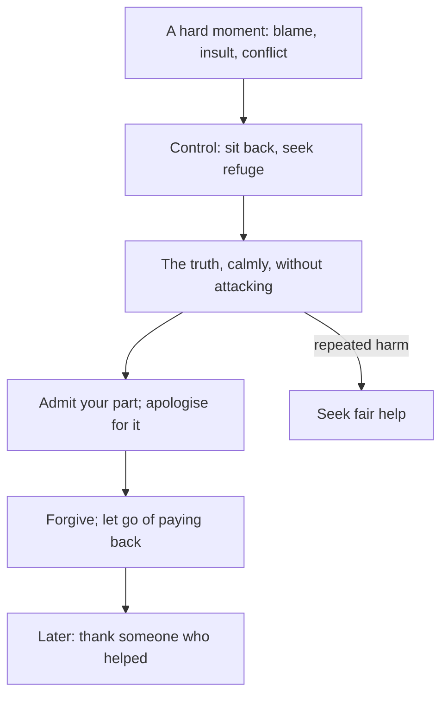

## The meeting, step by step

Hamza's incident review on Monday lasted forty minutes. The hard part lasted about two. In those two minutes he was blamed unfairly in front of eight people, felt the anger rise, sat back, sought refuge in Allah, told the truth calmly, admitted his own small part, and let the rest go. Later that day he thanked the colleague who had stayed late to help fix the outage.

Each of those steps is a separate habit with its own source. Together they are a sequence for hard moments with people, at work, at home or anywhere. This chapter goes through them in order.

Before you step through the meeting, make a guess.

```predict
prompt: "According to Sahih al-Bukhari 6114, who is the truly strong person?"
options:
  - id: controls
    label: "The one who controls himself when angry"
  - id: wins
    label: "The one who wins every argument he enters"
correctOptionId: controls
explanation: "The strong is not the one who overcomes people by strength; the strong is the one who controls himself when angry (Sahih al-Bukhari 6114; Sahih Muslim 2609)."
```

Step through the canvas below. It follows the meeting and the rest of Hamza's day.

<InteractiveCanvas slug="a-hot-moment" />

The canvas showed six steps: unfair blame, control first, the facts calmly, an apology for his own part, forgiveness, and thanks to someone who helped.

## Control first

Abu Hurairah reported that the Prophet, peace be upon him, said (Sahih al-Bukhari 6114):

> لَيْسَ الشَّدِيدُ بِالصُّرَعَةِ، إِنَّمَا الشَّدِيدُ الَّذِي يَمْلِكُ نَفْسَهُ عِنْدَ الْغَضَبِ

Meaning: The strong is not the one who overcomes people by wrestling; the strong is the one who controls himself when angry (Sahih al-Bukhari 6114).

A man asked the Prophet for advice, and he said: do not become angry. The man repeated his request several times, and each time the Prophet said: do not become angry (Sahih al-Bukhari 6116). He did not give a long list. He gave one instruction, repeated, because anger is the door through which so many other wrongs enter: harsh words, lies, broken relationships.

Module 8 gave the practical first steps: if you are standing, sit; if it does not pass, lie down (Sunan Abi Dawud 4782); and say "I seek refuge in Allah from Satan" (Sahih al-Bukhari 3282). In a meeting, sitting back in your chair and breathing is the same idea. The point is to change something physical before you speak.

## Then the truth, calmly

After control comes truth. Hamza did not stay silent and let the false blame stand; that would not have been honest. He shared the timeline: what happened, when, and which change caused what. Truthfulness leads to righteousness (Sahih al-Bukhari 6094). But he said it without attacking Usman, without listing his past mistakes, and without raising his voice. Lower your voice (Quran 31:19).

Truth and calm together are powerful. Truth without calm sounds like an attack, and people stop listening. Calm without truth lets a wrong stand. Both together let the facts do the work.

## Your part, and an apology

One configuration change really was Hamza's. He said so, and apologised for it. This is the hardest step for many people, because in an unfair moment, admitting any fault feels like losing. But a person who admits their part is believed more about the rest. And it is simply honest.

In a family argument, the same step often ends the argument. "I shouldn't have said it like that; I'm sorry" from one person makes it much easier for the other to say the same.

## Forgive

Allah describes the people of taqwa as those who spend in ease and hardship, who restrain their anger and who pardon people; and Allah loves those who do good (Quran 3:134).

> وَالْكَاظِمِينَ الْغَيْظَ وَالْعَافِينَ عَنِ النَّاسِ

Meaning: And those who restrain anger and pardon people (Quran 3:134).

And Abu Hurairah reported that the Prophet said: charity does not decrease wealth, and no one forgives except that Allah increases him in honour, and no one humbles himself for Allah except that Allah raises him (Sahih Muslim 2588). Many people fear that forgiving makes them look weak. The hadith says the opposite: forgiving increases honour.

Forgiving Usman did not mean pretending he was right. It meant letting go of the wish to pay him back. Hamza did not bring up Usman's past mistakes, then or later. Forgiveness also does not mean accepting continued harm. If someone wrongs you again and again, it is right to seek fair help, from a manager, a family elder or someone you trust.

## Thank people

Abu Hurairah reported that the Prophet said: whoever does not thank people does not thank Allah (Sunan Abi Dawud 4811, graded sahih). Gratitude to Allah and gratitude to people are joined. Saying "thank you" by name, for something specific, is a small habit with a large effect: "Thanks, Ali, for staying late on Saturday; I don't think we'd have fixed it without you."

Thanks also belongs at home. Thanking a parent for a meal, a spouse for a small help, a child for doing a chore without being asked. These are the moments the hadith on character "best to your wives" points to.

The diagram shows the sequence for a hard moment.



The order matters. Truth before control comes out as anger. An apology before the truth can be taken as admitting everything. Forgiveness after both is real, not forced. The side branch is a safeguard: forgiveness is not the same as staying silent about repeated harm.

## Building it the 1% way

Week one: control. Every time anger rises, change something physical first: sit, breathe, or step away for a minute, and seek refuge in Allah.

Week two: your part. In one disagreement this week, name your own part out loud before anything else.

Week three: forgiveness. Choose one old grievance and let it go: no more bringing it up.

Week four: thanks. Thank one person a day by name, for something specific.

## Worked example: Musa and his sister

On Sunday, Musa's little sister Zoya breaks his model plane. Follow his reaction.

**The anger.** He wants to shout at her. He sits down on the floor instead, as his uncle taught him.

**The truth.** He tells her, without shouting, that he spent two weeks on the plane and is upset.

**His part.** He admits he left it on the floor where she plays.

**Forgiveness.** When she cries and says sorry, he says it's okay, and means it a little more an hour later.

**Thanks.** That evening, when Zoya helps him glue it, he says "thanks, Zoya". She is very proud.

## The same sequence at home

Most hard moments are not in meetings. They are at home, at the end of a long day, over small things: a late dinner, a forgotten errand, a tone of voice. The sequence works the same way there, and matters even more, because the people at home are the ones the hadith on character names first (Jami' at-Tirmidhi 1162). Sit down before you answer. Say what is true without the extra sting. Name your part. Let it go. And later, thank them for something.

Hamza tries this with his mother the following week, when she criticises how he parked the car. He sits down, agrees that the corner was tight, apologises for blocking the neighbour, and thanks her for noticing. The whole exchange lasts a minute, and dinner is warm.

## Where people misunderstand it

The first misunderstanding is "forgiving means I was wrong". It means letting go of paying back, and it increases honour (Sahih Muslim 2588).

The second is "admitting my part makes me weak". It makes the rest of what you say more believable, and it is simply honest.

The third is "controlling anger means never showing displeasure". The Prophet showed displeasure when something was wrong. Control means your words and actions stay right while you feel it.

## Check your understanding

```quiz
type: mcq
question: "In a family argument, Saima's brother blames her for something that was mostly his fault, though she played a small part. Which response follows this chapter?"
options:
  - "Stay silent and let the blame stand, to keep the peace in the family"
  - "Calm first, the facts without attacking, and admit her small part"
  - "List his past mistakes so he understands how it feels"
  - "Leave the house until he apologises"
correct: 1
explanations:
  - "Silence lets a wrong stand; truth is part of good character (Sahih al-Bukhari 6094)."
  - "Right. Control (Sahih al-Bukhari 6114), truth calmly, and her own part named."
  - "Listing past mistakes is paying back, not truth."
  - "Stepping away briefly can help control anger, but leaving until he apologises is not the sequence taught here."
```

```quiz
type: mcq
question: "Usman fears that forgiving a colleague who wronged him will make him look weak. Which source answers him?"
options:
  - "Sahih Muslim 2588: forgiving increases honour"
  - "Sahih al-Bukhari 6412: health and free time, two blessings"
  - "Sahih Muslim 35: haya is a branch of faith"
  - "Quran 49:6: verify news"
correct: 0
explanations:
  - "Right. Forgiving increases honour (Sahih Muslim 2588), and Allah loves those who pardon people (Quran 3:134)."
  - "That hadith is about time."
  - "That hadith is about haya."
  - "That verse is about checking news."
```

## This week

Practise the physical step for anger every time it rises. Thank one person a day by name, for something specific.

**Next:** Rights, friends and humour.
