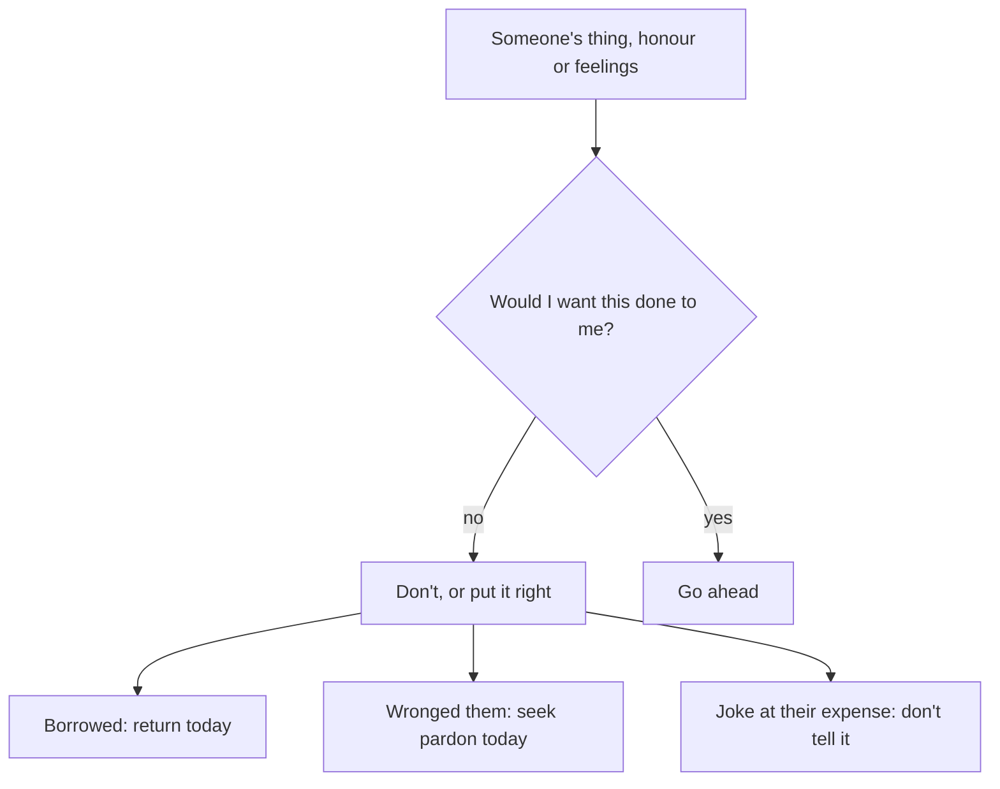

## A charger, a joke and a friend

Musa's week had three small moments with classmates: a borrowed charger kept for three days, a joke about a boy's old shoes that he laughed at, and a choice, every break time, about which group to sit with. None of these is dramatic. But each one involves the rights of another person, and each one shapes who Musa is becoming.

This chapter is about the everyday rights people have over each other, and two habits closely tied to them: humour and friendship.

Before you step through Musa's week, make a guess.

```predict
prompt: "If you have wronged someone, when does Sahih al-Bukhari 2449 say to seek their pardon?"
options:
  - id: later
    label: "Later, when the feelings on both sides have calmed down"
  - id: today
    label: "Today, before the Day when there is no money to pay"
correctOptionId: today
explanation: "Whoever has wronged his brother in his honour or anything else, let him seek his pardon today, before a Day when there will be no dinar or dirham (Sahih al-Bukhari 2449)."
```

Step through the canvas below. It follows Musa's week at school.

<InteractiveCanvas slug="rights-friends-humour" />

The canvas showed five moments: returning a borrowed charger, seeking pardon, keeping jokes true, not laughing at someone's poverty, and choosing good friends.

## The rights of others

Anas reported that the Prophet, peace be upon him, said (Sahih al-Bukhari 13):

> لا يُؤْمِنُ أَحَدُكُمْ حَتَّى يُحِبَّ لأَخِيهِ مَا يُحِبُّ لِنَفْسِهِ

Meaning: None of you truly believes until he loves for his brother what he loves for himself (Sahih al-Bukhari 13).

Chapter 9.3 used this hadith against envy. Here it is the measure of rights. Would you like someone to keep your charger for three days? To use your things without asking? To laugh at your shoes? The hadith turns every question about rights into a simple test: treat others' things, honour and feelings as you want yours treated.

## Trusts and borrowed things

Allah commands you to return trusts to their owners (Quran 4:58). And Abu Umamah reported that the Prophet said, among other things: a loan must be paid back, and something lent must be returned (Sunan Abi Dawud 3565, graded sahih).

A borrowed charger, a book, a pen, money lent by a friend, a secret told in confidence: each is an amanah, a trust. The habit is simple. Return borrowed things quickly, ideally the same day, and in the same condition. Never use someone's things without permission, even if you are sure they would not mind; ask first. And keep a short note on your phone of anything you have borrowed, so it is not forgotten for weeks.

The same applies to adults with larger things: money borrowed from relatives, tools from a neighbour, a car from a friend. Many family quarrels begin with a forgotten loan.

## Seek pardon today

Abu Hurairah reported that the Prophet said: whoever has wronged his brother, in his honour or anything else, let him seek his pardon today, before a Day when there will be no dinar and no dirham; if he has good deeds, they will be taken from him in proportion to his wrong (Sahih al-Bukhari 2449). Chapter 11.1 described the bankrupt of Sahih Muslim 2581, who loses his prayers and fasting to the people he wronged.

So when you wrong someone, the habit is to apologise soon: today if you can. "I'm sorry I kept your charger so long" is a small sentence. It settles a right that would otherwise wait.

## Humour that is true and kind

Islam does not ask for a life without laughter. Abu Hurairah reported that the companions said: Messenger of Allah, you joke with us. He said: yes, but I say only what is true (Jami' at-Tirmidhi 1990, graded sahih). And Mu'awiyah ibn Haydah reported that the Prophet said: woe to the one who speaks and lies to make people laugh; woe to him, woe to him (Sunan Abi Dawud 4990, graded hasan).

So the limits of humour are clear. Jokes may be true and kind. They should not be lies, even small ones, told to get a laugh. And they should not be at someone else's expense: their appearance, poverty, language, disability or mistakes. Allah says: let not a people mock another people; perhaps they are better than them (Quran 49:11). And the Prophet said: a Muslim is the brother of a Muslim; he does not wrong him, nor hand him over to harm (Sahih al-Bukhari 2442).

A useful test: would the person you are joking about laugh too, if they were here? If not, it is not a joke for this table.

## Choose your friends

Abu Musa reported that the Prophet said (Sahih al-Bukhari 2101):

> مَثَلُ الْجَلِيسِ الصَّالِحِ وَالْجَلِيسِ السَّوْءِ كَمَثَلِ صَاحِبِ الْمِسْكِ، وَكِيرِ الْحَدَّادِ

Meaning: The example of a good companion and a bad companion is like the musk seller and the blacksmith's bellows (Sahih al-Bukhari 2101).

The hadith continues: from the musk seller you either buy musk or at least enjoy its smell; from the blacksmith's bellows, either your clothes are burned or you smell something foul. Friends rub off on us whether we intend it or not. Abu Hurairah reported that the Prophet said: a person is upon the religion of his close friend, so let each of you look at whom he befriends (Jami' at-Tirmidhi 2378, graded hasan).

This does not mean dropping every friend who is not perfect. It means choosing your closest companions carefully, being the good influence in a mixed group, advising a friend gently and privately, and stepping away from a group that keeps pulling you toward wrong. Peer pressure is strongest where there is no friend standing with you. One good friend in a group changes it.

The diagram shows the test for each everyday right.



The one question at the top comes straight from Sahih al-Bukhari 13. It works for a charger, a joke and a promise alike. The three boxes at the bottom are the actions that follow when the answer is no.

## Building it the 1% way

Week one: borrowed things. Return everything you currently have that belongs to someone else, and start a note for future borrowing.

Week two: pardon. Think of one person you wronged recently, and apologise.

Week three: humour. For one week, tell no joke at anyone's expense, and do not laugh at one.

Week four: friends. Notice which friend makes you better and spend a little more time with them; give one piece of gentle, private advice to a friend who needs it.

## Worked example: Hamza's tools

Hamza borrowed his neighbour's drill six months ago. Follow his small repair.

**Noticing.** While making his borrowed-things note, he sees the drill in the cupboard.

**Returning.** He returns it the same evening, with a box of sweets and an apology for the delay.

**The result.** The neighbour laughs, says he had forgotten, and invites Hamza in for tea. They talk for the first time in months.

**The habit.** Hamza's phone note now has one line per borrowed item, and he checks it every Friday.

Notice that the drill was returned with an apology, not only returned. The apology settles the delay, which was also a small wrong, and it turned a forgotten loan into a new friendship.

Rights also include smaller things that are easy to overlook: a seat saved for someone, a turn in a queue, a share of a group task, a colleague's credit for their idea. Each is someone's right. Giving it to them, without being asked, is the same habit as returning the drill.

## Where people misunderstand it

The first misunderstanding is "small borrowed things don't matter". Something lent must be returned (Sunan Abi Dawud 3565), and trusts returned to their owners (Quran 4:58), large or small.

The second is "Islam forbids joking". The Prophet joked, but only with the truth (Jami' at-Tirmidhi 1990).

The third is "choosing friends means judging people". It means protecting yourself and helping others, as the musk seller's example shows (Sahih al-Bukhari 2101).

## Check your understanding

```quiz
type: mcq
question: "Asad's friends tell a funny story that is slightly made up, to make everyone laugh. Which source sets the limit?"
options:
  - "Sahih al-Bukhari 2101: the musk seller and the blacksmith's bellows"
  - "Quran 4:58: return trusts to their owners"
  - "Sunan Abi Dawud 4990: woe to the one who lies to make people laugh"
  - "Sahih al-Bukhari 2449: seek pardon today"
correct: 2
explanations:
  - "That hadith is about choosing companions."
  - "That verse is about trusts."
  - "Right. The Prophet joked with the truth (Jami' at-Tirmidhi 1990) and warned against lying to make people laugh (Sunan Abi Dawud 4990)."
  - "That hadith is about seeking pardon."
```

```quiz
type: mcq
question: "Mehwish borrowed money from her cousin months ago and both have forgotten. She remembers today. What fits this chapter?"
options:
  - "Leave it, since her cousin has forgotten"
  - "Wait until her cousin asks for it"
  - "Give it in charity instead, since that is also good"
  - "Return it soon, with an apology for the delay"
correct: 3
explanations:
  - "Forgetting does not cancel a right; a loan must be paid back (Sunan Abi Dawud 3565)."
  - "Waiting for a reminder risks the right never being returned."
  - "Charity is good, but it does not repay what is owed to her cousin."
  - "Right. Return trusts to their owners (Quran 4:58), and settle it today (Sahih al-Bukhari 2449)."
```

## This week

Return one borrowed thing, and start a borrowed-things note. Tell no joke at anyone's expense for a week.

**Next:** Mercy and courage.
